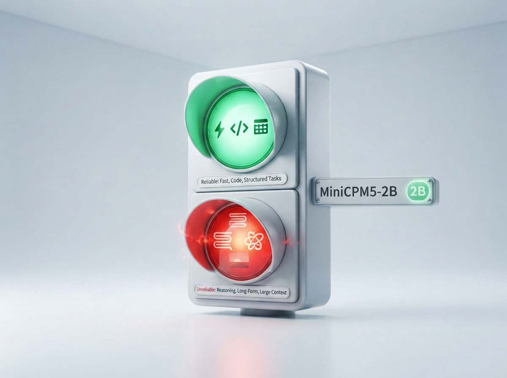
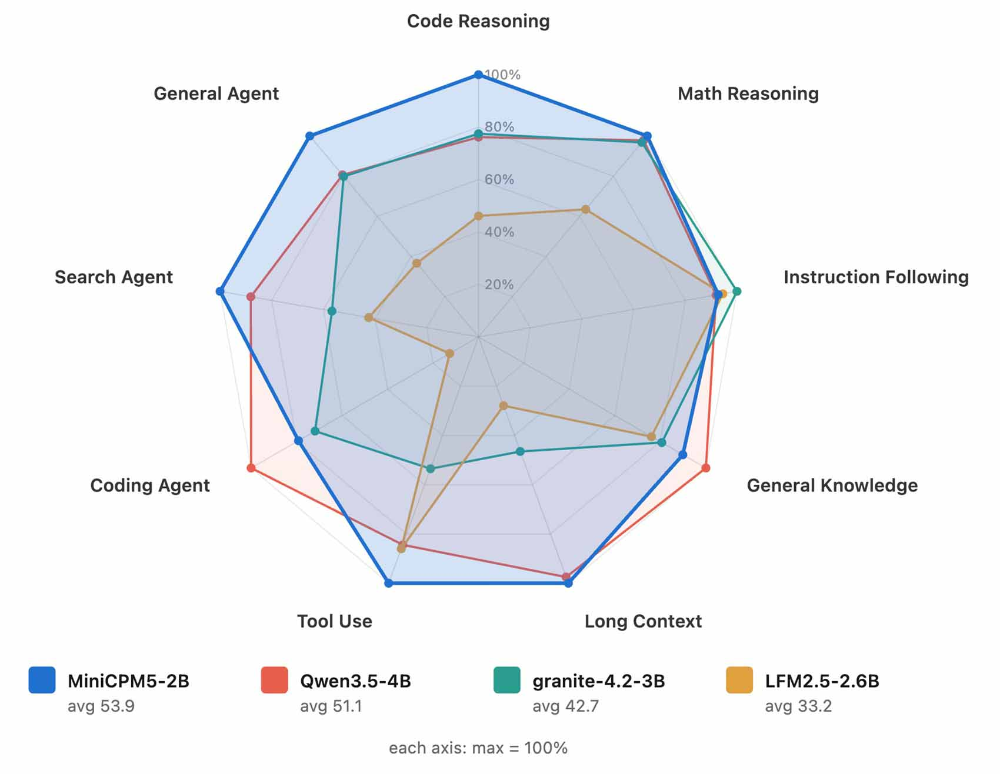
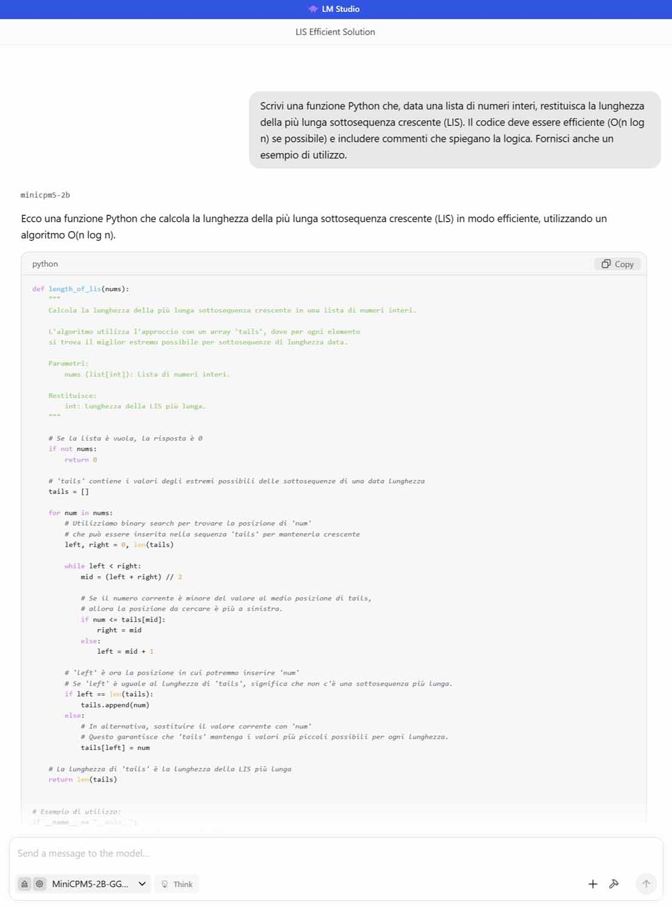
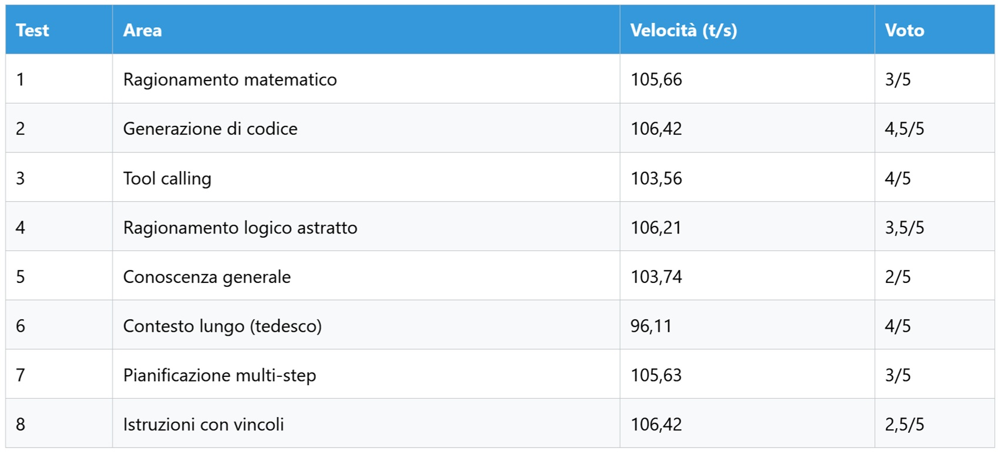

# MiniCPM5-2B: fulmineo, bene nel codice, meno in altro

*Nelle ultime settimane il nome MiniCPM5-2B ha attraversato timeline, newsletter e canali Discord dedicati all'AI locale con una frequenza sospetta per un modello da appena 2,5 miliardi di parametri. Secondo la scheda ufficiale su [Hugging Face](https://huggingface.co/openbmb/MiniCPM5-2B), il modello segna 97,1 su τ²-Bench Telecom, 69,1 su LiveCodeBench v6 e 86,5 su AIME, numeri che nel confronto pubblicato dagli stessi autori superano quelli di modelli 4B come Qwen3.5-4B. [Artificial Analysis](https://artificialanalysis.ai/articles/openbmb-releases-minicpm5-2b), che ha rieseguito parte dei test in modo indipendente, conferma che si tratta del punteggio più alto sul proprio Intelligence Index tra tutti i modelli open-weight sotto i 4 miliardi di parametri. La domanda che vale la pena farsi, prima di ripetere la frase "compete con modelli quattro volte più grandi", è semplice: compete davvero, e su cosa?*

## Il laboratorio, in breve

La configurazione hardware è la stessa descritta nella prima [puntata su Qwen 3.5](https://aitalk.it/it/qwen3.5-locale-puntata1): AMD Ryzen 7700, 32 GB di RAM DDR5, GPU AMD Radeon RX 9060 XT con 16 GB di VRAM, LM Studio come framework. Per i dettagli su come si installa e configura tutto rimando a quell'articolo.

Una nota metodologica importante: per questo test ho usato deliberatamente la versione Q8_0 da 2,7 GB e non la Q4_K_M da 1,56 GB, per capire se eventuali limiti dipendessero dalla quantizzazione o dal modello in sé. La risposta, come vedremo, è che i limiti sono strutturali: anche alla qualità massima disponibile in locale, il modello fatica su ragionamento astratto, pianificazione multi-step e istruzioni con vincoli multipli. La velocità resta invece eccezionale in ogni condizione, a conferma che l'efficienza dell'architettura non è marketing.

## Cos'è MiniCPM5-2B

Dietro il modello c'è OpenBMB, comunità di ricerca open source legata a Tsinghua e a ModelBest, che con la famiglia MiniCPM ha superato i 50 milioni di download complessivi secondo Tencent News. Non è un progetto hobbistico: il repository [OpenBMB/MiniCPM su GitHub](https://github.com/openbmb/minicpm) ha superato le 11.000 stelle e la lista di framework supportati al day-zero, da vLLM a SGLang fino a nove architetture di chip diverse tramite FlagOS, parla di un'operazione industriale.

L'architettura è una densa standard `LlamaForCausalLM`, 2,52 miliardi di parametri totali (1,98 miliardi esclusi gli embedding), 42 layer, attenzione GQA con 16 teste di query e 2 di key-value. Il contesto nativo dichiarato è 131.072 token, la licenza è Apache 2.0, quindi uso commerciale libero. È un modello solo testuale, niente visione, con thinking mode attivabile via un parametro nella chat template e tool calling nativo in formato XML.

Il vero valore aggiunto, però, non sono i pesi in sé: OpenBMB ha pubblicato anche l'intera ricetta, i dataset di UltraData, il framework di reinforcement learning e la pipeline di post-training basata su On-Policy Distillation, che fonde le capacità di sedici modelli esperti (di cui cinque specializzati in compiti agentici) in un unico checkpoint finale. È lo stesso approccio, in scala ridotta, che ha reso interessanti altri progetti open-weight cinesi negli ultimi due anni.

C'è però un dettaglio che vale la pena mettere subito sul tavolo, perché racconta qualcosa sull'hype più di qualsiasi benchmark: al [World Artificial Intelligence Conference di Shanghai](https://www.orcarouter.ai/blog/minicpm5-2b-open-weights-release) del 19 luglio 2026, ModelBest aveva presentato il modello con un contesto dichiarato di 512.000 token e una lista di partner hardware che includeva AMD, Intel, MediaTek e Qualcomm. I pesi effettivamente pubblicati a settembre configurano invece 131.072 token. Non è un dettaglio da poco per chi progetta un flusso di lavoro su documenti lunghi: conviene pianificare su 128K, che restano comunque sufficienti per un libro di circa 250 pagine, non sui 512K annunciati in conferenza.

## Cosa promette il produttore

La tabella comparativa pubblicata da OpenBMB mette a confronto MiniCPM5-2B con modelli della stessa classe (LFM2.5-2.6B, Qwen3.5-2B, Gemma-4-E2B-it) e con modelli 4B più grandi (Qwen3.5-4B, granite-4.2-3B, Nemotron-3-Nano-4B). La media generale è 53,9 contro 51,1 del miglior modello 4B in tabella. I punti di forza dichiarati sono coding, tool calling, capacità agentiche e matematica: su SWE-bench Verified il modello segna 46,4 contro il 33,6 di Qwen3.5-4B, su τ²-Bench Telecom 97,1 contro 92,1.

I punti deboli, dichiarati dagli stessi autori nella tabella, sono altrettanto chiari: su conoscenza generale MMLU-Pro il modello si ferma a 70,8 contro il 78,0 di Qwen3.5-4B, su GPQA-Diamond scende a 70,2 contro 77,1, e su benchmark di coding agentico più complessi come SWE-bench Pro (14,4 contro 28,2) e Terminal-Bench v2.1 (8,6 contro 25,8) il divario con i modelli 4B si allarga considerevolmente.

C'è poi un dato interessante sul fronte della credibilità del numero più citato in assoluto, l'Intelligence Index di Artificial Analysis. Al lancio di luglio, OpenBMB comunicava un punteggio di 17. Con la revisione metodologica v4.2 di settembre, che pesa di più i test riservati e introduce nuovi componenti agentici, il punteggio ufficiale è sceso a 15, comunque il più alto tra i modelli open-weight sotto i 4B, come riportato dalla stessa [Artificial Analysis](https://artificialanalysis.ai/articles/openbmb-releases-minicpm5-2b). La recensione di [eesel AI](https://www.eesel.ai/blog/minicpm5-2b-review) segnala inoltre una discrepanza pubblica tra questo dato indipendente e un annuncio social dello stesso OpenBMB che citava 23 punti. Sono numeri che raccontano la stessa storia da prospettive diverse, ed è bene saperlo prima di prendere per buono il primo che si incontra su un post.

Sulla velocità dichiarata, la documentazione ufficiale non riporta cifre precise per smartphone o per Apple Silicon nella scheda modello: le stime circolate online (10-12 token al secondo su smartphone, 70-90 su Apple M4 Max) provengono da conversioni comunitarie non ufficiali, come una porting MLX che misura circa 96 token al secondo in decodifica su un M4 Max con 128 GB di memoria unificata. Vanno quindi trattate come indicazioni di massima, non come benchmark certificati dal produttore.

[Immagine tratta dal repository ufficiale su GitHub](https://github.com/openbmb/minicpm)

## I test sul campo

Qui entra la parte più importante di questo articolo: l'analisi pratica, condotta con la versione Q8_0 da 2,7 GB, la stessa qualità massima disponibile in locale senza passare per il formato BF16 completo.

**Ragionamento matematico**, voto 3/5, 105,66 token/s. Il problema dei due treni che partono da Milano e Roma è stato risolto correttamente (incontro alle 10:40), ma il percorso logico è stato inutilmente contorto: il modello ha calcolato tempi di percorrenza totali che non servivano alla soluzione, prima di arrivare all'equazione corretta. Nel mezzo sono comparsi caratteri fuori posto, residui di tokenizzazione mal gestiti. Arriva al risultato, ma non lo spiega bene: utile per una risposta rapida, meno per imparare un metodo.

**Generazione di codice**, voto 4,5/5, 106,42 token/s. Chiesta una funzione Python per la più lunga sottosequenza crescente in tempo O(n log n), il modello ha prodotto l'algoritmo ottimo con array `tails` e ricerca binaria, codice pulito, docstring, esempio funzionante. Un refuso lessicale e una spiegazione leggermente imprecisa in un punto non intaccano il giudizio: è il campo in cui il modello convince di più, in linea con quanto emerge dai benchmark ufficiali su SWE-bench Verified.

**Tool calling**, voto 4/5, 103,56 token/s. Nel compito che simula un assistente con `get_weather` e `send_email`, la sequenza di chiamate JSON era corretta nella forma, ma il modello non ha gestito la dipendenza logica tra le due chiamate: il corpo dell'email era testo fisso invece di fare riferimento all'output del meteo appena recuperato. Buono per automazioni semplici, meno per orchestrazioni con più passaggi collegati, coerentemente con il divario osservato nei benchmark ufficiali tra τ²-Bench (dove il modello eccelle) e i test di coding agentico più articolati.

**Ragionamento logico astratto**, voto 3,5/5, 106,21 token/s. Di fronte a un paradosso sillogistico a tre affermazioni contraddittorie, il modello ha individuato correttamente la soluzione, ma l'esposizione era confusa, con errori ortografici e senza ricorrere alla notazione insiemistica che avrebbe reso il ragionamento più rigoroso. Capisce il problema, fatica a esporlo con precisione.

*Screenshot durante i test di MiniCPM5-2B su LM Studio*

**Conoscenza generale**, voto 2/5, 103,74 token/s. Chiesta una sintesi sul Rinascimento italiano e nordico con due artisti per parte, il modello ha citato un solo artista per lato e ha attribuito a Hans Holbein una specializzazione nei paesaggi che storicamente non gli appartiene: Holbein è noto per i ritratti, mentre il paesaggio come genere autonomo si sviluppa nel Seicento olandese. È l'area in cui il divario con i modelli 4B, già visibile nei numeri MMLU-Pro e GPQA-Diamond della tabella ufficiale, si sente di più anche nell'uso reale.

**Contesto lungo**, voto 4/5, 96,11 token/s. Su un documento tecnico in tedesco riguardante la propagazione dell'autorità nei sistemi multi-agente, il modello ha prodotto una sintesi in cinque punti corretta e ben organizzata, cogliendo concetti tecnici come il problema del "confused deputy" e le sue implicazioni per gli sviluppatori. Qualche refuso e una lieve mescolanza linguistica non compromettono un risultato sorprendentemente solido su un compito che unisce comprensione multilingue e sintesi strutturata.

**Pianificazione multi-step**, voto 3/5, 105,63 token/s. Nel compito con tre strumenti (`read_file`, `write_file`, `run_command`) per modificare una chiave API in un file di configurazione, il modello ha bypassato gli strumenti forniti usando `sed` dentro `run_command` invece di passare per `write_file`, producendo una sequenza ridondante e non ha sfruttato l'output della lettura iniziale per estrarre il valore da sostituire. È la conferma più netta, tra tutti i test, che l'etichetta "agentico" va maneggiata con cura quando si parla di orchestrazioni realmente multi-step.

**Istruzioni con vincoli complessi**, voto 2,5/5, 106,42 token/s. Su un'email di scuse con cinque vincoli simultanei (lunghezza, data, sconto, tono, parola vietata), il modello ne ha rispettati quattro su cinque, ma con errori grammaticali evidenti e una frase finale poco comprensibile, oltre all'assenza di saluto iniziale e chiusura formale attesi in un'email professionale.

## Tabella riassuntiva

Media voti: 3,3/5. Velocità media: circa 104,2 token al secondo, un valore che nessun modello di questa classe con cui ho lavorato finora ha avvicinato.

## Dove usarlo, dove no

MiniCPM5-2B convince su compiti di coding di media difficoltà, dove produce codice pulito e funzionante quasi quanto un modello quattro volte più grande. È solido nel tool calling semplice, quello con uno o due strumenti indipendenti, ed è sorprendentemente competente nella sintesi di documenti tecnici anche in lingue diverse dall'italiano e dall'inglese. Con un ingombro di 2,7 GB in Q8 o 1,56 GB in Q4, gira su hardware che va dal Raspberry Pi allo smartphone di fascia media, con una velocità media che sfiora i 105 token al secondo su una configurazione consumer come la mia.

Non è invece un modello da usare per conoscenza enciclopedica, dove gli errori fattuali sono concreti e non solo statistici. Fatica sul ragionamento astratto complesso, dove arriva alla soluzione ma la espone in modo confuso, e soprattutto non è ancora in grado di orchestrare strumenti in sequenze multi-step con dipendenze reali tra un passaggio e l'altro, il vero banco di prova di qualsiasi agente. Le istruzioni con vincoli multipli restano un punto debole concreto, non solo teorico.

## Il verdetto: smontare l'hype

Quello che è vero: per la sua taglia, MiniCPM5-2B è un risultato tecnico notevole. La velocità è reale, il coding è di alto livello, il tool calling funziona per compiti semplici, e il fatto che OpenBMB rilasci anche dataset e ricetta di addestramento è un contributo raro all'ecosistema open. Quello che è hype: "compete con modelli quattro volte più grandi" è vero solo su un sottoinsieme di benchmark, coding e agentico soprattutto, non su conoscenza generale o ragionamento astratto, dove il divario resta ampio e misurabile. Quello che non è: non è un modello generalista, non è un piccolo tuttofare, e chi lo tratta come tale nei propri flussi di lavoro troverà i limiti molto più in fretta di quanto suggeriscano i grafici a radar diffusi nei giorni del lancio.

Mi viene in mente una scena di *Chungking Express*, quel film di Wong Kar-wai dove tutto scorre veloce e frammentato ma non tutto si lascia afferrare fino in fondo: MiniCPM5-2B ha lo stesso ritmo, scattante, quasi nervoso, ma quando gli chiedi di fermarsi e ragionare con calma su qualcosa di davvero complesso, l'inquadratura si sfoca. Oppure, per restare più terra terra: è come un'utilitaria sportiva, veloce, leggera, divertente da guidare in città. Ma non ci si affronta un viaggio di mille chilometri con famiglia e bagagli al seguito.

Il test condotto in Q8_0, alla qualità massima disponibile senza passare al BF16 completo, rafforza questa lettura: i limiti osservati non sono un effetto della compressione dei pesi, sono strutturali al modello stesso.

## A chi serve davvero

Gli utenti ideali sono sviluppatori e team che cercano un motore veloce e leggero per coding di routine e automazioni semplici su hardware con risorse limitate, magari abbinato a un modello più grande per i compiti che richiedono profondità. Gli utenti meno indicati sono chi cerca un assistente generalista, chi ha bisogno di conoscenza enciclopedica affidabile o chi vuole un agente capace di orchestrare strumenti complessi senza supervisione stretta. Per questi ultimi casi, resta più sensato orientarsi su modelli più grandi, magari nella fascia 4B che lo stesso confronto ufficiale di OpenBMB prende come riferimento.

Il consiglio, alla fine, è lo stesso di sempre quando l'hype corre più veloce dei fatti: usatelo per quello che è, un piccolo specialista veloce e affidabile in un perimetro preciso, non per quello che i post sui social vorrebbero farvi credere che sia.