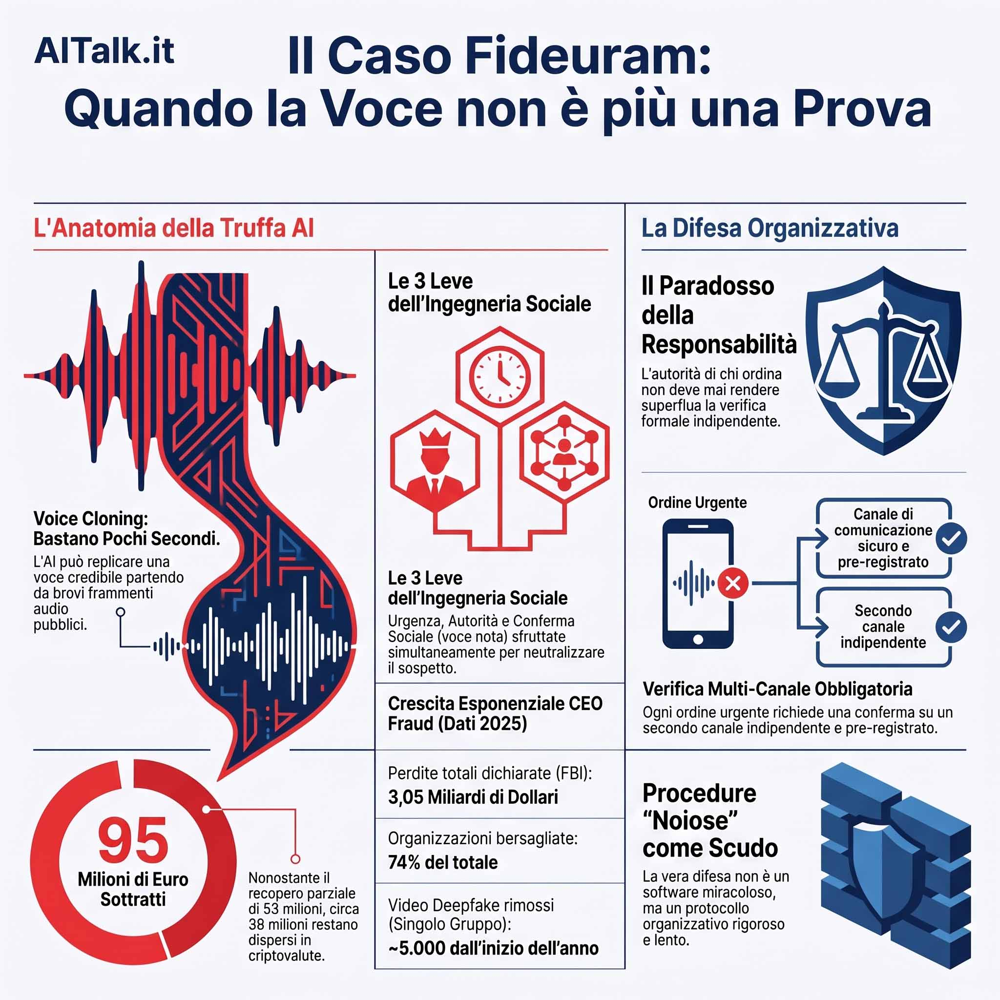

# Il caso Fideuram: la voce non è più una prova

*Questo articolo esce a distanza di giorni dalla notizia, non per pigrizia ma per scelta. Il caso è emerso il 25 settembre, ha riempito per due giorni le pagine di cronaca finanziaria, poi come sempre è scivolato via. Aspettare che il sensazionalismo si depositi permette di guardare i fatti con più lucidità, senza la fretta del titolo a effetto. È quello che proviamo a fare qui.
C'è una domanda che chiunque abbia fatto un bonifico online si è posto leggendo questa storia. Per spostare duecento euro dal proprio conto corrente, un utente qualsiasi deve superare due fattori di autenticazione, un codice temporaneo, a volte una chiamata della banca se l'importo è insolito. Un dirigente di altissimo livello, con decenni di esperienza bancaria alle spalle, ha invece autorizzato in poche ore un trasferimento di quasi 95 milioni di euro sulla base di un messaggio WhatsApp e di una telefonata. Non è una domanda ingenua. È probabilmente la domanda più utile che si possa fare su questa vicenda.*

## Il caso, ricostruito

A febbraio 2026 l'allora presidente di una delle principali società di private banking italiane, controllata di uno dei maggiori gruppi bancari del paese, riceve su WhatsApp un messaggio che sembra arrivare dall'amministratore delegato della capogruppo. Il numero non è quello noto, ma il tono e i contenuti non lasciano dubbi: serve una serie di bonifici urgenti, tramite la tesoreria della controllata, per un'operazione finanziaria all'estero che la capogruppo non può gestire direttamente a causa di problemi pratici legati a una possibile fuga di notizie. Il presidente, come [ricostruito dagli atti della Procura di Milano ripresi dall'Ansa](https://www.ansa.it/sito/notizie/cronaca/2026/09/25/lex-capo-di-fideuram-truffato-con-whatsapp-e-ia-spariti-36-milioni_f747847d-aaa5-4f5f-9bee-1d476b6bea1e.html), non si insospettisce perché mesi prima un'operazione simile era effettivamente saltata proprio per una fuga di notizie riguardante un'acquisizione bancaria internazionale.

Poco dopo arriva la seconda mossa, quella che rende il caso diverso da una comune truffa del finto capo. Il presidente riceve una telefonata da un legale internazionale che conosce personalmente, un professionista con cui aveva già lavorato. La voce è la sua, il tono è il suo, i modi di dire sono i suoi. Solo che non è lui: è una replica costruita con strumenti di intelligenza artificiale a partire da registrazioni pubbliche della sua voce, mentre il professionista reale, [come racconta la ricostruzione del Post](https://www.ilpost.it/2026/09/25/fideuram-truffa-whatsapp-ai/), non ne sa nulla e non è mai stato coinvolto. Rassicurato da quella seconda conferma, il presidente autorizza il trasferimento dei fondi, per circa 95 milioni di euro, principalmente verso conti in Cina e a Hong Kong.

Il sistema di allerta scatta comunque, e parte del bottino viene recuperato grazie alla collaborazione tra la Procura di Milano e le autorità internazionali, con il supporto di Eurojust: circa 40 milioni bloccati in un istituto cinese, altri 13 milioni individuati in Portogallo, [secondo la cronologia ricostruita dal Sole 24 Ore](https://www.ilsole24ore.com/art/l-ex-capo-fideuram-truffato-whatsapp-e-ia-spariti-36-milioni-AJXuauOB). Restano introvabili, a seconda delle fonti, tra i 36 e i 39,5 milioni di euro, in parte già convertiti in criptovalute e ormai difficili da rintracciare. Le indagini hanno portato a iscrivere nel registro degli indagati un cittadino straniero, mentre il presidente coinvolto, non indagato, si è dimesso a marzo per ragioni personali mai dettagliate pubblicamente.

## Una voce basta, davvero pochi secondi

La parte tecnica del caso è quella che più facilmente viene liquidata come fantascienza, e invece è ordinaria amministrazione. Gli strumenti di clonazione vocale oggi disponibili, alcuni open source e utilizzabili anche offline su un normale computer, non hanno bisogno di ore di audio pulito per produrre una voce credibile al telefono: bastano pochi secondi di parlato chiaro, il tipo di materiale che chiunque abbia mai tenuto una conferenza, rilasciato un'intervista o partecipato a un webinar produce senza accorgersene, come spiega bene [l'analisi tecnica di Pasquale Pillitteri sul caso](https://pasqualepillitteri.it/news/18297/fideuram-truffa-36-milioni-whatsapp-voce-clonata).

Qui si nasconde un paradosso che vale la pena mettere a fuoco. La vulnerabilità non dipende da quanto una persona sia distratta o poco esperta di tecnologia, dipende da quanto materiale pubblico esista della sua voce. Un avvocato d'affari che partecipa a convegni, un dirigente che rilascia interviste, un professionista che appare in podcast di settore: tutti, semplicemente esercitando la propria professione in modo pubblico, costruiscono senza saperlo l'archivio da cui un truffatore può attingere. La stessa autorevolezza che rende una voce affidabile al telefono è ciò che la rende clonabile. Non è un errore di sicurezza individuale, è un effetto collaterale della visibilità professionale in un mondo in cui pubblicare la propria voce online è diventato un atto quasi automatico.

## Urgenza e autorità, non ingenuità

Chi liquida questi episodi con un giudizio sulla sprovvedutezza della vittima non ha capito come funziona l'ingegneria sociale. Il meccanismo psicologico sfruttato in questi casi non aggira l'intelligenza di chi lo subisce, aggira i suoi automatismi cognitivi, gli stessi che usiamo tutti i giorni per prendere decisioni rapide senza dover rianalizzare da zero ogni situazione.

Funzionano in combinazione tre leve. La prima è l'urgenza: una richiesta che non lascia tempo per verificare, perché ogni minuto di ritardo viene presentato come un costo concreto, un'occasione persa. La seconda è l'autorità: la richiesta arriva, o sembra arrivare, da chi occupa il vertice della gerarchia, e mettere in discussione un ordine del capo del capo richiede un tipo di attrito sociale che la maggior parte delle persone evita istintivamente. La terza è la conferma sociale, il riconoscimento di una voce nota che rassicura proprio nel momento in cui dovrebbe scattare il sospetto. Nessuna di queste tre leve richiede competenze informatiche per essere riconosciuta o ignorata, richiede però una procedura che non dipenda dal giudizio istantaneo di chi risponde al telefono in quel preciso momento.

## Il paradosso della responsabilità

Ed è qui che arriva il cuore della questione, quello che la domanda dell'uomo della strada mette a fuoco meglio di qualsiasi analisi tecnica. Per un bonifico di poche centinaia di euro un correntista qualunque affronta controlli multipli, pensati apposta per non fidarsi di un singolo canale di conferma. Per operazioni di importo enormemente superiore, quelle gestite ai vertici delle organizzazioni, il livello di controllo formale è spesso più basso, non più alto, perché si presume che l'autorità di chi ordina renda superflua la verifica.

Non è un paradosso legato alla stupidità di chi occupa posizioni apicali. È l'effetto di un'architettura organizzativa in cui la fiducia gerarchica, necessaria per far funzionare qualsiasi azienda di dimensioni rilevanti, in un mondo in cui l'identità vocale può essere replicata diventa esattamente il punto debole. Più un'organizzazione ha bisogno che gli ordini dall'alto vengano eseguiti rapidamente, meno probabile è che quegli ordini vengano sottoposti a verifica indipendente. Il caso raccontato qui non riguarda un fallimento di attenzione individuale, riguarda un sistema in cui la verifica umana, per quanto presente, era comunque aggirabile perché ancorata a un unico elemento, la voce riconosciuta, che si è rivelato falsificabile.

## Chi risponde, quando l'autorità è falsa

Le domande aperte da questo caso contano più di qualsiasi risposta definitiva, ed è giusto lasciarle tali. Chi certifica davvero che un ordine arrivi da chi dice di darlo, quando ogni canale di comunicazione può essere simulato? Dove dovrebbe collocarsi, in un'organizzazione complessa, una procedura di verifica che non dipenda dalla persona che in quel momento risponde al telefono? E la responsabilità, in casi come questo, ricade su chi esegue l'ordine, su chi progetta i sistemi di controllo interno, o su chi non ha previsto per tempo che la clonazione vocale sarebbe diventata accessibile a chiunque?

Non sono domande da liquidare in fretta. Vale la pena ricordare che in ambiti apparentemente lontani, come quello degli agenti software autonomi, si sta affrontando la stessa questione di fondo: la sicurezza non può basarsi sull'autorità apparente di chi impartisce un'istruzione, deve basarsi su una verifica indipendente dall'identità dichiarata di chi la fornisce. È lo stesso principio, applicato a un contesto diverso.

## Quello che dice la FTC, e i suoi limiti

Il giorno stesso in cui la vicenda tornava alla ribalta, dall'altra parte dell'oceano il presidente della Federal Trade Commission americana, Andrew Ferguson, interveniva su un tema collegato, quello della responsabilità degli agenti di intelligenza artificiale. Parlando alla conferenza Reuters Momentum AI ad Austin, Ferguson ha respinto l'idea di trattare questi sistemi come attori autonomi capaci di agire di propria iniziativa, dichiarando, [come riportato da Reuters](https://www.reuters.com/business/ftc-chair-pushes-back-treating-ai-agents-independent-actors-2026-09-25/), che continuerà a resistere a questa "antropomorfizzazione" degli strumenti finché resterà a capo dell'agenzia. Secondo Ferguson, le verifiche sui log di sistemi presentati come fuori controllo mostrano quasi sempre macchine che eseguono istruzioni ricevute, non decisioni prese in autonomia, e la responsabilità dovrebbe quindi ricadere su chi quei sistemi li progetta e li istruisce, non sullo strumento in sé.

Vale la pena essere onesti su cosa sia questa dichiarazione e cosa non sia. [Come nota bene un'analisi di Forkast successiva all'intervento](https://forkast.news/ferguson-says-ai-agents-are-tools-not-actors-and-developers-bear-the-liability/), non è una norma vincolante, non introduce un nuovo quadro legale specifico per gli agenti autonomi, è una posizione politica espressa pubblicamente da chi guida l'autorità di riferimento sulla tutela dei consumatori negli Stati Uniti. Ma segnala una direzione, ed è interessante che arrivi proprio mentre in Italia si discute di un caso in cui il problema non era un agente software fuori controllo, ma una voce umana perfettamente imitata: il principio di fondo, però, resta lo stesso. Se l'identità di chi dà un ordine può essere falsificata, l'unica difesa reale è un sistema che non si fidi ciecamente di quell'identità, chiunque o qualunque cosa la stia impersonando.

## Procedure noiose, non software miracolosi

La parte più utile di questa storia, dal punto di vista pratico, è forse la più antipatica da accettare: la difesa non è tecnologica, è organizzativa, e funziona meglio quanto più è noiosa da seguire. Nessun trasferimento sopra una certa soglia dovrebbe partire sulla base di una richiesta arrivata solo per un canale informale, senza una seconda chiamata su un numero già registrato in azienda, indipendente dal numero da cui è arrivata la richiesta originale. Servirebbe una seconda autorizzazione da parte di chi non ha ricevuto il messaggio iniziale, per evitare che la stessa persona ingannata sia anche l'unica a validare l'operazione. Le operazioni verso beneficiari o paesi mai utilizzati prima meritano una pausa obbligatoria, per quanto scomoda possa sembrare quando la richiesta insiste sull'urgenza.

C'è una regola più semplice di tutte, ed è forse la più efficace: quando una richiesta arriva dall'alto della gerarchia e allo stesso tempo chiede di fare in fretta, il sospetto dovrebbe attivarsi proprio per questo motivo, non nonostante questo motivo. È un rovesciamento controintuitivo del riflesso naturale, che spinge a fidarsi di più quando la fonte sembra più autorevole. Contro una voce familiare al telefono, l'esperienza personale da sola non basta più: serve una procedura che non dipenda da chi in quel momento si trova a rispondere.

## Non un caso isolato

Chi pensasse che questa vicenda sia un episodio limite, quasi cinematografico nella sua messa in scena, dovrebbe guardare cosa sta emergendo intorno ad essa. La stessa Procura di Milano che ha ricostruito questo caso [sta indagando in parallelo su altri due episodi con schema simile](https://www.ilfattoquotidiano.it/2026/09/25/ceo-fraud-fideuram-95-milioni-notizie/8517689/): una truffa da circa 24 milioni di euro, con fondi dirottati tra Spagna, Singapore, Hong Kong e Bahrein e in parte recuperati a Barcellona, e una terza da circa 2 milioni ai danni di un istituto di dimensioni minori, con altri gruppi bancari italiani tra i bersagli segnalati. Non si tratta quindi di un attacco costruito su misura per un singolo obiettivo, ma di uno schema che si sta replicando con la stessa logica industriale con cui si replica qualsiasi tecnica di attacco che funziona.

I numeri confermano che il fenomeno più ampio, quello della truffa del finto amministratore delegato, non è nato con l'intelligenza artificiale ma ne sta venendo trasformato nella scala. [Secondo i dati dell'FBI ripresi da MilanoFinanza](https://www.milanofinanza.it/news/fideuram-intesa-sanpaolo-l-ex-presidente-paolo-molesini-vittima-di-una-truffa-da-36-milioni-202609251035572085), relativi al 2025, negli Stati Uniti sono state registrate quasi 24.800 denunce di frodi via email aziendale, per perdite dichiarate pari a 3,05 miliardi di dollari, in crescita rispetto ai 2,77 miliardi dell'anno precedente. Un'indagine dell'Association for Financial Professionals riporta che nel 2025 il 74 per cento delle organizzazioni intervistate è stato bersaglio di almeno un tentativo di questo tipo, contro il 63 per cento dell'anno prima. Il responsabile della sicurezza del gruppo bancario coinvolto nel caso raccontato in apertura ha dichiarato, [in una ricostruzione del Fatto Quotidiano](https://www.ilfattoquotidiano.it/2026/09/25/ceo-fraud-fideuram-95-milioni-notizie/8517689/), che solo dall'inizio dell'anno sono stati fatti rimuovere circa cinquemila video falsi generati con l'intelligenza artificiale, la maggior parte dei quali costruiti usando l'immagine dell'amministratore delegato del gruppo. Prima serviva un'organizzazione criminale strutturata per mettere in piedi un attacco credibile contro un dirigente di alto livello, oggi bastano un computer e materiale pubblico reperibile in pochi minuti. È la democratizzazione di una tecnica che un tempo richiedeva competenze rare, e che ora richiede soprattutto pazienza nel raccogliere gli indizi giusti.

## Le domande che restano aperte

Mi tocca tornare a citare un videogioco indipendente, *Papers, Please*, in cui l'unico compito del giocatore è verificare documenti a un valico di frontiera, confrontando ogni dettaglio con regole che cambiano di continuo mentre il tempo stringe e le conseguenze di un errore ricadono su persone reali. È un gioco sulla fatica di dover dubitare sistematicamente anche di ciò che sembra ovvio, ed è difficile non pensarci leggendo questa vicenda. La stessa tensione tra fiducia e verifica attraversa anche una serie come *Severance*, dove l'obbedienza automatica alle procedure aziendali diventa una gabbia proprio perché nessuno si ferma mai a chiedersi chi stia davvero dando gli ordini.

Restano sul tavolo più domande che risposte, ed è giusto lasciarle così. Come si autentica davvero l'identità di chi parla al telefono, in un momento storico in cui la voce non è più una prova sufficiente di nulla? Per quanto tempo ancora procedure pensate come "noiose" reggeranno contro attacchi che diventano ogni mese più credibili e più economici da mettere in piedi? E soprattutto, il sospetto metodico verso ogni richiesta urgente proveniente dall'alto deve diventare uno standard operativo per chiunque gestisca somme rilevanti, non un'eccezione riservata a chi si è già scottato una volta?

La domanda con cui si è aperto questo articolo, quella del correntista che si stupisce di dover verificare più lui per duecento euro di quanto abbia dovuto fare un dirigente per novantacinque milioni, non è ingenua. È probabilmente la domanda giusta. La risposta, per quanto scomoda, è che questo tipo di attacco non è costruito contro l'intelligenza di chi lo subisce, è costruito contro il modo in cui tutti, inevitabilmente, ci fidiamo delle voci che riconosciamo. E l'unica difesa che non dipenda da chi si trova a rispondere in quel momento resta una procedura lenta, antieconomica, fastidiosa da seguire ogni singola volta. È il prezzo, forse inevitabile, di vivere in un tempo in cui anche la voce di chi conosciamo può non essere più sua.