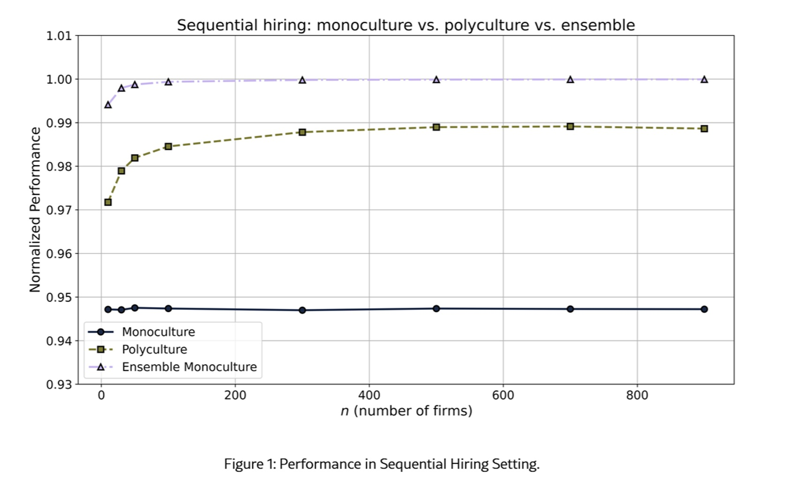
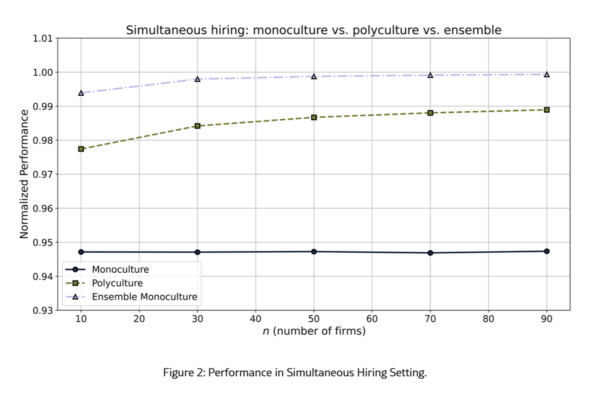

# La monocultura algoritmica: una sola AI per tutti, rischio o rimedio?

*Due studi usciti a pochi mesi di distanza sembrano dire cose opposte. Guardati da vicino, misurano cose diverse. Kyle Behm mandava candidature e riceveva sempre lo stesso rifiuto. Nel racconto che Cathy O'Neil ne fa in Armi di distruzione matematica, ripreso dal [paper del MIT](https://arxiv.org/html/2604.06047v2), Behm scoprì solo alla fine che tutte le aziende usavano lo stesso sistema di selezione, che a quanto pare lo aveva penalizzato per una condizione di salute mentale. Non erano tanti giudizi indipendenti, era un solo giudizio ripetuto ovunque.*

È questa la paura che chiamiamo monocultura algoritmica: molti decisori che si affidano allo stesso algoritmo, o ad algoritmi così simili da sbagliare insieme. Il paradosso opposto, però, è altrettanto reale. Se ogni azienda avesse il proprio algoritmo, il sistema non diventerebbe per forza più giusto, potremmo ritrovarci con decisioni incoerenti, impossibili da verificare, più facili da manipolare, e con una persona respinta ovunque per un accumulo di stranezze invece che per un singolo errore.

Il 29 settembre 2026 il MIT [ha presentato](https://news.mit.edu/2026/algorithmic-monoculture-effects-depend-on-details-0929) uno studio di Brian Hedden e Manish Raghavan che ridimensiona il pericolo. A maggio Stanford aveva [pubblicato](https://hai.stanford.edu/news/ai-hiring-tools-can-yield-racial-bias-and-systemic-rejection) il primo grande esame su dati reali, che trova rifiuti sistemici più frequenti del previsto. La domanda guida è semplice da enunciare e scomoda da chiudere: la diversità degli algoritmi è sempre un bene, oppure può essere preferibile un unico sistema trasparente, controllabile, magari composto da tanti modelli? Anticipo la risposta prudente: dipende, e cercherò di spiegare da che cosa.

## Banano, metafora con limiti

La parola viene dall'agricoltura, e la metafora funziona: un campo con una sola varietà rende bene finché non arriva la malattia che colpisce proprio quella. Lo sa chi conosce la storia del banano Gros Michel, distrutto a metà Novecento dal mal di Panama e sostituito dal [Cavendish](https://en.wikipedia.org/wiki/Cavendish_banana) che troviamo al supermercato, clonato e minacciato oggi da una nuova variante dello stesso fungo, arrivata nelle Americhe nel 2019. Ma Hedden e Raghavan mettono le mani avanti: un'analogia non è una prova, e il loro lavoro nasce proprio dal sospetto che venga usata in automatico.

Nel mondo delle macchine il termine copre situazioni diverse. C'è la monocultura stretta, con tutti sullo stesso algoritmo. C'è quella di mercato, in cui molte organizzazioni comprano dallo stesso fornitore anche se sotto il cofano i modelli cambiano. C'è quella dei componenti, in cui sistemi distinti condividono dati, modello di base o obiettivi. C'è quella degli esiti, dove sistemi diversi finiscono per produrre risultati simili. E c'è la monocultura generativa, di cui parleremo, in cui un singolo modello linguistico restringe la varietà delle risposte rispetto ai testi umani da cui ha imparato.

Il concetto ha una genealogia precisa. Nel 2021 Jon Kleinberg e lo stesso Raghavan [mostrarono](https://www.pnas.org/doi/10.1073/pnas.2018340118) che un algoritmo un po' più accurato, adottato da tutti per convenienza individuale, può lasciare la collettività peggio di prima.

## Stanford, numeri dal campo

Lo studio di Stanford, firmato da Rishi Bommasani, Sarah Bana, Kathleen Creel, Dan Jurafsky e Percy Liang, è il primo a osservare decisioni reali di un fornitore di selezione automatica su più aziende. Il [paper](https://arxiv.org/pdf/2605.27371.pdf), presentato a giugno alla conferenza FAccT, analizza i dati di pymetrics tra il 2018 e il 2022: circa 4,2 milioni di candidature di 3,4 milioni di persone, per 1.746 posizioni in 156 aziende di 11 settori. Non si tratta di curriculum ma di giochi online, dopo i quali un modello per ciascuna posizione assegna un "consigliato" o un "non consigliato". Chi non è consigliato, di norma, non incontra nessun essere umano.

Il primo risultato riguarda i rifiuti sistemici. Tra chi presenta quattro candidature, il 10% viene respinto ovunque, più di quanto accadrebbe se ogni azienda decidesse in modo statisticamente indipendente. Il punto è l'eccesso rispetto a quel riferimento, non la percentuale in sé, e lo scarto resta a dieci candidature, dove il 4% viene respinto da tutte le posizioni. Va anche dosata la portata: l'84% delle persone si è candidato una sola volta e appena l'1% circa quattro. Lo stesso modello usato da aziende diverse esiste (42 modelli, 142 coppie di aziende) ma è raro, e la correlazione nasce soprattutto dal fatto che gli stessi giochi alimentano modelli diversi.

Come prova del nove, gli autori usano lo [studio di Kline, Rose e Walters](https://www.nber.org/papers/w29053), che aveva inviato 83.000 curriculum finti a 108 grandi aziende americane: lì i rifiuti totali sono in linea con decisioni indipendenti. Suggestivo, ma non un esperimento gemello: popolazioni, ruoli e tassi di successo differiscono, come gli autori riconoscono. C'è anche una nota rassicurante: simulando le valutazioni di 939 candidati su 495 modelli, nessuno viene respinto da tutti, ma per portare i rifiuti totali sotto lo 0,1% bisognerebbe candidarsi a 25 posizioni invece di 10.

Il secondo risultato è più tecnico e forse più istruttivo. Negli Stati Uniti la regola dei quattro quinti segnala un possibile effetto discriminatorio quando un gruppo viene consigliato a meno dell'80% del ritmo del gruppo più favorito. Sui dati aggregati, il rapporto per i candidati neri è 0,839 e tutto sembra a posto. Ma la legge ragiona posizione per posizione, e in quel modo il 10,6% delle posizioni penalizza i candidati neri e il 5,3% quelli asiatici. Il 25,9% delle candidature di persone nere e il 14,7% di quelle asiatiche finiscono in posizioni con questo squilibrio. Lo studio fa un paragone chiaro: se solo uomini venissero consigliati per i posti da medico e solo donne per quelli da infermiere, la media potrebbe tornare, ma il problema resterebbe.

Restano limiti che gli autori dichiarano da soli. C'è un solo fornitore e un solo tipo di prova, basata su giochi. Mancano misure della qualità dei candidati e della validità dei modelli, e non si sa come le aziende usino le raccomandazioni. E uno squilibrio statistico può giustificare un'indagine, ma non stabilisce da solo che una pratica sia illegale.

## La difesa del MIT

Il lavoro di Hedden, filosofo, e Raghavan, informatico, [pubblicato](https://onlinelibrary.wiley.com/doi/10.1111/phpe.70018) su una rivista di filosofia, non sostiene che la monocultura sia buona. Sostiene che le accuse più comuni non reggono o non bastano. È un lavoro teorico, con simulazioni, non uno studio sul campo.

Prendiamo l'esclusione. In un mercato con un numero fisso di posti e di candidati, dicono gli autori, restano senza lavoro lo stesso numero di persone con un solo algoritmo o con tanti. Cambiano quali persone, non quante. Persino nel caso in cui tutte le aziende classificano i candidati allo stesso modo, chi arriva secondo può essere assunto dalla seconda azienda perché il primo è già stato preso. E più algoritmi non garantiscono equità: se ciascuno preferisce un candidato diverso, qualcuno che tutti mettono al secondo posto può restare fuori lo stesso. Il paper aggiunge un vantaggio poco discusso, cioè che un unico criterio rende più semplice scoprire e correggere una discriminazione, mentre in un mosaico di algoritmi gli esiti dipendono da un intreccio difficile da districare.

Per Raghavan c'è perfino un effetto sul potere dei candidati: se tutte le aziende inseguono le stesse persone, queste possono ottenere offerte migliori. Il paper però tratta questa idea con prudenza, ricordando che la letteratura economica sul tema riguarda soprattutto chi ha già un impiego. Sul fronte dell'autonomia individuale, gli autori osservano che il timore di non poter migliorare il proprio punteggio vale solo per una monocultura ingenua, basata su tratti immutabili, mentre il rischio opposto, quello di imparare a truccare il sistema, esiste anche con tanti algoritmi diversi.

Un lettore attento noterà dove queste conclusioni sono fragili. Il modello presuppone che si assuma con un algoritmo unico e completo, mentre Stanford osserva soltanto una fase preliminare: per il MIT essere ammessi al colloquio conta poco se poi non cambia chi ottiene il lavoro, ma si può obiettare che per chi viene respinto in partenza quel colloquio sia tutto. Inoltre le simulazioni idealizzano il mondo reale, con posti che non si aprono tutti insieme e mercati pieni di attriti. Ed è significativo che la principale bersaglio della critica, Creel, sia anche coautrice dello studio Stanford: i due lavori sono in dialogo diretto, quasi un botta e risposta a distanza.

[Immagine tratta dal paer Algorithmic Monoculture and its Critics](https://arxiv.org/html/2604.06047v2)

## Ensemble, esplorazione, dubbi

L'obiezione che gli stessi autori considerano più seria riguarda la scoperta. Se tutti si fidano dello stesso ordinamento, i candidati sfavoriti non vengono mai messi alla prova, il sistema non impara che si era sbagliato su di loro. Nel gergo dei problemi a "banditi con più braccia", quelli in cui bisogna decidere tra sfruttare ciò che si sa ed esplorare, una popolazione di decisori che si affidano alla stessa informazione ha più probabilità di scegliere il braccio sbagliato e di non accorgersene mai. Le simulazioni del paper lo confermano, purché l'algoritmo unico non sia migliore dei tanti che sostituisce.

Ma c'è di più. Nel caso dell'assunzione, nessuna azienda può prendere il primo in graduatoria se lo ha già preso un'altra, perciò qualche esplorazione forzata c'è comunque. Le piattaforme reali, poi, non sono puri sfruttatori: introducono già dosi di casualità, e nel paper si ricorda persino uno studio in cui un algoritmo che tiene conto dell'incertezza sceglieva candidati più vari di uno che ordina solo per punteggio stimato. Chi conosce le Oblique Strategies, il mazzo di carte pubblicato nel 1975 da Brian Eno e Peter Schmidt per far uscire gli artisti dai blocchi creativi, riconosce il principio: a volte serve un elemento di disturbo dichiarato.

La proposta più interessante è l'insieme di modelli, in inglese ensemble: invece di tanti algoritmi che decidono separatamente, uno solo che ne combina molti, per esempio facendo la media dei loro punteggi. In simulazione, secondo gli autori, questa monocultura "a più voci" ottiene risultati pari o migliori sia della monocultura semplice sia del mosaico. Vantaggi possibili: meno rumore, decisione uniforme, controllo centralizzato. Ma qui sorgono le domande. Combinare modelli costruiti sugli stessi dati non garantisce indipendenza. La media può schiacciare i segnali minoritari. Un punteggio aggregato può nascondere chi è responsabile di un errore. E resta un unico punto di rottura. Hedden stesso avverte che non si sa quanto sia praticabile. Un insieme di modelli è pluralismo, o solo una monocultura più elaborata?

Infine, il dominio conta. Il paper ricorda che assunzioni, credito e università hanno posti limitati ed esclusivi, e lì la monocultura non crea più esclusi. Dove non ci sono vincoli simili, come i premi cinematografici, potrebbe escludere di più. Per la medicina e la giustizia gli autori rinviano a studi futuri, e sulla ricerca scientifica o sui contenuti generati avvertono che le cose potrebbero funzionare diversamente e peggio.

## Stessi ingredienti, altre etichette

Si capisce meglio il timore se si guarda a cosa c'è dentro le applicazioni. Un'app può avere interfaccia, istruzioni e messa a punto diverse dalla concorrente e poggiare sullo stesso modello di base, sugli stessi dati e sugli stessi filtri di sicurezza. Gli autori di Stanford lo dicono esplicitamente: la concentrazione dei fornitori non basta a misurare il fenomeno, perché anche modelli di aziende diverse possono respingere le stesse persone quando condividono dati o architettura. Lo conferma, per i modelli linguistici, uno studio presentato all'ICML 2025 su [più di 350 modelli](https://proceedings.mlr.press/v267/kim25e.html): su un test di riferimento, quando due modelli sbagliano concordano sulla risposta errata il 60% delle volte, e i modelli più grandi e accurati sbagliano in modo molto simile anche con architetture e produttori diversi. Gli autori ne verificano gli effetti anche sulla selezione dei candidati e sui modelli usati come giudici.

La versione più insidiosa è quella generativa. Fan Wu, Emily Black e Varun Chandrasekaran l'hanno [descritta](https://arxiv.org/abs/2407.02209) come un restringimento della varietà degli output rispetto ai dati di partenza: per esempio recensioni di libri quasi tutte positive, anche per titoli accolti in modo misto, o codice che copre meno strategie. Il quadro è ambivalente: ridurre la varietà a volte migliora, il codice può risultare più efficiente, ma diventa un problema quando sparisce l'opinione non convenzionale. Gli autori aggiungono un dato poco rassicurante, e cioè che cambiare il modo di campionare o di formulare le richieste non basta a correggere il fenomeno, le cause sembrano annidate nell'allineamento del modello.

Chi lavora con modelli locali, quantizzati o installati in azienda, dovrebbe interrogarsi su una distinzione che qui è un'ipotesi di ragionamento, non un risultato: la sovranità sull'esecuzione non coincide con la diversità del modello. Se molti progetti aperti derivano dallo stesso modello di base e dagli stessi dati, avere i pesi in casa dà autonomia, ma non necessariamente prospettive diverse. Lo stesso vale per gli agenti, dove la questione resta aperta: una squadra di dieci agenti con lo stesso modello, gli stessi strumenti e gli stessi criteri di valutazione è davvero plurale o è una monocultura in fila per dieci? E se il modello che giudica gli output somiglia a quello che li produce, chi controlla chi?

Il giornalismo lo sa bene. Kyle Chayka, nel libro Filterworld citato dal paper del MIT, racconta come gli algoritmi di raccomandazione appiattiscano il gusto. Se redazioni, motori di ricerca e assistenti si appoggiano a modelli simili, le fonti minoritarie possono sparire senza censura, solo perché statisticamente meno probabili.

[Immagine tratta dal paper Algorithmic Monoculture and its Critics](https://arxiv.org/html/2604.06047v2)

## Antidoti, controlli, contestazione

Che cosa fare, allora, senza slogan del tipo "usiamo algoritmi diversi"? Il paper di Stanford propone strumenti concreti. Il primo: misurare l'impatto per singola posizione, non sulla media di un fornitore, cosa che oggi non sempre avviene. Il secondo: sorvegliare il mercato, cioè capire quanto sono diffusi certi fornitori e quanto sono intrecciati, dato che i dati raccolti oggi dalle autorità sono aggregati e anonimi e non permettono di seguire la stessa persona da un'azienda all'altra. Il terzo: garantire ai ricercatori l'accesso ai dati, come fa per le grandi piattaforme il regolamento europeo sui servizi digitali. Gli autori stessi ricordano di aver lavorato grazie a un accordo con pymetrics che non le permetteva di bloccare la pubblicazione, e temono che la loro ricerca scoraggi altri fornitori dal condividere i dati.

Sul piano delle metriche, oltre alla correlazione degli esiti serve quella degli errori: i sistemi concordano soprattutto quando sbagliano? Serve capire quanto si sovrappongono dati e modelli, se il sistema esplora candidati non convenzionali, se un errore sistematico può essere attribuito a un componente preciso. E soprattutto se la persona respinta ha un modo reale di contestare. Una maggiore diversità di decisioni, va detto, non è un valore in sé, perché se nasce da rumore o incompetenza peggiora gli esiti. L'obiettivo è una diversità che porti informazione utile, con qualcuno che risponde.

L'Europa non ha una norma che si chiami "monocultura algoritmica", e sarebbe scorretto attribuirgliela. Ma la selezione del personale rientra nei sistemi ad alto rischio dell'AI Act, con obblighi su gestione del rischio, qualità dei dati, documentazione e sorveglianza umana. Una scadenza va aggiornata: l'agosto 2026 citato dallo studio Stanford è superato. Il pacchetto di semplificazione noto come Digital Omnibus, [approvato dal Consiglio il 29 giugno 2026](https://labs.cloudsecurityalliance.org/research/csa-research-note-eu-ai-act-omnibus-vii-deadline-delay-20260/), è diventato il [regolamento (UE) 2026/1744](https://eur-lex.europa.eu/eli/reg/2026/1744/oj/ita), pubblicato il 24 luglio e in vigore dal 27, e secondo una [ricostruzione dedicata](https://lawandtechnology.eu/en/digital-omnibus-on-ai-official-journal-regulation-2026-1744/) sposta al 2 dicembre 2027 gli obblighi per i sistemi autonomi ad alto rischio. Il ponte più diretto resta la concorrenza. Un [documento della direzione concorrenza della Commissione](https://competition-policy.ec.europa.eu/document/download/c86d461f-062e-4dde-a662-15228d6ca385_en), che precisa di non rappresentare la posizione ufficiale dell'istituzione, individua nell'intelligenza artificiale generativa colli di bottiglia come dati, chip e potenza di calcolo, e segnala la difficoltà di cambiare fornitore di servizi cloud. Indica come antidoti i modelli aperti e l'interoperabilità. Pochi fornitori dominanti non sono illeciti di per sé, ma creano dipendenze, e lo studio Stanford aggiunge il rischio che un blackout di un fornitore blocchi la selezione in migliaia di aziende.

## Domande ancora aperte

Torniamo a Behm e alla domanda iniziale. La risposta non è scegliere tra uno e molti algoritmi. È chiedersi quanti sistemi siano davvero indipendenti, quanto condividano dati e modelli, se gli errori siano correlati, chi ne sopporti il danno, se il sistema esplori alternative e chi possa controllarlo e correggerlo.

I due studi, in fondo, non si contraddicono. Il MIT chiede che cosa segue necessariamente da certi modelli e scopre che molto meno di quanto si pensava, il che è un buon antidoto agli slogan. Stanford misura che cosa è successo in un ecosistema concreto e mostra che il rischio non è puramente ipotetico, anche se limitato a un fornitore, a un tipo di test e a una parte piccola dei candidati. Una coerenza che rende gli errori più visibili è un vantaggio, ma solo se qualcuno guarda; una diversità che moltiplica gli errori senza nessuno che li verifichi è solo confusione.

Restano questioni che nessuno dei due lavori chiude. Che cosa succede quando modelli generativi e agenti prendono il posto delle graduatorie? Un insieme di modelli può essere davvero pluralista? Quanta casualità siamo disposti ad accettare in una decisione che cambia una vita? La diversità degli algoritmi può aiutare, ma non sostituisce il diritto di essere ascoltati: chiedere quante AI decidono conta meno che sapere quanta indipendenza c'è tra loro e se, dopo un no, resta qualcuno a cui rispondere.