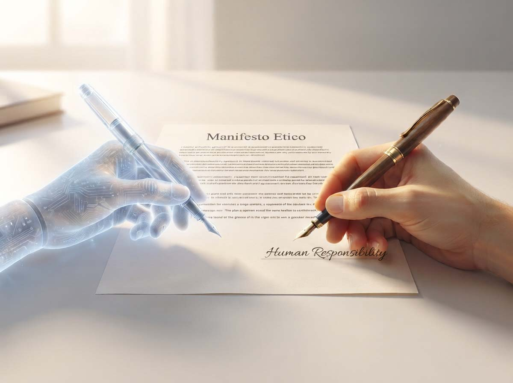
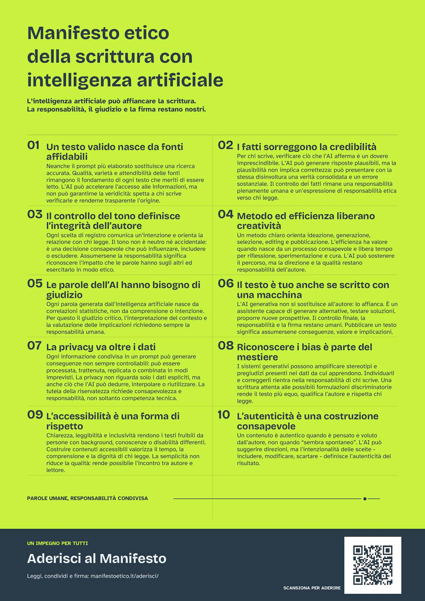

# Intervista a Fulvio Julita sul Manifesto Etico della scrittura con l'AI

*Ho scoperto il Manifesto una settimana fa, per caso, scorrendo i social. Mi è sembrata l'occasione per mettere alla prova il metodo che mi sono costruito negli ultimi anni e che racconto nella [pagina sul metodo editoriale di AITalk](https://aitalk.it/it/metodo-editoriale). Il confronto è stato doppio. Prima a mano, leggendo i dieci principi accanto alla mia prassi quotidiana. Poi con una Skill, un piccolo strumento personale che ho costruito per incrociare il mio metodo e alcuni miei lavori con il testo del Manifesto, perchè volevo capire se ero stato indulgente con me stesso.*

Il risultato: ero sostanzialmente allineato, senza conoscere il progetto, e in alcuni punti più rigoroso di quanto comunicassi. Va detto con onestà che è un esame su me stesso, quindi da prendere con la cautela di ogni autovalutazione. Mi è servito comunque a precisare due cose: quando l'AI genera contenuto sostanziale e quando offre un'assistenza marginale, e come dichiaro la verifica umana delle fonti. Da qui la decisione di parlare direttamente con uno dei promotori, per capire se un Manifesto può diventare pratica e non solo dichiarazione.

## Dieci principi, non decalogo

Il [Manifesto etico della scrittura con intelligenza artificiale](https://manifestoetico.it/manifesto/) è un'iniziativa italiana nata da un [comitato promotore](https://manifestoetico.it/comitato-promotore/) di undici professionisti della scrittura, tra cui Fulvio Julita. Propone dieci principi per usare l'AI con trasparenza, cura e responsabilità, e attraversa fonti, fatti, tono, privacy, pregiudizi, accessibilità e autenticità, fino al giudizio umano e alla firma. La frase d'apertura dice quasi tutto: l'AI può affiancare la scrittura, mentre responsabilità, giudizio e firma restano di chi scrive.

Non è quindi un manuale tecnico, ma il tentativo di fissare una cultura della scrittura assistita, in cui firmare significa controllare, verificare e rispondere. E non nasce nel vuoto, perché il dibattito internazionale su autorialità, dichiarazione dell'uso e integrità dei testi è già acceso.

## Il mondo discute

Il Manifesto italiano non è un caso isolato. Negli Stati Uniti l'Authors Guild ha esteso a marzo 2026 la certificazione [Human Authored](https://authorsguild.org/news/human-authored-certification-expands-to-all-authors/) a tutti gli autori di libri pubblicati nel Paese. Il testo deve essere scritto da esseri umani, con tolleranza per correttori ortografici e per usi come ricerca, brainstorming e indici, e l'autore firma una licenza dopo una verifica d'identità. Nell'editoria scientifica il [COPE](https://publicationethics.org/guidance/cope-position/authorship-and-ai-tools) esclude che uno strumento di AI possa figurare come autore, perché non può rispondere del lavoro, e chiede di indicare quale strumento sia stato usato e come. L'[ICMJE](https://www.icmje.org/recommendations/browse/artificial-intelligence/ai-use-by-authors.html) (L'International Committee of Medical Journal Editors) aggiunge che l'output va rivisto perché può essere errato, incompleto o distorto, e che tacere l'uso può costituire, in certi casi, una condotta scorretta.

Il punto comune è la centralità dell'autore umano, con trasparenza e una qualche tracciabilità. Resta aperta la tensione tra dichiarare l'uso e documentare il processo: strumento, funzione, estensione, controllo umano.

## Dichiarare non basta

Molte linee guida chiedono di dichiarare l'uso dell'AI, poche dicono quanto dettaglio serva. Uno [studio su AI & Society](https://link.springer.com/article/10.1007/s00146-024-02081-0), condotto su 602 partecipanti, indica che per giudicare un autore conta soprattutto il grado di assistenza ricevuta, più di chi la fornisca. A parità di aiuto, però, l'assistente umano è percepito come più meritevole di autorialità e responsabilità, e la dichiarazione è sentita come più necessaria quando l'aiuto è umano. Gli autori ne ricavano che conviene documentare quanto l'AI abbia davvero fatto, oltre a dire che c'è stata.

Per chi legge informazione la domanda non è "hai usato l'AI?", ma "come hai garantito che ciò che leggo sia verificabile e responsabile?". Con questa domanda in testa ho iniziato dal principio: come è nato il progetto.

## Parla Julita

**Come e da quale esigenza concreta è nato il Manifesto etico della scrittura con intelligenza artificiale? Tra i problemi che avete avvertito (affidabilità delle informazioni, opacità sull'uso dell'AI, omologazione della scrittura, perdita di competenze, deresponsabilizzazione di chi pubblica) quale ha funzionato da innesco iniziale, e quali si sono rivelati altrettanto urgenti nel corso della vostra discussione?**

Il Manifesto è nato dall’esigenza di dare un riferimento a chi sceglie di scrivere con l’intelligenza artificiale e vuole farlo con consapevolezza e responsabilità. Ne parlavo con Alessandra Perotti, editor e writer coach: nel dibattito vedevamo molto entusiasmo e molto rifiuto, ma poco spazio per ragionare su come usare questi strumenti mantenendo il proprio giudizio e la propria voce.\
La mia esperienza, anche nella formazione, mi mostrava che l’AI poteva stimolare il pensiero e aiutare a scrivere meglio. Allo stesso tempo, vedevo il rischio di scambiare un testo ben formulato per un testo attendibile, o di accettare una risposta senza chiedersi se esprimesse davvero ciò che si voleva dire. Il punto di partenza era questo: come cogliere le possibilità dell’AI senza delegarle le scelte di chi scrive?\
Con un comitato di undici professionisti della scrittura abbiamo discusso questa esigenza individuando dieci principi valoriali. Affidabilità delle informazioni, trasparenza, tutela dei dati e attenzione ai pregiudizi sono aspetti diversi di una responsabilità che resta umana: chi firma deve poter rispondere di ciò che pubblica.

**Perché avete scelto la forma del Manifesto, cioè una dichiarazione di principi, invece di una guida pratica, un codice deontologico o una certificazione? Che cosa implica, nella pratica, aderire al progetto: un impegno culturale, un criterio professionale, una policy per le organizzazioni o altro?**

Abbiamo scelto la forma del Manifesto perché volevamo mettere a fuoco i valori che orientano il lavoro di chi scrive con l’AI. Gli strumenti cambiano rapidamente; il bisogno di verificare le informazioni, tutelare le persone e assumersi la responsabilità di ciò che si pubblica resta. Una dichiarazione di principi può offrire un riferimento comune a persone che scrivono in contesti diversi e usano strumenti diversi.\
Durante il confronto nel comitato è emersa anche l’esigenza di indicazioni pratiche. È un’esigenza che condividiamo: l’intenzione è affiancare al Manifesto un protocollo operativo che aiuti a tradurre i principi nel lavoro quotidiano.\
Aderire significa riconoscersi in quei valori e impegnarsi a portarli nel proprio modo di scrivere. È un impegno culturale con conseguenze concrete: riguarda le fonti che scegliamo, i controlli che facciamo, il rispetto per chi legge e per le persone di cui scriviamo. Il Manifesto può offrire un riferimento anche a professionisti e organizzazioni che vogliono definire le proprie pratiche. L’adesione, però, non certifica la qualità dei loro testi: quella responsabilità va esercitata ogni volta che si firma e si pubblica.

**Uno dei nodi del Manifesto è il giudizio umano: l'AI può produrre una bozza, ma non può assumersi responsabilità. Come distingui, nel lavoro reale, una revisione autentica dalla semplice approvazione di un testo generato? Quali controlli minimi dovrebbero essere non negoziabili prima della pubblicazione: fonti, citazioni, numeri, attribuzioni, tono, possibili pregiudizi?**

La differenza si vede quando interroghi il testo, invece di limitarti a rileggerlo. Per ogni passaggio mi chiedo: è ciò che intendo sostenere? Su che cosa si basa? Ci sono affermazioni che non saprei spiegare o giustificare? Un testo può suonare molto bene e non superare queste domande. La revisione comprende anche la disponibilità a scartare una risposta ben formulata quando porta nella direzione sbagliata.\
Sui controlli, parto dalle fonti: le apro, verifico che sostengano davvero l’affermazione a cui sono associate e ne valuto l’autorevolezza rispetto all’argomento. La presenza di un collegamento non è una garanzia. Citazioni, numeri e attribuzioni richiedono lo stesso lavoro: controllo le parole nel loro contesto, la provenienza dei dati e l’esattezza dei riferimenti. Il modello può inventare anche un titolo, un autore e un anno dall’apparenza perfettamente plausibile.\
Poi considero come il testo parlerà a chi legge: il tono è adeguato? Ci sono generalizzazioni o stereotipi? Sono rimaste informazioni personali o riservate che non devono essere pubblicate? La tutela di quei dati, però, comincia prima: quando decido quali informazioni posso consegnare allo strumento.

**L'AI può rendere la scrittura più accessibile, ma può anche rafforzare dipendenza da piattaforme proprietarie, stereotipi linguistici e disuguaglianze di competenza. Come affrontate, nel Manifesto, questo doppio effetto? E, poiché sei formatore: qual è l'errore pedagogico più comune che vedi nell'insegnamento dell'AI alla scrittura, a studenti, professionisti e aziende?**

L’AI può aiutare a esprimersi, a organizzare un pensiero e a rendere un testo più comprensibile. Questo può allargare la possibilità di partecipare alla scrittura, ma avere accesso a uno strumento non significa automaticamente saperlo usare bene. Il Manifesto offre un orientamento per esercitare quella possibilità con consapevolezza; le disuguaglianze di accesso e la dipendenza dalle piattaforme richiedono anche risposte che vanno oltre una dichiarazione di principi.\
L’errore che vedo più spesso nella formazione è insegnare le funzioni e fornire prompt pronti da copiare senza spiegare la logica dell’interazione. Un’istruzione funziona per ragioni precise: chiarisce lo scopo, il lettore, il contesto e i vincoli del lavoro. Se comprendo quelle ragioni, posso costruire le mie richieste, adattarle e capire quando una risposta non è adeguata. Se imparo soltanto una formula, rischio di dipendere da quella formula.\
Lo stesso vale per gli stereotipi: non basta insegnare a ottenere un testo scorrevole. Serve allenare a riconoscere quali punti di vista privilegia, quali esperienze lascia fuori e quali modi di esprimersi tratta come normali. Per me una buona formazione deve aumentare l’autonomia della persona: renderla più capace di scegliere, anche quando scegliere significa fare a meno dell’AI.

**Qual è l'obiezione più seria che avete ricevuto al Manifesto, per esempio da chi ritiene l'etica una responsabilità individuale, o da chi teme obblighi di trasparenza troppo rigidi, e come rispondete? C'è un'obiezione che vi ha fatto cambiare qualcosa nel Manifesto o nel modo in cui lo presentate?**

Una delle obiezioni riguarda la scelta stessa di usare l’AI nella scrittura, che per alcune persone riduce il valore del lavoro dell’autore. Il Manifesto non invita tutti a usarla: offre un riferimento a chi sceglie di farlo e vuole mantenere consapevolezza e responsabilità.\
Un’altra questione, sollevata da più persone, è stata: avete usato l’AI per scrivere il Manifesto? Qualcuno ha anche provato a misurarne il contributo analizzando il testo. Non avevamo previsto questa necessità di chiarimento durante la stesura. Ci ha portato a integrare la comunicazione sul sito con una dichiarazione presente in tutte le pagine e un articolo che racconta il processo.\
L’AI ha avuto un ruolo significativo soprattutto nell’analisi del confronto tra i membri del comitato. Lavorando sulle trascrizioni delle riunioni, ci ha aiutato a recuperare osservazioni che erano emerse ma che, nel seguito della discussione, avevamo perso di vista. Tornare su quei passaggi ci ha permesso di riconsiderare alcuni termini e precisare alcuni concetti nella rielaborazione del testo.\
Per questo una valutazione basata soltanto sul testo finale racconta una parte della storia: non restituisce il lavoro che lo ha preceduto né le scelte compiute dopo ogni proposta. Le domande ricevute ci hanno fatto capire che questo percorso andava reso visibile. Abbiamo quindi lavorato sul modo di presentare il Manifesto, spiegando dove era intervenuta l’AI e come avevamo discusso e valutato il suo contributo.

**Un manifesto invecchia. Immaginate una seconda versione, o un passaggio a strumenti più operativi come linee guida, checklist o percorsi di certificazione? Cosa dovrebbe cambiare, nel Manifesto o nel contesto, perché resti attuale?**

Un manifesto non deve cambiare allo stesso ritmo degli strumenti. Abbiamo scelto dei principi proprio perché potessero durare, ma il Manifesto non è scritto nella pietra. Se l’esperienza farà emergere una questione che abbiamo trascurato o la necessità di formulare meglio un principio, potremo tornare a discuterne nel comitato.\
Il passo che immaginiamo oggi è il protocollo operativo già citato. Potrebbe aiutarci anche a capire dove l’applicazione dei principi incontra difficoltà. Nell’intenzione del comitato, dovrà nascere dal confronto con chi scrive e dai problemi che incontra: è lì che possiamo verificare se il Manifesto continua a offrire un orientamento utile.

## Firmare è scegliere

Il Manifesto non è un punto d'arrivo, ma un invito a rendere espliciti criteri che molti professionisti applicano già in modo informale. Il mio confronto iniziale lo conferma: ero allineato, e mi ha spinto a comunicare meglio due aspetti del metodo. Nel dibattito internazionale la direzione sembra chiara, perché trasparenza, responsabilità umana e tracciabilità sono ormai criteri di qualità e non semplici etichette.

La domanda non è se usare o meno l'AI, ma come firmare ciò che pubblichiamo: con quali controlli, quali fonti e quale responsabilità. Chi vuole leggere i principi o aderire trova tutto su [manifestoetico.it](https://manifestoetico.it/).