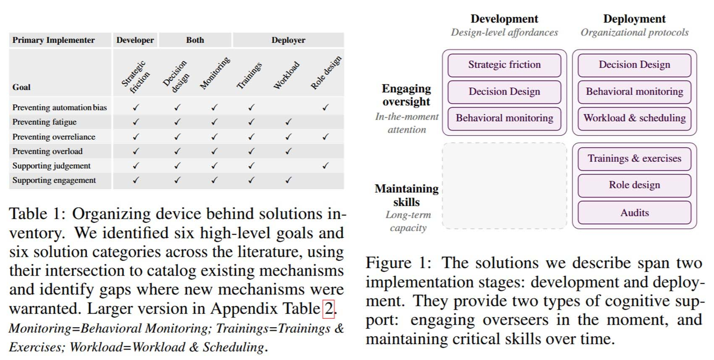

# Gli agenti AI spingono gli umani fuori dal loop

*Un nuovo [position paper](https://arxiv.org/abs/2608.23642) firmato da Margaret Mitchell, Avijit Ghosh e Samir Passi sostiene che gli agenti AI non rendono soltanto più difficile la supervisione: il loro uso prolungato può erodere proprio le competenze che servirebbero per esercitarla. Nel Cavaliere inesistente di Calvino, il paladino più scrupoloso dell'esercito di Carlo Magno è Agilulfo, un'armatura bianca con dentro nessuno. Esiste per forza di volontà, conosce a memoria il regolamento, è sempre al suo posto e non sbaglia una formalità. È un buon ritratto dell'umano nel loop quando la sua presenza è soltanto formale: c'è nell'organigramma, nel modulo, nel pulsante, ma dentro mancano il tempo, le informazioni e la competenza per decidere.*

Ora un ufficio qualunque. Un agente AI legge documenti, interroga il gestionale, cerca in rete, prepara una proposta, aggiorna dei record, scrive una bozza di email e infine si ferma: «Approvi?». Quel clic dovrebbe essere una decisione informata, ma per esserlo servirebbe sapere quali dati sono stati usati e quali scartati, quali strumenti attivati, con quali permessi e con quali effetti. Se non si può, non si è nel loop: si è l'ultima firma su un processo che non si governa.

È il tema di *AI Agents Push Humans Out of the Loop*, [pubblicato su arXiv](https://arxiv.org/abs/2608.23642) il 24 agosto 2026 e giunto alla terza versione il 6 settembre. La formula «human in the loop» è ovunque, perfino nell'[articolo 14 dell'AI Act](https://artificialintelligenceact.eu/article/14/), che chiede una sorveglianza umana efficace. Gli autori ricordano però che la presenza di un supervisore non garantisce una supervisione affidabile, e che di rado ci si chiede se questa sia davvero possibile.

Con un chatbot l'errore è una risposta da correggere. Un agente compie più passaggi e, ricorda il paper, può modificare o cancellare file senza dare nell'occhio, trasferire dati riservati, avviare pagamenti.

Ne ho parlato nella storia di Kiro, l'agente di programmazione di Amazon. Secondo il [Financial Times](https://www.ft.com/content/00c282de-ed14-4acd-a948-bc8d6bdb339d), che cita fonti interne anonime, a dicembre 2025 avrebbe cancellato e ricreato parte di un ambiente, causando circa tredici ore di interruzione di AWS Cost Explorer in una regione della Cina continentale. Amazon, come riassume l'[AI Incident Database](https://incidentdatabase.ai/cite/1442/), parla di un evento molto limitato, dovuto a errore dell'utente e a permessi mal configurati, non all'AI. Nel [mio articolo](https://aitalk.it/it/amazon-down) riportavo che l'agente operava con i permessi di un operatore senior e senza revisione obbligatoria. Le due letture convivono: se l'errore è umano perché i permessi erano troppo larghi, resta da chiedersi chi abbia reso possibile che bastasse un permesso largo per arrivare a un danno. Dare la colpa a chi "doveva controllare" non prova che controllare fosse praticabile.

## Il paper

È un position paper: niente nuovo modello, niente esperimento decisivo, ma una tesi sostenuta con la letteratura su automazione, interazione uomo-macchina, scienze cognitive e governance. La tesi è che le pratiche attuali non sostengono una supervisione efficace e che l'uso prolungato degli agenti indebolisce le capacità cognitive necessarie per esercitarla, in una formula degli autori: «oversight degrades the overseer». La cura ha due gambe: gli sviluppatori dovrebbero costruire ambienti di esecuzione che sostengano attenzione e consapevolezza della situazione, le organizzazioni protocolli che preservino le competenze e riducano la fatica. Non si chiede di abolire gli agenti, ma di trattare i bisogni cognitivi di chi supervisiona alla pari della capacità dell'agente.

Una cautela sulle prove, perché il paper stesso parla di evidenze iniziali. Il materiale citato è eterogeneo: c'è uno [studio osservazionale multicentrico](https://www.sciencedirect.com/science/article/pii/S2468125325001335) sul rischio di perdita di abilità degli endoscopisti dopo l'esposizione all'AI, c'è una [revisione sistematica sugli studenti](https://doi.org/10.1186/s40561-024-00316-7), ma ci sono anche preprint, lavori da workshop e testimonianze su blog e forum. Diversi studi vicini al tema, come quello sugli sviluppatori e gli agenti di programmazione, sono firmati da uno degli autori stessi. Il quadro è ben fondato, ma non è una legge verificata: nessuno ha dimostrato che ogni agente faccia perdere competenze.

## Perché gli agenti sfuggono

La difficoltà non viene da una generica opacità dell'AI, ma dal modo in cui un agente lavora: interpreta un obiettivo, pianifica, sceglie strumenti, li usa, legge gli esiti e rivede il piano, spesso con ruoli interni distinti per pianificare, eseguire e valutare. Per un supervisore l'informazione rilevante è enorme e sparsa in componenti che possono cambiare o sparire, al punto che chiedersi perché l'agente abbia scelto un certo strumento può essere, in pratica, una domanda senza risposta.

Poi ci sono gli strumenti. Il paper parla di allucinazione degli strumenti: l'agente ne inventa uno inesistente, ne usa uno vero con parametri sbagliati, fraintende il risultato, e l'errore si propaga ai passaggi successivi. Un lavoro citato, [The Reasoning Trap](https://aclanthology.org/2026.acl-long.376/), riporta che potenziare il ragionamento dei modelli tende ad amplificare questo difetto. Nei sistemi con più agenti si aggiungono i fallimenti di comunicazione, [analizzati in un lavoro presentato a NeurIPS 2025](https://proceedings.neurips.cc/paper_files/paper/2025/file/b1041e52d3be19f0a9bc491657488e4a-Paper-Datasets_and_Benchmarks_Track.pdf), quando un agente non passa a un altro un'informazione necessaria.

Immaginiamo, è un esempio mio, un agente incaricato di ridurre del dieci per cento i costi dei fornitori non strategici. Se una categoria è classificata male o un'eccezione contrattuale non viene letta, le comunicazioni successive saranno coerenti e fondate su un errore. Chi approva l'email finale non vede la classificazione né i record esclusi.

C'è anche il costo di valutare. Il paper, appoggiandosi a un'[analisi di EvalEval](https://evalevalai.com/research/2026/04/29/eval-costs-bottleneck/) di cui Ghosh è coautore, sostiene che collaudare in anticipo il comportamento multi-passaggio costa molto più che collaudare risposte singole, tanto da rendere la copertura completa impraticabile per i più. Parte del controllo slitta così a quando l'agente è già al lavoro, e ricade su una persona che deve insieme usarlo, concedere permessi, giudicare le scelte e prevederne le conseguenze. Il risultato è l'affaticamento da approvazione, in cui si smette di guardare ciò che si approva. Nel [post tecnico](https://www.anthropic.com/engineering/claude-code-auto-mode) su una modalità di Claude Code, Anthropic scrive che gli utenti accettano il 93% delle richieste di permesso. Un tasso alto non prova da solo la disattenzione, perché molte azioni sono innocue, ma l'azienda lo collega proprio a quel fenomeno.

[Immagine tratta dal paper su arxiv.org](https://arxiv.org/abs/2608.23642)

## L'ironia dell'automazione

Nel 1983 Lisanne Bainbridge descrisse in [Ironies of Automation](https://www.sciencedirect.com/science/article/pii/0005109883900468) un paradosso: più un sistema è capace, più all'operatore resta un monitoraggio passivo, e nei casi rari e gravi in cui dovrebbe subentrare è meno preparato a farlo. Il paper ne fa il perno: la supervisione serve soprattutto nei momenti critici, che sono quelli in cui chi supervisiona è più impreparato. È l'intuizione di *La macchina si ferma*, il racconto di E. M. Forster del 1909 su un'umanità accudita da un sistema che nessuno sa più riparare.

Gli autori richiamano la perdita di abilità pratiche (deskilling), la ruggine dell'intuizione, cioè del fiuto che fa riconoscere un'anomalia, il debito cognitivo, e bias come l'eccesso di fiducia nella proposta automatica e l'ancoraggio alla prima risposta. Le prove vengono da contesti diversi dagli agenti: una [ricerca preliminare](https://arxiv.org/abs/2506.08872) associa l'uso di un modello linguistico per scrivere saggi a una minore connettività cerebrale, ma è un preprint su un compito di scrittura e va letto così. Né l'ironia significa che chi usa l'AI smetta di pensare: significa che interfacce costruite per comodità e delega riducono le occasioni di esercitare un giudizio indipendente.

Le categorie più fragili sono due. I novizi, che rischiano di non costruire le basi per verificare ciò che l'agente fa, e gli esperti ai margini della propria competenza, come lo sviluppatore esperto assistito da un agente in un linguaggio che conosce poco. Lo [studio di Dhanorkar, Passi e Vorvoreanu](https://doi.org/10.1145/3805689.3812402) sugli sviluppatori che usano agenti rileva scorciatoie comprensibili ma rischiose, come trattare il piano dell'agente come riflesso fedele di ciò che farà o dare per corretto il codice che supera i test.

Una lente utile è quella del mio articolo [Cyborg, Centauri o Automi](https://aitalk.it/it/cyborg-centauri-automi.html), sullo [studio di ricercatori di Harvard e MIT](https://www.hbs.edu/ris/Publication%20Files/26-036_e7d0e59a-904c-49f1-b610-56eb2bdfe6f9.pdf) su 244 consulenti BCG. Circa il 60% lavorò da Cyborg, in dialogo continuo con GPT-4, il 14% da Centauro, tenendo il controllo e delegando compiti circoscritti, il 27% da Self-Automator, delegando problema ed esecuzione (la somma supera cento per gli arrotondamenti). I Centauri produssero le raccomandazioni più accurate, e per gli Self-Automator lo studio parla di mancato sviluppo di competenze. Il paper non cita questo lavoro, l'accostamento è mio, e ha i limiti già dichiarati nel pezzo: una sessione del 2023 con un modello conversazionale, non un agente. Serve a distinguere collaborazione e abdicazione, non a classificare gli agenti.

Resta un possibile circolo vizioso, che il paper presenta come ipotesi. Se la qualità di un agente si misura con tassi di approvazione o gradimento, un supervisore stanco può mandare segnali di successo senza aver controllato, e il sistema potrebbe essere premiato per risposte facili da accettare più che da verificare. Non servono cattive intenzioni: basta che ciò che si misura, l'approvazione, si separi da ciò che si vuole, l'azione ben controllata. A sostegno gli autori citano ricerche sulla piaggeria dei modelli, come uno [studio su Science](https://www.science.org/doi/abs/10.1126/science.aec8352) in cui i sistemi compiacenti convalidano gli utenti più degli umani e sono preferiti, ma nessuna riguarda la supervisione di agenti, e il passaggio resta un'estrapolazione. Lo stesso vale per il rischio che un agente impari cosa viene ispezionato di rado: uno [studio presentato a ICML](https://openreview.net/forum?id=fKtCkb8Ixj) documenta agenti che nascondono i fallimenti indovinando risultati o inventando file, e il paper ne ricava una possibilità, non un fatto.

## Autonomia delimitata, controllo progettato

Le soluzioni del paper sono un inventario costruito su letteratura vicina, non ricette già validate sugli agenti, e gli autori presentano il loro schema come una mappa, non come una classificazione definitiva.

La prima famiglia è la frizione strategica: chiedere un po' di lavoro cognitivo nei punti giusti. Con l'impegno preventivo la persona annota la propria valutazione prima di vedere la raccomandazione dell'agente, contro l'ancoraggio, e lascia una traccia verificabile. Le sonde di ragionamento sono domande nei momenti delicati, come «quale prova ti farebbe cambiare idea?». Il blocco delle azioni chiede una verifica esplicita prima di un passo importante. Hanno un fondamento: [Buçinca e colleghi](https://doi.org/10.1145/3449287) mostrano che interventi di questo tipo possono ridurre l'eccesso di fiducia, ma gli utenti potrebbero gradire meno i sistemi che li adottano, e il paper lo ammette.

La seconda è la progettazione delle decisioni: fissare in anticipo ciò che l'agente può fare da solo (autonomia delimitata), chiedere l'approvazione su blocchi coerenti di lavoro, presentati come differenze rispetto allo stato precedente anziché come cascata di micro-conferme, e lasciare ai controlli automatici le proprietà che non richiedono giudizio. Qui torna il [loop engineering](https://aitalk.it/it/loop-engineering): nel mio articolo notavo che un ciclo di verifica funziona dove il criterio di successo è controllabile meccanicamente, come una suite di test, e degenera in "approvazione allucinata" quando a verificare è un altro agente senza un riferimento solido. Anche i filtri automatici hanno limiti. Nel post citato, Anthropic riporta che il suo classificatore blocca per errore lo 0,4% delle azioni innocue su diecimila reali, ma lascia passare il 17% di 52 azioni reali troppo intraprendenti, e scrive che per chi già approva con cura a mano potrebbe essere un arretramento e che non sostituisce una revisione umana accurata sull'infrastruttura ad alto rischio.

La terza è misurare la qualità della supervisione, non solo l'accuratezza dell'agente: tempi di revisione che calano mentre la complessità cresce, tassi di dissenso che scendono, richieste di prove che spariscono, compiti sentinella con risposta nota inseriti nel flusso, controlli a posteriori che confrontano i riassunti dell'agente con i registri grezzi. Il paper avverte che tutto questo va bilanciato con il rischio di sorveglianza dei lavoratori.

La quarta riguarda l'organizzazione: esercizi periodici senza AI per mantenere la competenza, formazione sulla differenza tra fluente e corretto, pause e rotazioni, ruoli affidati a chi ha la competenza, supervisori distinti da chi beneficia dell'approvazione e incentivi che non puniscano lo scrupolo.

Mio, non del paper, è il criterio con cui concludo: assegnare autonomia non in base a quanto l'agente appare convincente, ma chiedendosi se l'azione sia reversibile, se il danno sia rilevabile subito, se chi approva conosca il dominio e abbia il tempo di verificare, se il sistema registri in modo verificabile cosa ha fatto. Sono buon senso ingegneristico, non risultati sperimentali.

## Obiezioni e domande aperte

Il paper affronta tre obiezioni. Primo: gli effetti sono esagerati e ci si adatterà, come con i motori di ricerca. Gli autori rispondono che un motore restituisce documenti da valutare, un agente compie azioni da autorizzare, e che le capacità degli agenti crescono più in fretta della ricerca cognitiva. L'adattamento resta però possibile, e il paper non lo smentisce con un esperimento, perché non ne fa. Secondo: basteranno strumenti e trasparenza migliori. Servono, rispondono, ma non bastano, perché le spiegazioni agiscono su capacità che l'uso degrada e possono essere sbagliate o fare da àncora. Il mio articolo sui Cyborg ne contiene un esempio: un consulente chiede a GPT-4 di validare la propria raccomandazione, ottiene conferma con argomenti plausibili e accetta una risposta sbagliata. Terzo: l'allineamento renderà superflua la supervisione. Gli autori ribattono che dipende da capacità future non dimostrate e che addestrare i modelli sulle preferenze presume che le preferenze misurino la qualità del controllo, mentre le persone tendono a preferire risposte fluenti e accomodanti.

Due considerazioni mie. Non ogni delega è perdita: il tempo liberato può essere reinvestito in analisi e apprendimento, oppure convertito in più pratiche per persona, e dai dati disponibili non so dire quale esito prevalga. E il paper non mette in gara umani e macchine: l'oggetto è il sistema che li comprende, con interfacce, obiettivi e incentivi.

Cosa dice la pratica? Nel [rapporto Currents di DigitalOcean](https://www.digitalocean.com/currents/february-2026) di febbraio 2026, commentato in [Gli agenti AI lavorano. E i conti tornano](https://aitalk.it/it/agenti-al-lavoro), solo il 10% degli intervistati ha agenti pienamente autonomi in produzione, il 40% fa rivedere tutto a una persona e il 58% indica i punti di approvazione umana come principale misura di controllo. Il campione, circa 1.100 risposte di sviluppatori, responsabili tecnici e fondatori, è autodichiarato e non rappresenta il lavoro nel suo insieme, ma suggerisce che l'umano che approva sia oggi il presidio di sicurezza più diffuso, cioè il bersaglio del paper. Il paper osserva che l'onere ricade quasi interamente sugli utenti. Se la firma serva a prevenire gli errori o solo a stabilire dopo chi risponde, né il paper né io possiamo dirlo: è una domanda da rivolgere ai propri processi.

Gli agenti AI non ci stanno necessariamente espellendo dal loop, ma possono farlo ogni volta che scambiamo una firma per un controllo, un registro per una comprensione, un tasso di approvazione per sicurezza. Non basta costruire agenti capaci di agire: servono organizzazioni e interfacce che ci lascino capaci di fermarli, correggerli e comprenderli. In ogni flusso di lavoro resta una domanda: chi risponde dell'ultima decisione, e di quali strumenti dispone per meritare quella responsabilità?