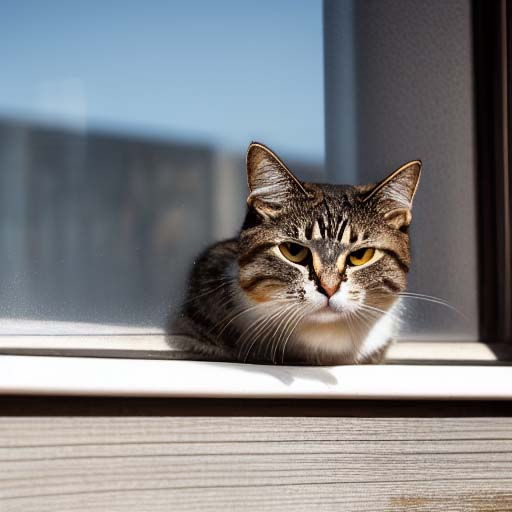
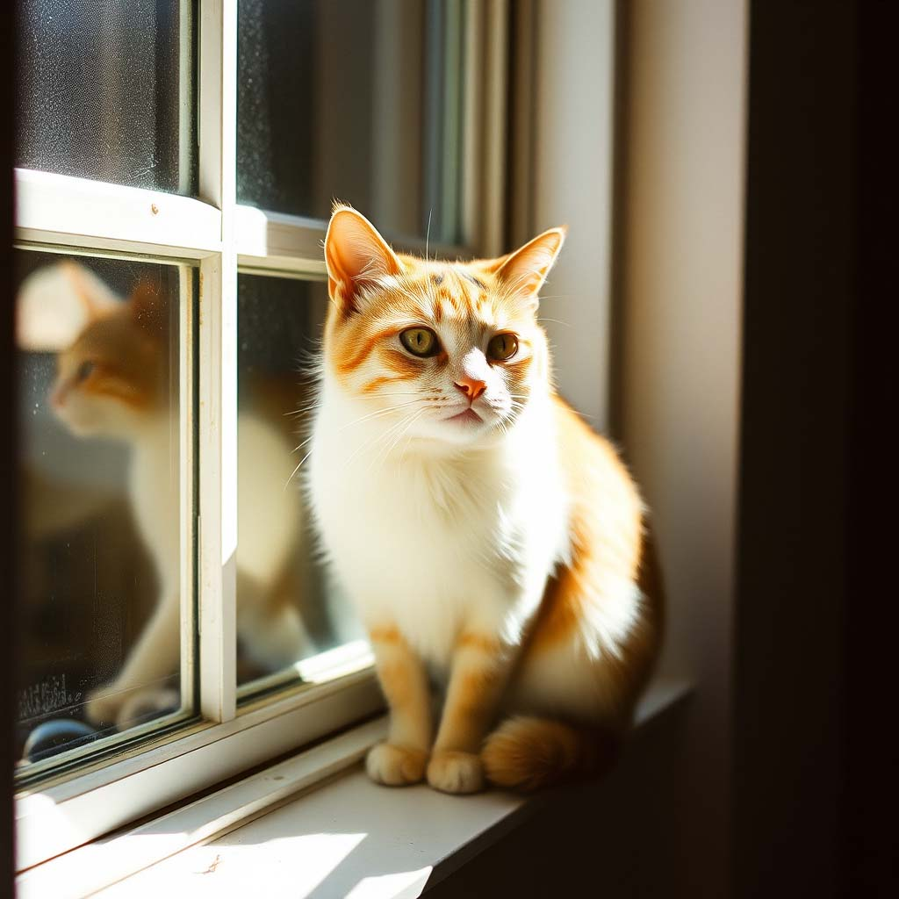
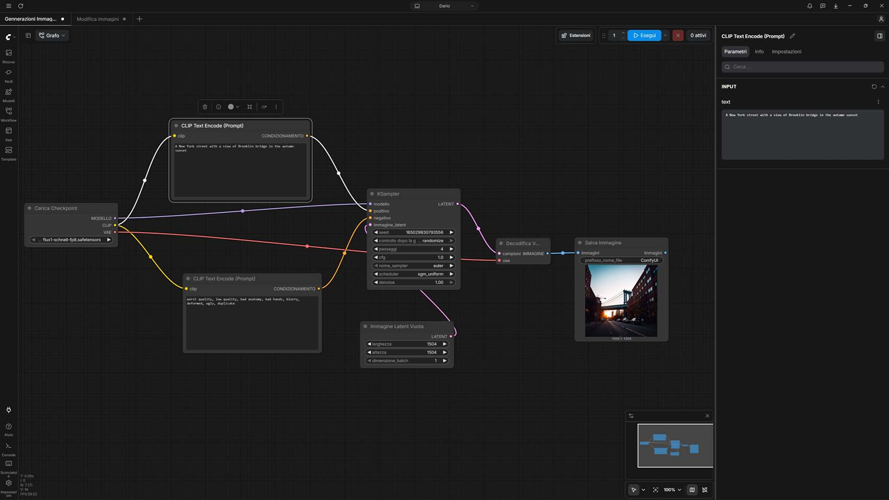

# Immagini fatte in casa con ComfyUI

*Generare un'immagine con un servizio online costa poco, ma costa ogni volta. Lo si paga in crediti che finiscono a metà mese, in piani gratuiti che si ricaricano quando decidono loro, in regole su cosa si può chiedere e cosa no stabilite da qualcun altro. Midjourney, DALL-E e Firefly sono strumenti notevoli, ma hanno in comune la natura dell'affitto: la casa è splendida, però non è mia. Da qui è partito questo esperimento, nato come prova personale e diventato articolo strada facendo. Volevo capire se si possono produrre immagini senza costi per scatto, senza contatori che scendono e senza limiti di credito, usando soltanto il computer che ho sulla scrivania.*

Di ComfyUI avevo sentito parlare tempo fa, poi il nome era scivolato fuori dal radar, come capita alle cose lette una volta sola. Me lo sono ritrovato davanti nei giorni scorsi interrogando, in cerca di spunti, la LLM wiki che aggiorno con Matteo Baccan, un archivio dove ogni giorno incorporiamo notizie sul mondo AI, nel repository [AINews](https://github.com/matteobaccan/AINews). Un archivio fatto bene serve a questo: restituisce ciò che avevi dimenticato di aver dimenticato. La promessa era seducente, un controllo granulare su ogni passaggio della generazione, senza abbonamenti e senza crediti mensili. La domanda vera, però, era un'altra: la mia macchina ce la fa?

La macchina è quella già descritta nella [prima puntata sull'AI in casa](https://aitalk.it/it/qwen3.5-locale-puntata1): un Ryzen 7700, 32 GB di RAM DDR5 e una Radeon RX 9060 XT con 16 GB di memoria video. Niente di esotico, un hardware che molti appassionati riconoscerebbero come proprio. Ha però una caratteristica che nelle prossime pagine pesa parecchio: la scheda è AMD, non NVIDIA, e chi segue questo mondo sa che la differenza non è un dettaglio da fanboy ma una variabile tecnica.

## Nodi, errori e SD 1.5

Ho installato ComfyUI Desktop su Windows, attirato dalla semplicità rispetto alla versione portable. La [documentazione ufficiale](https://docs.comfy.org/installation/system_requirements) lo indica per Windows 10 o successivi con GPU NVIDIA o AMD, e vedere AMD citata con naturalezza è stata già una buona notizia. L'impatto con l'interfaccia, poi, è stato di curiosa familiarità: una tela piena di blocchi collegati da fili è la grammatica di n8n, lo strumento di automazione che conosco e uso per alcuni processi. Cambia il contenuto dei blocchi, non l'idea di fondo, perché ogni nodo riceve qualcosa, lo trasforma e lo passa al successivo.

ComfyUI, per chi non lo conoscesse, è un programma open source che trasforma la generazione di immagini in una catena di montaggio: ogni fase del processo è un blocco, e sta a chi lo usa decidere quali collegare e in che ordine.

Per non partire alla cieca ho chiesto alla versione gratuita di DeepSeek una guida passo passo, dall'installazione al primo flusso di lavoro. Mi è stata utile ma un po' ingarbugliata, perché è arrivata tutta insieme invece che un passo alla volta, e descriveva i blocchi con i nomi inglesi mentre il mio ComfyUI li mostrava in italiano. Quanto di quello che è successo dopo sia colpa della guida e quanto mia, per aver scambiato nodi dal nome simile, non saprei dirlo con onestà. Probabilmente c'è un po' di entrambe.

Il primo inciampo concreto riguardava i modelli. Dove vanno messi? Ho cercato nella cartella di installazione sotto Program Files, quella che sembrava ovvia, e l'ho trovata vuota. I modelli vivono altrove, in una cartella condivisa dentro il profilo utente (nel mio caso sotto `LOCAL/APPDATA`, in Comfy-Desktop e poi ComfyUI-Shared, dentro models). Un dettaglio logico a posteriori e invisibile a priori. Il secondo inciampo era più psicologico: davanti alle migliaia di modelli su Hugging Face e Civitai ho provato la sensazione di entrare in una biblioteca senza catalogo. Ho deciso di cominciare dal più leggero e diretto, Stable Diffusion 1.5, nel file `v1-5-pruned-emaonly-fp16.safetensors`. È un modello del 2022 e si vede. La [scheda ufficiale](https://huggingface.co/stable-diffusion-v1-5/stable-diffusion-v1-5) lo colloca sotto licenza CreativeML OpenRAIL-M, e l'organizzazione che lo ospita si presenta ormai come custode di modelli Stable Diffusion superati.

Ho costruito il primo flusso un blocco alla volta, per capirne la logica. Load Checkpoint carica il modello. CLIP Text Encode traduce il mio testo in numeri comprensibili alla macchina, una specie di interprete simultaneo. Empty Latent Image è la tela di partenza, che però non è bianca ma piena di rumore, con le dimensioni dell'immagine finale. KSampler è il cuore, perché parte dal rumore e lo ripulisce passo dopo passo finché emerge qualcosa di riconoscibile, il principio della [diffusione](https://aitalk.it/it/diffusion-vs-autoregressive) di cui ho già scritto. VAE Decode traduce dal linguaggio interno del modello ai pixel veri e Save Image li salva su disco.

L'errore da principiante è arrivato puntuale: `KeyError: 'g'`. Il messaggio citava un campo, `tokens["g"]`, che esiste soltanto nei modelli SDXL. Avevo piazzato CLIPTextEncodeSDXL al posto di CLIPTextEncode, due nodi dal nome quasi gemello. Mi è tornato in mente *Primer*, il film del 2004 di Shane Carruth dove due ingegneri costruiscono una macchina del tempo in un garage e basta un collegamento fuori posto a far deragliare tutto. Il mio garage era più modesto, ma la lezione identica: sostituito il nodo con quello giusto, tutto ha preso a funzionare. È stato il momento in cui ho capito la logica modulare del software e l'importanza di abbinare il nodo giusto al modello giusto.

Poi è arrivata la prima immagine, dal mio prompt a dir poco banale: "a cat on a windowsill, sunlight", a 1024x1024. Un disastro: tripla testa sovrapposta, dettagli confusi, colori strani. La causa era nella scheda del modello, che racconta un addestramento a 512x512. Tornato a quella risoluzione, ho aggiunto al prompt le parole propiziatorie di rito (masterpiece, best quality, detailed fur, soft lighting, photorealistic) e ritoccato i parametri del KSampler: passi da 20 a 30, CFG da 8 a 7, scheduler da simple a karras. Non so dire quale ingrediente abbia fatto più effetto, come in ogni rituale, ma il risultato è migliorato molto.

*L'immagine creata al secondo tentativo con stable-diffusion-v1-5*

## Flux cambia le regole

La svolta è arrivata con Flux.1 schnell, scelto dopo aver letto della sua qualità superiore. Ho scaricato la versione FP8 in un unico file, un cosiddetto checkpoint all-in-one che raccoglie [modello, codificatore del testo e decodificatore](https://comfy.org/p/supported-models/flux1-schnell-fp8) in un solo pacchetto. Pesa circa 17 GB, e ha un vantaggio decisivo per chi sperimenta: la licenza Apache 2.0, a differenza del fratello dev che è [limitato all'uso non commerciale](https://www.hivenet.com/post/flux-1-dev-cloud-gpu).

La sorpresa è stata scoprire che i parametri imparati faticosamente con SD 1.5 andavano buttati. Con Flux schnell il CFG sta a 1.0, non a 7, i passi sono 4, non 25-30, e la risoluzione di partenza è 1024x1024. La versione schnell è distillata, cioè addestrata a ottenere in pochissimi passi ciò che altri modelli fanno in molti, e per lei vale una forbice di [uno-quattro passi](https://mybyways.com/blog/wow-flux-by-black-forrest-labs). Primo test con lo stesso identico prompt del disastro precedente: qualità molto buona.

Messe una accanto all'altra, la differenza tra SD 1.5 e Flux sul gatto al sole è evidente. Flux capisce il linguaggio naturale molto meglio, non ha bisogno delle parole magiche e produce un'immagine molto più grande, coerente anche con una frase scritta come la direbbe una persona.

C'è però una controindicazione estetica. Flux tende a un look lucidato, quasi da render tridimensionale o da fotografia di repertorio, troppo pulito per sembrare vero. Ho provato a ridurre l'effetto con termini come film grain, raw photo e unedited, con risultati variabili. Non sono il solo a porsi il problema. Krea ha impostato la presentazione di [Krea 2 in versione aperta](https://www.krea.ai/krea-2-open-source) proprio sull'estetica, offrendo il modello come il più curato tra quelli con pesi aperti. È un'affermazione di marketing da prendere come tale, ma racconta che la gara oggi si gioca anche sul gusto e non solo sulla fedeltà al prompt.

Dopo una ventina di prove, i limiti di Flux schnell si sono rivelati meno casuali di quanto pensassi. Le scene statiche gli riescono benissimo, e anche il movimento non lo spaventa: ghepardo, auto in derapata e papera gigante sono usciti bene. Il guaio è il corpo umano in azione dinamica, perché corsa, calcio e sci producono arti che si fondono o si moltiplicano. L'altra debolezza è il testo, tipico del metodo a diffusione. Sono osservazioni mie, su un solo modello e un solo sistema.

*L'immagine creata al primo tentativo con Flux.1 schnell*

## Il muro della VRAM

Poi ho fatto la cosa che fa chiunque abbia appena scoperto un giocattolo nuovo: ho alzato la risoluzione. A 1500 pixel la generazione richiedeva circa un minuto. A 2048 pixel ci volevano cinque o sei minuti. Il salto non è proporzionale: per un'immagine quadrata i pixel totali crescono di poco meno del doppio, il tempo di cinque o sei volte. La spiegazione più plausibile, e sottolineo plausibile perché è un'ipotesi e non una diagnosi, è che a un certo punto la memoria della scheda non basti più e ComfyUI sia costretto a spostare pezzi di modello avanti e indietro tra la VRAM e la RAM di sistema. Il sospetto è rafforzato da un dato semplice: il file di Flux schnell FP8 pesa più dei 16 GB della mia scheda, e una [wiki non ufficiale](https://mintlify.wiki/Comfy-Org/ComfyUI/configuration/hardware-support) indica 12 GB come minimo e 16 come valore consigliato per questo modello. Tradotto: sono al limite, e il limite si sente. I 32 GB di RAM fanno da cuscinetto, ma un cuscinetto lento.

È la presa di coscienza più concreta dell'intera prova. La mia Radeon è potente, ma non illimitata, e con i modelli locali la scelta dell'architettura si fa in base alla memoria disponibile prima ancora che al gusto personale. Il resto lo fanno le versioni quantizzate, copie del modello con numeri meno precisi e quindi più leggere, come il formato FP8 che ho usato o i GGUF di cui parlerò tra poco. Ogni riduzione di precisione è un compromesso tra spazio, velocità e qualità, da valutare a occhio caso per caso.

Mi ha colpito, per contrasto, un'altra mia esperienza recente. Con [OmniVoice Studio](https://aitalk.it/it/omnivoice-studio.html), sullo stesso identico PC, la scheda AMD su Windows è rimasta fuori dai giochi e la sintesi vocale è finita sulla CPU, con circa 200 secondi per dieci secondi di audio. Con ComfyUI è andata molto meglio: la documentazione ufficiale elenca per AMD su Windows i pacchetti ROCm e cita esplicitamente l'architettura RDNA 4 della mia scheda, e io ho usato ROCm senza drammi. Va detto che la già citata wiki non ufficiale definisce sperimentale il supporto AMD su Windows, quindi è un territorio in rapido miglioramento ma non ancora pacificato. La stessa GPU, due destini diversi, a conferma che nell'AI locale conta quanto il software sappia parlare con il silicio.

Questo vale ancora di più per il video, che per ora ho solo osservato da fuori. Nei miei articoli precedenti [Ovi](https://aitalk.it/it/ai-video-generativa-ovi) chiedeva almeno 24 GB di VRAM e [LongCat-Video](https://aitalk.it/it/longcat-video) ne voleva circa 60, o 18 con la quantizzazione a 8 bit su una RTX 4090. Il quadro si sta muovendo. La documentazione di ComfyUI sostiene che Wan 2.2 nella versione da 5 miliardi di parametri [stia in circa 8 GB con lo scaricamento nativo](https://book.st-hakky.com/en/data-science/wan2-2-vram-recommended-config), mentre il repository ufficiale parla di 24 GB; il fratello da 14 miliardi, per girare su 16 GB, richiede secondo le segnalazioni della comunità versioni quantizzate. E il 12 agosto 2026 è arrivato su ComfyUI [LTX-2.5](https://blog.comfy.org/p/ltx-25-day-0-support-in-comfyui), con pesi aperti, audio e video sincronizzati e una promessa dichiarata dagli autori di velocità su hardware consumer. Promessa da verificare con la propria scheda, come sempre.

## Modificare è un altro mestiere

Soddisfatto della generazione da zero, ho provato a modificare un'immagine esistente: una vettura gialla da trasformare in rossa, tutto il resto invariato. Il parametro che regola la faccenda è il denoise del KSampler. Secondo la [documentazione](https://docs.comfy.org/built-in-nodes/KSampler), il sistema aggiunge rumore ai dati dell'immagine originale in base a quel valore e poi lascia che il modello la ridipinga, quindi a valori bassi cambia poco, a valori alti cambia tutto. Con SD funziona come un cursore regolare. Con Flux schnell ho osservato un comportamento a gradino: sotto 0,8 l'immagine non cambiava affatto, a 0,81 il modello riscriveva tutto e perdeva l'auto originale. Zero controllo, molta frustrazione.

Una spiegazione sicura non ce l'ho. Un indizio arriva da una [segnalazione sul forum di FLUX.2 klein 9B](https://huggingface.co/black-forest-labs/FLUX.2-klein-9B/discussions/36), un altro modello distillato a quattro passi, dove un utente descrive artefatti crescenti a denoise bassi e li attribuisce al campionamento in pochissimi passi. Non è lo stesso scenario né lo stesso modello, quindi lo prendo come sospetto e non come verdetto. La mia ipotesi di lavoro è che un modello costruito per fare tutto in quattro mosse abbia poca grana su cui regolare un cursore, e che in ogni caso l'img2img agisca sull'intera immagine e non su una parte. Per modifiche mirate esistono strumenti pensati allo scopo.

Il più promettente è [FLUX.1 Kontext dev](https://bfl.ai/blog/flux-1-kontext-dev), un modello da 12 miliardi di parametri dedicato esclusivamente all'editing guidato da istruzioni testuali, con la stessa licenza non commerciale di Flux dev. Dichiara di poter girare su hardware consumer, ma il conto è presto fatto. Un modello da 12 miliardi occupa nell'ordine dei 24 GB in precisione piena, come il Flux dev che pesa [23,8 GB](https://comfyui-wiki.com/en/tutorial/advanced/flux1-comfyui-guide-workflow-and-examples), circa 12 in FP8 e circa 7 in una quantizzazione GGUF a 4 bit (stime mie, a spanne). Sulla mia scheda l'FP8 sarebbe lento e il GGUF un compromesso interessante. Entrambi restano test da fare.

Nel frattempo è comparsa una strada più comoda. Black Forest Labs ha rilasciato all'inizio del 2026 la famiglia [FLUX.2 klein](https://github.com/black-forest-labs/flux2/wiki), modelli piccoli, da 4 e da 9 miliardi di parametri, pensati per girare su hardware consumer e capaci di generare e modificare immagini. La versione da 4 miliardi è sotto licenza Apache 2.0, quella da 9 sotto licenza non commerciale. Quanta memoria servano davvero dipende dalle fonti: il repository parla di circa 8 GB, la [documentazione ufficiale](https://docs.bfl.ai/flux_2/flux2_overview.md) di circa 13. In entrambi i casi la mia scheda ci sta con comodo, e il prossimo esperimento è già deciso.

*Uno screenshot del canvas di ConfyUi durante i test*

## Libertà con la bolletta

Prima di fare i conti conviene dire cosa sia davvero ComfyUI, perché il mio test ne ha toccato solo la superficie. Il sistema a blocchi non è un vezzo dell'interfaccia ma la sua ragion d'essere: lo stesso modo di lavorare che mi ha fatto generare un gatto serve a modificare un'immagine esistente, come ho tentato con l'auto gialla, e anche al video, che i suoi sviluppatori supportano con aggiornamenti dedicati a ogni nuovo modello importante. Si cambia il compito cambiando i blocchi, non lo strumento. Un flusso si salva, si ripete identico, si condivide e si modifica partendo da modelli già pronti. È la differenza tra un elettrodomestico e un banco da lavoro: il primo fa bene una cosa, il secondo chiede di imparare a usarlo ma lascia costruire ciò che serve. Il prezzo, come si vedrà, è la pazienza.

Se l'esperimento mi ha insegnato una cosa, è che "gratis" è una parola da maneggiare con cautela. I vantaggi del locale sono reali e li ho toccati con mano. Ogni immagine in più non costa nulla di marginale, quindi sperimentare diventa un gesto leggero e si prova senza pensarci, come si fa solo quando nessun contatore corre. I dati e le immagini restano sulla mia macchina. E il controllo è totale, nel senso che ogni parametro è a portata di mano e si impara facendo, anche sbagliando.

Anche l'architettura aiuta. ComfyUI separa nettamente il motore, i modelli e le estensioni, quindi si può cambiare modello senza rifare il flusso o aggiungere funzioni senza toccare il nucleo. Esiste una comunità che produce nodi personalizzati, raccolti in un [registro pubblico](https://registry.comfy.org) e gestiti con ComfyUI-Manager, che nella versione Desktop è [già incluso](https://docs.comfy.org/ko/basic-concepts/custom-nodes) (la documentazione ufficiale, in questo caso, è consultabile in coreano). Esistono flussi di lavoro pronti da modificare, e un trucco che ho trovato elegante: le immagini salvate portano con sé il flusso che le ha generate, quindi basta trascinare un PNG nella tela per riprodurre il lavoro. La riproducibilità, per chi vuole capire e non solo consumare, è un tesoro.

Il rovescio della medaglia è fatto di tre cose. La prima è l'hardware, di cui ho parlato. La seconda è il costo nascosto: la scheda, la corrente, lo spazio su disco, e soprattutto il tempo, che nel mio caso è andato in cartelle sbagliate, nodi scambiati e prove a vuoto. La terza è la frammentazione. Ogni modello ha le sue regole d'uso e la sua licenza: SD 1.5 con OpenRAIL-M, Flux dev e Kontext dev con licenze non commerciali, Flux schnell e klein 4B con Apache 2.0, klein 9B di nuovo non commerciale. Le licenze cambiano, e chi vuole farne un uso professionale deve leggerle con attenzione, non fidarsi di un riassunto.

C'è poi una questione di prospettive. Le aziende che pubblicano modelli aperti spesso li accompagnano con servizi a pagamento: Black Forest Labs offre klein anche [tramite API](https://docs.bfl.ai/flux_2/flux2_overview.md), da pochi centesimi per immagine, e gli stessi pesi che scarico gratis alimentano un listino commerciale. Per chi sperimenta è una buona notizia, perché il locale resta una porta aperta. Chi guadagna di più sono le aziende, che usano la comunità come banco di prova, e i produttori di GPU, in particolare NVIDIA, che nella stessa wiki risulta ancora il riferimento per prestazioni e compatibilità. Chi rischia di restare indietro è chi ha una macchina datata, per cui la libertà del locale è accessibile solo in teoria. Una domanda aperta riguarda il confronto con il cloud: non ho fatto test diretti, ma chiaramente i modelli proprietari di frontiera restano superiori, in particolare con la generazione di figure umane. I due fronti sono due modi diversi di pensare e possedere uno strumento.

*Immagine 1500X1500, ottenuta con Flux.1 schnell, con prompt: "A New York street with a view of the Brooklyn Bridge at autumn sunset."*

## Chi dovrebbe provarci

Consiglierei questa avventura a chi cerca controllo e privacy e non teme di perdere un pomeriggio dietro a un messaggio d'errore. Chi ha almeno 12 GB di VRAM parte in condizioni ragionevoli, e con 16 come me si lavora bene finché non si alza troppo l'asticella. Il profilo ideale è quello del curioso con una predisposizione a sporcarsi le mani, uno che apprezza il momento in cui un nodo trova il suo posto. Lo sconsiglio a chi cerca una soluzione pronta, di quelle in cui si scrive una frase e si ottiene un'immagine senza mai incontrare una variabile, e a chi ha hardware limitato e poca voglia di aspettare.

Il bilancio personale è positivo e con qualche riserva. Ho imparato che il nodo giusto va con il modello giusto, che ogni famiglia di modelli ha il suo vocabolario di parametri e che i numeri su una scheda tecnica raccontano solo metà della storia. Ho ottenuto immagini di buona qualità con Flux partendo da zero. Ho misurato i limiti: la memoria, la complessità, modelli ancora troppo pesanti per alcuni usi. Img2img e video restano evoluzioni future, perché la parte che mi interessava oggi era la creazione "text to image" da zero in locale, e quella ha funzionato.

Mi viene in mente *Dungeon Meshi*, il manga di Ryoko Kui in cui un gruppo di avventurieri attraversa un labirinto cucinando i mostri che incontra, con ciò che trova e imparando le ricette a proprie spese. L'AI in locale ha lo stesso spirito di autosufficienza, e una buona dose di rischio di intossicazione. Non è un'alternativa gratuita ai servizi cloud, è un'altra cosa: un ecosistema dove personalizzazione e apprendimento sono possibili in modo impensabile con un abbonamento. Il prossimo passo è provare klein 4B e un Kontext quantizzato, con il gatto sul davanzale ad aspettare di cambiare colore.

---

*Nota tecnica: i dati su dimensioni, licenze e requisiti sono verificati sulle fonti linkate a ottobre 2026 e possono cambiare. I tempi di generazione sono osservazioni personali su un singolo sistema (Ryzen 7700, 32 GB DDR5, RX 9060 XT 16 GB, Windows, ComfyUI Desktop con ROCm), non benchmark.*
