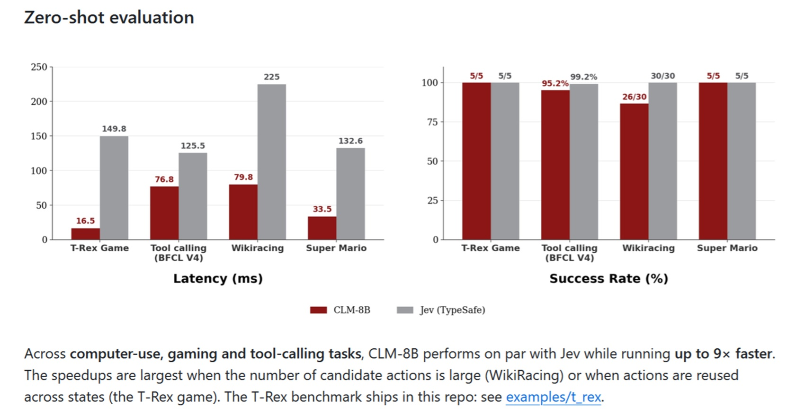
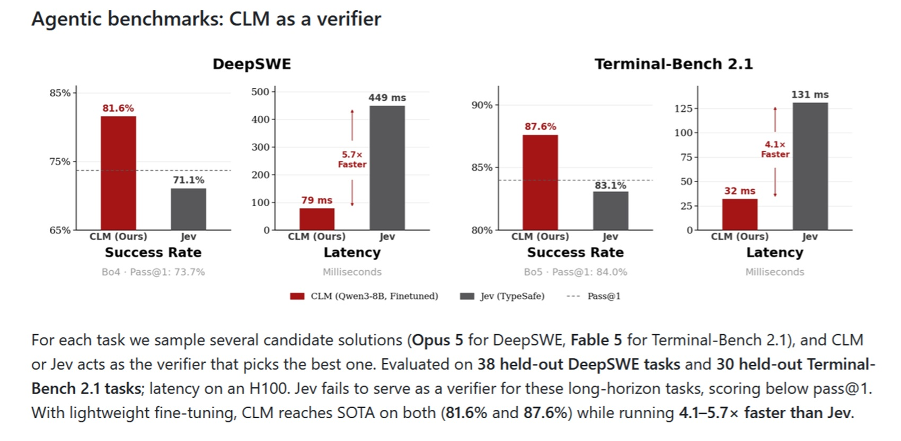
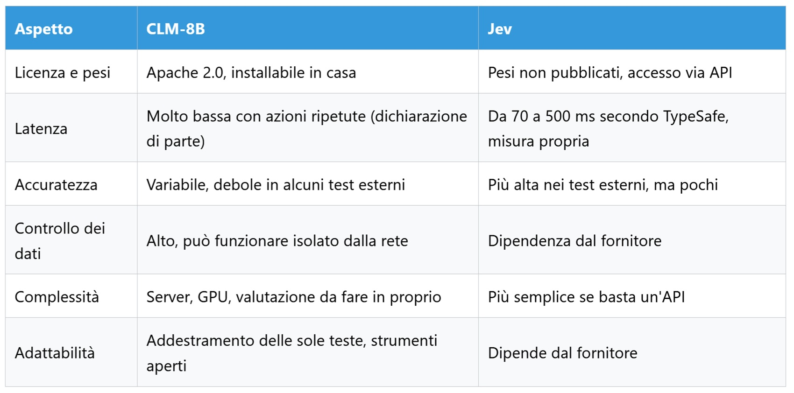

# CLM-8B, the Open Decision-Maker Challenging Jev

*In the [piece on Jev](https://aitalk.it/it/jev), I wrote about a model that gives up words to do one single thing: decide. You give it a situation and a set of possible choices, and it returns a choice with an associated probability, without writing a line of text. TypeSafe, which launched it on September 15, named the category System One, paying homage to Kahneman's fast thinking. Eight days later, a proposal arrived from the opposite camp: [CLM-8B](https://github.com/Contrastive-LM/CLM), released by researchers from Stanford and NVIDIA under the Apache 2.0 license, making it downloadable and self-hostable.*

It would be tempting to dismiss it simply as the "free Jev," but that's a misleading shortcut. Framing it merely as a response to Jev is a journalistic interpretation, not a claim made by its authors. CLM addresses the same core problem—making fast decisions without generating text word by word—but with a distinct architecture and a different purpose. Based on available evidence, it emerges as a specialist rather than a direct replacement.

## Two Encoders, One Cache

To understand the difference, an image helps. In 1975, Brian Eno and Peter Schmidt published Oblique Strategies, a deck of cards containing aphorisms to draw when a creative process gets stuck. The deck remains constant; what changes is the situation in which you consult it. CLM operates similarly: possible actions form a fixed deck, and each new situation is compared against the cards to see which fits best.

Technically, the model uses two distinct readers—one for the situation and one for actions—translating both into coordinates within a shared space. The action closest to the situation wins. This mirrors semantic search engines, trained via an InfoNCE contrastive loss that rewards correct pairings and penalizes incorrect ones. The practical advantage: action coordinates are pre-computed once and kept in memory (the cache), while each incoming request requires reading only the situation.

Jacky Kwok, the project lead, explained to [VentureBeat](https://venturebeat.com/technology/stanford-and-nvidias-open-clm-8b-caches-reusable-agent-actions-and-runs-up-to-9x-faster-than-jev-in-tests) that Jev and a related model, Laya, cache only the situation. CLM's dual-encoder separation offers a greater speedup when contexts and actions are lengthy or reused. This reflects the project author's perspective and remains unverified by third parties: Jev's internal architecture is proprietary, TypeSafe has disclosed neither weights nor model size, and external reconstructions, such as analyst [Archer Hume's](https://archerhume.com/posts/jevs-architecture-unmasked/), remain explicitly speculative.

Caching isn't magic, as the [README](https://github.com/Contrastive-LM/CLM) itself admits. In the authors' benchmarks on an RTX 4090 GPU, processing a completely novel situation takes about 28 milliseconds with or without caching, because it must still be read; when situations repeat, latency drops from roughly 1.7 to 0.6 milliseconds. Gains depend on how frequently an agent revisits identical scenarios (a self-reported claim, unverified by third parties).

## Truly Open Weights?

Here lies the first concrete advantage over Jev, which remains a closed API service. [Weights and code are under Apache 2.0](https://huggingface.co/Contrastive-LM/CLM-v0.1-8B), requiring no contractual agreements and allowing complete on-premise execution. For proponents of local AI and data sovereignty, this is the decisive factor. Yet "open" spans three distinct levels.

The first level is the weights, where CLM delivers—with a caveat. The component trained by the authors is a 75-megabyte file: the heavy lifting is done by Alibaba's Qwen3-8B, a pre-existing base model kept frozen, to which CLM attaches two small prediction heads (one for situations, one for actions). According to the [baobab-tech overview](https://github.com/baobab-tech/decision-models-experiments/blob/main/docs/models/clm-8b.md), running it requires a vLLM server for the encoder, roughly 16 GB of memory, and, as specified by the authors, an NVIDIA GPU. A third-party workaround exists for Mac, while Ollama is unsupported. Local execution is viable, though not trivial.

The second level is evaluation. The repository includes scripts to reproduce tests on code and the T-Rex game, allowing partial verification, though the same overview notes that a dataset cited in the README is missing from the organization's file list. The third level is the ecosystem, which remains immature: the fine-tuning guide is, according to baobab, written for an autonomous agent rather than a human reader; data and training pipelines reside in a separate repository; and training data licenses are unlisted, including 30 million plausible hard-negative responses generated via Gemini 2.5 Flash-Lite, whose terms of service the overview flags as unverified for this use.

[Image from the official GitHub repository](https://github.com/Contrastive-LM/CLM)

## Authors' Claims

All figures in this section reflect self-reported claims from the creators. In zero-shot benchmarks without task-specific fine-tuning, the README claims CLM matches Jev across computer use, gaming, and tool calling, while running up to 9x faster. The standout case is Chrome's dinosaur game: 16.5 milliseconds versus 149.8, with both models scoring 5 out of 5, as they also do on Super Mario. On the BFCL v4 benchmark for tool calling, CLM achieves 95.2% accuracy versus Jev's 99.2%, with execution times of 76.8 versus 125.5 milliseconds. On WikiRacing (navigating between Wikipedia pages via hyperlinks), CLM completes 26 out of 30 trials while Jev finishes all 30, taking 79.8 milliseconds versus 225.

Two honest clarifications are in order. Parity is not uniform: where accuracy diverges, Jev maintains the upper hand, and CLM's speed advantage ranges from 1.6x to 9x depending on the task. Furthermore, CLM was benchmarked on a local GPU while Jev is a hosted cloud service; consulted sources do not clarify whether Jev's latency includes network round-trips—a detail that significantly alters the comparison.

The most striking claim involves code. Following lightweight fine-tuning, the authors report 81.6% on DeepSWE and 87.6% on Terminal-Bench 2.1, compared to Jev's 71.1% and 83.1%. However, those results stem from custom-trained adapter heads rather than the base published model, evaluated on small test suites of 38 and 30 held-out tasks. Crucially, CLM does not solve the problems itself: it selects among candidate solutions generated by larger frontier models—Opus 5 for the first benchmark and Fable 5 for the second. It remains an intriguing result, as it represents the only domain where, according to the authors, CLM surpasses Jev. No independent party has reproduced these numbers yet.

## Field Tests and Third-Party Findings

This brings in third-party evaluations, featuring distinct methodologies and limitations.

The first is [local-jev-bench](https://github.com/tak-bro/local-jev-bench), tested on an M3 Max Mac with 36 GB RAM and summarized in the baobab-tech overview. CLM scored 39% across 105 English decisions, 41% in Korean, and 20% on BANKING77 (a benchmark covering 20 intent categories for banking queries, where random guessing yields ~5%). Two other open-weight models in the same benchmark achieved 89%, 87%, and 89% (Kev-4B) and 81%, 84%, and 80% (AnyJev L0). Note that this is not a comparison against Jev, but against competing open-weight alternatives. Testers also failed to reproduce the README's official urgency example (scoring 0.41 versus the claimed 0.852). Limitations: non-NVIDIA hardware unsupported by the authors and third-party test procedures.

The second is an [evaluation by michabbb](https://gist.github.com/michabbb/da531cc4720d8ec62395fc02dfdd476c) on 140 real-world knowledge graph entity-linking pairs, evaluating binary connectivity between nodes. On 40 ground-truth pairs, CLM achieved an Area Under the Curve (AUC, where 1.0 is perfect and 0.5 is chance) of 0.77 when input texts were truncated to 2,048 tokens, 0.64 on full text, and 0.998 for Jev. CLM agreed with Jev's decision confidence tiers in roughly 44% of cases and never assigned a probability below 0.22. CLM's latency was also higher—0.52 seconds versus 0.28 seconds for Jev—though the setup was unequal: CLM ran on a DGX Spark with prediction heads on CPU, while Jev was called via API. The author notes key caveats: the task differs substantially from CLM's intended use cases, 129 of 140 inputs exceeded the token window, ground-truth labels were generated by an LLM rather than human annotators, no fine-tuning was performed, and the model was v0.1.

The third source includes benchmark aggregators. [BenchLM](https://benchlm.ai/compare/clm-8b-vs-jev-1-13-0) records scores on JevBench of 8.57 versus 63.29 for v1.4 and 1.51 versus 72.13 for v1.5, while declining to rank CLM due to insufficient comparative data. [Benchmark Heaven](https://benchmarkheaven.com/jev-models/clm-8b) ranks CLM 87th out of 92 open-weight decision models, though the site is a personal beta project. Furthermore, JevBench was created specifically around Jev-style model architectures. These represent signals worth monitoring rather than definitive verdicts.

[Image from the official GitHub repository](https://github.com/Contrastive-LM/CLM)

## Why Benchmark Numbers Diverge

It would be wrong to conclude that anyone is lying. In Kurosawa's *Rashomon*, the same incident produces four irreconcilable accounts without any witness acting in bad faith: they simply observe from different vantage points. The same happens here with benchmarks.

Official tests focus on choosing among few repeated actions, tool calling, games, and selecting among candidate responses. Independent tests evaluate broad multi-class classification, real-world support tickets, and judgment over long, structured texts. Key variables shift: input length (which CLM silently truncates beyond its 2,048-token default window), the candidate pool size, and the frequency of action reuse (upon which the cache entirely depends). The execution setup also differs: published model versus custom-trained adapter heads.

Kwok himself acknowledged this candidly: he would not substitute CLM for a general reasoning model when tackling math problems, long texts, or complex planning. VentureBeat highlights another structural constraint: CLM's probabilities are relative strictly to the candidate set provided—if all options are wrong, the model will still select one. My takeaway is this: CLM can excel within its intended domain while performing poorly outside it. How large that domain actually is remains unproven.

## Production Trade-Offs

In fairness, Jev also relies heavily on self-reported figures from TypeSafe: the company classifies its speed and cost metrics as internal, and has published no calibration curves, as I noted in my [previous article](https://aitalk.it/it/jev). On cost, no standardized head-to-head comparison exists, as VentureBeat admits.

Jev remains the more predictable choice for raw accuracy today; CLM is the most compelling option for control, zero marginal cost, and low latency, but demands validation on your specific workload. Who benefits? Organizations handling sensitive data and repeated action patterns. Who takes on risk? Anyone adopting it solely based on headline claims.

## What Is Needed for a Verdict

I state the limitations clearly, as they ground this analysis. I could not run a local test on AMD hardware, which official documentation does not support. Independent benchmarks remain sparse and cover disparate tasks. Reproducible head-to-head tests using identical tasks, prompts, and Jev versions (which has reached 1.13.0) are lacking. Performance following task-specific fine-tuning is undocumented by third parties. We lack worst-case latency figures, real-world deployment costs, memory footprints, and out-of-domain degradation measurements. Finally, the authors announced a larger multimodal sibling, CLM-35B, for early October; as of October 11, it has not appeared on Hugging Face.

## A Selective Alternative, Not a Replacement

CLM-8B is significant because it introduces an open-weight System One alternative into the public domain, backed by an architechturally distinct and auditable design. Latency and open licensing are genuine advantages, particularly for high-frequency agents and controlled deployments. Yet in currently available third-party benchmarks, Jev remains distinctly more reliable for classification, binary judgments, and complex textual tasks.

The right question, then, is not "CLM or Jev?", but whether your workload involves reusable actions, concise candidate sets, and a requirement for on-premise hosting. If the answer is yes, CLM merits a trial benchmarked on your own data. If general zero-shot accuracy is your top priority, Jev remains the safer choice. As with any deck of cards, the card itself matters less than the hand you're playing: measure before you decide.
