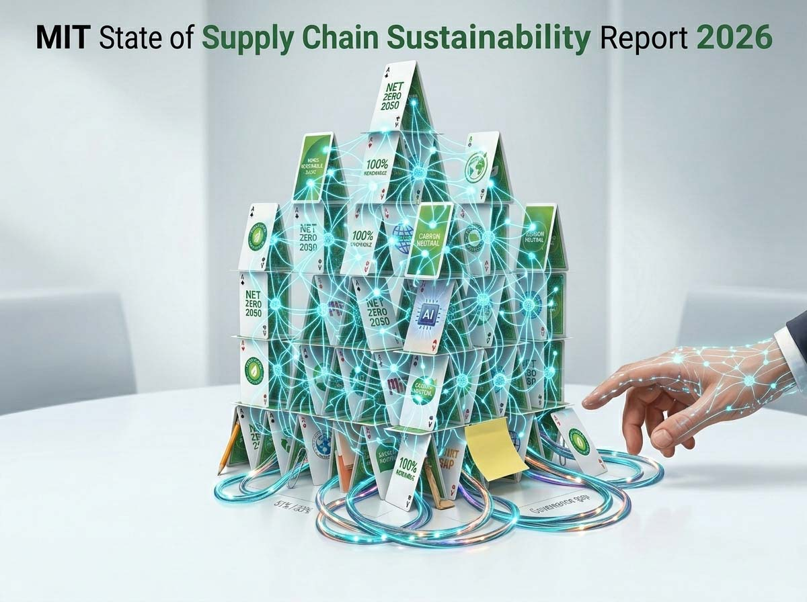
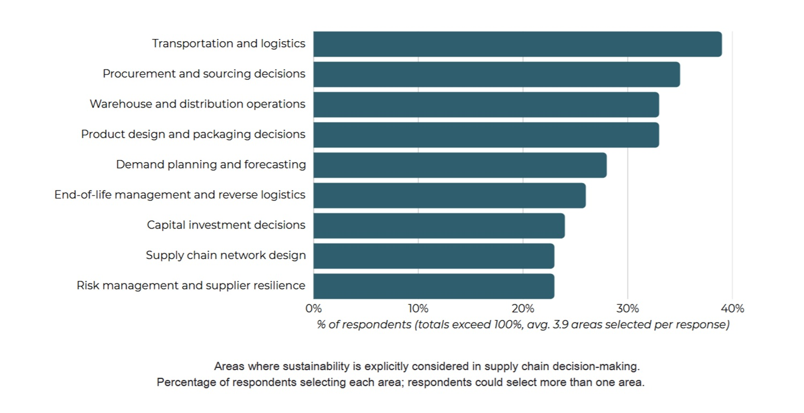
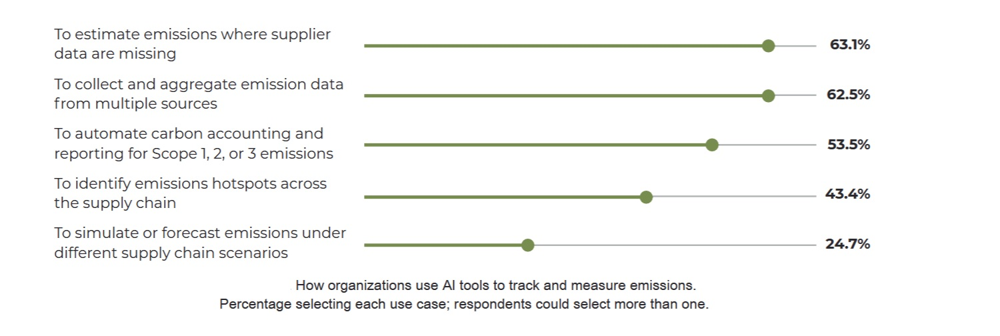

# Più efficiente non significa più sostenibile

*L'intelligenza artificiale entra nelle catene di approvvigionamento promettendo meno sprechi. Il nuovo rapporto del MIT mostra che il bilancio climatico dipende da chi misura, da chi risponde e da che cosa viene davvero misurato. Nessuno osa più dire ad alta voce che la sostenibilità non conta. Nel [rapporto 2026 del MIT Sustainable Supply Chain Lab](https://ctl.mit.edu/state-supply-chain-sustainability-report-2026), settima edizione di un'indagine annuale, l'83% dei professionisti interpellati la giudica importante o molto importante per il successo di lungo periodo, contro l'80% dell'anno scorso.*

Dopo le recenti svolte della politica climatica americana, il 59% dichiara un impegno maggiore e solo il 13% circa uno minore. Fin qui, una buona notizia. Poi il quadro si incrina: il 68% riferisce che l'incertezza sui dazi ha costretto a ritardare, ridimensionare o compromettere le proprie strategie, circa un terzo ha visto le turbative commerciali far crescere le emissioni operative (si cambiano fornitori, si allungano le rotte) e l'84% ritiene che i conflitti armati riducano l'efficacia dell'azione climatica. [Sreedevi Rajagopalan](https://news.mit.edu/2026/state-of-supply-chain-sustainability-report-1015), direttrice del laboratorio e autrice principale, riassume la fase in tre mosse: impegno solido, misurazione in espansione, AI in accelerazione. E avverte che ora viene il difficile, cioè trasformare tutto questo in responsabilità precise.

Prima di fidarci dei numeri conviene sapere da dove arrivano. Sono 1.810 risposte da 91 Paesi, raccolte tra febbraio e aprile 2026 con un campionamento mirato e a valanga, che passa da associazioni professionali, reti del MIT, elenchi di partner e social. Il 29% dei rispondenti lavora in ruoli di sostenibilità, cioè proprio dove l'interesse per il tema è massimo. Non è un controllo indipendente sulle aziende: fotografa percezioni e pratiche dichiarate. I finanziatori sono la fondazione di C.H. Robinson, azienda di logistica, Breakthrough, società del gruppo US Venture, e CO2 AI con Dassault Systèmes, due aziende tecnologiche, e ciascuno firma nel testo una citazione. Il rapporto stesso, infine, dichiara di essere stato preparato con l'aiuto dell'AI per elaborare i dati, calcolare le statistiche, generare le figure e abbozzare i testi, poi validati dagli autori. In un'indagine su ciò che l'AI fa davvero, è un dettaglio da tenere in piena vista.

## Chi risponde delle emissioni

Il secondo divario, spiega il rapporto, è interno. Tra le aziende con obiettivi pubblici, solo il 51% ha un gruppo formale che attraversa le funzioni, il 37% ha un gruppo dedicato con poca presa sul resto e il 12% affida tutto a una funzione sola. Quanto alla vigilanza, il 33% la colloca nel consiglio di amministrazione, il 52% a livello dirigenziale e il 15% non ne ha affatto. Dove il gruppo trasversale esiste, il 57% dice che la sostenibilità entra spesso o sempre nelle decisioni quotidiane; dove la responsabilità sta in un'unica funzione, il 13%. Quarantaquattro punti di scarto che i curatori leggono come il ritorno della governance. Resta però un'associazione: le aziende più convinte potrebbero essere proprio quelle che creano il gruppo, e il rapporto parla infatti di legame, non di causa.

Anche la mappa delle decisioni racconta qualcosa. La sostenibilità pesa soprattutto dove il lavoro è immediato: trasporti e logistica (39%), acquisti (35%), magazzini (34%), progettazione di prodotti e imballaggi (33%). Si assottiglia dove si decide per anni: investimenti, progetto della rete, pianificazione del rischio. Le aziende imparano a gestire meglio le catene, non ancora a disegnarle meglio, e la differenza è enorme, perché scegliere un corriere cambia un trimestre, mentre scegliere dove costruire un impianto vincola le emissioni per lungo tempo. I benefici dichiarati confermano il tono: conformità alle norme (62%), efficienza (61,6%) e visibilità sulla filiera (60,7%) battono la riduzione dei costi (51%). Il caso economico, insomma, regge più per il controllo che per il risparmio.

Chi vince in questo scenario? Chi ha costruito strutture capaci di sopravvivere ai cambi di stagione. Chi perde è chi ha promesso senza attrezzarsi, perché un impegno gestito solo a livello operativo, nota il rapporto, è più facile da lasciar cadere in silenzio quando le condizioni si irrigidiscono. Resta una domanda aperta e scomoda: la governance produce la serietà, o la serietà produce la governance?

## Efficienza locale, emissioni globali

L'intelligenza artificiale entra in questo quadro con numeri vistosi. L'uso di AI industriale, quella che prevede, ottimizza e aiuta a decidere, nelle iniziative di sostenibilità è dichiarato dal 78% dei rispondenti in Nord America, dal 77% in Europa e dal 76% in Asia, Cina esclusa. Nel sottogruppo cinese lo dichiarano tutti, risultato che il rapporto attribuisce alla composizione del campione o alla spinta del governo, non a una stima di popolazione. Tra gli utilizzatori l'87% parla di effetto positivo, l'86% di meno sprechi di materiali, l'81% di meno energia o carburante, mentre il 63% la usa per stimare le emissioni dei fornitori che mancano. Quanto all'impronta dell'AI stessa, il 37% la abbraccia senza riserve, il 47% la usa continuando a pesarne i costi ambientali e il 9% la evita o la limita.

Il rapporto, però, precisa la natura di questi benefici. Chi vede un effetto positivo lo attribuisce all'efficienza operativa (57%), poi alla riduzione delle emissioni (41%), alla misurazione (40%) e, ultime, alle decisioni strategiche (27%). Solo il 25% la impiega per simulare scenari futuri. L'AI, dunque, fa meglio il lavoro che già si faceva, ma non cambia ancora quale lavoro si fa.

Poi arriva la figura 31, che ribalta il tono. Tra gli utilizzatori maturi, quelli con uso esteso o con decisioni integrate e autonome, il 53% percepisce una riduzione delle emissioni totali di gas serra (17% forte, 36% lieve), il 15% nessun cambiamento e il 29% un aumento (21% lieve, 8% forte). I curatori precisano che questo non significa che l'AI causi gli aumenti: significa che migliorare un processo e migliorare il risultato netto sono cose diverse. Va ripetuto con forza, perché sono percezioni e perché, per questo sottogruppo, il rapporto non indica la numerosità.

L'idea che ottimizzare un pezzo non equivalga a migliorare il tutto ha una nobile genealogia narrativa. Ted Chiang, in un [saggio del 2017](https://kottke.org/17/12/ted-chiang-on-the-similarities-between-civilization-destroying-ais-and-silicon-valley-tech-companies) sulle paure per le superintelligenze, immaginava un'AI incaricata di raccogliere più fragole possibile che, per riuscirci, trasforma la Terra in campi di fragole; la sua tesi è che quel mostro somigli alle aziende che inseguono un solo obiettivo senza guardare altro. Il rapporto del MIT non evoca mostri, ma l'avvertimento è affine: un sistema che spreme un indicatore può peggiorarne un altro, se nessuno gli ha chiesto di guardarlo. Lo stesso rischio compare nell'[analisi dell'Agenzia internazionale dell'energia](https://www.iea.org/reports/energy-and-ai/executive-summary), che per i trasporti cita l'effetto rimbalzo: le auto autonome, più efficienti, potrebbero sottrarre passeggeri al trasporto pubblico.

[Immagine tratta dal report ufficale](https://ctl.mit.edu/state-supply-chain-sustainability-report-2026)

## Magazzini, o Factorio reale

Il banco di prova più nitido è il magazzino, e per raccontarlo vale l'esempio di Factorio, il videogioco in cui si costruisce una fabbrica sempre più vasta su un pianeta alieno. Ogni macchina che lavora emette inquinamento, la nube attira gli abitanti ostili e, secondo la [documentazione ufficiale](https://wiki.factorio.com/Pollution), l'inquinamento prodotto dalle macchine fa crescere anche l'evoluzione dei nemici. Automatizzare di più vuol dire produrre di più, e finché non si guarda il contatore dell'inquinamento successo e problema crescono insieme.

I dati, circa 368 risposte di aziende con magazzini o distribuzione, in prevalenza grandi reti di più sedi, sembrano scritti dal progettista del gioco. Il 40% dei magazzini opera a un livello avanzato o completamente automatizzato, e tra quelli che usano l'AI il 71% la lascia agire, in parte o in larga parte, in autonomia. La si impiega soprattutto per ottimizzare le scorte (64% per l'AI industriale, 56% per quella agentica, cioè capace di eseguire decisioni) e per gestire l'energia (52% e 45%), mentre il monitoraggio delle emissioni in tempo reale chiude la classifica (36% e 26%). Dopo l'adozione dell'AI, tra i magazzini a automazione moderata il 59% segnala più energia e il 54% più rifiuti; tra quelli avanzati o completamente automatizzati si sale al 78% e al 76%. Dentro questo secondo gruppo, chi gestisce al massimo dieci magazzini riferisce aumenti nel 92% dei casi per entrambe le voci, chi ne gestisce di più nel 65% e nel 59%, con circa un quarto che vede un calo. Il rapporto sintetizza: la scala sembra attenuare il prezzo.

Il testo è onesto sui limiti. I dati non permettono di distinguere tra due spiegazioni: l'AI autonoma spinge le macchine più a lungo e più forte, oppure i magazzini che le concedono più autonomia sono già i più grandi e veloci a crescere, e consumi e scarti sarebbero saliti comunque. L'effetto rimbalzo, dunque, qui è un'ipotesi, non un risultato.

Il dato più rivelatore riguarda lo sguardo. L'88% dei magazzini dice di misurare la sostenibilità, ma solo il 24% usa un sistema con sensori o AI in tempo reale, il 49% si affida a software parzialmente automatizzato e un altro 24% a fogli di calcolo e rendiconti annuali. Attenzione: quel 24% riguarda tutti i magazzini del campione, non solo i più automatizzati, come il comunicato di presentazione lascia intendere. Ne segue che gli aumenti di consumo potrebbero emergere con grande ritardo. A guadagnarci sono gli operatori che ottengono produttività, visto che i rispondenti indicano proprio spazio e robotica tra i ritorni economici più forti; a rischiare di più sembrano i più piccoli. Quanto sia merito dell'AI e quanto della crescita, nessuno lo sa ancora.

## Camion, fornitori, stime

Nei trasporti l'AI non è la protagonista, e il rapporto non dice quanta parte dell'ottimizzazione usi davvero strumenti di AI. Tra circa 348 risposte del settore, il 76% ha le rotte ottimizzate a regime, mentre consolidamento dei carichi, programmi per gli autisti e requisiti ai vettori superano il 67%. Eppure il 43% fa girare flotte interamente o prevalentemente a diesel, solo il 19% ha superato metà dell'energia a basse emissioni e l'8% ha completato la transizione. Il rapporto lo riassume così: la prima fase ha sfruttato meglio i mezzi esistenti, la seconda dovrà cambiare i mezzi. Il confine tra Europa e Nord America passa dai capitali: i veicoli elettrici a batteria sono a regime nel 60% delle aziende europee e nel 36% di quelle nordamericane, i carburanti alternativi nel 63% contro il 50%, e l'84% delle europee giudica positivo l'effetto delle politiche recenti, contro il 44%. Dall'altra parte dell'Atlantico solo il 16% lo giudica negativo, mentre il 40% non sa o non vede effetti: più confusione che resistenza. L'idrogeno è a regime nel 6% dei casi, escluso dall'8%. L'AI può accorciare i chilometri a vuoto, ma non sostituisce il combustibile.

Nello Scope 3, cioè le emissioni indirette lungo la filiera, la parte più grande e difficile di ogni impronta, il progresso è più nitido. La partecipazione a programmi congiunti con i fornitori è salita dal 31% al 58% in un anno, le intese sui fornitori condivisi dal 23% al 55%, le alleanze tra settori dal 28% al 47%, e chi lavora del tutto da solo è sceso dal 18% al 6%. Sugli strumenti, invece, il rapporto avverte che le domande del 2025 e del 2026 usano metriche diverse e non vanno lette come crescita: oggi circa il 75% usa abitualmente fogli di calcolo e una quota simile software dedicati, e i primi non se ne sono andati.

Qui l'AI ha il ruolo più delicato. Il 63% la usa per stimare le emissioni dove i dati dei fornitori mancano. Chi la usa per tracciare le emissioni si dice molto fiducioso nell'accuratezza dei propri conti Scope 3 nel 50,5% dei casi, contro il 15,3% di chi non la usa; il rapporto non stabilisce causalità. Fiducia, però, non è accuratezza, e una stima fondata su medie di settore può servire a decidere le priorità senza dimostrare riduzioni vere. Questa è una nostra lettura, non una conclusione del rapporto. Le cifre sui risparmi dell'AI applicata, nel testo, vengono dall'amministratrice delegata di CO2 AI, che cita stime di BCG e McKinsey: sono voci di sponsor e consulenti, non dati del sondaggio. Chi ne trae vantaggio è chi avrà un quadro più completo per scegliere dove intervenire. Resta aperto chi verifichi le stime, e chi ne risponda se si sbagliano.

[Immagine tratta dal report ufficale](https://ctl.mit.edu/state-supply-chain-sustainability-report-2026)

## Il conto energetico

Nessun bilancio dell'AI nelle filiere può ignorare il costo dell'AI stessa, e il rapporto del MIT lo misura solo come atteggiamento, non come impronta. Per i numeri bisogna guardare all'[Agenzia internazionale dell'energia](https://www.iea.org/reports/energy-and-ai), rapporto dell'aprile 2025: nel 2024 i centri dati hanno consumato circa 415 terawattora, l'1,5% dell'elettricità mondiale, e nello scenario di base saliranno a circa 945 entro il 2030. Le loro emissioni da elettricità passerebbero da 180 a 300 milioni di tonnellate entro il 2035, fino a 500 nello scenario più spinto, restando sotto l'1,5% di quelle del settore energetico ma tra le voci a crescita più rapida. Sul versante opposto, applicare largamente le soluzioni di AI già esistenti potrebbe evitare emissioni pari a circa il 5% di quelle energetiche nel 2035: più delle emissioni dei centri dati, molto meno di quanto serva. La conclusione dell'agenzia è doppia: gli allarmi sul clima sembrano esagerati, ma lo sono anche le attese che l'AI risolva da sola il problema.

Il fronte critico è diverso. L'analista Ketan Joshi, in un rapporto commissionato da una coalizione di organizzazioni ambientaliste, [ha esaminato](https://www.aa.com.tr/en/energy/general/74-of-big-techs-ai-climate-claims-unproven-report/54775) 154 dichiarazioni pubbliche sui benefici climatici dell'AI e ne ha trovato il 74% non dimostrato; solo il 26% rimanda a ricerche accademiche e il 36% a nessuna prova. La sua obiezione più interessante è che gran parte delle promesse riguarda l'AI tradizionale, assai meno energivora, mentre gli impatti dell'AI generativa vengono sfumati da etichette generiche che mettono tutto nello stesso sacco. Tra le fonti esaminate figura anche l'IEA, e va detto che la committenza è militante. Il [rapporto completo](https://algorithmwatch.org/en/ai-climate-hoax/) è pubblico.

Il MIT, dal canto suo, non distingue l'AI generativa: parla di AI industriale e agentica, cioè di decisioni su produzione, acquisti e magazzini. Il confronto è dunque asimmetrico, perché Joshi punta l'AI di consumo e i dati dei magazzini descrivono altro. Questo non lo smentisce né lo conferma, ma mostra quanto la sigla sia troppo larga per un bilancio serio. L'IEA aggiunge un dettaglio che non va dimenticato: le reti elettriche sono già sotto sforzo e circa il 20% dei progetti di centri dati rischia ritardi, quindi l'impatto è locale prima che globale.

## Misurare prima di automatizzare

Che cosa dovrebbe fare un'azienda? Il rapporto non detta ricette puntuali, ma i suoi dati ne suggeriscono un cammino. Si comincia dalla struttura: un gruppo trasversale con il potere di decidere e non solo di consigliare, e una vigilanza che arrivi al consiglio di amministrazione, legata a obiettivi, bilancio e gestione del rischio. Si prosegue allargando lo sguardo oltre trasporti e acquisti, verso investimenti e progetto della rete, dove si fissa l'impronta degli anni a venire. Poi la regola per l'AI: stabilire in anticipo che cosa si misura (energia, emissioni dirette e indirette, rifiuti, fornitori), mettere monitoraggio continuo accanto all'automazione, soprattutto in magazzino, e trattare le stime come ipotesi da confermare con dati primari. Infine gli indicatori: contare l'emissione netta e non solo l'efficienza, perché è il numero che nei dati diverge. Tutto questo costa, e le grandi reti sembrano cavarsela meglio: ci si può chiedere se la sostenibilità dell'AI diventerà un privilegio di scala.

Restano i controargomenti. L'AI è giovane, ed è vero, ma l'adozione è già diffusa. I dati sono dichiarati, ed è giusto, per questo li trattiamo come indizi di tendenza e non come prove. Il problema è la mancanza di dati più che l'AI, ed è in parte vero, ma proprio per questo un'AI senza governance rischia di produrre stime non verificate. L'energia dei centri dati è un tema a parte? Non se si valuta la sostenibilità complessiva. E la collaborazione crescente sui fornitori è un segnale buono, da non confondere con una decarbonizzazione verificata.

La tesi si lascia dire in poche righe. L'AI è un amplificatore: amplifica l'efficienza dove i processi sono ben progettati, e amplifica opacità, consumi ed emissioni dove mancano governance, dati e responsabilità. Il rapporto del MIT non dice che l'AI sia incompatibile con la sostenibilità. Dice qualcosa di più interessante, e cioè che una filiera può diventare più efficiente senza diventare più sostenibile. La differenza non la fa il modello, ma chi decide che cosa misurare, chi risponde dei risultati e quali compromessi accetta di pagare.

*Nota tecnica. Salvo diversa indicazione, le cifre provengono dal [rapporto MIT](https://ctl.mit.edu/state-supply-chain-sustainability-report-2026) (settembre 2026, versione 1) e dal [comunicato del MIT](https://news.mit.edu/2026/state-of-supply-chain-sustainability-report-1015) del 15 ottobre 2026. Sono percezioni di un campione non probabilistico, e per i sottogruppi (AI matura, magazzini, flotte) il rapporto non indica sempre la numerosità. Le letture causali e le valutazioni sulla fiducia nelle stime sono nostre.*