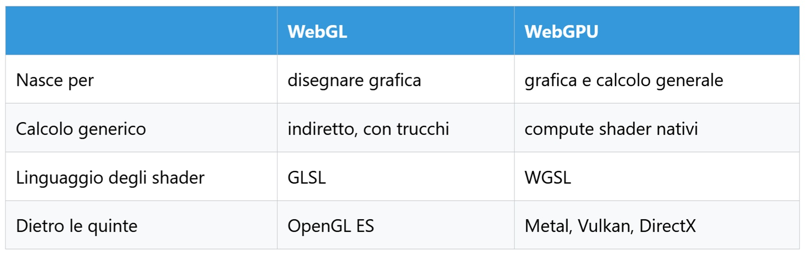
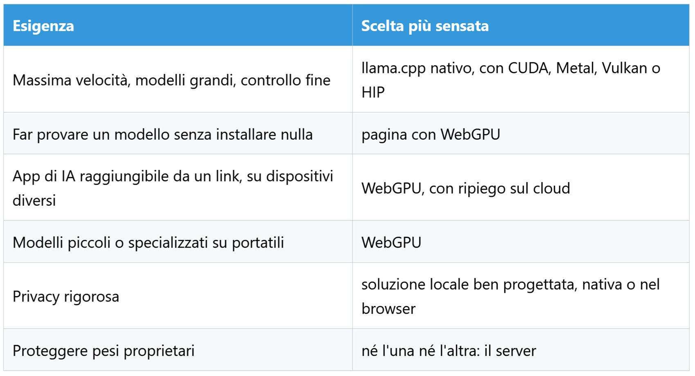

# WebGPU: l'IA nel browser, sulla tua GPU

*Come un sito può far girare un modello linguistico sul dispositivo di chi lo visita, senza installazioni e senza una chiamata al cloud per ogni parola generata. Si apre una pagina, compare una barra di avanzamento che impiega qualche minuto a riempirsi, poi una casella di testo. Si scrive e il modello risponde. Nessun programma da installare, nessuna chiave da incollare, nessun server che sforni parole: a lavorare è la scheda grafica del computer che si ha davanti, guidata da una pagina web. Alla visita successiva la barra quasi non si vede, perché i pesi del modello sono rimasti sul disco, in uno spazio che il browser riserva a quel sito.*

Il protagonista di questa scena si chiama WebGPU, e conviene dire subito cosa non è. Non è un modello, non è un formato di file, non è un programma da installare. È un'interfaccia che il browser offre alle pagine web per parlare con la scheda grafica, sia per disegnare sia per fare calcolo parallelo generico, definita dalla [specifica del W3C](https://www.w3.org/TR/webgpu/). Scaricare i pesi, conservarli, tradurre il testo in numeri e viceversa spetta ad altri pezzi della filiera. Questo articolo li mette in fila tutti, con i numeri oggi disponibili e un onesto sguardo ai limiti.

## La GPU entra nel browser

Per capire perché la scheda grafica serva all'intelligenza artificiale, aiuta l'immagine della cucina. Il processore è uno chef di grande esperienza, che prepara un piatto alla volta con gesti perfetti. La GPU è una cucina con migliaia di aiutanti, ciascuno capace di una sola operazione semplice ma tutti al lavoro nello stesso istante. Un modello linguistico passa il suo tempo a moltiplicare tabelle di numeri, un compito che si spezza in milioni di conti indipendenti: è la serata ideale per la brigata, non per lo chef.

Il browser, però, per anni ha saputo parlare con la GPU soprattutto per disegnare. Con WebGL, chi voleva usarla per altri calcoli doveva travestire i numeri da pixel e i conti da effetti grafici. WebGPU cambia impostazione, perché affianca alla grafica i compute shader, piccoli programmi scritti in un linguaggio chiamato WGSL che la GPU esegue per qualsiasi calcolo, non solo per colorare triangoli.

Tra la pagina e il silicio corre una rete di condotti non troppo diversa da quella di *Brazil*, il film di Terry Gilliam in cui ogni richiesta attraversa uffici e tubature prima di produrre un effetto. Il sito parla WebGPU, il browser traduce verso Metal su Apple, Vulkan su Linux e Android, DirectX su Windows, e a farlo sono motori diversi: [Dawn](https://dawn.googlesource.com/dawn) nei browser basati su Chromium, [wgpu](https://github.com/gfx-rs/wgpu) in Firefox, un'implementazione propria di WebKit in Safari, come descrive il [preprint di cui parleremo più avanti](https://arxiv.org/html/2605.20706v1).

Il traguardo che rende sensato parlarne oggi è la copertura dei browser. Come ricorda [web.dev](https://web.dev/blog/webgpu-supported-major-browsers), Chrome ed Edge supportano WebGPU dalla versione 113 su Windows, macOS e ChromeOS, mentre su Android serve Chrome 121 e almeno Android 12. Firefox lo offre su Windows dalla versione 141 e sui Mac con processore ARM dalla 145, Safari lo ha introdotto con la versione 26 su tutti i sistemi Apple. Le [note di Khronos](https://www.khronos.org/developers/linkto/webgl-and-webgpu-sigg26) collocano Firefox su Windows a luglio 2025 e Safari a settembre 2025, e aggiungono che Chromium ha esteso il supporto a Linux con le GPU Intel di dodicesima generazione e successive a gennaio 2026. Restano indietro Firefox su Linux e Android, ancora in lavorazione secondo web.dev. Chi sviluppa deve quindi prevedere un piano di riserva per chi non rientra in questi elenchi.

## Dal download ai token

Il percorso dell'IA nel browser segue una sequenza precisa. La pagina verifica che WebGPU esista e che la GPU sia adatta, poi scarica il modello da un server o da una rete di distribuzione dei contenuti, lo conserva nello spazio del browser e lo carica in memoria grafica. Quando l'utente scrive, il testo viene spezzato in token, cioè frammenti di parola, i calcoli girano sulla GPU tramite WebGPU e i token prodotti vengono ricomposti in frasi. Un dettaglio che spesso si perde: WebGPU non scarica nulla e non salva nulla, fa soltanto il calcolo. Il resto lo fanno le normali interfacce di rete e di archiviazione del browser.

A mettere insieme i pezzi sono librerie JavaScript. [WebLLM](https://arxiv.org/abs/2412.15803), nato nel progetto MLC, offre un'interfaccia simile a quella delle API di OpenAI e usa WebGPU per la scheda grafica e WebAssembly per i compiti sulla CPU. [Transformers.js](https://huggingface.co/docs/transformers.js/index) poggia su ONNX Runtime, e [wllama](https://github.com/ngxson/wllama) porta nel browser i modelli di [llama.cpp](https://github.com/ggml-org/llama.cpp), nato per eseguirli su CPU e oggi dotato anche di un backend WebGPU. Il post di web.dev già citato conferma che ONNX Runtime e Transformers.js sfruttano WebGPU per l'inferenza locale.

Dentro il calcolo si distinguono due fasi, e la differenza conta. Nel prefill il modello legge l'intero prompt in un colpo solo, e a dominare sono le moltiplicazioni tra matrici. Nel decode produce un token alla volta, e il lavoro diventa moltiplicare matrici per vettori. Le misure del preprint su un Apple M3, con un modello da un miliardo di parametri compresso a quattro bit, mostrano che le prime occupano il 92,6 per cento del tempo di prefill e le seconde l'89,9 per cento del decode. Il decode, inoltre, è limitato soprattutto dalla velocità con cui si leggono i pesi dalla memoria, ed è per questo che comprimerli aiuta: si spostano meno byte.

Qui si annida la differenza tra accesso e prestazione. WebGPU, nota il preprint, offre portabilità funzionale ma non portabilità delle prestazioni: lo stesso codice gira ovunque, non ovunque alla stessa velocità. Servono pesi compressi, calcoli scritti con cura per ogni famiglia di GPU, una gestione attenta della memoria. Al primo avvio c'è poi un costo una tantum, la compilazione dei programmi per la GPU, che gli autori stimano tra uno e cinque secondi.

## Dove finiscono i pesi

Dopo il download i pesi non svaniscono. La [guida di Chrome alla conservazione dei modelli](https://developer.chrome.com/docs/ai/cache-models) ricorda quanto siano ingombranti: un file da 1,35 gigabyte, come una versione compressa di Gemma 2B, è considerato piccolissimo per un modello linguistico. Per tenerli sul dispositivo esistono tre strade, la Cache API, l'Origin Private File System e IndexedDB. Il team di Chrome consiglia in generale la prima e giudica IndexedDB la peggiore per i file grandi.

Non si tratta quindi di un file da cercare in una cartella. L'Origin Private File System è, secondo la stessa guida, privato per il sito e invisibile all'utente. Questo non significa che il contenuto sia un formato esotico: wllama, per esempio, conserva in quello spazio modelli nel formato GGUF di llama.cpp, come racconta il preprint. Semplicemente non li si vede con il file manager.

Chiudere la scheda libera la memoria di sistema e quella video, ma i file restano. Chiudere il browser non cambia nulla, e alla visita successiva il sito può ricaricare il modello dalla copia locale. A cancellarla sono le impostazioni del browser oppure il browser stesso: se il sito non ha chiesto e ottenuto la conservazione persistente, avverte la guida di Chrome, i dati possono essere eliminati quando lo spazio scarseggia.

Ogni sito ha il suo spazio. Le [FAQ di webllm.io](https://webllm.io/docs/faq/), un kit di sviluppo indipendente che si appoggia al motore di MLC e non va confuso con il progetto originale, precisano che i modelli sono isolati per origine, quindi inaccessibili agli altri siti e cancellabili dalle impostazioni, con download tra 1,5 e 4,5 gigabyte a seconda della potenza del dispositivo. Ne consegue, ed è una deduzione e non una misura, che lo stesso modello scaricato da due siti diversi possa occupare spazio due volte. Il browser somiglia al castello errante di Howl, la casa di Miyazaki che cammina portandosi dietro tante porte, ognuna aperta su un luogo diverso e ognuna con la propria serratura.

## Chi paga il calcolo

Eccoci al nodo economico. Se l'inferenza avviene sul dispositivo, il fornitore distribuisce il modello come un file statico e lascia elettricità, calore e tempo di calcolo a chi usa il servizio. È un ragionamento e non un dato misurato, ma regge: ogni sessione locale è una sessione in meno da servire con GPU in affitto. Gli autori del preprint ricordano che l'esecuzione locale può migliorare latenza ed efficienza energetica, citando studi di terzi, il che lascia aperta una domanda alla quale nessuno qui risponde: il bilancio complessivo, tra pochi data center e milioni di portatili, migliora davvero?

Il server, comunque, non sparisce. Resta proprietario della pagina, degli account, degli aggiornamenti e dei file del modello, e quei file pesano: il costo di banda per consegnare qualche gigabyte a ogni nuovo visitatore non evapora, si sposta dal calcolo al trasferimento. Non a caso la documentazione di webllm.io descrive un'architettura ibrida, con ripiego sul cloud quando WebGPU manca o la scheda non basta. Lo stesso testo avverte che l'esecuzione locale richiede intestazioni di isolamento, dette COOP e COEP, perché usa la memoria condivisa: un requisito che il gestore del sito deve impostare e che può avere effetti sulle risorse esterne incluse nella pagina.

Chi vince, allora, e chi perde? Sono scenari e non previsioni. Vincono i fornitori di servizi leggeri, che alleggeriscono la bolletta cloud, gli utenti con una buona scheda, che ottengono risposte immediate e dati che restano a casa, e i produttori di GPU, per i quali la memoria video diventa un argomento di vendita. Perdono gli utenti con hardware datato, condannati al ripiego sul cloud o a un'esperienza lenta, e chi vive di GPU in affitto per l'inferenza leggera.

## Limiti, numeri alla mano

Il dato più completo oggi disponibile arriva dal preprint [Llamas on the Web](https://arxiv.org/html/2605.20706v1), uscito su arXiv a maggio 2026 da un gruppo dell'Università della California a Santa Cruz con un coautore di Microsoft Research. Va letto con due cautele: non ha ancora superato una revisione paritaria, e gli autori sono gli stessi che hanno scritto il backend WebGPU di llama.cpp, quindi misurano anche il proprio lavoro. La mole è però notevole: sedici dispositivi di otto produttori, dieci modelli, circa venticinque ore di prove.

Il primo risultato è il più utile a chi si aspetta miracoli. Contro i backend nativi di llama.cpp, WebGPU perde nettamente su alcune GPU: CUDA e Vulkan lo superano fino a dieci volte nel prefill e due volte e mezza nel decode, grazie ai tensor core, unità dedicate al calcolo matriciale, e a funzioni specifiche dei costruttori. Su Apple, Metal vince di oltre due volte nel prefill e del 50 per cento nel decode. Ma il quadro non è a senso unico: sempre secondo il preprint, su Mac WebGPU supera Vulkan tradotto via MoltenVK fino al 59 per cento in prefill e al 45 in decode, e su una scheda AMD il backend Vulkan resta indietro di tre volte in prefill rispetto a WebGPU pur battendo il nativo HIP in decode. Su una Intel, WebGPU supera SYCL del 23 per cento in prefill, ma con i controlli di sicurezza disattivati, una condizione che nel browser non esiste.

Quei controlli hanno un prezzo. I compilatori WebGPU aggiungono verifiche contro gli accessi fuori memoria e le divisioni per zero, e togliendole in prova si è visto che costano in media il 14 per cento del prefill con il modello compresso e il 23 con quello a precisione piena, fino al 42 su una RTX 5080, mentre nel decode l'effetto va dall'1 al 5 per cento. È il prezzo di una sandbox: una pagina web non deve poter leggere dove non le compete.

C'è poi la questione WebLLM. Il suo [articolo](https://arxiv.org/abs/2412.15803) sostiene che possa mantenere fino all'80 per cento delle prestazioni native, mentre il [blog di MLC](https://blog.mlc.ai/2024/06/13/webllm-a-high-performance-in-browser-llm-inference-engine) parla di fino all'85 per cento rispetto a Metal su un MacBook Pro M3 Max, con entrambi i motori compilati dallo stesso strumento. Non contraddicono il preprint di Santa Cruz: misurano contro basi diverse, e vanno confrontati con prudenza.

Tra i runtime del browser, il confronto del preprint è meno lusinghiero per gli altri che per gli autori. Il loro backend genera testo più in fretta, tra il 45 e il 69 per cento in più nel decode su quattro GPU di produttori diversi, e usa dal 29 al 33 per cento di memoria in meno, ma nel prefill resta indietro, dal 21 al 51 per cento, perché le istruzioni matriciali più veloci, dette subgroup matrix, non sono ancora nelle versioni stabili dei browser. Per WebLLM e Transformers.js gli autori segnalano inoltre picchi di memoria vicini ai dieci gigabyte in alcune configurazioni, che attribuiscono a probabili perdite. Sono misure su versioni precise: oggi potrebbero essere cambiate.

Per i telefoni il quadro è più stretto. Su iPhone una scheda di Safari dispone di meno di 500 megabyte, e le GPU più modeste, fra iPhone e Android, hanno fatto girare soltanto i quattro modelli più piccoli della batteria di prova, con 4-17 token al secondo in decode. Sulle GPU di fascia alta i modelli piccoli superano i 3000 token al secondo in prefill e i 100 in decode, mentre il più grande provato, un Gemma 4 da circa 3 gigabyte, scende a 65 e 30.

Pesa anche la scelta del browser. Su un Mac con chip M3 lo stesso modello gira a circa un token al secondo su Firefox, contro i circa 52 di Chrome, e gli autori hanno escluso Firefox dalle misure per questo motivo. È un dato singolo e non una sentenza, ma dice che "supporta WebGPU" e "va bene quanto Chrome" non sono la stessa frase.

Infine i limiti del linguaggio. WGSL non conosce ancora il formato bf16, né gli interi a otto e sedici bit, né i tipi a quattro bit che le GPU recenti usano nativamente, per cui vanno emulati. Ne deriva un effetto controintuitivo documentato dal preprint: in WebGPU la compressione dei pesi serve soprattutto a far entrare il modello in memoria, non a velocizzarlo, tanto che passare da quattro a due bit su hardware di fascia media costa il 17 per cento di velocità in decode.

## Privacy con riserva

Il vantaggio più citato è la privacy, ed è reale ma condizionato. Conviene separare tre affermazioni che nei comunicati si fondono. La prima è che il calcolo sia locale, e questo WebGPU lo rende possibile. La seconda è che l'applicazione non invii altrove prompt, risposte o metadati: dipende dal sito, non dalla tecnologia. La documentazione di webllm.io, per esempio, assicura che nella modalità solo locale non viene trasmesso alcun dato per l'inferenza, ma nello stesso prodotto convive la modalità con ripiego sul cloud, e la configurazione decide quanto la promessa valga. Se il testo finisce a un servizio di ricerca, moderazione o registrazione, la località svanisce.

La terza è che il modello sia protetto, e qui la risposta è no. La guida di Chrome osserva che i dati conservati nella cache o in IndexedDB si estraggono senza fatica con gli strumenti per sviluppatori e che cifrarli non risolve, perché la chiave deve comunque raggiungere il dispositivo. Chi deve proteggere un modello proprietario, conclude, lo tenga sul server.

## Browser o nativo?

Dove sta dunque la convenienza? Dipende da cosa si cerca, e la tabella prova a riassumerlo con le cautele del caso.

Le due strade, intanto, si avvicinano: il backend WebGPU di llama.cpp è entrato nel progetto attraverso oltre cento contributi e porta nel browser gli stessi modelli GGUF delle app native. Anche gli standard si muovono. Gli aggiornamenti raccolti da Khronos segnalano estensioni legate ai subgroup, i gruppi di thread che cooperano, comparse in Chrome 144 e 145, cosa diversa dalle istruzioni matriciali che il preprint attende. Un'altra via è quella delle API di IA integrate di Chrome, come Prompt, Summarizer e Translator, elencate nella [documentazione dedicata](https://developer.chrome.com/docs/ai/built-in): funzioni offerte dal browser ai siti, invece di modelli portati da ciascun sito. Quanto questo percorso conviva con WebGPU è una domanda aperta.

## Il tuo PC, il tuo server

La prima conclusione è modesta. Per chi vuole la massima velocità, i modelli più grandi e il pieno controllo, WebGPU non sostituisce llama.cpp o LM Studio: i numeri lo dicono con onestà, visto che nel prefill il vantaggio dei backend nativi può arrivare a un fattore dieci e che i telefoni reggono solo modelli minuscoli. La seconda è più interessante. Per la prima volta i principali browser sanno parlare con la GPU, e questo rende plausibile un modo nuovo di distribuire l'IA: un indirizzo, qualche gigabyte scaricato una volta, il lavoro svolto dalla macchina di chi usa il servizio.

Restano aperte la frammentazione tra browser, driver e schede, il peso dei controlli di sicurezza, i tempi dei subgroup matrix nelle versioni stabili e il bilancio energetico di milioni di piccole GPU al posto di pochi data center. Si può dirlo con una formula: WebGPU non trasforma il browser in un server di IA, lo trasforma in un ambiente protetto in cui il tuo computer può diventare il server della tua IA.

---

*Nota tecnica: i dati sulle prestazioni provengono da un preprint non ancora sottoposto a revisione paritaria e riguardano configurazioni e versioni di maggio 2026. Versioni di browser e runtime cambiano in fretta, e le cifre vanno ricontrollate prima di essere riutilizzate.*