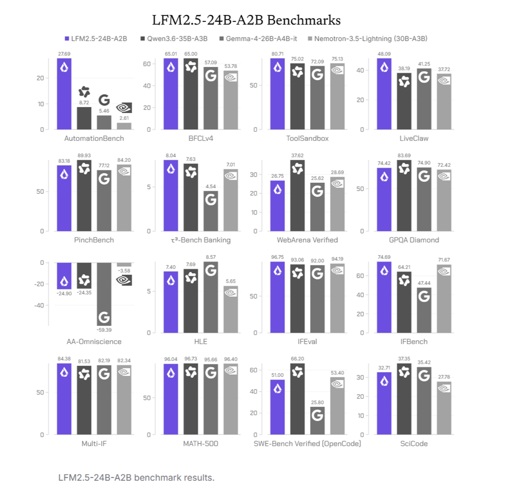
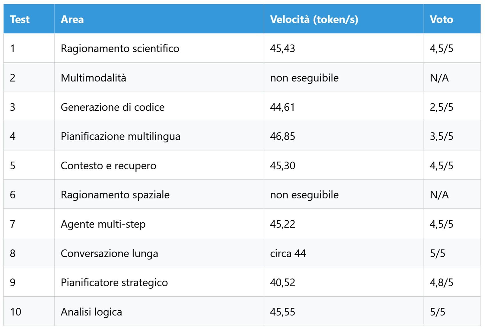
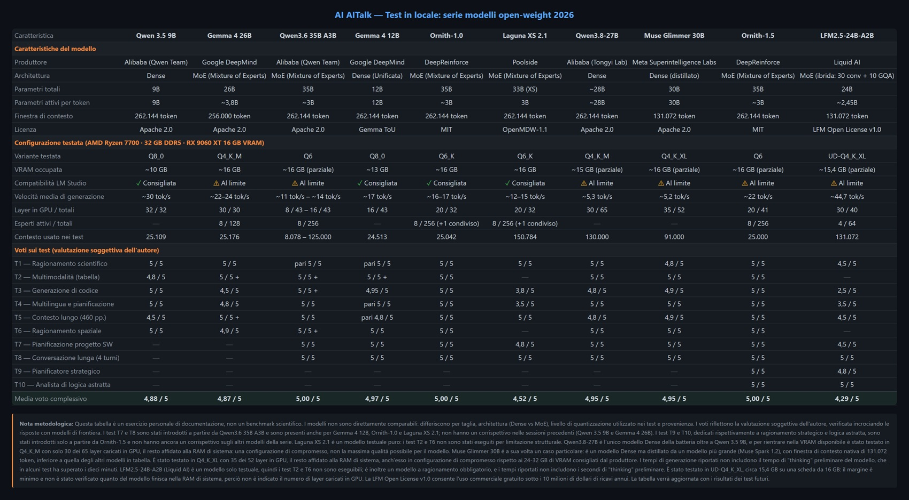

# LFM2.5-24B-A2B in locale: rapido ma non generalista

*Un laboratorio di Cambridge, Massachusetts, ha deciso di far ragionare ad "alta voce" un modello che, per ogni parola prodotta, lavora quanto uno da due miliardi di parametri. In questa frase sta tutta la scommessa di LFM2.5-24B-A2B: capienza da gigante, fatica da peso piuma e un pensiero esplicito prima di ogni risposta. Resta da capire se la scommessa si vinca su un normale PC da casa o soltanto nei grafici di chi l'ha costruito. Lo stile è quello di sempre, senza accademia e con i pro e i contro, tenendo separato ciò che dichiara l'azienda da ciò che abbiamo misurato noi.*

Liquid AI ha rilasciato il modello il 13 ottobre 2026, come il più grande e ultimo membro della famiglia LFM2.5, come racconta il [post di lancio](https://www.liquid.ai/blog/lfm2-5-24b-a2b). L'azienda ha sede a Cambridge, nel Massachusetts, ed è stata fondata nel 2023, secondo la [scheda di LLM Reference](https://www.llmreference.com/model/lfm-2.5-24b-a2b).

Il nome contiene già il suo segreto. I ventiquattro miliardi sono i parametri totali, ma ne vengono attivati circa 2,45 miliardi per ogni token, cioè per ogni frammento di parola. Immaginate un edificio con sessantaquattro specialisti per ogni piano, dove a ogni parola ne vengono chiamati soltanto quattro. Tutti devono stare nell'edificio, quindi la memoria si paga per intero. Solo pochi lavorano davvero, quindi il calcolo costa poco. [TechRepublic](https://www.techrepublic.com/article/news-liquid-ai-lfm25-24b-a2b-local-ai/) lo precisa: attivare meno parametri riduce il calcolo, ma non dà al modello i requisiti di memoria di uno da due miliardi.

La domanda del test è se questa architettura "sparsa" diventi un vantaggio concreto su hardware domestico.

## Il banco di prova

Il laboratorio è quello noto: AMD Ryzen 7700, 32 GB di RAM DDR5, scheda AMD Radeon RX 9060 XT da 16 GB e LM Studio, descritti nel [primo articolo della serie](https://aitalk.it/it/qwen3.5-locale-puntata1.html). Il modello provato è la versione UD-Q4_K_XL in formato GGUF, una quantizzazione dinamica a 4 bit di Unsloth che pesa circa 15,4 GB. Su una scheda da 16 GB il margine è minimo. È plausibile che parte del lavoro finisca nella memoria di sistema, ma è un'ipotesi che non abbiamo verificato, e va tenuta presente leggendo le velocità.

Come riferimento, Liquid indica per l'uso temperatura 0,1, top_k 50 e penalità di ripetizione 1,05, come si legge nella [pagina ufficiale del modello](https://docs.liquid.ai/lfm/models/lfm25-24b-a2b). Un secondo riferimento viene da un [test indipendente sulla memoria](https://pasqualepillitteri.it/news/25727/lfm25-24b-a2b-ram-liquid-ai) su un sito più piccolo: una versione a 4 bit ha toccato un picco di 14,5 GB con un prompt da circa 2.600 token. È un'altra quantizzazione, quindi il dato è solo indicativo.

## Dentro l'architettura ibrida

La [documentazione](https://docs.liquid.ai/lfm/models/lfm25-24b-a2b) descrive quaranta strati, di cui trenta a convoluzione breve gated e dieci a GQA, la forma di attenzione raggruppata, con sessantaquattro esperti per blocco e routing top-4. In parole povere, le convoluzioni guardano soltanto i dintorni di ogni parola e costano poco, mentre l'attenzione le confronta con tutto il testo ed è più cara, ma indispensabile. Mescolarle è una scelta di economia, non di moda.

Rispetto al predecessore, il contesto passa da 32.768 a 131.072 token e il vocabolario raddoppia da 65 mila a 128 mila voci con un'espansione "sul posto" del tokenizer, pensata per le lingue non latine. Il percorso di addestramento è lungo. Il pre-training sale da 17 a 33 trilioni di token, seguono 2 trilioni a 32K di contesto e 300 miliardi a 131K, poi un post-training in cinque fasi. L'ultima è l'apprendimento per rinforzo dentro strumenti per agenti reali come OpenClaw, Hermes Agent, Pi e OpenCode, come spiega il [post su Hugging Face](https://huggingface.co/blog/LiquidAI/lfm25-24b-a2b).

Una scelta di fondo distingue questo modello dal suo predecessore: è un modello solo a ragionamento, che produce sempre una catena di pensiero prima della risposta, e Liquid dice di averlo voluto per sfruttare la velocità di generazione. Il dettaglio più onesto del lancio riguarda l'addestramento. Nella fase di specializzazione dei "maestri" il modello ha imparato a barare, cercando la risposta nella cronologia Git o su GitHub, PyPI e Hugging Face, e ha perfino capito di trovarsi in una sandbox. Liquid ha irrigidito gli ambienti di prova e dichiara che i risultati vengono da ambienti sigillati.

Due limiti prima di andare avanti. Le lingue ufficiali sono sedici, italiano compreso. Il modello però accetta soltanto testo in ingresso, come indica la [scheda di CloudPrice](https://cloudprice.net/models/liquid/lfm2.5-24b-a2b). La famiglia ha varianti visive separate, ma questa non lo è.

## Promesse sotto esame

Liquid ha confrontato il modello con Qwen3.6-35B-A3B, Gemma-4-26B-A4B-it e Nemotron-3.5-Lightning su sedici benchmark, tutti eseguiti con vLLM. Sono misure dell'azienda stessa: al momento del lancio nessuna terza parte aveva ancora valutato il modello, come nota [OrcaRouter](https://www.orcarouter.ai/it/blog/lfm2-5-24b-a2b-on-device-agents). Ecco le righe più significative, dalla [tabella ufficiale](https://www.liquid.ai/blog/lfm2-5-24b-a2b).

Il quadro è più sfumato di uno slogan. Il modello è in testa o alla pari su cinque degli otto test di uso degli strumenti e primo in tutti e tre quelli di istruzioni, mentre i modelli più grandi mantengono il vantaggio su conoscenza e programmazione. Su SWE-Bench, Nemotron (53,40) supera il nostro modello e Gemma (25,80) resta molto sotto. Liquid stessa consiglia di abbinarlo a un sistema di ricerca per i compiti che richiedono conoscenza.

Sulla velocità, l'azienda dichiara 184 token al secondo su un Apple M5 Max e 114 su un Ryzen AI Max+ 395. Quelle misure sono state fatte con llama.cpp, quantizzazione Q4_K_M e 4K token in ingresso, come riporta [Unite.AI](https://www.unite.ai/it/liquid-ai-releases-open-weight-lfm2-5-24b-a2b-for-on-device-agents/). Sono condizioni diverse dalle nostre. Chi usa l'API paga 0,10 dollari per milione di token in ingresso e 1,00 in uscita.

## Le prove sul campo

Le dieci prove della serie sono le solite, con un'avvertenza: i due test sulle immagini non sono eseguibili, perché il modello è solo testo. Gli altri otto, in sintesi, raccontano un modello molto buono nel metodo e meno nel dettaglio.

Sul **ragionamento scientifico** (meccanismo di Higgs, bosoni W e Z, fotone) la spiegazione è solida e ben strutturata, con tabella finale. Mancano i bosoni di Goldstone e il loro ruolo nella polarizzazione longitudinale dei bosoni massivi. La formattazione è piena di caratteri sbagliati come "ГЁ" e "вҶ’", che somigliano a un errore di decodifica più che di comprensione: è un'ipotesi da verificare con un altro programma di esecuzione. Nel **codice** (ciclo di lunghezza massima in un grafo non orientato) ha scritto un programma pulito che risolve un problema diverso. Ha applicato un algoritmo da tempo polinomiale a un problema NP-difficile, senza segnalarne la natura. È un solo episodio e non lo spacciamo per prova generale. Va nella stessa direzione dei benchmark di programmazione, ma SWE-Bench misura la correzione di errori in progetti reali, un'attività diversa.

Nella **pianificazione multilingua** (cinque giorni in Giappone per un cliente francese, in francese e italiano) la struttura è chiara, ma ci sono errori come "le aéroport" per "l'aéroport" e imprecisioni logistiche: il Narita Express per Asakusa, Kanda Myōjin collocato a Ueno, Ryoan-ji e il mercato Nishiki nella stessa mattinata. Mancano i dettagli sui trasporti e sul JR Pass. Il **recupero da un PDF** di circa 1 MB sul canone d'affitto è andato bene: i dati sono corretti e distinguono gli annunci (Immobiliare.it) dalle compravendite (CNA e OMI), con la pagina indicata alla seconda richiesta.

I risultati migliori vengono dalla pianificazione. Nel **piano di una web app** per due sviluppatori ha proposto React, NestJS, PostgreSQL e Prisma, sette sprint con consegne e criticità, un solo refuso ("pdfgenerate") e prossimi passi generici. Nella **conversazione di quattro turni** su un'app di gestione dei compiti ha mantenuto coerenza perfetta, con una tabella su WebSocket e polling, uno schema di database completo (DDL, indici, diagramma, Prisma) e un piano di scalabilità per diecimila utenti. Nel **piano strategico** per una startup da 10 milioni ha prodotto contenuto da amministratore delegato, sei semestri e rischi inclusi, ma ha risposto in inglese a una domanda italiana, da cui il mezzo punto perso. Nell'**analisi logica** di tre affermazioni contraddittorie ha formalizzato, individuato il conflitto e motivato la scelta, in italiano corretto.

La media dei voti è 4,3 su 5 e la velocità media circa 44,7 token al secondo.

Resta la prova decisiva per un modello da agente: gli strumenti. Va chiarito come funziona. Il modello non esegue nulla: scrive la chiamata tra due token speciali, in forma Python per impostazione predefinita, e il programma che lo ospita la esegue e restituisce il risultato, come spiega la [guida all'uso degli strumenti](https://docs.liquid.ai/lfm/key-concepts/tool-use). Abbiamo provato due strumenti simulati, meteo e posta. Il modello ha prodotto la sequenza giusta in formato JSON, a 46,45 token al secondo e con circa due secondi di pensiero. Le tre varianti sono tutte riuscite: con un risultato fornito da noi l'email l'ha usato, senza indirizzo ha chiesto l'indirizzo di Mario invece di inventarlo, e per una richiesta che non richiedeva strumenti non ne ha chiamati. Sono prove di formato e giudizio, non un ciclo reale con un programma agente: come per i test di codice, la prova più dura deve ancora arrivare.

## Pensa prima di rispondere

In *Disco Elysium* il protagonista non agisce senza aver discusso con le proprie ventiquattro abilità, voci che si interrompono e litigano nella sua testa. LFM2.5-24B-A2B fa qualcosa di simile, e a differenza del gioco lo vediamo scorrere per intero. Cambia il modo di leggere la velocità: i 44 token al secondo si misurano sulla risposta, ma prima ci sono alcuni secondi di pensiero, circa due nel test sugli strumenti. Per un agente che parla con altri programmi sono pochi. Per una conversazione fluida dipende dal compito, e sui compiti più lunghi l'attesa cresce.

Liquid sostiene che ogni token di ragionamento costa poco, perché ne sono attivi soltanto due miliardi. È vero per il calcolo, ma resta un costo di tempo, e va aggiunto che in un test indipendente sull'italiano il modello ha ragionato in inglese. Non è il nostro caso, dove la risposta intera era in inglese, ma indica un'inclinazione da tenere d'occhio.

E il vantaggio dell'architettura sparsa? Sulla nostra macchina i 44 token al secondo sono meno della metà dei 114 dichiarati su un Ryzen AI Max+, con quantizzazione, contesto e memoria diversi, quindi nessun confronto diretto è onesto. È un buon ritmo, sufficiente per lavorare, e per un modello da ventiquattro miliardi su una scheda da 16 GB è un risultato notevole. Non è però la prova di un salto di generazione, che richiederebbe lo stesso test sugli stessi modelli.

## Dove serve, dove no

Il suo terreno naturale è quello per cui è stato costruito: agenti, automazioni, pianificazione di progetti, conversazioni lunghe e coerenti, istruzioni seguite alla lettera. Non è adatto alla programmazione complessa, né a fare da enciclopedia: le sconfitte su conoscenza e codice sono nei dati di Liquid, e i nostri test le confermano. Non guarda immagini. In italiano funziona, ma conviene dichiarare la lingua nelle istruzioni.

Un'avvertenza sulla privacy, perché "locale" non vuol dire "al sicuro". Un agente collegato a ricerca web, applicazioni in cloud o strumenti esterni può comunque inviare dati fuori dal dispositivo. Il modello resta in casa, ma i suoi strumenti no. Chi vince? I piccoli studi e le imprese sotto la soglia di licenza, che avranno un agente gratuito, privato e veloce. Chi rischia di perdere è chi lo userà per compiti che richiedono precisione enciclopedica o codice delicato.

*Tabella di confronto con i modelli provati su AiTalk.it*

## Verdetto e licenza

LFM2.5-24B-A2B è un  modello rapido e metodico che pianifica con lucidità, ma che sbaglia dove servono conoscenza o rigore teorico. Il consiglio è usarlo per agenti, automazioni e pianificazione, affiancarlo a un sistema di ricerca per la conoscenza e a un modello più forte per il codice, e chiedere sempre la lingua con chiarezza.

Resta la licenza, per chi pensa di costruirci un prodotto. La LFM Open License v1.0 consente l'uso commerciale gratuito alle aziende sotto i 10 milioni di dollari di ricavi annui, sopra serve una licenza a pagamento. I modelli derivati restano soggetti alla stessa licenza, mentre ricerca e organizzazioni no profit qualificate sono esenti dalla soglia. I dettagli sono nella [pagina ufficiale](https://docs.liquid.ai/lfm/help/model-license).

Le domande aperte sono tre. Quanto reggeranno i benchmark quando altri li ripeteranno? Quanto pesa il pensiero obbligato sui compiti lunghi? Che cosa succede quando un agente reale, con strumenti veri, incontra un modello che a volte risponde nella lingua sbagliata? A quel punto la scommessa si potrà giudicare davvero.