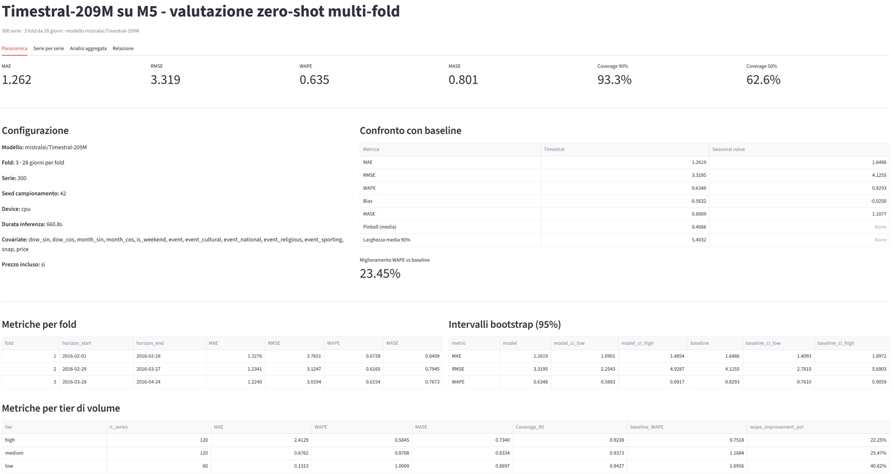
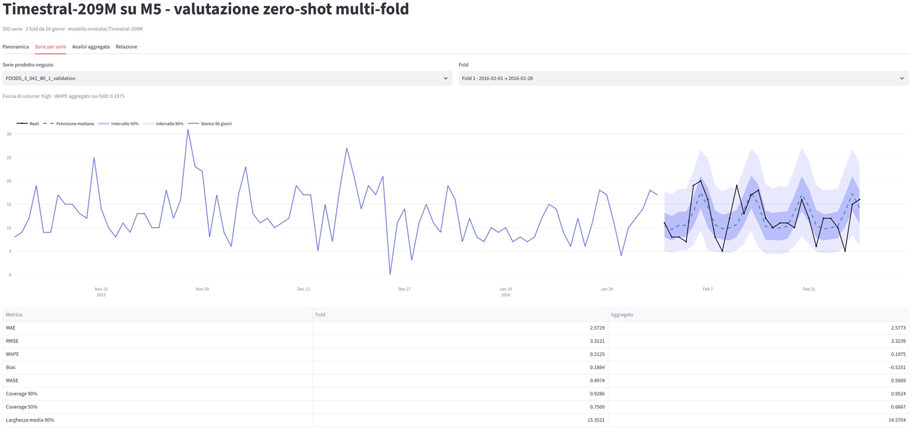
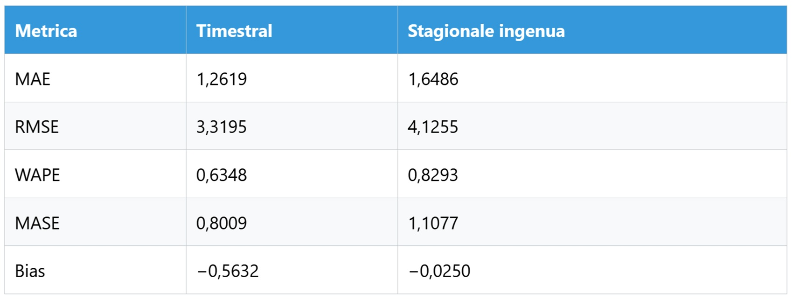

# Timestral-209M: prevedere senza studiare

Immaginate un magazzino con tremila referenze e un responsabile che, il lunedì mattina, deve decidere quanti pallet ordinare, quanti addetti convocare per il fine settimana, quali scorte non lasciare mai a zero. Nessuno gli chiede di leggere il futuro. Gli chiedono qualcosa di più umile e più utile, una stima condizionata: dato ciò che è accaduto finora, quale ventaglio di domani è plausibile? Una buona previsione, non indica un sentiero solo, ma disegna il ventaglio dei sentieri e dice quali sono più probabili.

Per decenni il mestiere si è fatto in un modo solo. I modelli classici, come ARIMA, ne assegnano uno a ogni serie storica e imparano soltanto da quella: costano poco, si spiegano bene, ma ripartono da zero a ogni nuova serie. Il deep learning, ad esempio con PatchTST, impara da molte serie insieme, ma di norma va addestrato da capo su ciascun insieme di dati, come [racconta lo stesso blog di Mistral](https://mistral.ai/news/timestral). I modelli fondazionali, o *foundation model*, cambiano la ricetta: vengono pre-addestrati su un corpus enorme e poi impiegati su dati mai visti, senza altro studio. Si chiama *zero-shot*, zero tentativi di addestramento sul caso specifico.

Su quanto sia grande la rivoluzione, i pareri sono più cauti dei comunicati. Rob Hyndman, tra i nomi più autorevoli della materia, [scrive](https://robjhyndman.com/hyndsight/foundation_models.html) che questi modelli sono un cambiamento reale nel modo in cui le previsioni si producono, ma non ancora una dimostrazione generale di maggiore accuratezza. Questo articolo sta tra le due posizioni: presenta Timestral-209M di Mistral, ne spiega il funzionamento e riporta una prova fatta in casa su dati di vendita reali, onesta ma senza pretese di benchmark.

In una frase, Timestral è un segnale serio che la previsione sta diventando generalista, ma non prova che un modello fondazionale batta sempre un buon modello statistico calibrato sul caso specifico.

## Anatomia di Timestral

Timestral è una famiglia di quattro modelli da 5, 28, 123 e 209 milioni di parametri, [rilasciati da Mistral](https://huggingface.co/mistralai/Timestral-209M) a metà ottobre 2026. I parametri sono le manopole interne che il modello regola durante l'addestramento: 209 milioni sono molti per un modello statistico classico, pochissimi per un modello linguistico moderno. Il formato è stato scelto per girare anche su un processore ordinario, in azienda o in ambienti isolati dalla rete.

Quattro numeri della [scheda ufficiale](https://huggingface.co/mistralai/Timestral-209M) aiutano a capire cosa può fare. Il *contesto*, cioè quanta storia il modello legge, arriva a 32.768 passi temporali. L'*orizzonte*, cioè quanto lontano guarda, a 1.024 passi in un colpo solo, oltre i quali procede a blocchi riaccodando la propria mediana come se fosse storia vera. I *quantili* sono soglie che descrivono l'incertezza: il quantile 0,95 è il valore che il modello ritiene superato solo cinque volte su cento, e Timestral ne produce 21, da 0,01 a 0,99. Infine accetta una o più serie insieme, più *covariate*, informazioni di contorno come calendario, prezzi o festività note in anticipo.

Il modello è un trasformatore con 24 strati e dimensione interna 768, che non legge i valori uno alla volta ma a *patch*, pezzi da 32 passi, ciascuno accompagnato da un indicatore dei buchi nei dati. Combina due tipi di attenzione, ossia di capacità di pesare quali informazioni contano: quella nel tempo, che guarda quali momenti passati sono rilevanti, e quella tra le variabili, che guarda come le serie si influenzano tra loro. Secondo il [blog](https://mistral.ai/news/timestral), il metodo chiamato DHF tiene l'intera storia visibile e aggiunge gettoni di previsione separati, così ogni valore osservato serve sia da bersaglio sia da contesto. L'attenzione sulle covariate, invece, lascia passare informazione solo dalle covariate verso i bersagli, per evitare che il futuro di una serie contamini la sua stessa previsione.

La parte più sorprendente è l'addestramento: la maggior parte dei dati è sintetica, processi con tendenze, stagionalità e rumori generati ad arte, in una prima fase con contesto di 8.192 passi, seguita da una fase con dati reali e sintetici e contesto quattro volte più lungo. È l'opposto di Funes, il personaggio di Borges che ricorda ogni foglia di ogni albero e proprio per questo non sa generalizzare: qui si insegnano le forme del tempo, non gli eventi. Cosa ci sia esattamente nel corpus reale non è dichiarato. Il rapporto tecnico è annunciato come "in arrivo".

Due promemoria pratici. Lo stato è di [anteprima pubblica](https://docs.mistral.ai/models/timestral-1-0-209m). La [licenza](https://huggingface.co/mistralai/Timestral-209M/blob/main/LICENSE), una MIT modificata, non è open source in senso stretto: nega l'uso a chi, come azienda o datore di lavoro, supera i 20 milioni di dollari di fatturato mensile consolidato globale nel mese precedente, salvo accordo commerciale con Mistral. Non è una royalty, è una soglia d'ingresso, e vale anche per i derivati.

## Promesse da verificare

Mistral dichiara che Timestral-209M è primo tra i modelli pre-addestrati e zero-shot su tre classifiche pubbliche, [GIFT-Eval](https://huggingface.co/spaces/Salesforce/GIFT-Eval), [TIME](https://huggingface.co/spaces/Real-TSF/TIME-leaderboard) e [fev-bench](https://huggingface.co/spaces/autogluon/fev-bench), battendo il precedente stato dell'arte con due terzi dei parametri. Nella scheda i numeri sono questi: su GIFT-Eval l'errore MASE è 0,658 contro 0,661 di t0-gamma, il CRPS 0,446 contro 0,452. Il MASE misura l'errore rispetto a un metodo ingenuo di riferimento, il CRPS valuta la qualità dell'intera distribuzione prevista, e per entrambi più basso è meglio. Su fev-bench il punteggio SQL è 50,39 contro 49,42 di t0-gamma. I margini sono reali ma piccoli, e sono risultati dichiarati dal produttore: Mistral rilascia il [codice](https://github.com/mistralai/timestral) proprio per riprodurli, ma una replica indipendente non c'è ancora.

Sull'efficienza la dichiarazione è puntuale. Su una CPU da server a 8 thread, per prevedere un giorno avanti partendo da tre settimane di storico a 15 minuti, servono 10 millisecondi con il modello da 5 milioni di parametri e 140 con quello da 209. Il 28M è cinque volte più veloce, il 123M resta entro lo 0,2% di punteggio con tre quarti della latenza. Sono misure fatte in condizioni ben precise, diverse da quelle della nostra prova, e come tali vanno lette.

C'è poi il problema di fondo delle classifiche, e qui Hyndman è utile. Richiama le [analisi di Christoph Bergmeir](https://cbergmeir.com/papers/Bergmeir2024LLMs.pdf), secondo cui i confronti con i metodi statistici sono spesso fatti con versioni poco curate. Cita poi lo studio di [Meyer e colleghi](https://arxiv.org/abs/2510.13654v3): su 401 insiemi di dati usati da 22 modelli fondazionali pubblicati, solo il 6% non era mai comparso nei dati di addestramento di alcun modello. Chi ha letto il cult *Primer* sa come va a finire quando un'informazione viaggia indietro nel tempo senza che nessuno se ne accorga. Mistral stessa, del resto, riconosce il problema: la sua piattaforma [Forge](https://mistral.ai/products/forge/) promette il pieno controllo sui dati di addestramento, così che nulla di ciò che si prova sul proprio storico sia già stato visto dal modello.

*Screenshot della dashboard con la panoramica dei risultati del nostro test.*

## Come abbiamo fatto la prova

La prova non è un singolo esperimento, ma una piccola catena di passaggi: si parte dai file originali, si preparano i dati, si generano le previsioni, si confrontano con i valori reali e si producono numeri, report e grafici. Ogni passaggio salva il proprio risultato su disco e il successivo riparte da lì. Questo rende il lavoro controllabile e ripetibile, e permette di interromperlo senza perdere quello che è già stato fatto. La sequenza è questa.

**1. Un ambiente chiuso.**

Prima di tutto abbiamo confinato l'esperimento in una sola cartella di progetto. Lo script di avvio crea l'ambiente Python locale (.venv), installa lì le dipendenze e sposta cache, file temporanei e credenziali dentro il progetto, così niente finisce nelle cartelle di sistema. Il dataset M5 viene scaricato da Kaggle e i tre file necessari, vendite, calendario e prezzi, vengono copiati in data/raw/m5/. Il modello Timestral-209M viene scaricato una volta da Hugging Face e salvato in models/timestral/. Se i file sono già presenti, vengono riusati. Un test automatico controlla che directory, cache e percorsi restino davvero dentro il progetto.

**2. Preparazione dei dati.**

Con i tre file in locale, abbiamo costruito il dataset della prova. Delle oltre 30.000 serie prodotto-negozio ne abbiamo scelte 300 con campionamento casuale stratificato (seme 42): 120 ad alto volume, 120 a volume medio, 60 a basso volume o intermittenti. Il volume è misurato solo sulla finestra più vecchia, così la scelta non dipende dal futuro. Le serie senza vendite in quella finestra sono state escluse; i giorni mancanti sono stati messi a zero, e ogni serie è diventata una sequenza giornaliera continua, una riga per ogni giorno. A ogni serie abbiamo aggiunto le informazioni note in anticipo: giorno della settimana, mese, weekend, eventi, giorni SNAP e prezzo, quest'ultimo solo se disponibile per tutte le serie e per tutto l'orizzonte. Il risultato è salvato in Parquet, un formato compresso e veloce da rileggere.

**3. Il taglio temporale.**

Abbiamo poi diviso il periodo in tre finestre consecutive di 28 giorni, dal 1 febbraio al 24 aprile 2016. Per ciascuna abbiamo tenuto 365 giorni di storico e abbiamo messo da parte i 28 giorni da prevedere: quei valori reali non sono mai entrati nella fase di previsione, ma solo in quella di valutazione. Le finestre sono 1–28 febbraio, 29 febbraio–27 marzo e 28 marzo–24 aprile. Il codice registra le date di ogni finestra in un file di configurazione e controlla che le previsioni coprano esattamente i 28 giorni attesi. Tre finestre invece di una servono a non basare tutto su un mese particolare: se il risultato tiene in tutte e tre, è più credibile.

**4. L'inferenza zero-shot.**

Qui il modello entra in scena. Carichiamo Timestral-209M dai file locali, senza addestramento ulteriore, e lo usiamo una serie alla volta. Per ogni serie gli passiamo i 365 giorni di vendite e le covariate note per l'intero periodo, cioè 365 giorni passati più i 28 futuri; il modello restituisce i 28 giorni sotto forma di cinque quantili (5%, 25%, 50%, 75%, 95%). Le previsioni sono calcolate a blocchi di otto serie, su CPU, in modalità di sola inferenza; i valori negativi vengono portati a zero perché le vendite non possono essere negative. Ogni risultato viene salvato con serie, data, finestra, quantili e tempo di calcolo. Se l'esecuzione si interrompe, il programma riparte dalle serie che mancano.

**5. Valutazione e confronto.**

Una volta fissate le previsioni, le uniamo ai valori reali dei 28 giorni e calcoliamo gli errori: MAE, RMSE, WAPE, MASE, bias, pinball loss, copertura e ampiezza degli intervalli. Facciamo la stessa cosa con una baseline semplice, la previsione stagionale ingenua, che ripete il valore dello stesso giorno della settimana precedente. Le metriche vengono aggregate per serie, per fascia di volume, per finestra e sul totale; gli intervalli di confidenza al 95% arrivano da 1.000 ricampionamenti delle serie. I risultati finiscono in sei file CSV, uno per le serie, uno per l'aggregato, uno per la baseline, uno per i tier, uno per gli intervalli e uno per il riepilogo. La previsione puntuale usata per MAE, RMSE, WAPE e bias è la mediana.

**6. Report e dashboard.**

L'ultimo passaggio trasforma i numeri in qualcosa di leggibile. Un modulo genera automaticamente il report Markdown con obiettivo, dataset, protocollo, metriche, confronto con la baseline, casi migliori e peggiori e limiti. Una dashboard Streamlit legge gli stessi file e mostra quattro schede: panoramica, serie per serie, analisi aggregata e relazione. I grafici sono fatti con Plotly e mostrano storico, valori reali, mediana e bande al 50% e al 90%. Tutto si rigenera con un solo comando: lo script di avvio esegue la pipeline e poi apre la dashboard.

Questo è il senso del percorso: non raccontare un modello, ma rendere verificabile un esperimento. La pipeline è una sequenza di decisioni esplicite (quali serie, quanto storico, quali variabili, quale baseline) e ognuna può essere controllata, rifatta o contestata. I numeri che seguono valgono quanto vale il processo che li ha prodotti: per questo il taglio temporale, deciso prima di vedere qualsiasi risultato, è il passaggio che dà senso a tutto il resto.

*Screenshot della dashboard, l'ultima parte è il confronto con i dati reali e quelli previsti da Timestral.*

## La prova su M5

Premessa onesta: è una prova casalinga, non un benchmark, e non è indipendente nel senso accademico del termine. [M5](https://www.kaggle.com/competitions/m5-forecasting-accuracy) è una gara di previsione sulle vendite unitarie di Walmart, con 30.490 serie prodotto-negozio e 1.941 giorni tra il 2011 e il 2016. La metrica ufficiale della gara, il WRMSSE, qui non è calcolata, quindi i risultati non sono confrontabili con la classifica originale.

Abbiamo estratto 300 serie con campionamento casuale stratificato (seme 42): 120 ad alto volume, 120 a volume medio, 60 a basso volume o intermittenti, con soglie calcolate solo sul periodo più vecchio per non far dipendere il campione dal futuro da prevedere. Le serie a volume nullo sono state escluse, i giorni mancanti messi a zero. Tre finestre consecutive da 28 giorni, dal 1 febbraio al 24 aprile 2016, ciascuna con 365 giorni di storico. Il modello ha lavorato in zero-shot e in modalità univariata, su CPU, con covariate note in anticipo: giorno della settimana, mese, weekend, eventi, giorni SNAP (i buoni alimentari) e prezzo, assunto noto per l'intero orizzonte. Niente promozioni, inventario, meteo. Il riferimento è la previsione stagionale ingenua, che ripete il valore dello stesso giorno della settimana precedente. I valori reali dell'orizzonte non sono mai stati passati al modello, e le previsioni sono state troncate a zero perché le vendite non possono essere negative.

## Numeri sotto esame

Il MAE è l'errore assoluto medio in unità vendute al giorno per serie, l'RMSE punisce di più gli errori grandi. Il WAPE è l'errore totale diviso per le vendite totali, ed è importante chiarire che 0,6348 non vuol dire "accuratezza del 63%": significa un errore pari al 63% del venduto. Il MASE confronta l'errore con quello medio di un metodo ingenuo calcolato sullo storico: 0,80 contro 1,11 della previsione ingenua sulla stessa scala. Rispetto al riferimento il WAPE migliora del 23,45%, il MAE del 23,46%, l'RMSE del 19,54%, il MASE del 27,70%. Il segno è coerente nelle tre finestre, con WAPE di 0,6728, 0,6165 e 0,6154.

Va letto con le cautele del caso. Gli intervalli di confidenza al 95% ricavati ricampionando le serie danno per il WAPE 0,5883–0,6917 contro 0,7610–0,9059, ben separati. Per l'RMSE sono 2,2543–4,9287 contro 2,7815–5,6903, molto sovrapposti, e il MAE sfiora la sovrapposizione: su queste due metriche il vantaggio non è dimostrato. Gli intervalli, inoltre, colgono la variabilità tra serie, non quella tra periodi.

Il bias merita attenzione. Misura l'errore medio con segno, e −0,5632 significa sottostima sistematica: su vendite medie di circa due unità al giorno (ricavate dal rapporto tra MAE e WAPE) è quasi il 28%, contro il −0,025 della previsione ingenua. Vale circa il 45% del MAE. Per chi gestisce scorte è il difetto peggiore, perché porta a rimanere senza merce. Il report non dice quale previsione puntuale sia stata usata: se fosse la mediana, su serie con molti zeri sarebbe una spiegazione plausibile, ma resta un'ipotesi da verificare.

Gli intervalli di previsione sono conservativi. Quello al 90% ha copertura 93,30%, cioè contiene il valore reale più spesso del dovuto, e quello al 50% arriva al 62,62%, dodici punti sopra il nominale, con larghezza media del 90% di 5,40 unità, più del doppio delle vendite medie. Su dati discreti e pieni di zeri la copertura è naturalmente gonfiata, e senza un riferimento probabilistico equivalente non possiamo dire se siano buoni o semplicemente larghi.

Dividendo per volume le conclusioni si fanno più sfumate. Sulle 120 serie ad alto volume (circa 4 unità al giorno) il WAPE è 0,5845 contro 0,7518, miglioramento del 22,25%. Sul volume medio (circa 0,8) è 0,8708 contro 1,1684, +25,47%. Sulle 60 intermittenti (circa 0,13) il WAPE è 1,0069 contro 1,6956, un miglioramento del 40,62% che è però ingannevole: un WAPE sopra 1 è peggiore di una previsione di soli zeri, e la previsione ingenua parte da un riferimento pessimo. Qui MASE e pinball, l'errore sui quantili, che per Timestral vale 0,4066 in media, sono più affidabili.

I singoli casi insegnano più delle medie. Il migliore per WAPE è FOODS\_3\_042\_WI\_1, 0,1975 con MASE 0,5069, ma un altro tra i "migliori", FOODS\_3\_329\_CA\_1, ha MASE 1,4251, peggiore della previsione ingenua: le metriche possono contraddirsi. Il peggiore, HOUSEHOLD\_2\_124\_TX\_2, ha WAPE 26,22 perché vende circa 0,012 unità al giorno, praticamente nulla. In FOODS\_1\_110\_WI\_1 tutto l'errore è sovrastima, forse un prodotto uscito dal catalogo o rimasto senza scorte. Gli zeri di M5 non sono sempre domanda assente.

I limiti sono quelli annunciati: 300 serie su oltre 30.000, 84 giorni senza cambi strutturali, nessuna covariata promozionale, un solo riferimento semplice, nessun confronto con ARIMA, ETS o altri modelli fondazionali. Per la contaminazione, M5 è pubblico dal 2020 e non possiamo escludere che sia finito nei dati di addestramento. La conclusione dunque non è che "Timestral è il migliore su M5", ma che batte una regola ingenua in modo coerente, con limiti precisi.

In parole semplici: in questa prova Timestral ha previsto le vendite dell'ultimo mese meglio della regola che ripete il valore della settimana precedente, con circa un quarto di errore in meno (WAPE 0,63 contro 0,83) e lo stesso segno in tutte e tre le finestre. Il vantaggio è però solido soprattutto sull'errore complessivo e sul MASE, mentre su MAE e RMSE gli intervalli si sovrappongono e il primato non è dimostrato. Resta anche una sottostima sistematica di circa il 28%, il difetto più insidioso per chi gestisce le scorte, e le previsioni sono più affidabili sui prodotti ad alto volume che su quelli intermittenti, dove gli zeri non distinguono domanda assente e merce mancante. In sintesi: un buon risultato zero-shot, chiaramente migliore di una baseline elementare, ma non una prova definitiva che Timestral sia il modello da scegliere su il tipo di dati che propone M5.

## Chi lo usa, chi no

Nel blog Mistral cita casi come i sensori industriali, i flussi e i volumi finanziari, l'energia, la pianificazione della supply chain e le metriche di osservabilità dei sistemi. Il commercio al dettaglio, qui, è coperto soltanto dalla nostra prova. Nei contesti con molte serie, poche risorse statistiche e dati ricchi di covariate note, il valore è evidente: un solo modello pre-addestrato evita di costruire e mantenere una pipeline per ciascuna serie. Nella [scheda](https://huggingface.co/mistralai/Timestral-209M) Timestral precede di poco Chronos-2, TimesFM-3, Toto-2.0 (nella versione da 2,5 miliardi di parametri) e t0-gamma, quindi la gara è aperta. Per Mistral, inoltre, il modello da 28 milioni batte su GIFT-Eval e TIME il Chronos-2, circa quattro volte più grande.

Serve meno in alcuni casi, che il buon senso e Hyndman indicano: poche serie, relazioni causali note, spiegabilità obbligatoria, dati scarsi, assenza di competenze per mantenere un modello in produzione. Il [suo consiglio](https://robjhyndman.com/hyndsight/foundation_models.html) si riassume in tre mosse: partire da un riferimento statistico ben fatto, provare sui propri dati con prove a finestre mobili e non fidarsi della classifica altrui, pesare il costo totale tra calcolo, latenza, dipendenza dal fornitore e scarsa interpretabilità. A questo si aggiunge la licenza, che va letta da un ufficio legale prima di costruirci sopra un prodotto.

## Più accessibile, non magica

Il collo di bottiglia si sposta: meno sulla scelta del modello, più sulla qualità dei dati, sul monitoraggio di bias e copertura, sulla governance di covariate e licenze. La sovranità, con installazione in azienda, log e audit, è un argomento in più per chi non può mandare i dati altrove.

Quattro cose da seguire nei prossimi mesi: l'uscita del rapporto tecnico, replicazioni indipendenti dei risultati, casi d'uso in produzione e confronti seri con le alternative, comprese quelle statistiche. Fino ad allora Timestral è un segnale forte, non una prova definitiva. Nella nostra prova batte una regola ingenua del 23% sul WAPE, ma sottostima, ha intervalli larghi e un campione limitato.

La previsione non è diventata magia. È diventata più accessibile.