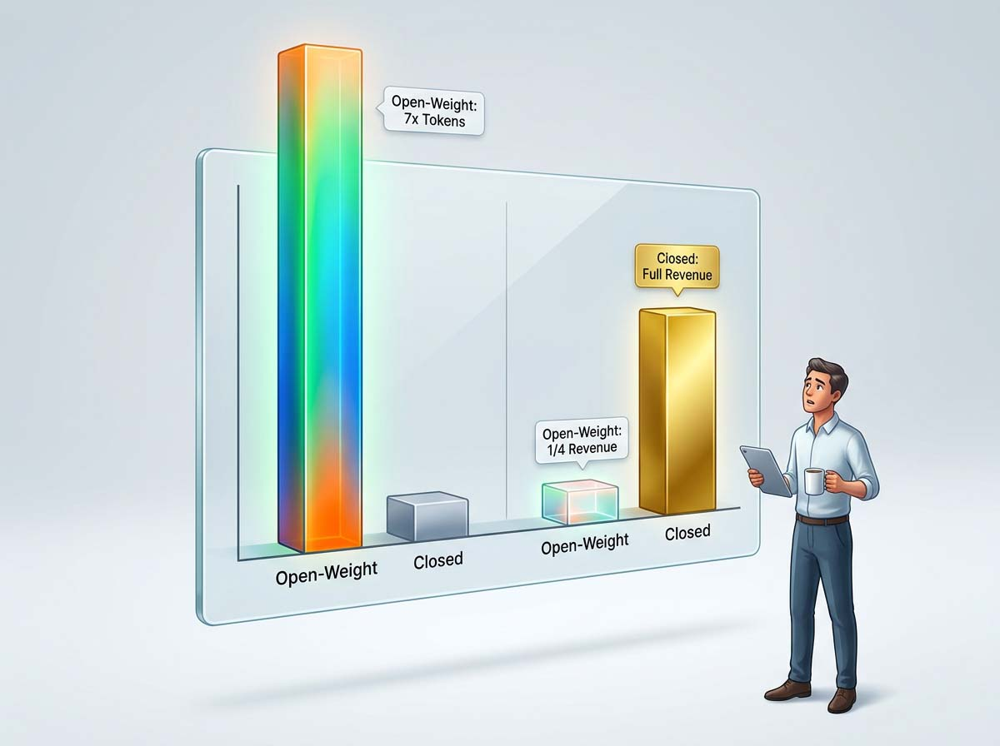
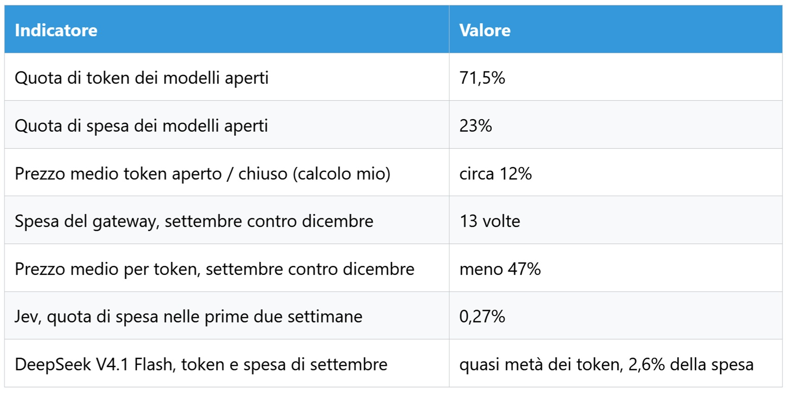
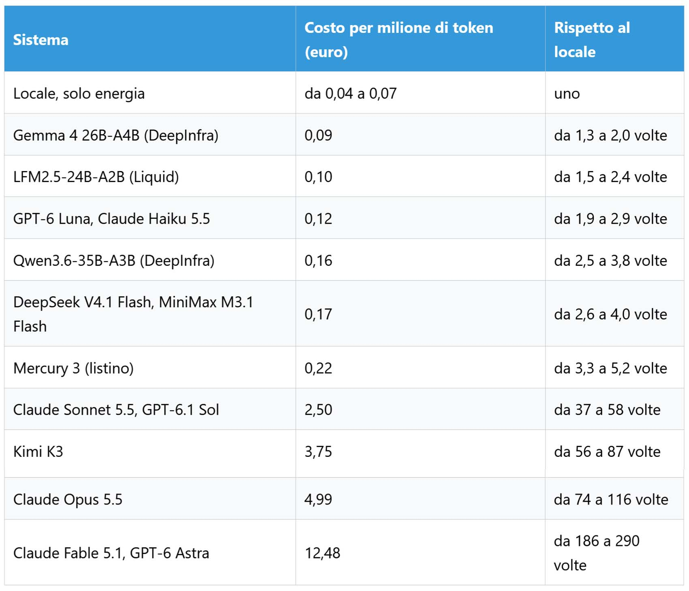
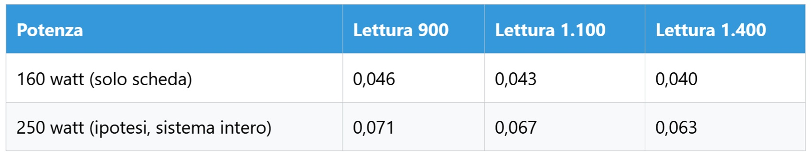

# Pesi aperti, conto vero

*Un token è un frammento di parola, l'unità con cui si misura e si fattura il lavoro di un modello linguistico. Nelle rilevazioni di settembre dell'[AI Gateway di Vercel](https://vercel.com/blog/ai-gateway-production-index-october-2026) più di sette token su dieci sono stati elaborati da modelli dai pesi aperti, cioè scaricabili, ispezionabili e ospitabili da chiunque ne abbia i mezzi. La spesa racconta altro: quei modelli incassano il 23% dei dollari, poco meno di uno su quattro. Era uno su venti a giugno, quindi la crescita c'è, ma i dollari restano indietro.*

Non è una vittoria ideologica, ed è il punto che mi interessa. È una decisione di prezzo, presa da chi paga i token con la freddezza del mercante Lawrence in *Spice and Wolf*, la serie di romanzi di Isuna Hasekura, quando pesa margini e rischi prima di accettare un affare che sembra troppo generoso. Se costano così poco, viene da chiedersi perché tanti non li facciano girare in casa. Il gateway però non vede ciò che accade sui computer personali, quindi quanti lo facciano resta una domanda aperta. Possiamo invece provare a capire cosa succede quando lo si fa.

Il percorso è questo: i numeri del gateway, tre modelli che interpretano l'apertura in modi diversi, il test su una scheda da 16 GB e infine il conto, con i punti deboli dichiarati uno per uno.

## Cosa misura davvero Vercel

Il materiale è traffico di produzione, non un sondaggio. Ogni mese, scrive Vercel, tra applicazioni reali e laboratori passano decine di trilioni di token. Nel conteggio entrano token di ingresso, di uscita, di ragionamento, letti dalla memoria di appoggio (la cache) e scritti in essa. La spesa è stimata ai prezzi di listino, con l'avvertenza che le fatture reali possono essere diverse. La classificazione dei modelli aperti segue l'elenco attuale del gateway, una definizione più larga di quella dei rapporti precedenti, come spiega la [nota metodologica](https://vercel.com/ai-gateway/leaderboards/about).

Ci sono tre limiti da dichiarare subito. I clienti di Vercel sono una porzione del mercato, e quanto somiglino al resto è tutto da verificare. I listini ignorano sconti e contratti. Carichi di lavoro molto diversi finiscono nello stesso conteggio. Resta uno dei pochissimi dataset pubblici che mette token e dollari sullo stesso perimetro, e questo basta a renderlo prezioso.

## Il prezzo nascosto nei numeri

Dividendo la quota di spesa per quella di token si ricava un prezzo medio implicito. Per gli aperti 0,23 diviso 0,715 fa circa 0,32. Per i chiusi 0,77 diviso 0,285 fa circa 2,70. Il primo vale il 12% del secondo. È un calcolo mio, non di Vercel, e mescola modelli e compiti diversi, quindi è un ordine di grandezza più che un tasso di cambio. Spiega però il paradosso: un token aperto costa in media circa un ottavo.

La crescita è asimmetrica. Dal dicembre scorso la spesa sui modelli di frontiera è decuplicata, quella sugli aperti è salita di oltre settanta volte. I chiusi guadagnano di più, ma su una fetta più piccola del lavoro di ciascun cliente.

Il dato che complica la storia "aperto uguale economico" è Kimi K3. Secondo Vercel i modelli con prezzo almeno quadruplo della media degli aperti hanno generato circa due terzi dell'aumento di spesa, e K3 da solo quasi la metà, con molti meno token di DeepSeek. Moonshot, il laboratorio che lo produce, pesa il 3,6% dei token e il 13,2% della spesa. Dividendo, il suo token costa circa 3,7 volte la media del gateway, mentre DeepSeek, con il 58% dei token e il 6,6% della spesa, ne costa circa un nono (anche questi sono calcoli miei). K3 ha i pesi pubblici su [Hugging Face](https://huggingface.co/moonshotai/Kimi-K3), con 2,8 trilioni di parametri di cui 104 miliardi attivi per token, e secondo [le tariffe riportate](https://benchlm.ai/moonshot/api-pricing) l'API costa 3 dollari per milione di token in ingresso e 15 in uscita. Su una miscela di nove parti di ingresso e una di uscita fanno 4,20 dollari, contro i 2,80 di [Claude Sonnet 5.5](https://www.anthropic.com/pricing). Un modello aperto più caro di uno chiuso: forse il nodo non sono i pesi ma la capacità.

C'è poi la geografia. Quasi il 70% della spesa sui modelli cinesi passa da fornitori con sede negli Stati Uniti, e nove token su dieci di Moonshot sono serviti da fornitori americani. Chi costruisce il modello e chi incassa possono essere soggetti diversi, e allora chi vince davvero dall'apertura, chi la rilascia o chi la ospita?

Infine Jev, di TypeSafe AI. Ha raggiunto il 35,3% dei team paganti in due settimane, il record del gateway, ma ha pesato lo 0,27% della spesa in quel periodo, e a settembre l'1% dei token e lo 0,15% della spesa. È un modello di decisione, spiega Vercel, che consuma una frazione dei token di una richiesta linguistica. Adozione non è valore.

## Tre strategie e un intruso

**DeepSeek V4.1 Flash** ha pesi sotto licenza MIT e un'architettura a esperti: la [scheda del modello](https://huggingface.co/deepseek-ai/DeepSeek-V4.1-Flash-1017) descrive una dorsale da 552 miliardi di parametri, con 8 miliardi attivi in lettura e 16 in scrittura, e un contesto da un milione di token. Il repository riporta circa 763 miliardi di parametri complessivi, quindi nessuna scheda da 16 GB lo vedrà mai. Il prezzo ufficiale è quello citato sopra, 0,15 e 0,60 dollari fuori punta e 0,003 per gli ingressi già in cache. Vercel misura la versione di settembre, mentre l'API serve oggi la revisione 1017. Qui il prezzo fa più notizia del punteggio nei test.

**Mercury 3**, di Inception, genera il testo in parallelo invece che un token alla volta, e dichiara oltre mille token al secondo. Secondo il [lancio del 19 ottobre](https://www.inceptionlabs.ai/blog/introducing-mercury-3) il listino è di 0,20 e 0,70 dollari, dimezzato al lancio. La pagina non dichiara la licenza, e i confronti con Luna e Haiku sono dell'azienda. Mostra che più veloce non significa più economico.

**MiniMax M3.1 Flash**, uscito lo stesso giorno, costa [0,15 in ingresso e 0,60 in uscita](https://www.minimax.io/blog/minimax-m31f), con 0,015 per la cache. I pesi, dice l'azienda, arriveranno più avanti, senza data né licenza. È un'apertura con scadenza ancora da fissare: viene da domandarsi se l'apertura sia anche una leva commerciale.

L'intruso sono i modelli come Jev. Cloudflare ne ha appena presentato un parente, [Clairic](https://blog.cloudflare.com/clairic-extraction-model), modello di estrazione che risponde in un solo passaggio, senza generare token e facendo pagare soltanto l'ingresso. Cloudflare dichiara che una catena con Clairic costa il 49% in meno e va oltre tre volte più veloce di una catena fatta solo di modelli linguistici (un test dell'azienda). I pesi sono promessi "presto". Se il lavoro si sposta verso modelli che emettono pochi token, quanto resta utile misurare il mercato in token?

Forse i pesi aperti hanno vinto soprattutto dove il compito è ripetibile e verificabile: estrarre, classificare, instradare. Su questo la verifica resta da fare.

## Il banco di prova

Il computer è un Ryzen 7 7700 con 32 GB di memoria DDR5 e una Radeon RX 9060 XT da 16 GB. Il modello è [LFM2.5-24B-A2B](https://docs.liquid.ai/lfm/models/lfm25-24b-a2b) di Liquid, in quantizzazione UD-Q4_K_XL da 15,4 GB, eseguito con LM Studio. Ha 24 miliardi di parametri complessivi e circa 2,45 attivi per token, e ragiona sempre prima di rispondere. Su dieci prove, otto sono state valide con media 4,3 su 5. Le altre due erano multimodali, quindi fuori dal conteggio, e non sono fallimenti. Il voto dice che il modello è usabile, non entra nel conto.

Ho misurato una sola velocità: 44,7 token al secondo in generazione. Tre numeri sono invece stime, e li dichiaro come tali.

La lettura del testo di ingresso (il *prefill*) è molto più rapida della scrittura, e pesa sul conto perché nove token su dieci sono di ingresso. Non l'ho misurata. Ho cercato tre riferimenti indipendenti e ne ho ricavato il rapporto tra lettura e scrittura. Su una RTX 4060 Ti da 16 GB con lo stesso modello, [llamabench](https://llamabench.ai/?mode=tune&model=lfm2-5-24b-a2b) riporta 4.073 token al secondo in lettura e 131 in scrittura (16 ottobre), un rapporto di circa 31. Per la mia scheda, [una guida](https://bestllmfor.com/guide/llm-radeon-rx-9060-xt/) cita una tabella della comunità di llama.cpp con 1.420 e 68 su un modello da 7 miliardi, rapporto circa 21. Un [Qwen3.8 da 27 miliardi](https://huggingface.co/vmarcelo/Qwen3.8-27B-MIX_GGUF) su una RX 9070 XT con LM Studio dà circa 638 contro 33, rapporto circa 19. Applicati ai miei 44,7 token al secondo danno da 860 a 1.390 token al secondo in lettura. Uso 1.100 come valore centrale, con intervallo tra 900 e 1.400.

La potenza assorbita è la seconda stima. [AMD](https://www.amd.com/en/products/graphics/desktops/radeon/9000-series/amd-radeon-rx-9060xt.html) indica 160 watt di potenza tipica per la sola scheda. Non ho un wattmetro, quindi uso due scenari: 160 watt, che è la scheda sola, e 250 watt, un'ipotesi mia per l'intero computer. Per l'energia uso 0,3163 euro al kWh, il [prezzo di riferimento ARERA da luglio](https://quifinanza.it/economia/aumento-costi-bollette-luglio-2026/1006324/) per i clienti vulnerabili, tasse incluse. Sul mercato libero si paga di più o di meno.

La ripartizione tra ingresso e uscita è la terza. Non viene da questo test, perché non ho contato i token per prova, ma da tracce di produzione. Un [studio su 6,1 miliardi di richieste](https://arxiv.org/html/2608.13573v2) misura un rapporto di 14,2 a 1, il blog di [Requesty](https://www.requesty.ai/blog/context-window-new-battleground-input-output-ratio) parla di 19 a 1, e [un'analisi dei dati OpenRouter](https://aifoc.us/the-token-salary/) trova il 93,4% di ingresso nella programmazione a gennaio. Sono carichi di sviluppo e agenti, quindi non rappresentano tutto. Nel conto uso 90 a 10, scelta prudente, tenendo presente che un modello che ragiona scrive di più.

## Il conto, riga per riga

Prendo un milione di token, 900.000 in ingresso e 100.000 in uscita. Il locale impiega circa 818 secondi a leggere e 2.237 a scrivere, in tutto 51 minuti. L'energia vale tra 0,136 e 0,212 kWh, cioè tra 4,3 e 6,7 centesimi. Tenendo conto delle incertezze su lettura, potenza e tariffa, la forbice completa va da 4 a 8 centesimi. Gli altri prezzi sono ai listini ufficiali, tier standard e contesto corto, con il cambio di 0,8917 euro per dollaro (tasso di riferimento [BCE](https://www.ecb.europa.eu/stats/eurofxref/) del 20 ottobre).

I prezzi vengono dai listini di [Anthropic](https://www.anthropic.com/pricing), [OpenAI](https://platform.openai.com/docs/pricing), [DeepInfra](https://deepinfra.com/pricing) e [Liquid](https://www.liquid.ai/pricing), oltre a quelli già citati. Haiku sopra i 100.000 token per richiesta cambia listino, quindi "contesto corto" qui conta.

Il confronto più onesto è con i modelli di taglia simile: il locale è due o tre volte più economico del cloud, con un margine che gli scenari sulla potenza restringono. Il confronto con i frontier, da decine a centinaia di volte, regge solo sulla carta. Qui un modello con 2 miliardi di parametri attivi si misura con sistemi di tutt'altra classe, e il mio test sulla qualità non basta per metterli sullo stesso piano.

*Euro per milione di token, ripartizione 90 a 10, tariffa 0,3163. Con 0,3557 euro al kWh i valori salgono del 12%. Con una ripartizione 95 a 5 e lettura a 1.100 scendono a circa 0,028 e 0,044.*

Il risultato si ribalta se si contano tutti i token alla velocità di scrittura: 6,2 ore e tra 31 e 49 centesimi, più del DeepSeek in cloud. È la parte più istruttiva del test, perché la fase di lettura, cioè il prefill, cambia l'ordine dei fattori.

C'è infine la cache. Tutti i prezzi cloud sopra sono senza memoria di appoggio, mentre nei lavori ripetuti la maggior parte dell'ingresso può essere letta a un costo ridotto: 0,003 dollari per DeepSeek, 0,10 per Sonnet 5.5. Con l'80% dell'ingresso dalla cache, e senza contare il costo di scrittura in cache, il conto scende a circa 0,08 euro per DeepSeek, 1,3 per Sonnet e 6,2 per Fable. A quel punto il locale e DeepSeek sono quasi alla pari, se si scelgono i 250 watt. Quanto pesi la cache nei carichi reali è, ancora una volta, una domanda aperta.

## Costi che il token non mostra

Il conto sopra è solo energia. Il computer, tra scheda e sistema, vale circa 1.300 euro: ammortizzati in tre anni sono circa 36 euro al mese. Se lavora a ciclo continuo può elaborare circa 860 milioni di token al mese, e allora l'hardware pesa 4 centesimi per milione. Se lavora il 10% del tempo, sono 42 centesimi. Se lavora l'1%, più di quattro euro. Il vero conto del locale dipende da quanto lo si usa.

Poi c'è il tempo, che non è quello dell'operatore: 51 minuti per milione di token sono macchina al lavoro, mentre l'attesa per singolo compito resta di decine di secondi e la supervisione non sparisce. E c'è la manutenzione: aggiornare LM Studio e i driver, trovare quantizzazioni nuove, vedere invecchiare il modello.

Anche l'apertura ha una sua clausola. Liquid concede i suoi pesi gratis sotto i 10 milioni di dollari di ricavi annui. La licenza di Kimi K3 richiede un accordo separato a chi vende il modello come servizio sopra i 20 milioni, [secondo le ricostruzioni](https://www.unite.ai/?p=441945), e il testo completo sta nel repository. DeepSeek è sotto MIT. "Aperto" ha molte gradazioni, e conviene leggere la licenza prima del listino.

## Cento miliardi nel telefono

Cristiano Amon, amministratore delegato di Qualcomm, ha detto in un'intervista ripresa da [The Next Web](https://thenextweb.com/news/qualcomm-cristiano-amon-ai-companies-phones-2028) che alcune aziende all'avanguardia vogliono modelli da almeno 100 miliardi di parametri sui telefoni entro il 2028. Non le nomina, e non sappiamo quanto spingano davvero. Un conto spannometrico: a quattro bit per parametro, cento miliardi occupano circa 50 GB di soli pesi. Memoria, banda, calore e batteria sono vincoli reali, e il sistema operativo occupa già la sua parte.

Se però accadesse, il costo marginale per token scenderebbe quasi a zero e la fattura si sposterebbe sul silicio, cioè sul prezzo del telefono. Mancherebbe a quel punto soprattutto l'economia del dispositivo, più che la dimensione del modello.

## Domande ancora aperte

Questo test non dimostra molto, e ne sono consapevole. Il gateway non è il mercato. Un token di estrazione e uno di ragionamento non hanno lo stesso valore. Ho provato un solo modello su una sola scheda, con otto prove valide, e non intendo stilare classifiche. I listini non sono i prezzi effettivi, perché batch, cache e contratti possono cambiare il conto cloud. Prefill e potenza sono stime. Infine la mia velocità di generazione, 44,7 token al secondo, è molto inferiore ai 131 riportati per una scheda da 16 GB con banda simile, e non so spiegarla: potrebbe dipendere dal contesto o da come il modello occupa la memoria.

Restano domande. Il prezzo per token conterà ancora, o conterà il prezzo per compito riuscito? Chi vince davvero dall'apertura, chi rilascia i pesi, chi li ospita o chi li usa? E se, come dice Qualcomm, il modello finirà sul dispositivo, chi pagherà l'energia e chi il tempo?

Nel racconto di Ursula K. Le Guin su Omelas la felicità di una città dipende da un costo che nessuno vuole guardare. Con i pesi aperti il costo è meno crudele, ma la domanda resta la stessa: chi paga, e dove sta scritto?