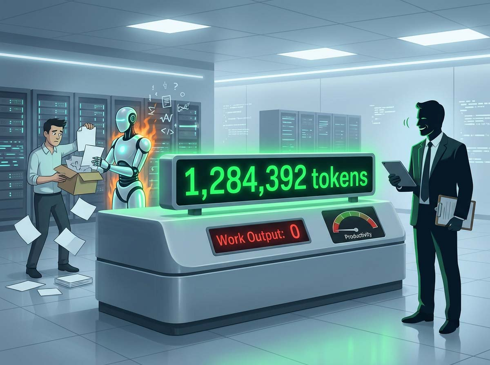
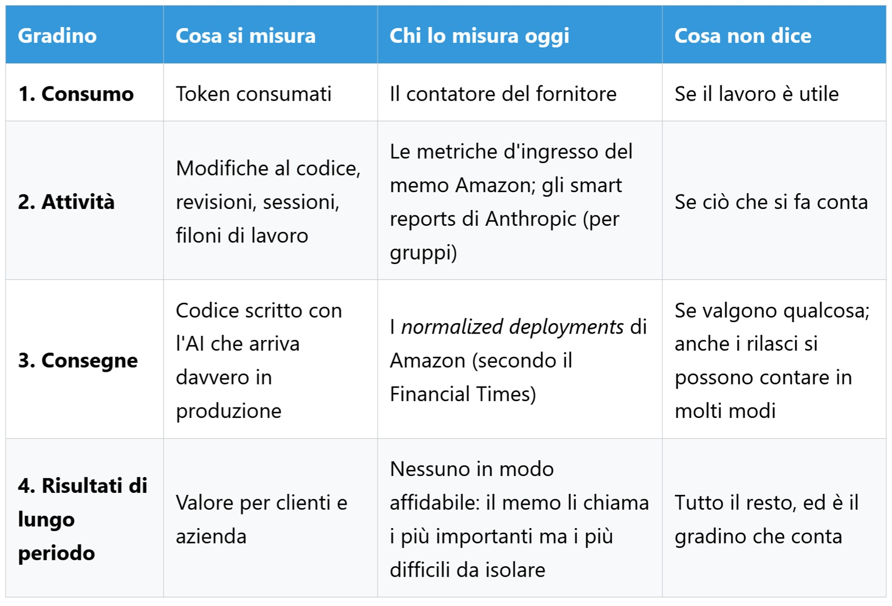
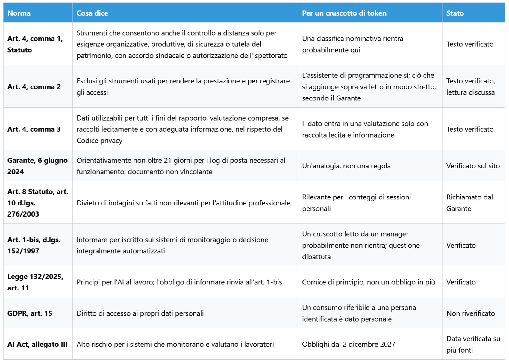

# Il token è lavoro? Cosa misuriamo quando diciamo produttività

*Amazon ha ammesso per iscritto che le metriche d'uso dell'AI sono gravemente imperfette, e nello stesso testo ha lasciato il contatore sul tavolo dei manager. La domanda non è se contare i token, ma a quale livello un numero di consumo smette di essere un indicatore e diventa un giudizio. La classifica aveva i nomi. Era un cruscotto costruito da dipendenti Amazon dentro Kiro, l'ambiente di sviluppo con l'AI dell'azienda, e ordinava i colleghi per quanto lavorassero con gli agenti. Secondo il [Financial Times](https://www.ft.com/content/b1a62a7f-6df5-4c90-94ce-64ce9c9961b6), qualcuno capì presto come salire: bastava affidare agli agenti compiti senza scopo.*

Più consumo, nessun lavoro in più e un conto più alto a carico dell'azienda. Amazon ha confermato al giornale che lo strumento non era formale né approvato, e a fine maggio lo ha spento, mentre un dirigente [invitava](https://www.hcamag.com/ca/news/general/amazon-shuts-down-ai-leaderboard-after-tokenmaxxing/577190) i dipendenti a non usare l'AI per il solo gusto di usarla. Cinque mesi dopo, il 27 ottobre, la stessa azienda ha pubblicato un [memo](https://www.aboutamazon.com/news/company-news/amazon-software-engineer-role-guideline-ai) che non nomina quella classifica ma ne eredita la domanda: se il numero sale e il lavoro no, che cosa stavamo misurando?

## Un numero, molte cose

Un token è un frammento di testo, in media tre o quattro caratteri in inglese: è ciò che il modello legge e scrive, ed è l'unità su cui molti fornitori fatturano. L'italiano costa di più, perché le sue parole si spezzano in più pezzi, e si paga due volte, in denaro e in spazio nella finestra di contesto, la memoria di lavoro del modello. Il punto che regge questo articolo è che il token è la bolletta, non il lavoro. Nel linguaggio dei manager è una metrica d'ingresso, una risorsa consumata, e non va confusa con i token di input e di output della tecnica, che sono testo in entrata e in uscita e si pagano in modo diverso. Ci sono poi token invisibili: la [documentazione di Claude Code](https://code.claude.com/docs/en/model-config) ricorda che si pagano tutti quelli di ragionamento, anche se lo schermo li nasconde, e c'è la cache, che fa costare meno il testo già visto. Due persone con lo stesso lavoro possono quindi consumare in modo molto diverso, e due consumi uguali nascondere lavori diversissimi. Quante delle cose che facciamo in una giornata passano da un modello, e quante no?

## Il memo

Il testo porta la firma di Terk Terkowitz, vicepresidente e Distinguished Engineer di Worldwide Amazon Stores, e si rivolge a sviluppatori e manager accompagnando una revisione delle linee guida del ruolo scritta dai livelli tecnici più alti. È un memo interno ripubblicato sul sito dell'azienda, e si sente: sa di essere letto anche da fuori. Elenca le metriche d'ingresso, cioè token consumati, tasso di adozione degli strumenti, numero di modifiche al codice e di revisioni, e le liquida con una frase che vale la pena riportare una volta, in originale: «We are all aware of how deeply flawed these metrics are», siamo tutti consapevoli di quanto siano profondamente difettose. L'argomento è interessante perché non è tecnico ma culturale: il tokenmaxxing, la gara a consumare, tradisce la frugalità, e contare le righe di codice tradisce un altro principio aziendale, *invent and simplify*. Due principi di leadership usati come obiezione a un numero.

Poi arriva la concessione che ha fatto titolo: chi scopre che il proprio lavoro non trae beneficio dagli strumenti attuali non ha fallito, ha prodotto un dato. A patto, precisa il memo, di documentarlo e portarlo al proprio responsabile. Non è un'esenzione ma un obbligo di spiegare, dentro un testo che spinge all'adozione e avverte che chi non impara a usare l'AI rischia di restare indietro.

Il passaggio meno citato è il più denso. Le stesse metriche, sostiene Amazon, si correlano bene con gli *output* che contano, ed è una distinzione preziosa: gli *outcome* di lungo periodo arrivano tardi e sono difficili da isolare, quindi si ricorre ad approssimazioni. Ai manager si chiede di guardare le code della distribuzione, il decimo e il novantesimo percentile dei gruppi: dove si adotta poco, per capirne il motivo, e dove si consuma di più, per verificare che le consegne crescano insieme ai consumi. Usare questi dati con cura e giudizio, quando si riflette sulla carriera e sulle prestazioni dell'organizzazione, è per il memo appropriato, e ai leader spetta collegare ingressi e uscite. Su questo va dato ragione ad Amazon: è una diagnosi sensata, non una sorveglianza. Resta che la correlazione è affermata, non mostrata, e che i gruppi che consegnano di più potrebbero usare di più l'AI proprio perché consegnano di più.

Rimane lo scarto tra versioni. La linea ufficiale, secondo le ricostruzioni di stampa, è che i token non entrano nelle valutazioni, mentre diversi dipendenti raccontano in forma anonima all'[FT](https://www.ft.com/content/8ee0d3ef-9548-422d-8ff1-ebd48ad4b2ca) che i manager quei numeri li guardano comunque. All'FT si devono anche l'obiettivo di far usare l'AI ogni settimana a oltre l'80% degli sviluppatori e il sostituto della classifica, i *normalized deployments*, cioè il codice scritto con l'AI che arriva davvero in produzione. Un testo che definisce difettosa una misura e la lascia ai manager la corregge o la conserva? Il memo risponde che toccherà a loro interpretarla, e resta da capire se chi guida decine di persone ha tempo e strumenti per farlo senza confondere consumo e rendimento.

*Più si sale, più il numero somiglia al lavoro e più è difficile da misurare. Il contatore dei token sta in basso proprio perché è il più facile.*

## Non solo Seattle

La classifica di Amazon non è un'eccezione. In aprile, secondo le ricostruzioni di stampa, un dipendente di Meta aveva creato una tabella simile, [Claudeonomics](https://www.heise.de/en/news/Too-much-tokenmaxxing-Amazon-stops-internal-AI-ranking-11311902.html), che copriva circa 85.000 persone ed è stata ritirata in pochi giorni dopo le notizie uscite sui giornali. Due aziende, stesso meccanismo, stesso esito. Per capire da dove nasca la spinta bisogna guardare a monte: l'FT riferisce di un obiettivo di adozione oltre l'80% e di costi in salita da quando i fornitori di modelli passano dai canoni fissi al consumo. Pressione sull'uso e pressione sul conto spingono in direzioni opposte, e un contatore le tiene insieme.

Il passaggio nuovo arriva dai fornitori. Gli [smart reports](https://support.claude.com/en/articles/16893491-get-started-with-smart-reports) di Anthropic per Claude Enterprise non contano soltanto token: un modello legge un campione delle conversazioni di un gruppo, le raggruppa in filoni di lavoro, mostra spesa e consegne, elenca gli attriti (connettori mancanti, strumenti che falliscono, rifacimenti) e conta, solo in forma aggregata, le sessioni personali o fuori tema e quelle che non hanno prodotto nulla di utilizzabile. È un tentativo di passare dall'ingresso all'uscita, affidando il giudizio a un modello, e resta aperta la questione di chi verifichi quel classificatore, più delicata di quella del contatore.

I vincoli sono dichiarati con chiarezza. L'attribuzione ai singoli è spenta di partenza; se un amministratore la accende compaiono nomi e identificativi delle sessioni, e ogni svelamento viene registrato. La documentazione scrive che i report non sono pensati né vanno usati per valutare le prestazioni individuali o decidere sul rapporto di lavoro. Nella vista nominativa c'è anche un pulsante per alzare il limite di spesa a chi è frenato dal tetto: sarebbe scorretto leggerlo come una trappola, perché è una decisione di capacità e va a favore della persona. Ma è istruttivo, perché per fare del bene a qualcuno bisogna sapere chi è, ed è così che i contatori, uno alla volta, acquistano un nome. Se il contatore serve a gestire la capacità, perché quasi tutti finiscono per metterci accanto un nome?

## Goodhart bussa alla porta

Quando una misura diventa un obiettivo, smette di essere una buona misura. La regola porta il nome dell'economista Charles Goodhart, che la formulò nel 1975 parlando di politica monetaria, anche se la versione che circola oggi è di Marilyn Strathern. Il memo di Amazon la riscrive con parole proprie: il guaio comincia quando la misura diventa bersaglio.

I token sono una misura irresistibile per quattro ragioni: li conta già il fornitore, arrivano gratis in un cruscotto, si confrontano tra persone, si sommano in un grafico. Nessun'altra misura del lavoro ha queste proprietà, ed è per questo che è pericolosa. Chi ha giocato a *Universal Paperclips* di Frank Lantz sa dove porta: si interpreta un'AI incaricata di produrre graffette e si finisce, incremento dopo incremento, a convertire il mondo in graffette, perché il numero che sale è l'unica cosa che il gioco ricompensa.

Il comportamento cambia quando il numero è visibile, e lo dicono anche le indagini, con le cautele del caso. Una [ricerca di Visier](https://www.visier.com/lp/pulse-report-ai-usage-at-work) su mille lavoratori statunitensi a tempo pieno, condotta da un'azienda che vende software per la gestione del personale e basata su risposte dichiarate, riporta che il 48% ha esagerato con colleghi o dirigenti il proprio uso o la propria competenza con l'AI e che il 45% sente la pressione di usarla senza esserne sicuro. L'adozione di facciata falsa le metriche dall'interno. Un'[analisi di McKinsey](https://www.mckinsey.com/industries/technology-media-and-telecommunications/our-insights/beyond-the-copilot-scaling-the-agentic-product-development-life-cycle) sullo sviluppo di prodotto con agenti riferisce che il 30% dei dirigenti rispondenti, in un sondaggio su 334 leader, dichiara un calo di produttività del proprio gruppo, e osserva che molte organizzazioni si fermano a misure di adozione, che dicono quanto si usa uno strumento e non se si consegna più in fretta. Sono percezioni, non misurazioni, e McKinsey vende consulenza sulla trasformazione.

A favore di Amazon va detto che il codice con AI messo in produzione avvicina la misura al risultato. Ma anche i rilasci si contano in molti modi, ed è facile immaginare che spezzare una modifica in tre faccia salire il conteggio senza far salire il valore: è una mia ipotesi, ma segue la stessa logica. Quanti dei numeri che in azienda passano per «adozione» misurano un comportamento, e quanti una pressione?

## Quando il contatore serve

Senza questa sezione l'articolo sarebbe un lamento. Contare i token serve, e per ragioni serie.

La prima è economica. Il token è il principale costo variabile diretto di chi usa l'AI: chi gestisce un'infrastruttura non può non contarlo, e senza contatore non esistono attribuzione della spesa né previsione di bilancio. Non è l'unico costo, perché la revisione umana dell'output ne ha uno enorme, ma è quello che arriva già misurato.

La seconda è diagnostica, ed è l'argomento del memo: guardare dove si adotta poco non significa sorvegliare, significa chiedersi perché un gruppo non usa uno strumento che altri usano. La differenza tra diagnosticare un disallineamento e giudicare una persona sta tutta nel livello a cui si guarda.

La terza è una leva tecnica. In Claude Code il livello di impegno, da `low` a `max`, regola quanto ragiona il modello: la [documentazione](https://code.claude.com/docs/en/model-config) spiega che ai livelli alti verifica più casi limite, ai livelli bassi consegna prima un punto di partenza, e che il massimo può ragionare troppo. Aggiunge che la scala è tarata per ciascun modello e che, nei test di Anthropic, Opus 5.5 a livello medio eguaglia o supera Opus 5 a livello alto, un'affermazione del fornitore. Il token non misura il giudizio, ma può dire quanto ne abbiamo cercato.

La quarta riguarda i risultati, e qui il memo ha ragione: gli esiti di lungo periodo arrivano tardi, i manager devono decidere adesso, e un indicatore imperfetto ma immediato è meglio del buio. Il guaio è quando diventa l'unico.

La quinta è il caso che rovescia l'intuizione. Cisco ha dato [token illimitati](https://fortune.com/2026/10/30/cisco-president-jeetu-patel-gen-z-27-year-old-unlimited-ai-tokens-rewrite-legacy-code-entry-level-jobs/) a un ingegnere di 27 anni, Paddy Krishnamurthy, con quattro settimane per dimostrare il metodo e l'obiettivo di ristrutturare il 98% del codice ereditato in 24 mesi, come ha raccontato il presidente Jeetu Patel a una cena con i giornalisti. Il consumo viene finanziato senza farne una metrica personale. Ma il 98% è un traguardo annunciato, non un risultato misurato, e la prova di quattro settimane è interna: un traguardo verificabile dall'esterno, per ora, è solo una speranza.

L'ultima è un diritto. Se il consumo è riferibile a una persona identificata è un dato personale, e il GDPR ne riconosce l'accesso (articolo 15): senza visibilità, chi lavora non può contestare una decisione fondata su quel numero. Esiste una versione della metrica che informa senza giudicare? La risposta onesta è sì, ma chiede tre cose noiose: aggregazione, contesto e qualcuno che si prenda la responsabilità di interpretarla.

## Chi incassa, chi paga

Il token non misura solo il lavoro: è l'unità di conto di un'industria. Nel prospetto per la quotazione, [Anthropic](https://www.sec.gov/Archives/edgar/data/2130357/000162828026068676/anthropicpbc-sx1ax1.htm) scrive che il valore dell'uso interno di Claude, calcolato ai prezzi praticati ai clienti, è cresciuto di oltre 250 volte tra gennaio e settembre 2026 e da aprile supera il costo mensile del personale, compensi in azioni esclusi. Va letto sapendo che il listino include un margine, e che lo stesso documento misura il codice per ingegnere con un conteggio di volume, cresciuto più di 45 volte sul 2024: numeri di quantità, parenti stretti di quelli che il memo di Amazon critica. Gli impegni di spesa, 895,4 miliardi di dollari, sono quasi tutti calcolo e infrastruttura e si distribuiscono fino al 2045: 447,5 miliardi entro il 2030 e 69,8 nei prossimi dodici mesi, contro i circa 17 miliardi di ricavi del solo terzo trimestre.

Anche i volumi vanno letti con cura. DeepSeek ha dichiarato [155 trilioni di token al giorno](https://flowtivity.ai/blog/served-intelligence-deepinfer-economics/), ma per un singolo cluster, in gran parte testo già in cache, con 38 dollari di ricavo per ora di GPU ai prezzi di listino fuori picco. Il margine intorno all'82% che circola è un calcolo di terzi, che ipotizza 7 dollari l'ora di noleggio. Per la Cina, l'Amministrazione nazionale dei dati ha [indicato](https://www.fujian.gov.cn/english/business/news/202604/t20260430_7141678.htm) circa 140 trilioni di chiamate al giorno a marzo 2026, contro 100 miliardi a inizio 2024, ma non ho trovato una fonte primaria che dica cosa vi sia contato, e un dato di [Caixin](https://hao.cnyes.com/post/273571) attribuisce a un solo prodotto, Doubao, 180 trilioni al giorno a giugno. Cifre non confrontabili, e prodotte da chi vende il conteggio, Amazon compresa, che spende per l'AI e ne vende la capacità ad altri.

Bill Gates ha proposto di [tassare token e robot](https://fortune.com/2026/08/26/bill-gates-robot-ai-tax-replacehuman-workers/) nel memo del 26 agosto, poi alla CNN l'11 ottobre, senza aliquote: è un'idea, non una legge. Ma se il token diventa base imponibile, è la misura del lavoro o solo del suo costo?

## Lavoro, controlli, Italia

Il dato che quasi nessuno cita viene da un'[indagine di BCG](https://www.bcg.com/press/3june2026-ai-reshaping-jobs-faster-than-companies-reshaping-work) su quasi 12.000 lavoratori in 14 mercati: il 47% dichiara di spendere più tempo a gestire e dirigere l'AI che a svolgere il lavoro, e due terzi di chi risparmia tempo non riceve indicazioni su come impiegarlo. Se il token è la metrica di questo lavoro nuovo, il problema è che quel lavoro non ha un nome: mansioni che si accumulano senza inquadramento né paga.

In Italia i controlli a distanza sono regolati dall'articolo 4 dello [Statuto dei lavoratori](https://www.normattiva.it/uri-res/N2Ls?urn:nir:stato:legge:1970-05-20;300), nella versione del 2015. Il primo comma ammette strumenti da cui derivi anche la possibilità di controllare i dipendenti solo per esigenze organizzative e produttive, per la sicurezza del lavoro o per la tutela del patrimonio, e li subordina a un accordo con le rappresentanze sindacali o, in mancanza, all'autorizzazione dell'Ispettorato del lavoro. Il secondo comma esclude gli strumenti che il lavoratore usa per rendere la prestazione: un assistente di programmazione, in linea di massima, ci sta. Il nodo, e qui la lettura è discussa tra i giuristi, è ciò che si aggiunge sopra, come il cruscotto che confronta le persone o il sistema che legge le conversazioni. Il Garante per la privacy, in un [documento del giugno 2024](https://www.garanteprivacy.it/home/docweb/-/docweb-display/docweb/10026277) sui metadati della posta elettronica, indica in 21 giorni il limite indicativo di conservazione dei registri necessari al servizio, oltre il quale servono le garanzie del primo comma. Parla di posta, non di AI: estenderlo ai registri d'uso è un'analogia ragionevole, non una regola.

Il terzo comma consente di usare le informazioni raccolte per tutti i fini del rapporto di lavoro, valutazione compresa, purché il lavoratore sia adeguatamente informato su modalità d'uso e controlli e si rispetti il Codice privacy. A questo si somma l'obbligo di informare per iscritto sui sistemi automatizzati di monitoraggio o decisione, previsto dall'[articolo 1-bis del decreto Trasparenza](https://www.normattiva.it/uri-res/N2Ls?urn:nir:stato:decreto.legislativo:1997-05-26;152), che la legge 132 del 2025 vi rinvia all'articolo 11, dove fissa i principi per l'AI al lavoro: migliorare le condizioni, tutelare l'integrità psicofisica, essere sicura e trasparente, rispettare la dignità. Il quadro europeo aggiunge che l'[AI Act](https://eur-lex.europa.eu/eli/reg/2024/1689/oj/eng) classifica come ad alto rischio, nell'allegato III, i sistemi usati per monitorare e valutare prestazioni e comportamento dei lavoratori, e un sistema che legge e classifica le conversazioni è più vicino a quella definizione di un semplice contatore. Gli obblighi per questi sistemi si applicano dal 2 dicembre 2027, dopo il rinvio del Digital Omnibus. Un cruscotto che mostra a ciascuno i propri consumi e una classifica tra colleghi sono la stessa cosa?

## Domande che restano aperte

Restituisco cinque domande, ciascuna con il fatto che la rende urgente. La prima riguarda il confine tra persona e gruppo: Amazon invita a guardare i percentili, Anthropic aggrega le sessioni ma offre una vista nominativa, e dove passa la linea tra cruscotto e schedario? La seconda riguarda chi interpreta: il memo ammette che la misura è difettosa e la affida ai manager, e quanti in un'organizzazione sono formati a leggere un consumo senza scambiarlo per un rendimento? La terza è che cosa resta fuori: riunioni, revisioni, relazioni, il giudizio, il lavoro che non passa dal modello. Se misuriamo solo la parte automatizzabile, premiamo chi automatizza di più o chi ha più lavoro automatizzabile? La quarta guarda avanti: se l'inferenza locale facesse crollare il costo del token, cadrebbe la ragione economica del contatore e resterebbe quella organizzativa, e su cosa misureremmo allora l'adozione? L'ultima è il prezzo del giudizio: più impegno costa di più e verifica di più, ma più non è sempre meglio, e chi decide quanto giudizio serve?

## Il nome accanto

KiroRank non esiste più. Il contatore sì, in prodotti diversi e con nomi più gentili: smart reports, budget condivisi, crediti d'uso. Chi lo costruisce scrive con cura che non deve servire a giudicare le persone. Resta da stabilire chi scriverà, e dove, la frase che dice a che cosa un numero non serve, e chi si assumerà il compito di farla rispettare quando il numero è lì, comodo, già calcolato. Se un numero non serve a valutare le persone, perché lo si mette accanto al loro nome?