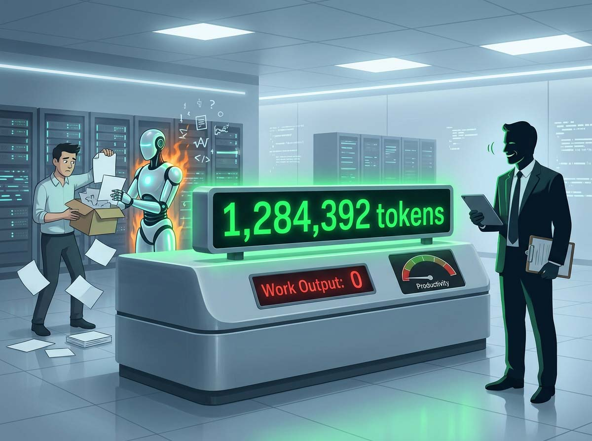
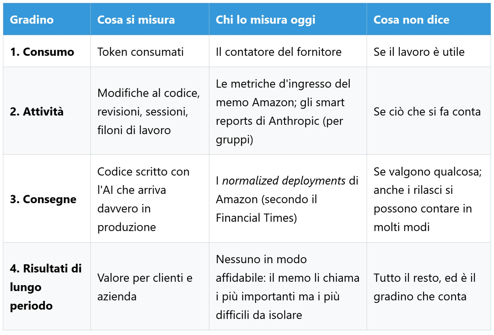
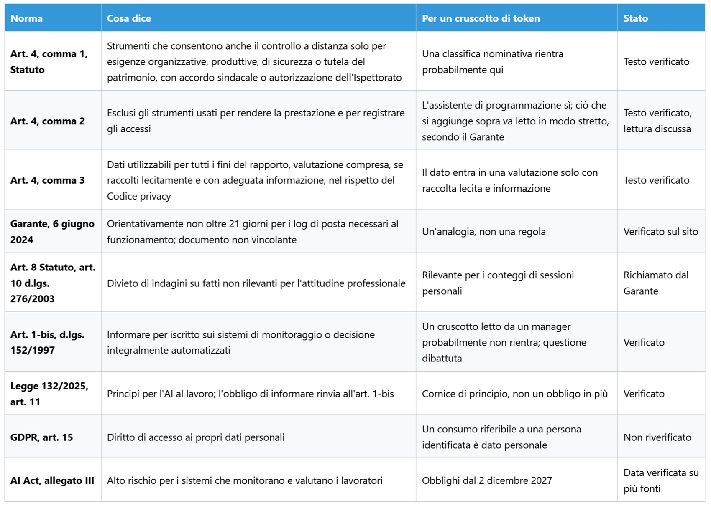

# Ist ein Token Arbeit? Was wir messen, wenn wir von Produktivität sprechen

*Amazon hat schriftlich eingeräumt, dass Metriken zur KI-Nutzung grundlegend fehlerhaft sind – und im selben Text den Zähler auf den Schreibtischen der Manager belassen. Die Frage ist nicht, ob man Token zählen sollte, sondern ab welchem Punkt ein Verbrauchswert aufhört, ein betrieblicher Indikator zu sein, und zu einem Leistungsurteil wird. Die Bestenliste enthielt Klarnamen. Es handelte sich um ein internes Dashboard, das Amazon-Mitarbeiter innerhalb von Kiro – der unternehmenseigenen KI-Entwicklungsumgebung – aufgesetzt hatten und das Kollegen danach sortierte, wie intensiv sie mit autonomen Agenten arbeiteten. Dem [Financial Times](https://www.ft.com/content/b1a62a7f-6df5-4c90-94ce-64ce9c9961b6)-Bericht zufolge begriffen etliche Ingenieure schnell, wie man aufsteigt: Man musste den Agenten lediglich völlig zwecklose Aufgaben übertragen.*

Mehr Verbrauch, keinerlei zusätzliche Arbeitsleistung und eine höhere Rechnung zu Lasten des Unternehmens. Amazon bestätigte gegenüber der Zeitung, dass das Tool weder offiziell noch autorisiert gewesen sei, und schaltete es Ende Mai ab, während eine Führungskraft die Belegschaft [dazu aufrief](https://www.hcamag.com/ca/news/general/amazon-shuts-down-ai-leaderboard-after-tokenmaxxing/577190), KI nicht bloß um des Nutzens willen einzusetzen. Fünf Monate später, am 27. Oktober, veröffentlichte das Unternehmen ein internes [Memo](https://www.aboutamazon.com/news/company-news/amazon-software-engineer-role-guideline-ai), das jene Bestenliste zwar nicht namentlich erwähnt, aber deren Kernfrage aufgreift: Wenn die Zahl steigt, die geleistete Arbeit aber nicht – was haben wir dann eigentlich gemessen?

## Eine Zahl, viele Bedeutungen

Ein Token ist ein Textfragment, im Englischen durchschnittlich drei bis vier Zeichen lang: Es ist das, was das Modell liest und generiert, und die Abrechnungseinheit fast aller Modellanbieter. Italienisch oder Deutsch fallen ins Gewicht, weil sich ihre Wörter in mehr Teilkomponenten aufspalten, was Teams doppelt belastet: finanziell und beim verfügbaren Platz im Kontextfenster, dem Arbeitsspeicher des Modells. Der Leitgedanke dieses Artikels ist: Das Token ist die Stromrechnung, nicht die Arbeit. In der Managersprache handelt es sich um eine Eingangsmetrik (*Input Metric*), eine verbrauchte Ressource – nicht zu verwechseln mit den technischen Input- und Output-Tokens, die eingehenden Prompt-Text und ausgegebene Antworten bezeichnen und zu unterschiedlichen Tarifen abgerechnet werden. Zudem existieren unsichtbare Tokens: Die [Dokumentation von Claude Code](https://code.claude.com/docs/en/model-config) erinnert daran, dass sämtliche Reasoning-Tokens voll bezahlt werden müssen, selbst wenn die Bildschirmoberfläche sie verbirgt, ergänzt um Kontext-Caching, das bereits verarbeiteten Text vergünstigt. Zwei Personen mit demselben Aufgabenbereich können daher höchst unterschiedlich verbrauchen, und zwei identische Verbrauchswerte können grundverschiedene Tätigkeiten verschleiern. Wie viel von dem, was wir im Laufe eines Tages leisten, läuft über ein Modell – und wie viel nicht?

## Das Memo

Das Dokument trägt die Unterschrift von Terk Terkowitz, Vizepräsident und Distinguished Engineer bei Worldwide Amazon Stores, und richtet sich an Software-Entwickler und Führungskräfte, flankiert von einer Neufassung der Rollenrichtlinien durch die höchsten technischen Fachstufen. Es ist ein internes Memo, das auf der Firmenwebsite öffentlich publiziert wurde, und das merkt man ihm an: Es ist sich bewusst, auch von außen gelesen zu werden. Es listet Eingangsmetriken auf – verbrauchte Tokens, Tool-Adoptionsraten, Anzahl von Code-Änderungen und Reviews – und wischt sie mit einem Satz vom Tisch, der es verdient, im Original zitiert zu werden: «We are all aware of how deeply flawed these metrics are» (Wir sind uns alle bewusst, wie tiefgreifend fehlerhaft diese Metriken sind). Die Argumentation ist bemerkenswert, weil sie nicht technisch, sondern kulturell ansetzt: Das *Tokenmaxxing*, der Wettlauf um reinen Rechenzeitverbrauch, widerspricht dem Führungsprinzip der *Frugalität*, und das Zählen von Codezeilen untergräbt ein weiteres Prinzip, *invent and simplify*. Zwei Führungsprinzipien als Einwand gegen eine simple Zahl.

Darauf folgt das Zugeständnis, das für Schlagzeilen sorgte: Wer feststellt, dass die eigene Arbeit von den derzeitigen Werkzeugen nicht profitiert, hat nicht versagt; er hat einen nützlichen Datenpunkt geliefert. Unter einer klaren Bedingung, wie das Memo betont: Man muss dies sauber dokumentieren und mit der eigenen Führungskraft besprechen. Es ist kein Freibrief, sondern eine Begründungspflicht innerhalb eines Textes, der massiv zur Adoption antreibt und davor warnt, dass abgehängt wird, wer den Umgang mit KI nicht lernt.

Die am wenigsten zitierte Passage ist zugleich die gehaltvollste. Dieselben Eingangsmetriken, so postuliert Amazon, korrelieren positiv mit jenen *Outputs*, auf die es tatsächlich ankommt – eine entscheidende Unterscheidung: Langfristige *Outcomes* stellen sich erst spät ein und sind schwer zu isolieren, weshalb man zu operativen Näherungswerten greift. Manager werden aufgefordert, die Verteilungsenden zu analysieren – konkret das 10. und 90. Perzentil der Teams: dort hinzuschauen, wo wenig adoptiert wird, um die Ursachen zu verstehen, und dort zu prüfen, wo am meisten verbraucht wird, um sicherzustellen, dass die Produktivitätsausbringung parallel zum Ressourcenverbrauch wächst. Diese Daten mit Bedacht und Urteilskraft heranzuziehen, wenn über Karriereverläufe und Teamleistungen nachgedacht wird, sei laut Memo vollkommen angemessen; den Führungskräften obliege es, Input und Output zusammenzuführen. In diesem Punkt muss man Amazon zustimmen: Das beschreibt eine rationale betriebliche Diagnose, keine Überwachung. Es bleibt jedoch dabei: Die Korrelation wird lediglich behauptet, nicht belegt, und Teams mit höherem Ausstoß nutzen KI womöglich schlicht deshalb mehr, weil ihr Gesamtdurchsatz ohnehin höher ist.

Es bleibt die Diskrepanz zwischen Verlautbarung und Praxis. Die offizielle Linie lautet, dass Tokens nicht in Mitarbeiterbeurteilungen einfließen; mehrere Ingenieure berichten gegenüber der [FT](https://www.ft.com/content/8ee0d3ef-9548-422d-8ff1-ebd48ad4b2ca) anonym, dass Führungskräfte sehr wohl auf diese Zahlen blicken. Aus dem FT-Bericht stammen auch die Vorgabe, dass über 80 % der Entwickler wöchentlich KI einsetzen sollen, sowie der Ersatz für die Rangliste: *Normalized Deployments* – also mit KI geschriebener Code, der tatsächlich in die Produktion gelangt. Korrigiert ein Text, der eine Messgröße als fehlerhaft einstuft und sie dennoch den Managern überlässt, das Problem, oder zementiert er es? Das Memo antwortet, es sei an ihnen, die Zahlen klug zu deuten. Es bleibt offen, ob Führungskräfte mit Dutzenden Mitarbeitern Zeit und methodische Rüstzeuge besitzen, um Ressourcenverbrauch nicht mit Leistungsfähigkeit zu verwechseln.

*Je weiter man nach oben steigt, desto mehr ähnelt die Zahl echter Arbeit und desto schwerer lässt sie sich messen. Der Token-Zähler steht ganz unten, schlicht weil er am leichtesten zu erfassen ist.*

## Nicht nur Seattle

Amazons Rangliste war kein Einzelfall. Im April hatte nach Medienberichten ein Meta-Mitarbeiter eine vergleichbare Übersicht namens [Claudeonomics](https://www.heise.de/en/news/Too-much-tokenmaxxing-Amazon-stops-internal-AI-ranking-11311902.html) aufgesetzt, die rund 85.000 Beschäftigte erfasste und nach öffentlichem Bekanntwerden innerhalb weniger Tage eingestampft wurde. Zwei Konzerne, dieselbe Mechanik, dasselbe Ergebnis. Um zu verstehen, woher der Druck rührt, muss man die Wertschöpfungskette betrachten: Die FT verweist auf Adoptionsziele von über 80 % und stark steigende Ausgaben, seitdem Modellanbieter von Pauschalen auf reine Nutzungsabrechnung umstellen. Druck auf die Nutzung und Druck auf das Budget wirken in entgegengesetzte Richtungen – ein Zähler versucht beides einzufangen.

Der jüngste Schritt kommt von den Anbietern selbst. Anthropic [Smart Reports](https://support.claude.com/en/articles/16893491-get-started-with-smart-reports) für Claude Enterprise zählen nicht nur Tokens: Ein Modell liest eine Stichprobe der Team-Konversationen, fasst sie zu Arbeitssträngen zusammen, stellt Kosten und Arbeitsergebnisse gegenüber, führt Reibungspunkte auf (fehlende Schnittstellen, scheiternde Tool-Calls, wiederholte Überarbeitungen) und erfasst – in aggregierter Form – private oder themenfremde Sitzungen sowie solche, die kein verwertbares Ergebnis erbrachten. Das ist der Versuch, vom Input zum Output überzugehen, indem man die Bewertung an ein Modell delegiert. Damit stellt sich allerdings die heikle Frage, wer wiederum dieses Prüfmodell überprüft – ein Problem, das weit komplexer ist als das simple Ablesen eines Zählers.

Die Schutzgrenzen sind klar definiert. Die Zuordnung zu Einzelpersonen ist standardmäßig deaktiviert; aktiviert ein Administrator diese Funktion, werden Namen und Sitzungs-IDs sichtbar, wobei jede De-Anonymisierung protokolliert wird. Die Dokumentation betont ausdrücklich, dass diese Berichte weder dafür gedacht sind noch dazu genutzt werden dürfen, individuelle Leistungen zu bewerten oder arbeitsrechtliche Entscheidungen zu treffen. In der namentlichen Ansicht gibt es zudem eine Schaltfläche, um das Ausgabenlimit für Mitarbeiter zu erhöhen, die durch Budgetdeckel ausgebremst werden: Dies als Falle abzutun wäre unzutreffend, da es der Kapazitätssteuerung dient und dem Mitarbeiter nützt. Es ist jedoch lehrreich: Um jemanden gezielt zu fördern, muss man wissen, wer er ist – und so erhalten Zähler schrittweise ein konkretes Gesicht. Wenn der Zähler nur der Kapazitätssteuerung dient, warum ordnet fast jedes System am Ende doch einen Klarnamen zu?

## Goodhart klopft an die Tür

Wenn eine Kennzahl zum Ziel wird, hört sie auf, eine gute Kennzahl zu sein. Diese Regel geht auf den Ökonomen Charles Goodhart zurück, der sie 1975 bezogen auf die Geldpolitik formulierte, auch wenn die heute gängige Fassung von Marilyn Strathern stammt. Das Amazon-Memo formuliert dies mit eigenen Worten: Das Problem beginnt, wenn die Kennzahl zur Zielvorgabe mutiert.

Tokens sind aus vier Gründen eine unwiderstehliche Messgröße: Der Anbieter zählt sie ohnehin, sie landen kostenlos im Dashboard, erlauben Vergleiche zwischen Personen und summieren sich mühelos in einer Grafik. Keine andere Kennzahl für geistige Arbeit besitzt diese Eigenschaften, und genau deshalb ist sie trügerisch. Wer Frank Lantz’ *Universal Paperclips* gespielt hat, weiß, wohin das führt: Man steuert eine KI, die Büroklammern produzieren soll, und endet Schritt für Schritt damit, das gesamte Universum in Büroklammern zu verwandeln, weil die steigende Zahl das Einzige ist, was die Belohnungsfunktion honoriert.

Das Verhalten ändert sich zwangsläufig, sobald eine Kennzahl sichtbar wird, wie auch arbeitswissenschaftliche Erhebungen mit den gebotenen methodischen Vorbehalten zeigen. Eine [Studie von Visier](https://www.visier.com/lp/pulse-report-ai-usage-at-work) unter tausend Vollzeitbeschäftigten in den USA – durchgeführt von einem HR-Softwareanbieter auf Basis von Selbstauskünften – ergab, dass 48 % gegenüber Kollegen oder Vorgesetzten ihre KI-Nutzung oder -Kompetenz übertrieben haben und 45 % einen Druck verspüren, KI einzusetzen, ohne sich ihres Nutzens sicher zu sein. Fassaden-Adoption verfälscht Kennzahlen von innen heraus. Eine [Analyse von McKinsey](https://www.mckinsey.com/industries/technology-media-and-telecommunications/our-insights/beyond-the-copilot-scaling-the-agentic-product-development-life-cycle) zur agentenbasierten Produktentwicklung berichtet, dass 30 % der befragten Führungskräfte (in einer Erhebung unter 334 Leitenden) einen Rückgang der Teamproduktivität feststellen. Sie merkt an, dass viele Unternehmen bei reinen Adoptionsmetriken verharren, die lediglich abbilden, wie oft ein Werkzeug aufgerufen wird, nicht aber, ob Arbeitsergebnisse zügiger ausgeliefert werden. Das sind subjektive Wahrnehmungen, keine Labormessungen – und McKinsey vertreibt Transformationsberatung –, doch sie beleuchten spürbare Reibungsverluste.

Zugunsten von Amazon muss man anführen, dass die Erfassung von KI-gestütztem Code, der tatsächlich in Produktion geht, die Messung näher an das reale Ergebnis rückt. Doch auch Deployments lassen sich auf vielerlei Weise zählen, und es liegt auf der Hand, dass die Aufteilung einer Änderung in drei separate Releases die Statistik nach oben treibt, ohne zusätzlichen Wert zu schaffen. Wie viele der Zahlen, die in Unternehmen als „Adoption“ firmieren, messen tatsächlichen Wandel – und wie viele bloß institutionellen Anpassungsdruck?

## Wann der Zähler gebraucht wird

Ohne diesen Abschnitt wäre dieser Artikel eine bloße Klage. Das Zählen von Tokens ist notwendig und beruht auf handfesten Gründen.

Der erste Grund ist rein ökonomischer Natur. Das Token ist der zentrale direkte variable Kostenfaktor beim KI-Einsatz: Wer eine technische Infrastruktur steuert, kann auf diese Erfassung nicht verzichten; ohne Zähler gibt es weder interne Kostenverrechnung noch solide Budgetplanung. Es ist nicht der einzige Kostenfaktor – die menschliche Prüfung der Ausgaben erzeugt immense Personalkosten –, aber es ist jener, der bereits fertig ausgewiesen auf der Monatsrechnung steht.

Der zweite Grund ist diagnostischer Art, wie das Memo treffend ausführt: Bereiche mit geringer Nutzung zu identifizieren dient nicht der Überwachung, sondern der Frage, warum ein Team ein Werkzeug meidet, das anderen hilft. Der Unterschied zwischen der Diagnose von Prozessbrüchen und der Leistungsbewertung eines Einzelnen hängt ausschließlich vom Aggregationsgrad der Daten ab.

Der dritte Grund ist ein technischer Hebel. In Claude Code steuert der Parameter für den Denkaufwand (*reasoning effort*), abgestuft von `low` bis `max`, wie intensiv das Modell abwägt: Die [Dokumentation](https://code.claude.com/docs/en/model-config) erläutert, dass höhere Stufen mehr Randfälle prüfen, während niedrigere Stufen schneller einen ersten Ausgangspunkt liefern, und dass die Maximalstufe zu unnötig ausschweifendem Nachdenken neigen kann. Sie ergänzt, dass die Skala für jedes Modell individuell kalibriert ist und dass laut Anthropic-internen Tests Opus 5.5 auf mittlerer Stufe die Leistung von Opus 5 auf hoher Stufe erreicht oder übertrifft. Das Token misst nicht menschliche Urteilskraft, aber es beziffert, wie viel rechnerische Reflexion angefordert wurde.

Der vierte Aspekt betrifft Liefertermine, und hier liegt das Memo richtig: Langfristige strategische Auswirkungen zeigen sich erst mit Verzögerung, Führungskräfte müssen jedoch im Hier und Jetzt entscheiden, und ein unvollkommener, aber sofort verfügbarer Indikator ist besser als völliger Blindflug. Gefährlich wird es erst dann, wenn er zur alleinigen Bewertungsbasis erhoben wird.

Der fünfte Grund zeigt sich in einem Fall, der gängige Denkmuster auf den Kopf stellt. Cisco stellte dem 27-jährigen Ingenieur Paddy Krishnamurthy [unbegrenzte Tokens](https://fortune.com/2026/10/30/cisco-president-jeetu-patel-gen-z-27-year-old-unlimited-ai-tokens-rewrite-legacy-code-entry-level-jobs/) zur Verfügung – mit einem vierwöchigen Zeitfenster zum Nachweis seiner Methodik und dem Ziel, 98 % des Altsystems innerhalb von 24 Monaten zu modernisieren, wie Präsident Jeetu Patel Journalisten berichtete. Der Rechenaufwand wird großzügig alimentiert, ohne ihn in eine individuelle Überwachungsmetrik umzumünzen. Allerdings sind jene 98 % eine angekündigte Zielmarke, kein testiertes Ergebnis, und die vierwöchige Testphase war rein intern: Ein extern überprüfbarer Nachweis bleibt vorerst Zukunftsmusik.

Der letzte Grund ist ein Recht. Wenn der Verbrauch einer identifizierbaren Person zugeordnet werden kann, stellt er ein personenbezogenes Datum dar, und die DSGVO garantiert Betroffenen ein Auskunftsrecht (Artikel 15): Ohne Einsicht in diese Protokolle können Beschäftigte eine auf solchen Zahlen basierende Personalentscheidung nicht anfechten. Gibt es eine Variante dieser Kennzahl, die informiert, ohne abzuurteilen? Die ehrliche Antwort lautet Ja – doch sie erfordert drei mühsame Voraussetzungen: statistische Aggregation, Einbettung in den Arbeitskontext und Führungskräfte, die die Verantwortung für deren Interpretation übernehmen.

## Wer kassiert, wer bezahlt

Das Token quantifiziert nicht nur Arbeit: Es ist die Verrechnungseinheit einer gesamten Industrie. In seinem Börsenprospekt legt [Anthropic](https://www.sec.gov/Archives/edgar/data/2130357/000162828026068676/anthropicpbc-sx1ax1.htm) dar, dass der rechnerische Wert der internen Claude-Nutzung – bemessen an den Endkundenpreisen – zwischen Januar und September 2026 um mehr als das 250-Fache gestiegen ist und seit April die monatlichen Personalkosten ohne aktienbasierte Vergütungen übersteigt. Man muss diese Zahl mit dem Wissen lesen, dass Listenpreise beträchtliche Margen enthalten, und dass dasselbe Dokument die Ingenieursleistung anhand reiner Code-Volumina misst, die gegenüber 2024 um mehr als das 45-Fache gestiegen seien: quantitative Kennzahlen, die eng mit jenen verwandt sind, die das Amazon-Memo kritisiert. Die langfristigen Ausgabenverpflichtungen des Unternehmens in Höhe von 895,4 Milliarden Dollar entfallen fast vollständig auf Rechenleistung und Cloud-Infrastruktur bis 2045: davon 447,5 Milliarden bis 2030 und 69,8 Milliarden in den kommenden zwölf Monaten – gegenüber Quartalserlösen von rund 17 Milliarden Dollar im dritten Quartal.

Auch globale Volumenzahlen verlangen einen nüchternen Blick. DeepSeek bezifferte den Durchsatz für einen einzelnen Cluster auf [155 Billionen Tokens pro Tag](https://flowtivity.ai/blog/served-intelligence-deepinfer-economics/) – zum Großteil bereits im Cache abgelegter Kontext –, mit einem Umsatz von rund 38 Dollar pro GPU-Stunde zu verkehrsarmen Zeiten. Die kolportierte Rohmarge von rund 82 % beruht auf Schätzungen Dritter, die von sieben Dollar Servermiete pro Stunde ausgehen. In China meldete die Nationale Datenverwaltung für März 2026 rund [140 Billionen API-Aufrufe pro Tag](https://www.fujian.gov.cn/english/business/news/202604/t20260430_7141678.htm), verglichen mit 100 Milliarden Anfang 2024. Eine Primärquelle über die Zählweise liegt jedoch nicht vor, während Daten von [Caixin](https://hao.cnyes.com/post/273571) allein dem Produkt Doubao im Juni 180 Billionen Tokens täglich zuschrieben. Zahlen, die kaum vergleichbar sind und von jenen Akteuren stammen, die Rechenleistung vermarkten – einschließlich Amazon, das eigene KI-Kosten stemmt und zugleich Cloud-Kapazitäten an Dritte verkauft.

Bill Gates schlug in einem Memo vom 26. August sowie am 11. Oktober auf CNN vor, [Tokens und Roboter zu besteuern](https://fortune.com/2026/08/26/bill-gates-robot-ai-tax-replacehuman-workers/) – ohne konkrete Steuersätze zu nennen: ein Denkanstoß, kein Gesetzesvorhaben. Doch wenn das Token zur Bemessungsgrundlage wird: Misst es dann reale Arbeitsleistung oder lediglich die Kosten automatisierter Ausführung?

## Arbeitsrecht, Überwachung und der italienische Rechtsrahmen

Die Zahl, die in der Debatte kaum auftaucht, liefert eine [BCG-Erhebung](https://www.bcg.com/press/3june2026-ai-reshaping-jobs-faster-than-companies-reshaping-work) unter fast 12.000 Beschäftigten in 14 Ländern: 47 % gaben an, mehr Zeit mit dem Instruieren und Steuern der KI zu verbringen als mit ihren eigentlichen Fachaufgaben, und zwei Drittel derer, die Zeit einsparen, erhalten keine Vorgaben, wie sie diese freigesetzte Arbeitszeit nutzen sollen. Wenn das Token zum Maßstab dieser Arbeitsrealität wird, liegt das Grundproblem darin, dass diese Tätigkeit keinen Namen hat: zusätzliche Aufgaben, die ohne Tätigkeitsbeschreibung oder tarifliche Einstufung anfallen.

In Italien regelt Artikel 4 des [Arbeitnehmerstatuts (Statuto dei lavoratori)](https://www.normattiva.it/uri-res/N2Ls?urn:nir:stato:legge:1970-05-20;300) in der Fassung von 2015 die Fernüberwachung am Arbeitsplatz. Absatz 1 gestattet Systeme, die eine mittelbare Leistungskontrolle ermöglichen, ausschließlich aus betrieblich-organisatorischen Gründen, zur Arbeitssicherheit oder zum Schutz des Betriebsvermögens, gekoppelt an eine Betriebsvereinbarung mit den Gewerkschaften oder eine Genehmigung der Arbeitsaufsichtsbehörde. Absatz 2 nimmt Werkzeuge aus, die der Arbeitnehmer unmittelbar zur Erbringung seiner Arbeitsleistung einsetzt: Ein Programmierassistent fällt grundsätzlich unter diesen Ausnahmetatbestand. Die juristische Kernfrage – und hier gehen die Meinungen auseinander – betrifft die darüber gelagerten Analyseebenen, wie Dashboards mit Mitarbeitervergleichen oder Systeme, die Prompt-Inhalte auswerten. Die italienische Datenschutzbehörde (Garante per la protezione dei dati personali) nannte in einem [Dokument vom Juni 2024](https://www.garanteprivacy.it/home/docweb/-/docweb-display/docweb/10026277) zu E-Mail-Metadaten eine Regelfrist von 21 Tagen für die Speicherung betriebsnotwendiger Protokolle, nach deren Ablauf die Schutzgarantien des ersten Absatzes greifen. Das betrifft E-Mails, nicht explizit KI: Dies auf KI-Nutzungsprotokolle zu übertragen ist eine naheliegende Analogie, aber noch kein festes Richterrecht.

Absatz 3 erlaubt die Verwertung gewonnener Daten für alle Zwecke des Arbeitsverhältnisses, einschließlich Leistungsbewertungen, vorausgesetzt, der Beschäftigte wurde vorab angemessen über Nutzungsbedingungen und Kontrollmodalitäten informiert und die Datenschutzgesetze werden gewahrt. Hinzu kommt die Pflicht zur schriftlichen Unterrichtung über automatisierte Überwachungs- und Entscheidungssysteme gemäß [Artikel 1-bis des Transparenzdekrets (D.lgs. 152/1997)](https://www.normattiva.it/uri-res/N2Ls?urn:nir:stato:decreto.legislativo:1997-05-26;152), worauf das italienische Gesetz 132 von 2025 in Artikel 11 verweist, um Grundsätze für KI am Arbeitsplatz festzulegen: Verbesserung der Arbeitsbedingungen, Schutz der psychophysischen Unversehrtheit, Sicherheit, Transparenz und Wahrung der Menschenwürde. Auf europäischer Ebene stuft der [EU AI Act](https://eur-lex.europa.eu/eli/reg/2024/1689/oj/eng) in Anhang III Systeme zur Überwachung und Bewertung von Leistung und Verhalten der Beschäftigten als Hochrisiko-KI ein; eine Lösung, die Konversationen mitliest und kategorisiert, steht dieser Definition weitaus näher als ein reiner Infrastrukturzähler. Die Pflichten für solche Hochrisikosysteme greifen nach den Fristverschiebungen des Digital Omnibus ab dem 2. Dezember 2027. Sind ein Dashboard, das jedem Mitarbeiter den persönlichen Verbrauch anzeigt, und eine vergleichende Rangliste zwischen Kollegen ein und dasselbe?

## Fragen, die offenbleiben

Ich formuliere fünf Kernfragen, untermauert von den Tatsachen, die sie dringlich machen. Die erste betrifft die Grenze zwischen Kollektivstatistik und Individuum: Amazon rät zum Blick auf Perzentile, Anthropic aggregiert Chats und bietet zugleich namentliche Ansichten – wo verläuft die Trennlinie zwischen Steuerungs-Dashboard und Überwachungsakte? Die zweite betrifft die Deutungskompetenz: Das Memo räumt ein, dass die Messgröße fehlerhaft ist, und überträgt die Interpretation den Managern – wie viele Führungskräfte sind geschult, einen Verbrauchswert zu lesen, ohne ihn mit Leistungsfähigkeit gleichzusetzen? Die dritte zielt auf das Nicht-Erfasste: Besprechungen, Architektur-Reviews, zwischenmenschliche Abstimmung, kritisches Urteilsvermögen – jene Denkarbeit, die an keinem Modell vorbeikommt. Wenn wir nur den automatisierbaren Anteil messen, belohnen wir dann die produktivsten Mitarbeiter oder jene mit den am leichtesten automatisierbaren Aufgaben? Die vierte blickt nach vorn: Wenn lokale Inferenz die Tokenkosten einbrechen ließe, entfiele die ökonomische Begründung des Zählers und nur die organisatorische bliebe übrig – woran bemessen wir dann Adoption? Die letzte Frage berührt den Preis des Denkens: Höherer Denkaufwand treibt die Kosten und prüft mehr Randfälle, doch mehr ist nicht automatisch besser – wer entscheidet, wie viel synthetische Reflexion eine Aufgabe erfordert?

## Der Name neben der Zahl

KiroRank existiert nicht mehr. Der Zähler hingegen besteht fort – in anderen Produkten und unter gefälligeren Bezeichnungen: Smart Reports, geteilte Budgets, Nutzungsguthaben. Deren Entwickler betonen sorgfältig, dass sie nicht dazu dienen dürfen, Mitarbeiter zu bewerten. Es bleibt offen, wer festlegen wird, und in welchen internen Richtlinien, wozu eine Kennzahl ausdrücklich nicht herangezogen werden darf – und wer dafür geradesteht, diese Grenzen durchzusetzen, wenn die Zahl fix und fertig im Dashboard vorliegt. Wenn eine Kennzahl nicht dazu taugt, Menschen zu bewerten: Warum stellt man sie dann unweigerlich neben ihren Namen?
