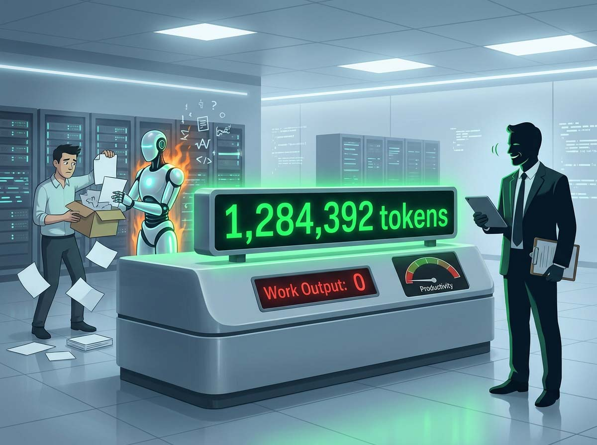
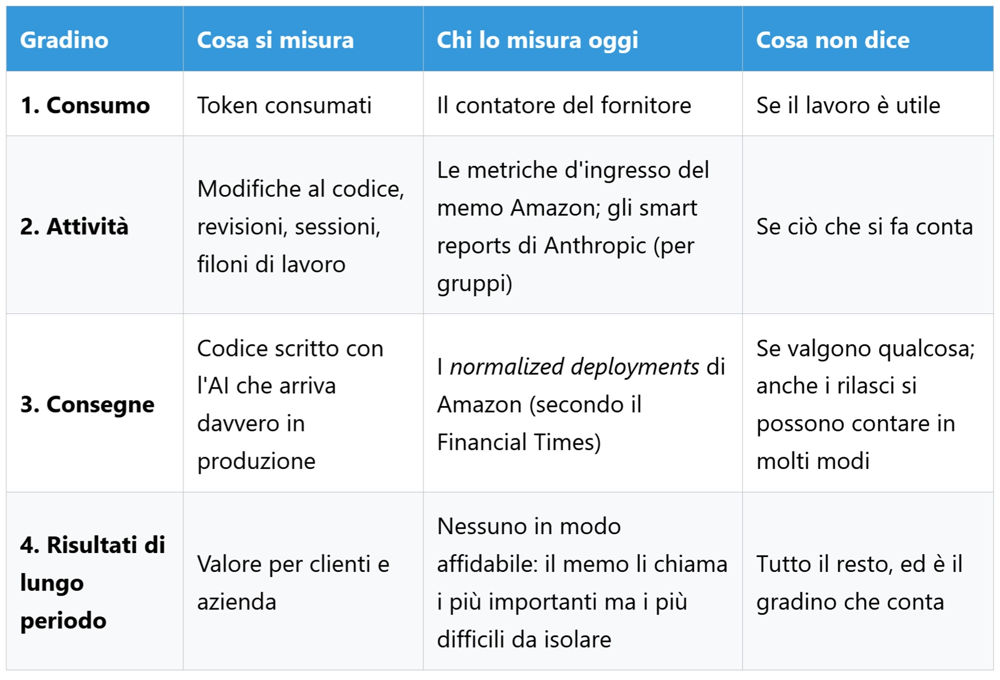
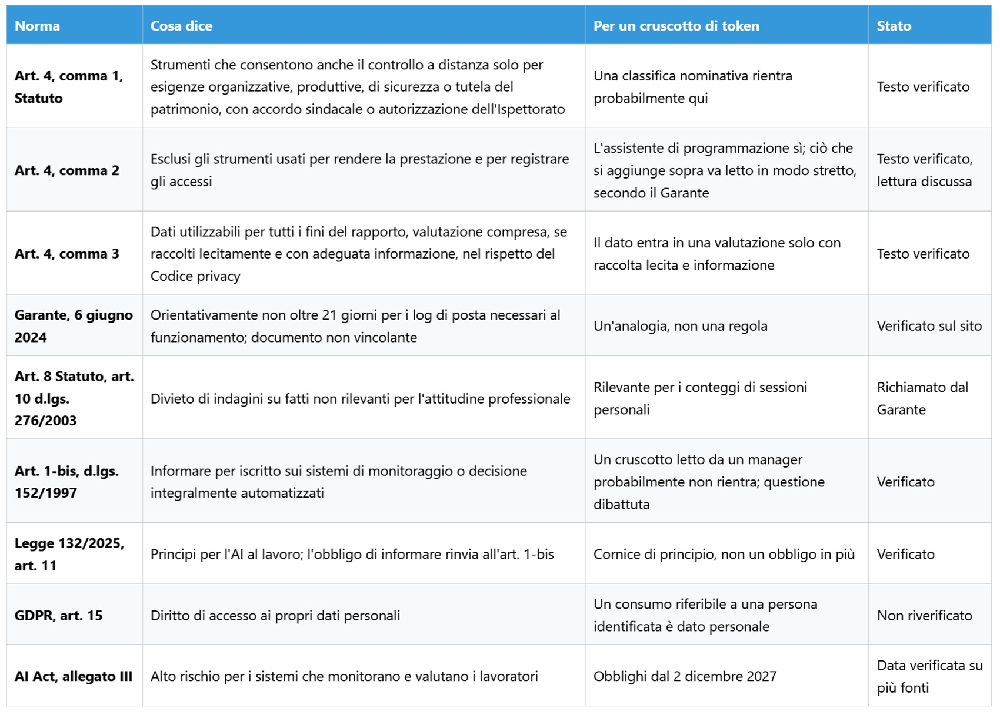

# Is a Token Work? What We Measure When We Say Productivity

*Amazon admitted in writing that AI usage metrics are deeply flawed, yet in the very same text left the counter sitting on managers' desks. The question is not whether to count tokens, but at what point a consumption metric ceases to be an operational indicator and becomes a performance evaluation. The leaderboard displayed real names. It was an internal dashboard built by Amazon employees inside Kiro—the company's AI development environment—ranking colleagues by how extensively they worked with autonomous agents. According to the [Financial Times](https://www.ft.com/content/b1a62a7f-6df5-4c90-94ce-64ce9c9961b6), several engineers quickly realized how to game the system: simply assign the agents pointless, resource-intensive tasks.*

Higher consumption, zero additional output, and a steeper cloud bill absorbed by the company. Amazon confirmed to the publication that the tool was neither official nor authorized, shutting it down in late May, while an executive [urged](https://www.hcamag.com/ca/news/general/amazon-shuts-down-ai-leaderboard-after-tokenmaxxing/577190) employees not to adopt AI merely for the sake of using it. Five months later, on October 27, the company released an internal [memo](https://www.aboutamazon.com/news/company-news/amazon-software-engineer-role-guideline-ai) that avoids mentioning the defunct leaderboard by name but inherits its core dilemma: when numbers climb without a corresponding rise in delivered work, what exactly are we measuring?

## One Number, Many Meanings

A token is a fragment of text, averaging three to four characters in English: it represents what the model ingests and generates, and it serves as the billing unit across API providers. Italian, among other languages, incurs a higher cost because its words fracture into a greater number of subword pieces, penalizing teams twice—in raw financial cost and in context window consumption, the model's active working memory. The foundational premise of this article is that a token represents the utility bill, not the work performed. In managerial terminology, it is an input metric—a consumed operational resource—and should not be conflated with the technical distinction between input and output tokens, which represent incoming prompts versus generated responses and carry different pricing tiers. Invisible tokens also enter the equation: [Claude Code documentation](https://code.claude.com/docs/en/model-config) highlights that reasoning tokens are fully billable, even when hidden from the user interface, alongside prompt caching mechanisms that lower the cost of repeated context. Consequently, two developers tackling identical assignments can exhibit vastly disparate token consumption, while identical consumption totals can conceal entirely different engineering tasks. How much of what we do in a day actually passes through a model, and how much does not?

## The Memo

The document is authored by Terk Terkowitz, Vice President and Distinguished Engineer at Worldwide Amazon Stores, addressing software engineers and engineering managers alongside an updated set of role guidelines drafted by senior technical leadership. As an internal memo republished on the corporate website, its tone reflects acute awareness of an external public audience. It catalogs standard input metrics—tokens consumed, tool adoption rates, commit counts, and code review volumes—and dismisses them with a sentence worth quoting verbatim: «We are all aware of how deeply flawed these metrics are». The underlying rationale is particularly notable because it frames the issue culturally rather than technically: "tokenmaxxing"—the competitive race to burn compute—violates the leadership principle of *frugality*, while tallying raw lines of code undermines *invent and simplify*. Two core leadership tenets weaponized against a simplistic metric.

Then comes the concession that drove headlines: an engineer who discovers that their immediate workflow derives no tangible benefit from current AI tooling has not failed; they have generated an operational data point. Provided, the memo stresses, that they document their findings and discuss them with their manager. It is not an exemption from accountability, but an obligation to justify, embedded within a document that aggressively pushes AI adoption and warns that failing to master these tools risks obsolescence.

The least quoted passage is by far the most consequential. Amazon asserts that these input metrics correlate meaningfully with impactful business *outputs*—a vital distinction: long-term business *outcomes* materialize slowly and prove notoriously difficult to isolate, necessitating operational proxies. Managers are directed to scrutinize the tails of distribution curves—specifically the 10th and 90th percentiles across teams: investigating low-adoption cohorts to diagnose roadblocks, while inspecting high-consumption cohorts to verify that production deliveries scale proportionately with compute spend. Employing these data points thoughtfully during performance evaluations and organizational reviews is, according to the memo, entirely appropriate, placing the onus on leadership to bridge the gap between inputs and outputs. On this point, Amazon's stance is defensible: it describes sound operational diagnosis rather than punitive surveillance. Nevertheless, this positive correlation is merely asserted rather than demonstrated, and high-performing teams might simply consume more AI resources precisely because their overall throughput is already higher.

A noticeable discrepancy persists between official narratives and operational realities. Amazon's official corporate stance maintains that token consumption does not factor into formal employee reviews, yet multiple engineers speaking anonymously to the [FT](https://www.ft.com/content/8ee0d3ef-9548-422d-8ff1-ebd48ad4b2ca) report that managers actively scrutinize those metrics. The FT report also revealed an internal organizational target mandating that over 80% of developers use AI tools weekly, alongside the metric introduced to replace the leaderboard: *normalized deployments*—code generated with AI assistance that successfully ships to production. Does a memo that denounces a metric as deeply flawed while leaving it in managers' hands rectify the problem, or institutionalize it? The memo answers that leadership must interpret the data with discernment, leaving unresolved whether engineering managers overseeing dozens of direct reports possess the bandwidth and methodological rigor to decouple raw compute consumption from genuine engineering impact.

*The higher one ascends, the more a metric reflects genuine work and the more challenging it becomes to quantify. The token counter sits at the very bottom precisely because it is trivial to measure.*

## Beyond Seattle

Amazon's internal leaderboard is hardly an anomaly. In April, industry reports revealed that a Meta employee had deployed a similar internal dashboard dubbed [Claudeonomics](https://www.heise.de/en/news/Too-much-tokenmaxxing-Amazon-stops-internal-AI-ranking-11311902.html), tracking approximately 85,000 employees before being decommissioned within days following press scrutiny. Two tech giants, the identical mechanism, the identical outcome. To understand the root of this pressure, one must examine macro economics: the FT notes aggressive 80%+ adoption targets colliding with rising cloud expenses as model providers transition enterprise agreements from flat licensing fees to pure usage-based pricing. Mandating widespread adoption while simultaneously controlling operational spend creates opposing organizational incentives, reconciled only through an active consumption counter.

The latest evolution originates directly from the vendors. Anthropic's [smart reports](https://support.claude.com/en/articles/16893491-get-started-with-smart-reports) for Claude Enterprise do not merely tally tokens: an underlying model analyzes a sample of team conversations, clusters them into distinct work streams, maps expenditure against delivered milestones, identifies systemic friction points (missing connectors, failing tool calls, extensive rework), and quantifies—strictly in aggregate—off-topic personal sessions or interactions that yielded zero usable artifacts. It represents an ambitious attempt to shift focus from raw input consumption to meaningful output by delegating analytical judgment to an AI model, raising the delicate question of who audits the auditing model—a governance challenge far more complex than reading a simple counter.

Platform guardrails are explicitly defined. Individual identity attribution is disabled by default; should an administrator enable it, user identities and session IDs become visible, with every deanonymization event logged in audit trails. Documentation explicitly cautions that smart reports are neither intended nor permitted for evaluating individual performance or driving personnel decisions. Within the named administrative view, a dedicated control allows administrators to lift spend caps for constrained power users: viewing this as an executive trap would be disingenuous, as it serves resource provisioning and directly benefits the developer. Yet it proves instructive: to direct resources effectively, organizations inevitably identify individuals, illustrating how aggregate telemetry inexorably acquires specific names. If a counter exists purely for capacity management, why does almost every implementation end up appending an employee name?

## Goodhart Knocks at the Door

When a measure becomes a target, it ceases to be a good measure. This principle bears the name of economist Charles Goodhart, who articulated it in 1975 regarding monetary policy, though the contemporary formulation is widely credited to anthropologist Marilyn Strathern. Amazon's memo restates the concept in corporate terms: organizational distortion begins the moment an operational proxy is transformed into a performance target.

Tokens represent an irresistible operational metric for four structural reasons: providers already track them automatically, they populate enterprise dashboards at zero marginal cost, they allow seamless cross-employee comparison, and they aggregate effortlessly into executive charts. Virtually no other measure of intellectual labor possesses these characteristics, which is precisely why it is dangerous. Anyone who has played Frank Lantz's *Universal Paperclips* recognizes the dynamic: players command an AI instructed to manufacture paperclips, eventually consuming the entire universe in a recursive loop because an ascending number is the only signal the reward function acknowledges.

Human behavior predictably shifts once performance metrics become visible, a reality confirmed by workplace research. A survey by [Visier](https://www.visier.com/lp/pulse-report-ai-usage-at-work) polling 1,000 full-time US workers—conducted by a HR software vendor and based on self-reported data—found that 48% of respondents had exaggerated their AI proficiency or usage frequency to colleagues or managers, while 45% felt organizational pressure to use AI despite uncertainty regarding its utility. Performative adoption corrupts operational metrics from within. Furthermore, a [McKinsey analysis](https://www.mckinsey.com/industries/technology-media-and-telecommunications/our-insights/beyond-the-copilot-scaling-the-agentic-product-development-life-cycle) examining agentic software development reports that 30% of surveyed engineering leaders (out of 334 executives) observed an actual decline in team productivity, noting that organizations routinely stall at adoption metrics that gauge tool usage frequency rather than acceleration of delivery cycles. While these represent qualitative perceptions rather than controlled empirical measurements—and McKinsey actively markets transformation consulting—they highlight structural friction.

To Amazon's credit, tracking AI-assisted code successfully deployed to production ties measurement closer to tangible results. Yet software releases can also be quantified in multiple ways, and it requires little imagination to see how splitting a single feature pull request into three distinct deployments inflates the metric without creating incremental business value. How much of what corporate dashboards categorize as "AI adoption" reflects genuine behavioral transformation, and how much represents organizational compliance?

## When the Counter Serves a Purpose

Without this section, this analysis would read as a one-sided grievance. Counting tokens remains essential, rooted in rigorous operational requirements.

First and foremost is economic discipline. Token consumption constitutes the primary direct variable cost of generative AI infrastructure: anyone managing cloud budgets must account for it, and without precise metering, neither department chargebacks nor financial forecasting are possible. While not the only expense—human review of synthetic output carries immense labor costs—it is the one that arrives pre-metered on the invoice.

The second is diagnostic utility, as articulated in Amazon's memo: identifying low-adoption pockets is not about employee surveillance, but about investigating why a team struggles with tooling that benefits peers elsewhere. The distinction between diagnosing systemic workflow friction and evaluating individual capability depends entirely on the level of organizational aggregation.

The third is technical control. Within Claude Code, the reasoning effort parameter, ranging from `low` to `max`, governs how extensively the model plans and analyzes: official [documentation](https://code.claude.com/docs/en/model-config) notes that higher settings evaluate more edge cases, lower settings yield rapid initial scaffolds, and maximum effort can lead to overthinking. It adds that effort scales are calibrated per model architecture and that Anthropic's evaluations indicate Opus 5.5 at medium effort matches or exceeds Opus 5 at high effort—a vendor claim, but technically informative. Token consumption does not evaluate human discernment, but it quantifies how much computational reasoning was requested.

The fourth pertains to delivery velocity, where the memo's logic is sound: definitive long-term outcomes take quarters to emerge, managers must make resourcing decisions today, and an imperfect real-time proxy is superior to complete operational blindness. The hazard arises when that proxy becomes the sole metric evaluated.

The fifth presents an intriguing counterintuitive case study. Cisco granted [unlimited tokens](https://fortune.com/2026/10/30/cisco-president-jeetu-patel-gen-z-27-year-old-unlimited-ai-tokens-rewrite-legacy-code-entry-level-jobs/) to 27-year-old engineer Paddy Krishnamurthy, providing a four-week window to validate a refactoring methodology aimed at modernizing 98% of legacy code within 24 months, as recounted by President Jeetu Patel during a press dinner. Here, compute consumption was lavishly funded without being converted into a personal surveillance metric. Yet that 98% represents an ambitious corporate target rather than an audited milestone, and the initial four-week sprint was an internal trial: externally verifiable impact remains, for now, prospective.

Finally, transparency represents a legal right. Under European regulatory frameworks, if token telemetry is tied to an identifiable employee, it constitutes personal data, and the GDPR grants a fundamental right of access (Article 15): absent visibility into these logs, workers cannot contest administrative or managerial determinations informed by those metrics. Can a metric inform without judging? The candid answer is yes, but it demands three unglamorous disciplines: data aggregation, workflow context, and managerial accountability for interpretation.

## Who Profits, Who Pays

Tokens measure far more than engineering labor: they serve as the foundational accounting currency for an entire industry. In its public offering prospectus, [Anthropic](https://www.sec.gov/Archives/edgar/data/2130357/000162828026068676/anthropicpbc-sx1ax1.htm) stated that the annualized value of its internal Claude usage, calculated at commercial customer list prices, surged over 250-fold between January and September 2026, exceeding non-equity payroll expenses since April. This disclosure must be contextualized: list prices incorporate healthy vendor margins, and the same filing measures developer output through raw code volume metrics—which expanded more than 45-fold relative to 2024 levels—a volumetric framing closely related to the measures criticized by Amazon. Anthropic's forward commercial commitments, totaling $895.4 billion, are almost entirely dedicated to compute and cloud infrastructure extending out to 2045: with $447.5 billion committed through 2030 and $69.8 billion over the next twelve months alone, contrasted against approximately $17 billion in Q3 revenues.

Global volume metrics warrant equal scrutiny. DeepSeek claimed an operational throughput of [155 trillion tokens per day](https://flowtivity.ai/blog/served-intelligence-deepinfer-economics/) for an individual cluster—largely driven by cached context—generating roughly $38 in revenue per GPU hour at off-peak rates. The circulating ~82% gross margin represents a third-party estimate assuming a $7/hour server rental cost. In China, the National Data Administration [reported](https://www.fujian.gov.cn/english/business/news/202604/t20260430_7141678.htm) approximately 140 trillion daily API invocations as of March 2026, up from 100 billion in early 2024; however, primary sources clarifying underlying measurement methodologies remain unavailable, while [Caixin data](https://hao.cnyes.com/post/273571) attributed 180 trillion daily tokens to ByteDance's Doubao product alone by June. These metrics lack cross-comparability and emanate from vendors selling computational capacity—including Amazon, which simultaneously consumes internal AI capacity and monetizes cloud compute for external enterprises.

Bill Gates advocated for [taxing tokens and robotic automation](https://fortune.com/2026/08/26/bill-gates-robot-ai-tax-replacehuman-workers/) in an August 26 memo and reiterated the proposal on CNN on October 11, without detailing specific tax rates: an intellectual proposition rather than enacted policy. Yet if compute tokens become a recognized tax base, do they quantify labor value, or merely the cost of automated execution?

## Labor, Oversight, and Italian Legal Standards

The data point most frequently overlooked stems from a [BCG global survey](https://www.bcg.com/press/3june2026-ai-reshaping-jobs-faster-than-companies-reshaping-work) covering nearly 12,000 workers across 14 markets: 47% of respondents reported spending more time managing and prompting AI models than performing core domain tasks, while two-thirds of workers who saved time received no organizational guidance on how to reallocate the surplus. If token consumption is the operational metric of this emerging paradigm, the fundamental issue is that this labor remains unclassified: administrative overhead accumulating without formal job descriptions or adjusted compensation.

In Italy, remote employee monitoring is strictly governed by Article 4 of the [Workers' Statute (Statuto dei lavoratori)](https://www.normattiva.it/uri-res/N2Ls?urn:nir:stato:legge:1970-05-20;300), as reformed in 2015. The first paragraph permits systems that inadvertently enable remote employee oversight solely for organizational, production, workplace safety, or asset protection requirements, strictly mandating prior collective bargaining agreements with trade union representatives or, absent agreement, authorization from the National Labor Inspectorate. The second paragraph exempts tools directly utilized by employees to perform their assigned work: an AI coding assistant broadly fits this exemption. The critical legal crux—vigorously debated among labor jurists—concerns analytical layers superimposed on top of the tool, such as comparative performance dashboards or conversation-monitoring systems. The Italian Data Protection Authority (Garante per la protezione dei dati personali), in a [June 2024 guidance document](https://www.garanteprivacy.it/home/docweb/-/docweb-display/docweb/10026277) addressing email metadata, established a benchmark 21-day retention limit for operational service logs, beyond which the stringent co-determination requirements of the first paragraph apply. While framed around email, extending this principle to AI telemetry represents a compelling legal analogy, though not settled statutory doctrine.

The third paragraph allows data gathered through compliant systems to inform employment relationships, including performance appraisals, provided workers receive clear, advance notice regarding monitoring modalities and privacy safeguards under the Privacy Code. This is reinforced by mandatory written disclosure requirements governing automated monitoring or decision-making systems under [Article 1-bis of Legislative Decree 152/1997 (Transparency Decree)](https://www.normattiva.it/uri-res/N2Ls?urn:nir:stato:decreto.legislativo:1997-05-26;152). Italian Law 132/2025 cross-references this in Article 11, outlining foundational principles for workplace AI: enhancing working conditions, protecting psychological and physical integrity, ensuring security and transparency, and upholding human dignity. At the European level, the [EU AI Act](https://eur-lex.europa.eu/eli/reg/2024/1689/oj/eng) classifies systems designed to monitor or evaluate employee performance and workplace behavior as high-risk under Annex III; an analytics platform that reads and categorizes prompt interactions aligns far more closely with that regulatory classification than a simple infrastructure metering counter. Compliance deadlines for high-risk employment systems apply from December 2, 2027, following the Digital Omnibus timeline adjustments. Is an individual personal consumption view legally and operationally equivalent to a competitive peer leaderboard?

## Unresolved Questions

Five pressing questions emerge, each underscored by operational reality. The first addresses the boundary between collective telemetry and individual scrutiny: Amazon advises inspecting percentile bands, Anthropic aggregates sessions while offering named administrative views—where precisely does an operational dashboard end and an employee dossier begin? The second concerns analytical capability: the memo concedes the metric is flawed and delegates interpretation to line managers—how many managers across an enterprise possess the training to evaluate token consumption without confusing cost with performance? The third concerns unmeasured labor: strategic meetings, architecture reviews, interpersonal mentoring, critical judgment—the cognitive work that bypasses models entirely. If we measure only automatable activities, are we rewarding the most productive engineers, or merely those with the most automatable workflows? The fourth anticipates technological evolution: if local edge inference causes marginal token costs to collapse, the economic justification for metering evaporates, leaving only organizational surveillance—what then becomes the metric of adoption? The final question concerns the cost of algorithmic judgment: higher model effort increases compute costs and verifies more edge cases, but more reasoning is not universally superior—who determines the appropriate threshold of synthetic reasoning required for a task?

## The Name Beside the Number

KiroRank has been dismantled. The underlying counter, however, endures across modern software suites under more palatable labels: smart reports, shared compute budgets, usage tiers. Platform vendors take meticulous care to declare that these tools must not serve to evaluate individuals. It remains to be seen who will articulate, and in what policy documents, precisely what these numbers must never be used for—and who will enforce those boundaries when the counter sits conveniently compiled on executive dashboards. If a metric has no place in evaluating human performance, why does every platform insist on placing it alongside an employee's name?
