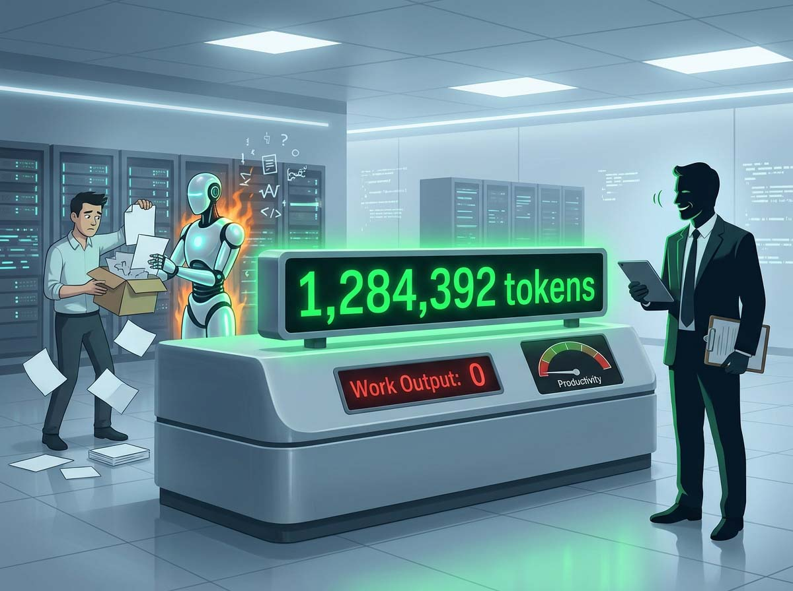
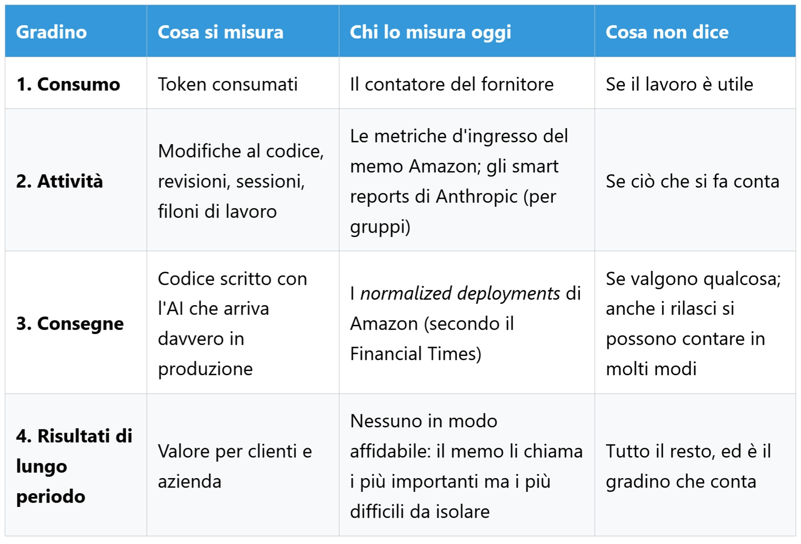
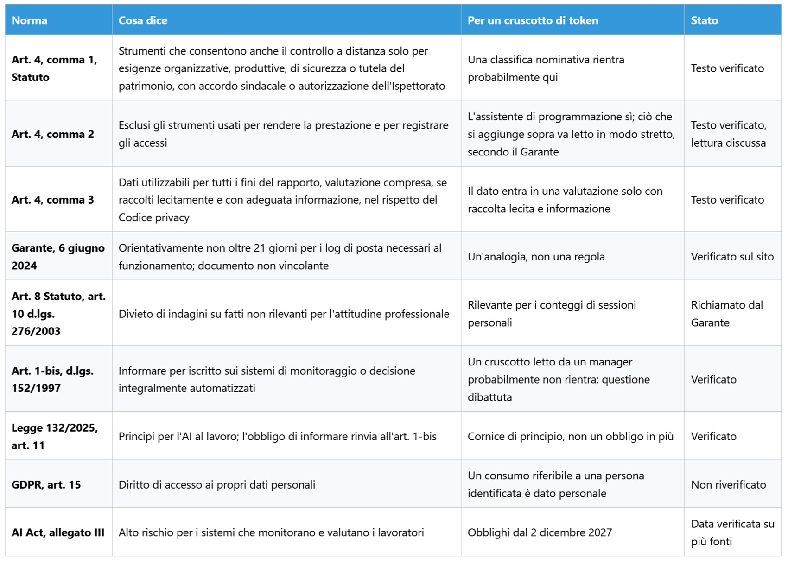

# ¿Es el token trabajo? Qué medimos cuando decimos productividad

*Amazon ha admitido por escrito que las métricas de uso de la IA son profundamente defectuosas y, en el mismo texto, ha dejado el contador sobre la mesa de los directivos. La cuestión no es si se deben contar los tokens, sino en qué punto un registro de consumo deja de ser un indicador operativo y se convierte en un juicio de valor. La clasificación mostraba nombres reales. Era un panel interno desarrollado por empleados de Amazon dentro de Kiro —el entorno de desarrollo con IA de la compañía— que ordenaba a los compañeros según el volumen de trabajo que delegaban en agentes autónomos. De acuerdo con el [Financial Times](https://www.ft.com/content/b1a62a7f-6df5-4c90-94ce-64ce9c9961b6), algunos ingenieros descubrieron de inmediato cómo escalar posiciones: bastaba con encargar a los agentes tareas deliberadamente inútiles.*

Mayor consumo, ningún trabajo adicional y una factura más abultada a cargo de la empresa. Amazon confirmó al periódico que la herramienta no era oficial ni contaba con autorización, procediendo a clausurarla a finales de mayo, mientras un directivo [instaba](https://www.hcamag.com/ca/news/general/amazon-shuts-down-ai-leaderboard-after-tokenmaxxing/577190) a la plantilla a no utilizar la IA por el mero afán de usarla. Cinco meses después, el 27 de octubre, la compañía publicó un [memorando](https://www.aboutamazon.com/news/company-news/amazon-software-engineer-role-guideline-ai) que no menciona expresamente aquella clasificación, pero que hereda su interrogante fundamental: si la cifra aumenta y el trabajo entregado no, ¿qué estábamos midiendo en realidad?

## Una cifra, múltiples realidades

Un token es un fragmento de texto, equivalente en promedio a tres o cuatro caracteres en inglés: constituye la unidad que el modelo procesa y genera, así como la base sobre la que facturan los proveedores. En español e italiano el coste resulta comparativamente superior, ya que sus vocablos se desglosan en más partes, penalizando a las organizaciones por partida doble: en la factura económica y en el espacio disponible en la ventana de contexto, la memoria operativa del modelo. La tesis central que articula este artículo es que el token refleja la factura del suministro eléctrico, no el trabajo efectivamente realizado. En el lenguaje de la dirección corporativa representa una métrica de entrada (*input metric*), un recurso consumido, y no debe confundirse con la distinción técnica entre tokens de entrada y de salida, que corresponden a los datos enviados y recibidos y se tarifican con tarifas diferentes. Existen asimismo tokens invisibles: la [documentación de Claude Code](https://code.claude.com/docs/en/model-config) advierte de que se abonan todos los tokens de razonamiento, con independencia de que la interfaz los oculte, además de las memorias caché de contexto que reducen el coste de la información ya procesada. Por ende, dos personas asignadas a una misma labor pueden consumir volúmenes sumamente dispares, y dos consumos numéricamente idénticos pueden enmascarar actividades profesionales de naturaleza opuesta. ¿Cuántas de las tareas que completáis a lo largo de una jornada pasan por un modelo y cuántas quedan al margen?

## El memorando

El documento lleva la firma de Terk Terkowitz, vicepresidente y Distinguished Engineer de Worldwide Amazon Stores, y se dirige a desarrolladores y directores de equipo acompañando una actualización de las pautas profesionales elaborada por los niveles técnicos más consolidados. Se trata de una circular interna difundida públicamente en el portal corporativo, lo que se aprecia con nitidez en su tono: es consciente de que será analizada desde el exterior. Enumera las métricas de entrada —tokens consumidos, ratio de adopción de herramientas, volumen de confirmaciones de código (*commits*) y revisiones efectuadas— y las descarta con una contundente declaración que merece citarse literalmente: «We are all aware of how deeply flawed these metrics are» (todos somos conscientes de lo profundamente defectuosas que son estas métricas). La argumentación reviste gran interés porque no es meramente técnica, sino cultural: el *tokenmaxxing* —la carrera desenfrenada por consumir computación— quebranta la *frugalidad*, al tiempo que computar líneas de código atenta contra otro principio corporativo cardinal, *invent and simplify*. Dos principios de liderazgo esgrimidos para impugnar una cifra simplista.

A renglón seguido figura la concesión que acaparó los titulares: aquel empleado que constate que su operativa diaria no obtiene beneficios de las herramientas actuales no ha fracasado; ha aportado un dato valioso. Con una salvedad indispensable, matiza el memorando: debe documentarlo rigurosamente y trasladarlo a su responsable directo. No constituye una exención de responsabilidades, sino una exigencia de justificación, enmarcada en un texto que apremia a la adopción y advierte de que quien no domine la IA corre el riesgo de quedar rezagado.

El pasaje menos divulgado es, paradójicamente, el más revelador. Amazon sostiene que esas mismas métricas guardan una correlación positiva con los resultados tangibles (*outputs*) que verdaderamente importan, introduciendo una distinción capital: los impactos estratégicos de largo recorrido (*outcomes*) tardan en consolidarse y resultan complejos de aislar, lo que obliga a recurrir a aproximaciones operativas. A los directivos se les encomienda examinar los extremos de la distribución, en particular los percentiles 10 y 90 de los equipos: identificando dónde la adopción es escasa para diagnosticar los motivos, y comprobando dónde el consumo es elevado para verificar que las entregas crezcan al mismo ritmo que el gasto. Aplicar estos datos con prudencia y criterio al ponderar la trayectoria profesional y el rendimiento de la organización resulta, a juicio del memorando, plenamente oportuno, asignando a los líderes el cometido de enlazar entradas con salidas. En este aspecto asiste la razón a Amazon: describe un diagnóstico operativo sensato, no una vigilancia punitiva. Con todo, la pretendida correlación se afirma sin demostrarse con evidencias públicas, y bien podría ocurrir que los equipos con mayor cadencia de entrega recurran más a la IA precisamente porque ya contaban con un rendimiento estructural superior.

Persiste, además, una discrepancia manifiesta entre las versiones. La postura corporativa oficial sostiene que los tokens no forman parte de las evaluaciones formales, mientras que diversos ingenieros revelan bajo anonimato al [FT](https://www.ft.com/content/8ee0d3ef-9548-422d-8ff1-ebd48ad4b2ca) que los directivos examinan sistemáticamente esos registros. Al propio FT se atribuye la revelación del objetivo de lograr que más del 80% de los programadores utilicen la IA de forma semanal, así como la fórmula sustitutoria del escalafón: los *normalized deployments*, es decir, el software asistido por IA que llega de forma efectiva a producción. ¿Acaso un texto que califica una métrica de defectuosa y a renglón seguido la deposita en manos de los mandos intermedios la neutraliza o la perpetúa? El memorando replica que competerá a ellos interpretarla con discernimiento, dejando sin despejar si quienes coordinan a decenas de profesionales disponen del tiempo y el instrumental analítico necesarios para no confundir consumo de recursos con productividad real.

*Cuanto más se asciende, más se asemeja la cifra al trabajo efectivo y más ardua resulta su medición. El contador de tokens se sitúa en la base precisamente por ser el más sencillo de registrar.*

## Más allá de Seattle

El panel de Amazon no constituye un caso aislado. En abril, de acuerdo con revelaciones periodísticas, un profesional de Meta implementó una tabla análoga, bautizada como [Claudeonomics](https://www.heise.de/en/news/Too-much-tokenmaxxing-Amazon-stops-internal-AI-ranking-11311902.html), que supervisaba a unos 85.000 empleados y fue desmantelada a los pocos días de trascender a la opinión pública. Dos corporaciones punteras, idéntica mecánica, idéntico desenlace. Para esclarecer el origen de semejante incentivo es preciso examinar la cadena de valor: el FT constata presiones para superar el 80% de adopción coincidiendo con el encarecimiento de los costes desde que los proveedores de modelos abandonaron las tarifas planas para imponer modelos basados estrictamente en el consumo. La urgencia por acelerar el uso combinada con la contención del gasto genera tensiones contrapuestas que un contador pretende arbitrar.

La innovación más reciente procede de los propios proveedores tecnológicos. Los [smart reports](https://support.claude.com/en/articles/16893491-get-started-with-smart-reports) de Anthropic orientados a Claude Enterprise no se limitan a tabular tokens: un modelo secundario analiza una muestra de las interacciones grupales, las clasifica en líneas de trabajo, coteja desembolsos frente a entregables, cataloga fricciones operativas (conectores ausentes, llamadas a herramientas fallidas, refactorizaciones) y cuantifica, con carácter agregado, las sesiones personales o inconexas y aquellas que no generaron valor tangible. Representa un ensayo destinado a pivotar del insumo al resultado confiando el juicio crítico a un modelo evaluador, lo que plantea el interrogante sobre quién fiscaliza al clasificador, dilema bastante más sensible que el cómputo aritmético.

Las salvaguardas se detallan con minuciosidad. La trazabilidad nominativa se encuentra desactivada por defecto; si un administrador decide habilitarla, se visualizan nombres e identificadores de sesión, registrándose cada desbloqueo en pistas de auditoría. La documentación puntualiza taxativamente que estos informes ni están diseñados ni deben emplearse para juzgar el rendimiento laboral individual o fundamentar medidas disciplinarias. En la visualización nominal figura incluso un comando para incrementar el techo de gasto de aquellos perfiles restringidos por la cuota: interpretarlo como una emboscada directiva sería inexacto, pues obedece a una gestión de capacidad en favor del propio usuario. Sin embargo, resulta revelador: para beneficiar a alguien resulta forzoso conocer su identidad, y es así como las métricas anónimas terminan adquiriendo nombres y apellidos. Si el contador tiene como finalidad gestionar recursos técnicos, ¿por qué casi todos acaban adosándole una etiqueta personal?

## Goodhart llama a la puerta

Cuando una medida se convierte en un objetivo, deja de ser una buena medida. Esta formulación lleva el nombre del economista británico Charles Goodhart, quien la enunció en 1975 en el contexto de la política monetaria, si bien la formulación divulgada en nuestros días procede de Marilyn Strathern. La circular de Amazon la reformula en sus propios términos: las distorsiones surgen cuando el indicador provisional se transforma en una meta imperativa.

Los tokens configuran una métrica seductora por cuatro propiedades: el proveedor ya los computa por defecto, se integran sin coste en los paneles, permiten la comparación inmediata entre empleados y se consolidan limpiamente en gráficos ejecutivos. Ningún otro indicador del trabajo intelectual reúne tales atributos, y es justamente ahí donde radica su peligro. Quien haya jugado a *Universal Paperclips*, de Frank Lantz, comprende adónde conduce esta dinámica: se asume el control de una IA encargada de fabricar clips y se termina, iteración tras iteración, transformando el universo entero en grapas, dado que el incremento numérico es el único estímulo reconocido por la función de recompensa.

Las conductas varían sustancialmente cuando el registro se vuelve visible, realidad refrendada por diversos estudios demoscópicos, aun con las debidas precauciones metodológicas. Una [investigación de Visier](https://www.visier.com/lp/pulse-report-ai-usage-at-work) sobre mil asalariados a jornada completa en EE. UU., elaborada por una firma proveedora de software de recursos humanos a partir de testimonios declarados, constata que el 48% ha exagerado ante superiores o compañeros su grado de dominio o frecuencia de uso de la IA, y que el 45% percibe una presión constante por utilizarla sin estar plenamente convencido de su idoneidad. La adopción puramente aparente vicia los datos desde el origen. Un [informe de McKinsey](https://www.mckinsey.com/industries/technology-media-and-telecommunications/our-insights/beyond-the-copilot-scaling-the-agentic-product-development-life-cycle) centrado en el desarrollo de producto mediante agentes refiere que el 30% de los líderes técnicos consultados (sobre una muestra de 334 directivos) percibe una merma efectiva en la productividad de sus departamentos, alertando de que muchas organizaciones se estancan en métricas de adopción que reflejan la frecuencia de uso del aplicativo pero no si las soluciones se despliegan con mayor rapidez. Son percepciones cualitativas y no mediciones de laboratorio —además de que McKinsey comercializa consultoría de transformación digital—, pero evidencian fricciones evidentes.

En descargo de Amazon cabe señalar que computar el software asistido por IA integrado en producción aproxima la medición al resultado neto. No obstante, las versiones y despliegues también admiten múltiples formas de cómputo, y no cuesta imaginar que fragmentar una modificación en tres entregas aisladas eleve la estadística sin aportar valor incremental alguno: es una conjetura lógica basada en idéntico principio. ¿Cuántas de las cifras que en vuestra organización se etiquetan como «adopción» reflejan una transformación real y cuántas una mera respuesta a la presión corporativa?

## Cuándo resulta imprescindible el contador

Sin este apartado, este análisis quedaría reducido a una queja estéril. Monitorizar el consumo de tokens es necesario y responde a imperativos fundados.

El primer motivo es estrictamente financiero. El token encarna el principal coste variable directo en la operativa con IA: quien gestione una infraestructura técnica no puede prescindir de su seguimiento, pues sin él devienen inviables tanto la imputación interna de gastos como la proyección presupuestaria. No agota la totalidad de los costes —la supervisión humana del material sintético acarrea un coste operativo notable—, pero es el concepto que figura desglosado en la factura mensual.

El segundo fundamento es analítico y de diagnóstico, tal como defiende el memorando: examinar los sectores con baja tasa de uso no persigue la vigilancia de los profesionales, sino diagnosticar por qué un colectivo rechaza un instrumento que a otros les reporta utilidad. La frontera entre evaluar desajustes en los flujos de trabajo y emitir un veredicto sobre una persona depende exclusivamente del grado de agregación de los datos.

El tercer factor atañe al control técnico del sistema. En entornos como Claude Code, el parámetro de esfuerzo de razonamiento, graduable desde `low` hasta `max`, modula la exhaustividad deliberativa del modelo: la [documentación](https://code.claude.com/docs/en/model-config) especifica que los niveles elevados verifican supuestos límite adicionales, las configuraciones básicas aportan borradores rápidos, y que la intensidad máxima puede propiciar una deliberación superflua. Puntualiza asimismo que la escala está calibrada para cada modelo y que, según evaluaciones internas de Anthropic, Opus 5.5 en nivel intermedio iguala o supera a Opus 5 en nivel alto. El token no califica la agudeza del juicio humano, pero constata cuánta computación se ha solicitado para resolver el problema.

La cuarta vertiente guarda relación con la cadencia de entrega, ámbito en el que la circular directiva no carece de fundamento: los resultados estratégicos definitivos emergen con lentitud, las direcciones deben adoptar decisiones en tiempo real y una aproximación imperfecta pero inmediata resulta preferible a la desinformación absoluta. El riesgo surge cuando se erige en el único criterio de evaluación.

El quinto argumento lo ilustra un caso que invierte los patrones habituales. Cisco facilitó [acceso ilimitado a tokens](https://fortune.com/2026/10/30/cisco-president-jeetu-patel-gen-z-27-year-old-unlimited-ai-tokens-rewrite-legacy-code-entry-level-jobs/) al joven ingeniero de 27 años Paddy Krishnamurthy, concediéndole un plazo de cuatro semanas para verificar su metodología con el propósito de modernizar el 98% del código heredado de la compañía en 24 meses, según relató su presidente Jeetu Patel durante un encuentro con profesionales de la prensa. Aquí el gasto computacional se asume con amplitud de recursos sin reconvertirse en una métrica disciplinaria personal. No obstante, ese 98% constituye una aspiración anunciada y no un hito auditado, y la prueba piloto se circunscribe al ámbito interno: la consecución verificable por terceros permanece, de momento, como una expectativa.

La última dimensión constituye un derecho legal inalienable. Si el consumo de computación resulta atribuible a un trabajador identificado, ostenta la condición de dato de carácter personal, reconociendo el RGPD el derecho fundamental de acceso (artículo 15): sin visibilidad directa sobre esos registros, el trabajador se ve privado de impugnar resoluciones laborales cimentadas en dichos parámetros. ¿Cabe concebir un indicador que oriente la gestión sin convertirse en un tribunal calificador? La respuesta sincera es afirmativa, pero demanda tres exigencias incómodas: agregación estadística, contexto de negocio y responsables dispuestos a asumir el criterio de su interpretación.

## Quién factura, quién financia

El token no se limita a cuantificar el trabajo profesional: constituye la moneda contable de un sector industrial en expansión. En su folleto preliminar de salida a bolsa, [Anthropic](https://www.sec.gov/Archives/edgar/data/2130357/000162828026068676/anthropicpbc-sx1ax1.htm) declara que el valor teórico de su propio uso interno de Claude, tasado a las tarifas comerciales que aplica a sus clientes, se multiplicó por más de 250 veces entre enero y septiembre de 2026, rebasando desde abril la masa salarial mensual con exclusión de las retribuciones en acciones. La lectura de estos datos exige recordar que la tarifa de catálogo incorpora un margen comercial relevante, y que ese mismo documento calibra el rendimiento de sus desarrolladores mediante una cuantificación volumétrica de código —que se incrementó en más de 45 veces respecto a los registros de 2024—, parámetros cuantitativos muy próximos a los censurados por el memorando de Amazon. Los compromisos plurianuales de gasto de la compañía, cifrados en 895.400 millones de dólares, corresponden casi íntegramente a capacidad de cómputo y centros de datos hasta 2045: 447.500 millones con vencimiento en 2030 y 69.800 millones en los próximos doce meses, frente a unos ingresos aproximados de 17.000 millones en el tercer trimestre.

Los volúmenes globales comunicados requieren idéntica cautela analítica. DeepSeek anunció un volumen de [155 billones de tokens diarios](https://flowtivity.ai/blog/served-intelligence-deepinfer-economics/) en un único clúster —compuesto en gran medida por texto reutilizado mediante caché—, generando unos 38 dólares por hora de GPU a precios fuera de hora punta. El margen bruto estimado en torno al 82% procede de análisis de consultoras externas que asumen un coste de alquiler de infraestructura de 7 dólares la hora. Por su parte, en China, la Administración Nacional de Datos [notificó](https://www.fujian.gov.cn/english/business/news/202604/t20260430_7141678.htm) un promedio de 140 billones de transacciones diarias en marzo de 2026 frente a los 100.000 millones contabilizados a principios de 2024, sin que conste documentación primaria que precise los criterios de cómputo adoptados, mientras estimaciones de [Caixin](https://hao.cnyes.com/post/273571) atribuyen únicamente a la plataforma Doubao un volumen de 180 billones de tokens diarios el pasado junio. Cifras difícilmente homologables entre sí y emitidas por las propias corporaciones que comercializan el cómputo, entre ellas Amazon, que al mismo tiempo financia su consumo interno y comercializa capacidad en la nube para terceros.

Bill Gates propuso formalmente [gravar fiscalmente los tokens y la robótica](https://fortune.com/2026/08/26/bill-gates-robot-ai-tax-replacehuman-workers/) en una reflexión del 26 de agosto y en declaraciones posteriores a la cadena CNN el 11 de octubre, sin detallar tipos impositivos concretos: se trata de una formulación doctrinal, no de un proyecto de ley en vigor. No obstante, si el token pasara a considerarse hecho imponible, ¿constituiría el reflejo del trabajo o únicamente la expresión cuantitativa de su coste?

## Relaciones laborales, fiscalización y marco normativo italiano

El hallazgo que apenas trasciende al debate público procede de una [encuesta de BCG](https://www.bcg.com/press/3june2026-ai-reshaping-jobs-faster-than-companies-reshaping-work) efectuada a cerca de 12.000 trabajadores en 14 mercados: el 47% asegura dedicar más tiempo a guiar, parametrizar y supervisar a la IA que a realizar sus labores profesionales centrales, y dos tercios de quienes logran ahorrar tiempo afirman no recibir directrices claras sobre a qué tareas reasignar esa jornada liberada. Si el token pasa a erigirse en la métrica rectora de esta nueva realidad, la paradoja reside en que este nuevo esfuerzo carece de catalogación formal: responsabilidades añadidas que proliferan al margen de categorías profesionales y complementos retributivos.

En Italia, la vigilancia laboral a distancia se encuentra regulada por el artículo 4 del [Estatuto de los Trabajadores](https://www.normattiva.it/uri-res/N2Ls?urn:nir:stato:legge:1970-05-20;300), reformado en 2015. Su apartado primero autoriza la implantación de dispositivos susceptibles de propiciar el control indirecto de la plantilla exclusivamente cuando concurran requerimientos organizativos, productivos, de seguridad laboral o de protección del patrimonio empresarial, supeditando su despliegue a la previa concertación con las representaciones sindicales o, en su defecto, a la preceptiva autorización de la Inspección de Trabajo. El apartado segundo excluye de tales trabas los instrumentos de los que se sirva el empleado para ejecutar su prestación laboral: un entorno de asistencia a la programación encaja genéricamente en esta salvedad. El dilema técnico —objeto de debate doctrinal entre laboralistas— se suscita con las capas de monitorización analítica superpuestas, como los cuadros de mando comparativos o los módulos que analizan el contenido de los intercambios con el modelo. El Garante per la protezione dei dati personali italiano, en una [resolución de junio de 2024](https://www.garanteprivacy.it/home/docweb/-/docweb-display/docweb/10026277) referida a metadatos de correo electrónico corporativo, estableció un plazo orientativo de 21 días para la conservación de registros técnicos indispensables para el servicio, rebasado el cual devienen de obligada observancia las garantías del primer apartado. Trata sobre correo y no específicamente sobre IA: transponer dicho criterio al análisis de registros de uso constituye una analogía plausible, mas no una norma consolidada.

El apartado tercero faculta la utilización de las informaciones recopiladas para la totalidad de las vicisitudes del contrato laboral, incluida la evaluación del rendimiento, siempre y cuando se haya facilitado al trabajador información previa y adecuada sobre las condiciones de uso y la modalidad de los controles, salvaguardando la normativa de protección de datos. A ello se adhiere la obligación de comunicar por escrito los sistemas automatizados de control o toma de decisiones establecida por el [artículo 1-bis del Decreto de Transparencia (Decreto Legislativo 152/1997)](https://www.normattiva.it/uri-res/N2Ls?urn:nir:stato:decreto.legislativo:1997-05-26;152), al que remite el artículo 11 de la Ley 132/2025 al fijar los principios de la IA en el entorno de trabajo: optimizar las condiciones laborales, salvaguardar la integridad psicofísica, operar con transparencia y seguridad y respetar escrupulosamente la dignidad humana. A escala comunitaria, el [AI Act europeo](https://eur-lex.europa.eu/eli/reg/2024/1689/oj/eng) clasifica como de alto riesgo en su anexo III las herramientas destinadas a monitorizar y calificar el rendimiento y el comportamiento de los trabajadores; un aplicativo que escrute y catalogue conversaciones se halla mucho más próximo a dicha catalogación que un mero contador de infraestructura técnica. La exigibilidad de estas disposiciones para entornos de empleo rige a partir del 2 de diciembre de 2027, tras la reprogramación temporal del paquete Digital Omnibus. ¿Constituyen lo mismo un panel que muestre a cada usuario su propio consumo individual y un escalafón comparativo entre compañeros?

## Cuestiones que permanecen abiertas

Planteo cinco interrogantes centrales, sustentados en hechos que reclaman atención inaplazable. El primero interroga la frontera entre la estadística grupal y la individualización: Amazon aconseja inspeccionar franjas de percentiles y Anthropic agrega interacciones al tiempo que habilita vistas nominales, ¿dónde discurre con exactitud la línea divisoria entre un cuadro de mando técnico y un expediente disciplinario encubierto? El segundo atañe a la capacidad analítica de la organización: el memorando admite la insuficiencia intrínseca del indicador y encomienda su interpretación a los mandos intermedios, ¿cuántos directivos en vuestra empresa cuentan con la capacitación requerida para evaluar un volumen de consumo computacional sin confundirlo con un dictamen sobre la capacidad profesional? El tercero alude a todo aquello que escapa a la máquina: sesiones estratégicas, revisiones arquitectónicas, relaciones interpersonales, deliberación cualitativa y el trabajo que no se canaliza a través de un modelo. Al registrar exclusivamente la fracción automatizable, ¿estáis incentivando a quien genera mayor valor o a quien desempeña labores de más sencilla automatización? El cuarto proyecta su mirada al medio plazo: si el avance de la inferencia local provocara el desplome del coste del token, se extinguiría la justificación económica de su cómputo subsistiendo únicamente la vertiente fiscalizadora; ¿bajo qué parámetros mediríais entonces la adopción tecnológica? El último cuestiona el coste del discernimiento computacional: un mayor grado de razonamiento synthetic encarece la factura y amplía la comprobación de casos límite, pero una mayor deliberación no equivale automáticamente a un resultado superior; ¿a quién corresponde determinar qué nivel de razonamiento requiere cada tarea?

## El nombre al lado de la cifra

KiroRank ha dejado de existir. El contador permanece, integrado en productos de diversa factura y arropado por denominaciones más amables: *smart reports*, presupuestos colaborativos, saldos de cómputo. Quienes los desarrollan puntualizan escrupulosamente que no deben instrumentalizarse para juzgar a los trabajadores. Queda por dilucidar quién estipulará formalmente, y en qué códigos internos, los propósitos para los que una cifra jamás debe utilizarse, y quién asumirá la determinación de hacer respetar esos límites cuando el dato se halle disponible, accesible y calculado de antemano. Si una cifra no es apta para juzgar el trabajo de las personas, ¿por qué motivo se insiste en colocarla invariablemente junto a su nombre?
