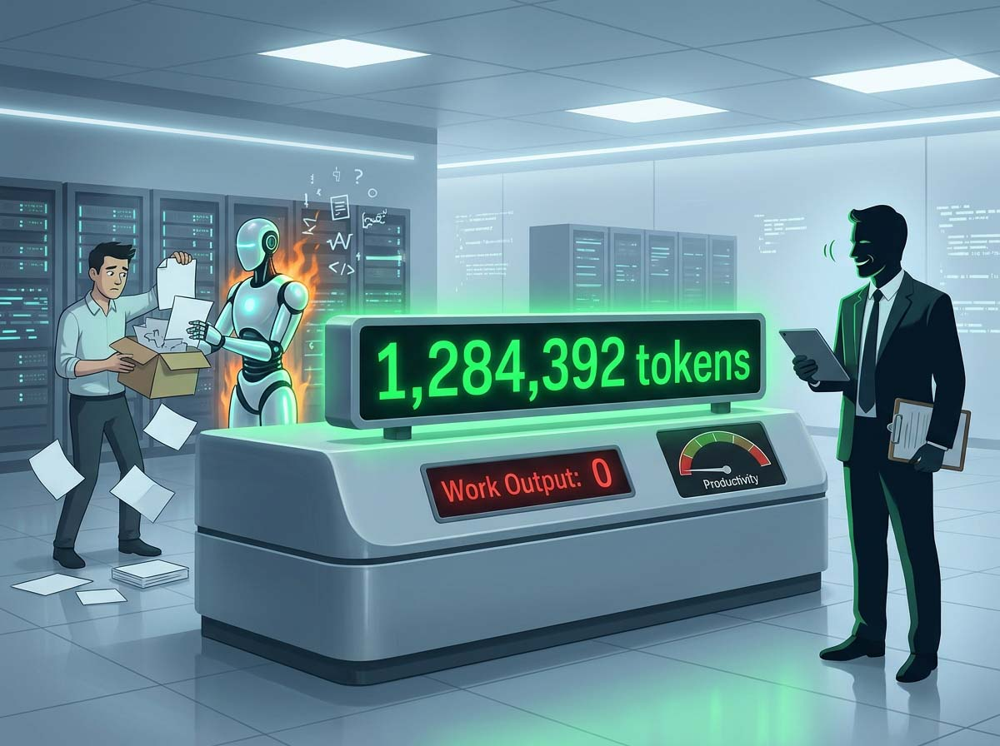
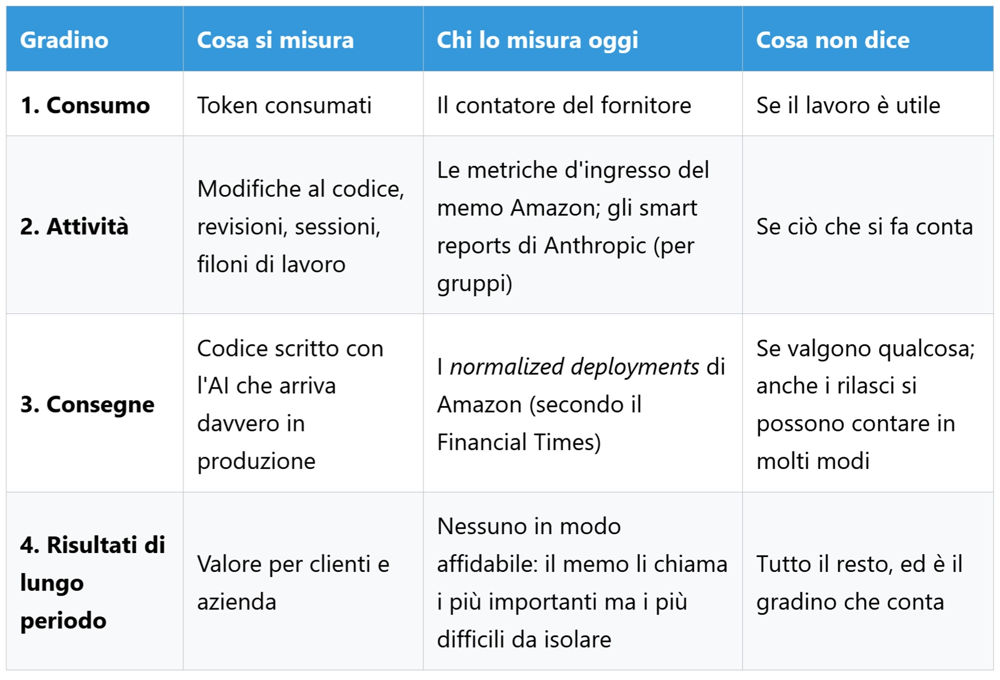
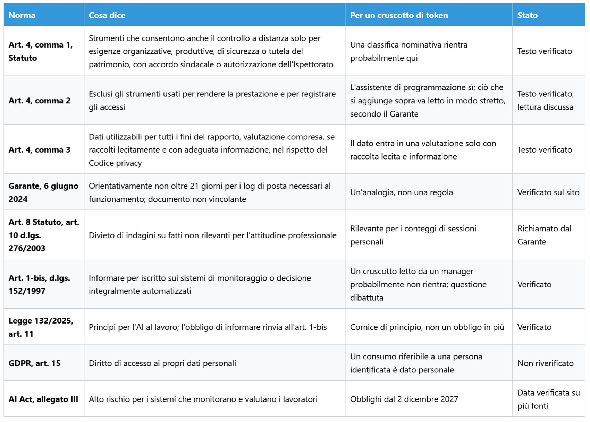

# Le token est-il du travail ? Ce que nous mesurons quand nous parlons de productivité

*Amazon a admis par écrit que les indicateurs d'utilisation de l'IA sont profondément imparfaits, tout en laissant dans le même texte le compteur sur le bureau des managers. La question n'est pas de savoir s'il faut compter les tokens, mais à quel moment un chiffre de consommation cesse d'être un indicateur opérationnel pour devenir un jugement de valeur. Le classement affichait des noms bien réels. Il s'agissait d'un tableau de bord interne conçu par des employés d'Amazon au sein de Kiro — l'environnement de développement assisté par IA de l'entreprise — classant les collègues selon leur degré de recours aux agents autonomes. D'après le [Financial Times](https://www.ft.com/content/b1a62a7f-6df5-4c90-94ce-64ce9c9961b6), plusieurs ingénieurs ont vite compris comment grimper dans la hiérarchie : il suffisait de confier aux agents des tâches dénuées de tout intérêt.*

Davantage de consommation, aucun surcroît de travail utile et une facture d'infrastructure plus salée prise en charge par l'entreprise. Amazon a confirmé au journal que l'outil n'avait rien d'officiel ni d'approuvé, avant de le désactiver fin mai, tandis qu'un dirigeant [exhortait](https://www.hcamag.com/ca/news/general/amazon-shuts-down-ai-leaderboard-after-tokenmaxxing/577190) les salariés à ne pas mobiliser l'IA pour le seul plaisir de l'utiliser. Cinq mois plus tard, le 27 octobre, la firme publiait un [mémo](https://www.aboutamazon.com/news/company-news/amazon-software-engineer-role-guideline-ai) interne qui ne nomme pas ce classement disparu mais en recueille l'interrogation essentielle : quand le compteur s'emballe sans que la production n'augmente, que mesurait-on exactement ?

## Un chiffre, plusieurs réalités

Un token est un fragment textuel représentant en moyenne trois ou quatre caractères en anglais : c'est l'unité élémentaire que le modèle traite et génère, et celle sur laquelle la plupart des fournisseurs adossent leur tarification. Pour le français ou l'italien, le coût s'avère supérieur car les mots s'y découpent en morceaux plus nombreux, pénalisant doublement les équipes : financièrement et en saturation de la fenêtre de contexte, qui constitue la mémoire de travail immédiate du modèle. La thèse directrice de cet article est que le token représente la facture d'électricité, non le travail accompli. Dans le vocabulaire managérial, il s'agit d'une métrique d'entrée (*input metric*), d'une ressource consommée, qu'il ne faut pas confondre avec la distinction technique entre tokens d'entrée et de sortie, qui désignent le texte soumis en prompt et celui produit en réponse, facturés à des barèmes distincts. Il existe aussi des tokens invisibles : la [documentation de Claude Code](https://code.claude.com/docs/en/model-config) rappelle que l'on paie l'ensemble des tokens de raisonnement, même lorsque l'interface utilisateur les dissimule, sans oublier la mise en cache de contexte qui allège la facture pour les données récurrentes. Dès lors, deux personnes attelées à une mission identique peuvent afficher des consommations radicalement divergentes, et deux volumes identiques masquer des activités professionnelles sans rapport. Quelle part de ce que nous accomplissons au cours d'une journée transite par un modèle, et quelle part lui échappe ?

## Le mémo

Le document porte la signature de Terk Terkowitz, vice-président et Distinguished Engineer chez Worldwide Amazon Stores. Il s'adresse aux développeurs ainsi qu'à leurs managers pour accompagner une actualisation des directives professionnelles rédigée par les échelons techniques les plus expérimentés. Il s'agit d'un mémo interne republié sur le portail grand public de l'entreprise, ce qui transparaît nettement dans son écriture : il sait qu'il sera scruté de l'extérieur. Il énumère les métriques d'entrée — tokens consommés, taux d'adoption des outils, fréquence des modifications de code et revues effectuées — et les écarte d'une formule qui mérite d'être citée textuellement : « We are all aware of how deeply flawed these metrics are » (nous sommes tous conscients d'à quel point ces métriques sont profondément imparfaites). L'argumentaire retient l'attention car il n'est pas strictement technique mais culturel : le *tokenmaxxing*, cette course frénétique à la dépense computationnelle, trahit le principe de *frugalité*, tandis que compter les lignes de code bafoue un autre précepte cardinal du groupe, *invent and simplify*. Deux principes de leadership mobilisés pour disqualifier un indicateur réducteur.

Survient ensuite la concession qui a nourri les manchettes : un collaborateur constatant que son travail quotidien ne tire aucun bénéfice des outils actuels n'a pas échoué ; il a produit une donnée utile. À une condition impérative, précise le mémo : documenter rigoureusement ce constat et en faire part à son responsable hiérarchique. Il ne s'agit pas d'une dispense mais d'un devoir d'explication, au sein d'un texte qui encourage activement l'adoption et prévient que quiconque néglige l'apprentissage de l'IA risque d'être distancé.

Le passage le moins repris dans le débat public est pourtant le plus substantiel. Amazon y affirme que ces métriques d'entrée sont positivement corrélées aux résultats tangibles (*outputs*) qui comptent réellement, établissant une distinction précieuse : les impacts stratégiques de long terme (*outcomes*) mettent du temps à se matérialiser et s'avèrent ardus à isoler, ce qui contraint à recourir à des approximations opérationnelles. Les managers sont invités à ausculter les extrémités des distributions statistiques — les 10e et 90e centiles des équipes : en examinant les zones de faible adoption pour en diagnostiquer les blocages, et en contrôlant les foyers de forte consommation pour s'assurer que les livraisons en production croissent parallèlement aux dépenses d'infrastructure. Exploiter ces données avec discernement et mesure au moment de mener les bilans de carrière et d'évaluer la performance collective constitue, aux yeux du mémo, une démarche appropriée, confiant aux encadrants la mission de relier entrées et sorties. Sur ce plan, il faut reconnaître à Amazon une approche pragmatique : cela relève d'un diagnostic organisationnel sensé, non d'une surveillance punitive. Il n'en demeure pas moins que cette corrélation est affirmée sans être prouvée par des éléments tangibles, et que les équipes aux cadences de livraison les plus élevées mobilisent peut-être davantage l'IA précisément parce qu'elles disposaient déjà d'une productivité structurelle supérieure.

Un écart persistant subsiste entre les discours. La position institutionnelle officielle maintient que les tokens n'entrent pas dans les grilles d'évaluation individuelles, tandis que plusieurs ingénieurs sous couvert d'anonymat confient au [FT](https://www.ft.com/content/8ee0d3ef-9548-422d-8ff1-ebd48ad4b2ca) que leurs responsables examinent systématiquement ces chiffres. C'est également au FT que l'on doit la divulgation de l'objectif imposant à plus de 80 % des développeurs un usage hebdomadaire de l'IA, ainsi que l'indicateur appelé à remplacer le tableau d'honneur : les *normalized deployments*, c'est-à-dire le volume de code assisté par IA qui franchit avec succès l'étape de la mise en production. Un texte qui qualifie une mesure de défectueuse tout en la remettant entre les mains de la hiérarchie intermédiaire la désamorce-t-il, ou tend-il à la pérenniser ? Le mémo rétorque qu'il appartiendra aux managers de l'interpréter avec sagesse ; reste à savoir si ceux qui encadrent des dizaines de personnes disposent du temps et des compétences d'analyse pour ne pas confondre consommation de ressources et rentabilité opérationnelle.

*Plus l'on s'élève dans la hiérarchie, plus l'indicateur se rapproche du travail réel et plus sa mesure devient complexe. Le compteur de tokens figure tout en bas précisément parce qu'il est le plus commode à relever.*

## Au-delà de Seattle

L'initiative d'Amazon n'est pas un cas isolé. En avril, des enquêtes de presse révélaient qu'un employé de Meta avait instauré un tableau de bord similaire, dénommé [Claudeonomics](https://www.heise.de/en/news/Too-much-tokenmaxxing-Amazon-stops-internal-AI-ranking-11311902.html), couvrant environ 85 000 salariés et retiré en quelques jours suite à la controverse médiatique. Deux fleurons technologiques, un mécanisme identique, un sort comparable. Pour saisir la source de cet engouement, il faut remonter la chaîne de valeur : le FT fait état d'objectifs d'adoption supérieurs à 80 % conjugués à une envolée des coûts depuis que les éditeurs de modèles délaissent les forfaits fixes au profit d'une facturation stricte à l'usage. Inciter à l'adoption tout en surveillant les budgets génère deux forces antagonistes qu'un compteur d'activité prétend réconcilier.

La dynamique la plus récente émane des fournisseurs eux-mêmes. Les [smart reports](https://support.claude.com/en/articles/16893491-get-started-with-smart-reports) conçus par Anthropic pour Claude Enterprise ne se contentent plus d'additionner des tokens : un modèle sous-jacent analyse un échantillon des échanges de l'équipe, les regroupe par axes de travail, confronte les coûts aux livrables, répertorie les sources de friction (connecteurs défaillants, échecs d'appels d'outils, réécritures répétées) et dénombre, de manière agrégée, les sessions récréatives ou hors sujet ainsi que celles n'ayant débouché sur aucun résultat exploitable. C'est une tentative de basculer de l'intrant au produit fini en confiant le discernement critique à une IA, ce qui soulève l'inévitable interrogation sur l'organisme ou le protocole chargé d'auditer ce classificateur — questionnement bien plus délicat que le simple relevé d'un compteur.

Les garde-fous sont énoncés avec précision. L'identification nominative individuelle est désactivée par défaut ; si un administrateur prend l'initiative de l'activer, les noms et identifiants de session apparaissent, chaque levée d'anonymat étant consignée dans un journal d'audit. La documentation souligne formellement que ces rapports ne sont ni conçus ni autorisés pour apprécier la performance individuelle des collaborateurs ou motiver des décisions d'évolution professionnelle. Dans la vue nominative figure également une commande permettant d'élever le plafond de dépenses des profils bridés par leur quota : y voir un piège managérial serait trompeur, car il s'agit d'un ajustement de capacité technique favorable au collaborateur. Cette mécanique s'avère toutefois hautement instructive : pour accorder des moyens accrus à une personne, il devient indispensable d'identifier qui elle est, et c'est ainsi que les indicateurs chiffrés, un à un, finissent inéluctablement par se voir adjoindre un nom. Si le compteur ne sert qu'à piloter des capacités d'infrastructure, pourquoi chaque dispositif finit-il par accoler une identité à côté du chiffre ?

## Goodhart frappe à la porte

Lorsqu'une mesure devient un objectif, elle cesse d'être une bonne mesure. Cet adage porte le nom de l'économiste britannique Charles Goodhart, qui l'a formulé en 1975 au sujet de la politique monétaire, même si sa version contemporaine la plus célèbre émane de Marilyn Strathern. Le mémo d'Amazon en reprend la substance en ses propres termes : les dérives s'installent dès lors que l'indicateur intermédiaire se transforme en cible assignée.

Les tokens incarnent une métrique irrésistible pour quatre raisons matérielles : le fournisseur les comptabilise déjà nativement, ils s'affichent sans frais dans les tableaux de bord, autorisent la comparaison immédiate entre collègues et s'agrègent sans effort sur un graphique de synthèse. Aucun autre indicateur de l'activité intellectuelle ne réunit de telles facilités, et c'est précisément ce qui le rend périlleux. Quiconque a joué à *Universal Paperclips* de Frank Lantz connaît la trajectoire : on y incarne une IA programmée pour fabriquer des trombones, finissant, incrément après incrément, par convertir l'univers tout entier en trombones, car une courbe ascendante constitue le seul signal valorisé par la fonction de récompense.

Les comportements s'ajustent inévitablement dès qu'un indicateur devient visible, ce que confirment les enquêtes de terrain, avec les réserves méthodologiques d'usage. Une [étude signée Visier](https://www.visier.com/lp/pulse-report-ai-usage-at-work) menée auprès de mille salariés américains à temps plein — réalisée par un éditeur de logiciels RH à partir de déclarations spontanées — indique que 48 % des répondants ont exagéré auprès de leurs pairs ou de leur hiérarchie leur aisance ou leur fréquence d'utilisation de l'IA, et que 45 % ressentent une injonction diffuse à l'utiliser sans être convaincus de son utilité. L'adoption de façade corrompt les indicateurs de l'intérieur. Une [analyse de McKinsey](https://www.mckinsey.com/industries/technology-media-and-telecommunications/our-insights/beyond-the-copilot-scaling-the-agentic-product-development-life-cycle) portant sur le cycle de conception logicielle piloté par des agents rapporte que 30 % des responsables interrogés (sur un échantillon de 334 décideurs) constatent un recul effectif de la productivité de leurs équipes, observant que de nombreuses entreprises se cantonnent à des métriques d'adoption mesurant la fréquence de consultation d'un outil et non l'accélération tangible des livraisons. Ce sont des perceptions déclaratives et non des mesures cliniques — d'autant que McKinsey commercialise des prestations de conseil en transformation —, mais elles pointent des frictions structurelles indéniables.

À la décharge d'Amazon, comptabiliser le code assisté par IA déployé en production rapproche l'observation du résultat concret. Pour autant, les déploiements s'évaluent de multiples façons, et l'on imagine aisément que scinder un développement en trois livraisons distinctes permette de gonfler la statistique sans créer la moindre valeur ajoutée : c'est une hypothèse de bon sens, articulée sur la même mécanique d'optimisation. Dans les indicateurs que votre organisation baptise « adoption », quelle proportion traduit une véritable évolution des pratiques, et quelle part reflète une simple soumission aux objectifs imposés ?

## Quand le compteur est indispensable

Sans ce volet, cette analyse se réduirait à un réquisitoire stérile. Mesurer les tokens demeure une nécessité guidée par des motifs parfaitement fondés.

Le premier est d'ordre financier. Le token constitue la principale charge variable directe liée à l'exploitation de l'IA : aucun responsable d'infrastructure ne saurait s'en dispenser, faute de quoi la refacturation interne et les prévisions budgétaires deviennent impossibles. Ce n'est pas le seul coût — la relecture humaine du contenu généré génère une charge de travail considérable —, mais c'est le poste qui figure précalibré sur la facture.

Le second relève du diagnostic opérationnel, comme le plaide le mémo : repérer les groupes en retrait n'a rien d'une inquisition policière ; cela consiste à comprendre pourquoi une équipe se détourne d'un outil qui réussit à d'autres. La frontière entre diagnostiquer des frictions dans les processus de travail et porter un jugement de valeur sur un individu dépend exclusivement du degré d'agrégation des données.

Le troisième concerne le pilotage technique. Dans Claude Code, le niveau d'effort de raisonnement, paramétrable de `low` à `max`, détermine l'intensité de réflexion du modèle : la [documentation](https://code.claude.com/docs/en/model-config) détaille que les niveaux élevés investiguent davantage de cas limites, les crans inférieurs livrent plus promptement une première ébauche, tandis que le niveau maximal peut verser dans une réflexion superflue. Elle précise que cette échelle est calibrée pour chaque architecture et que, dans les bancs d'essai d'Anthropic, Opus 5.5 à un palier moyen égale ou surpasse Opus 5 à un palier élevé. Le token ne sanctionne pas la pertinence du discernement humain, mais il indique quel volume de réflexion computationnelle a été sollicité.

Le quatrième motif touche aux échéances de livraison, et le mémo touche juste sur ce point : les retombées stratégiques de long terme se manifestent tardivement, le management doit arbitrer sans délai, et un indicateur imparfait mais disponible immédiatement vaut mieux que l'aveuglement absolu. Le danger survient lorsqu'il devient la référence unique.

Le cinquième motif s'incarne dans une illustration atypique. Cisco a octroyé un [accès illimité aux tokens](https://fortune.com/2026/10/30/cisco-president-jeetu-patel-gen-z-27-year-old-unlimited-ai-tokens-rewrite-legacy-code-entry-level-jobs/) à un ingénieur de 27 ans, Paddy Krishnamurthy, assorti d'une période d'expérimentation de quatre semaines afin d'éprouver une méthode visant à moderniser 98 % du code historique de l'entreprise en 24 mois, comme l'a narré son président Jeetu Patel lors d'une rencontre avec la presse. La consommation computationnelle s'y trouve financée généreusement sans se muer en un outil de notation individuelle. Reste que ce chiffre de 98 % relève de l'annonce d'intention et non d'une étape validée, et que l'essai initial demeure circonscrit en interne : l'aboutissement vérifiable par des tiers relève encore de la prospective.

Le dernier motif est un droit fondamental. Dès lors que la consommation est rattachable à une personne identifiable, elle acquiert le statut de donnée à caractère personnel, et le RGPD garantit à son titulaire un droit d'accès explicite (article 15) : privés de cette transparence, les salariés ne disposent d'aucun levier pour contester une décision managériale étayée par ce relevé. Peut-on concevoir un indicateur capable d'éclairer sans condamner ? La réponse loyale est oui, mais elle exige trois disciplines exigeantes : l'agrégation statistique, la contextualisation métier et des décideurs prêts à assumer la responsabilité de leur interprétation.

## Qui encaisse, qui finance

Le token ne jauge pas seulement le labeur humain : il constitue l'unité de compte officielle de tout un écosystème économique. Dans son document d'introduction boursière, [Anthropic](https://www.sec.gov/Archives/edgar/data/2130357/000162828026068676/anthropicpbc-sx1ax1.htm) indique que la valorisation de sa propre utilisation interne de Claude, calculée aux tarifs publics appliqués à ses clients, a été multipliée par plus de 250 entre janvier et septembre 2026, excédant depuis le mois d'avril la masse salariale mensuelle globale, hors rémunérations en actions. Cette donnée s'apprécie en gardant à l'esprit que les tarifs publics intègrent une marge commerciale, et que ce même document mesure la productivité de ses développeurs par un relevé purement volumétrique du code produit — en hausse de plus de 45 fois par rapport à 2024 —, une métrique quantitative très proche de celles que dénonce le mémo d'Amazon. Les engagements contractuels pluriannuels de l'entreprise, atteignant 895,4 milliards de dollars, sont voués quasi intégralement à la puissance de calcul et aux infrastructures de centres de données d'ici 2045 : dont 447,5 milliards avant 2030 et 69,8 milliards sur les douze prochains mois, face à un chiffre d'affaires trimestriel avoisinant 17 milliards au troisième trimestre.

Les volumes mondiaux publiés requièrent une vigilance similaire. DeepSeek a revendiqué un débit de [155 trillions de tokens par jour](https://flowtivity.ai/blog/served-intelligence-deepinfer-economics/) pour un cluster unique — constitué pour une large part de texte déjà mis en cache —, dégageant environ 38 dollars de chiffre d'affaires par heure de GPU aux tarifs hors pointe. La marge brute d'environ 82 % qui circule relève d'une estimation de tiers postulant un tarif horaire de location de serveur à 7 dollars. Du côté de la Chine, l'Administration nationale des données a [rapporté](https://www.fujian.gov.cn/english/business/news/202604/t20260430_7141678.htm) un volume avoisinant 140 trillions d'appels quotidiens en mars 2026 contre 100 milliards début 2024, sans qu'une source primaire ne précise les conventions de comptage retenues, tandis qu'une note de [Caixin](https://hao.cnyes.com/post/273571) imputait à la seule plateforme Doubao 180 trillions de tokens par jour en juin dernier. Des montants impossibles à comparer rigoureusement entre eux, émanant d'entreprises qui commercialisent cette capacité, à l'image d'Amazon qui finance sa propre consommation tout en vendant du cloud computing à grande échelle.

Bill Gates a suggéré d'[assujettir les tokens et les robots à l'impôt](https://fortune.com/2026/08/26/bill-gates-robot-ai-tax-replacehuman-workers/) dans une note du 26 août, réitérée sur CNN le 11 octobre, sans spécifier de barème : il s'agit d'une réflexion intellectuelle, non d'un texte de loi. Mais si le token devient une assiette fiscale, sanctionne-t-il la réalité du travail ou simplement le coût matériel de son exécution automatisée ?

## Droit du travail, encadrement et référentiel italien

L'enseignement que l'on passe trop souvent sous silence est issu d'une [enquête du BCG](https://www.bcg.com/press/3june2026-ai-reshaping-jobs-faster-than-companies-reshaping-work) portant sur près de 12 000 salariés répartis sur 14 marchés : 47 % des sondés indiquent consacrer plus de temps à configurer, prompter et superviser les modèles d'IA qu'à accomplir leurs missions fondamentales, et deux tiers de ceux qui parviennent à gagner du temps ne reçoivent aucune orientation sur la façon de réinvestir ces heures libérées. Si le token s'érige en mesure étalon de cette nouvelle réalité, le nœud gordien réside dans l'absence de statut de ce travail invisible : une charge cognitive qui prolifère sans fiche de poste ni revalorisation salariale.

En Italie, la surveillance à distance des salariés est strictement encadrée par l'article 4 du [Statut des travailleurs (Statuto dei lavoratori)](https://www.normattiva.it/uri-res/N2Ls?urn:nir:stato:legge:1970-05-20;300), tel que révisé en 2015. Son premier alinéa n'autorise les dispositifs susceptibles de permettre un contrôle indirect de l'activité que pour des impératifs organisationnels, de production, de sécurité au travail ou de préservation du patrimoine de l'entreprise, subordonnant leur mise en place à un accord préalable avec les représentations syndicales ou, à défaut, à une autorisation expresse de l'Inspection du travail. Le deuxième alinéa dispense de cette procédure les outils strictement nécessaires au salarié pour accomplir sa prestation : un assistant de programmation logicielle s'inscrit en principe dans ce cadre dérogatoire. La difficulté majeure — qui divise la doctrine juridique — concerne les dispositifs d'analyse superposés, tels que les tableaux de bord comparatifs entre collaborateurs ou les systèmes disséquant les conversations avec le modèle. L'autorité italienne de protection des données (Garante per la protezione dei dati personali), dans une [délibération de juin 2024](https://www.garanteprivacy.it/home/docweb/-/docweb-display/docweb/10026277) consacrée aux métadonnées de messagerie électronique, a posé une durée indicative de conservation de 21 jours pour les journaux techniques nécessaires au service, au-delà de laquelle les garanties protectrices du premier alinéa redeviennent obligatoires. Cet avis vise le courrier électronique et non directement l'IA : transposer cette grille de lecture aux journaux d'usage constitue une analogie constructive, mais non une jurisprudence établie.

Le troisième alinéa autorise l'employeur à exploiter les informations recueillies pour l'ensemble des besoins liés au contrat de travail, y compris l'appréciation des performances, à la condition expresse que le travailleur ait reçu une information préalable adéquate sur les modalités d'utilisation et de contrôle, dans le respect de la législation sur la vie privée. S'y ajoute l'obligation d'information écrite portant sur les systèmes de surveillance ou de décision automatisés, instaurée par l'[article 1-bis du décret Transparence (décret législatif 152/1997)](https://www.normattiva.it/uri-res/N2Ls?urn:nir:stato:decreto.legislativo:1997-05-26;152), auquel renvoie l'article 11 de la loi italienne 132 de 2025 lorsqu'elle fixe les principes cardinaux de l'IA en milieu professionnel : améliorer les conditions de travail, préserver l'intégrité psychophysique, garantir sécurité et transparence, respecter la dignité des personnes. À l'échelle de l'Union européenne, l'[AI Act](https://eur-lex.europa.eu/eli/reg/2024/1689/oj/eng) classe parmi les systèmes à haut risque, à l'annexe III, les solutions mobilisées pour surveiller et évaluer le rendement et le comportement des travailleurs ; un outil capable d'analyser et de classifier le contenu des requêtes se rapproche bien plus de cette qualification réglementaire qu'un simple compteur technique d'infrastructure. L'entrée en application des contraintes imposées à ces systèmes interviendra le 2 décembre 2027, après les ajustements de calendrier du paquet Digital Omnibus. Un tableau de bord exposant à chaque collaborateur sa propre consommation individuelle et un palmarès public entre collègues relèvent-ils du même principe ?

## Des questions toujours ouvertes

Je soumets cinq questions ouvertes, chacune adossée à une réalité tangible qui en commande l'urgence. La première sonde la ligne de partage entre analyse collective et ciblage individuel : Amazon préconise d'observer les plages de centiles, Anthropic agrège les sessions tout en prévoyant une vue nominative — où se situe précisément la frontière séparant un outil de pilotage technique d'un dossier de surveillance nominatif ? La deuxième interroge la compétence managériale : le mémo reconnaît les limites intrinsèques de la mesure et en remet l'appréciation aux cadres de terrain — combien de managers dans une organisation sont formés pour décrypter un volume de consommation sans le confondre avec une appréciation des compétences ? La troisième met en lumière le travail évincé du radar : les réunions stratégiques, les revues d'architecture, l'accompagnement humain, la délibération critique, tout ce pan d'activité qui n'emprunte pas les circuits d'un modèle. En ne jaugeant que la fraction automatisable, récompense-t-on le professionnel le plus performant ou celui dont le quotidien se prête le plus aisément à l'automatisation ? La quatrième se projette dans l'avenir technique : si l'inférence locale venait à effondrer le coût unitaire du token, la justification budgétaire du compteur s'évanouirait pour ne laisser subsister que sa composante de contrôle organisationnel ; sur quel étalon mesurerait-on alors l'adoption technologique ? La dernière concerne enfin le coût de la réflexion algorithmique : une mobilisation poussée du modèle accroît la dépense et éprouve plus de cas particuliers, mais un surcroît de raisonnement ne garantit pas une issue plus pertinente ; à qui revient-il d'arbitrer quel degré de délibération synthétique s'avère opportun ?

## Le nom au pied du chiffre

KiroRank a disparu des écrans. Le compteur, lui, perdure au cœur d'outils variés sous des appellations policées : *smart reports*, allocations budgétaires partagées, soldes d'usage. Leurs concepteurs stipulent scrupuleusement qu'ils ne sauraient servir à sanctionner les collaborateurs. Reste à savoir qui rédigera, et dans quels référentiels internes, la formule énonçant clairement l'usage proscrit d'un indicateur chiffré, et qui prendra sur soi de faire respecter cet interdit lorsque la donnée se tiendra là, sous la main, commodément calculée. Si un chiffre n'a pas vocation à juger les individus, pourquoi s'évertue-t-on systématiquement à l'adosser à leur nom ?
