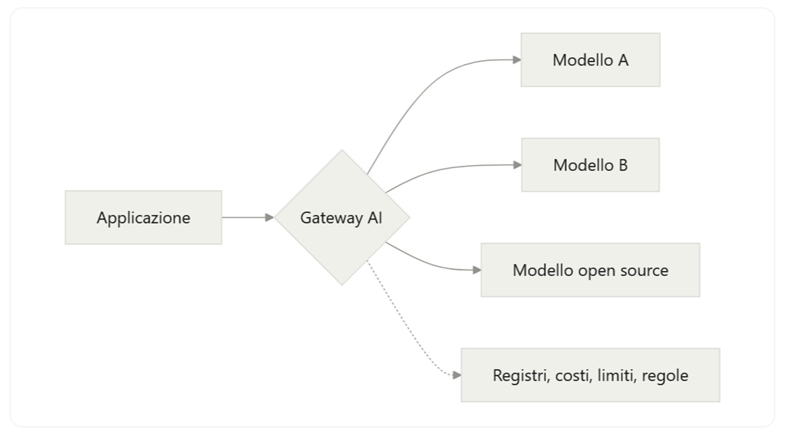
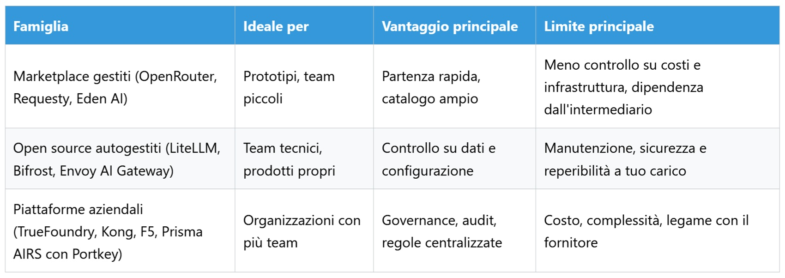
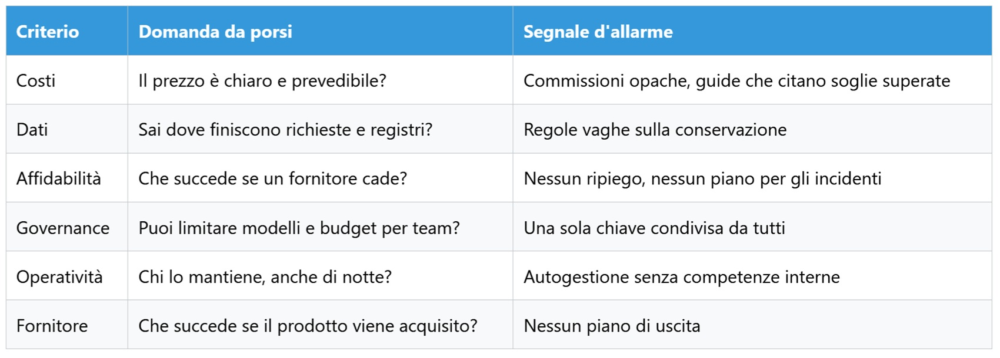

# Guida a come scegliere un gateway AI

*Un gateway è il varco da cui passano chiavi, dati e costi della tua applicazione. Nel 2026 alcuni dei nomi più noti del settore sono stati comprati o congelati: ecco come scegliere senza lasciarsi guidare dal prezzo. Oggi un prodotto serio raramente si affida a un solo modello. Si usano OpenAI, Anthropic, Google, Mistral, modelli aperti come quelli di Meta e a volte fornitori specializzati, ciascuno con un formato di richiesta, chiavi e fatture proprie. Il risultato è un groviglio: costi difficili da attribuire, nessun piano B se un fornitore va giù, poca visibilità su errori e tempi di risposta. Il gateway si interpone tra l'applicazione e i modelli e offre un punto unico per instradare le richieste (il *routing*), proteggere le chiavi, contare la spesa e conservare i registri.*

La tesi dell'articolo è semplice e un po' scomoda: non esiste il gateway migliore, esiste quello proporzionato alla tua maturità tecnica, al tuo budget e al controllo che devi mantenere. Nel 2026 se ne aggiunge una seconda: contano anche la solidità e il destino di chi sta dall'altra parte, perché il mercato ha cambiato faccia in pochi mesi. Evito anche le promesse assolute: un gateway non riduce sempre i costi, a volte aggiunge una voce di spesa.

## Cosa fa davvero

Le funzioni che contano sono sette, e si capiscono meglio dentro un esempio. Immagina il chatbot di un'azienda che risponde ai clienti: per le domande banali usa un modello economico, per le analisi complesse uno più potente. Senza gateway questa logica vive sparsa nel codice. Con un gateway diventa una regola configurabile.

La prima funzione è l'interfaccia unificata: un solo formato di richiesta, di solito compatibile con quello di OpenAI, per parlare con modelli diversi. [LiteLLM](https://docs.litellm.ai/index.md) la descrive come una chiamata sola per oltre cento fornitori. La seconda è l'instradamento, cioè la scelta di quale modello riceve quale richiesta, per costo, velocità o qualità. La terza è il ripiego automatico (*fallback*): se il fornitore principale non risponde, la richiesta passa a un altro. Come ricorda [la guida di Requesty](https://www.requesty.ai/blog/what-is-an-llm-gateway), il ripiego serve solo se il modello di riserva sa fare lo stesso lavoro, e va provato forzando i guasti prima che arrivino davvero.

La quarta è l'osservabilità, parola brutta per una cosa semplice: vedere token consumati, tempi di risposta, errori e costi, magari divisi per team. La quinta è la memoria delle risposte (*caching*): una domanda già posta può essere servita senza richiamare il modello. [Cloudflare](https://developers.cloudflare.com/ai-gateway/features/) la applica alle richieste identiche, mentre [Kong](https://developer.konghq.com/ai-gateway) arriva alla versione semantica, che riconosce domande simili ma non uguali: più risparmio, ma anche più rischio di servire una risposta non del tutto pertinente. La sesta sono le chiavi virtuali con i limiti: ogni team riceve una chiave propria, con un tetto di spesa e un elenco di modelli ammessi, mentre la chiave vera del fornitore resta nascosta. La settima sono i filtri di sicurezza su richieste e risposte, per esempio l'oscuramento dei dati personali prima che escano dal perimetro aziendale.

Qui sta la differenza che interessa a chi decide: accedere a tanti modelli è una comodità, governare l'AI in produzione è un'altra faccenda.

## Tre famiglie, confini sfumati

Per orientarsi serve una mappa, purché la si prenda per quello che è, cioè orientativa. I marketplace gestiti danno un account, una chiave e un catalogo enorme. I gateway open source autogestiti girano sui tuoi server. Le piattaforme aziendali puntano su regole, controlli e gestione di molti team. La scelta si riduce a tre domande: vuoi semplicità o controllo, vuoi delegare l'infrastruttura o gestirla tu, hai obblighi di conformità e team multipli?

I confini sono porosi. Portkey ha reso open source il proprio gateway e poche settimane dopo è stato acquistato da un colosso della sicurezza, TrueFoundry può girare come servizio gestito oppure nel tuo cloud, e un progetto nato per sviluppatori come LiteLLM offre ormai anche un servizio ospitato. Conviene leggere la tabella come una bussola, non come uno schedario.

## Il fascino del marketplace

Il marketplace gestito è la porta più larga. [OpenRouter](https://openrouter.ai/pricing) dichiara oltre seicento modelli di più di ottanta fornitori dietro un'unica interfaccia, e questo spiega perché sia il riferimento di chi prototipa. [Requesty](https://requesty.ai/glossary) è un'alternativa ospitata con criteri di ripiego configurabili e, stando alla sua documentazione, instradamento verso l'Europa tramite Francoforte. [Eden AI](https://docs.edenai.co/v3/overview/ai-gateway) ha una vocazione diversa: oltre ai modelli linguistici espone con lo stesso accesso servizi specializzati come riconoscimento del testo, trascrizione e traduzione, per oltre cinquecento modelli di più di cinquanta fornitori.

La comodità ha un prezzo, ed è l'argomento su cui le guide in circolazione sono più confuse. Secondo [le analisi che citano il listino](https://www.maximem.ai/blog/openrouter-pricing-2026), su OpenRouter il costo per token coincide con quello del fornitore e il ricavo arriva da una commissione sull'acquisto dei crediti: [la pagina ufficiale](https://openrouter.ai/pricing) indica il 5,5% sul piano Standard e l'8% sul Business. Chi porta le proprie chiavi evita la commissione fino a una soglia mensile calcolata sul prezzo di listino, oltre la quale scatta il 5%.

Qui vale un'avvertenza sull'invecchiamento delle informazioni. Diverse guide ancora online, [anche una di fine giugno](https://www.truefoundry.com/blog/openrouter-pricing), parlano di un milione di richieste gratuite con le proprie chiavi, criterio che [secondo un'altra analisi](https://www.truefoundry.com/blog/openrouter-byok-explained-cheaper-often-faster-and-changing) è stato ritirato a luglio. È il motivo per cui qui non trovi prezzi di listino: il consiglio vai sempre alle pagine ufficiali. Per Requesty e Eden AI, [analisi di terzi](https://www.getmaxim.ai/articles/requesty-alternatives.md) e [directory di settore](https://www.everydev.ai/tools/eden-ai) riportano commissioni dello stesso ordine, ma sono dati da verificare alla fonte.

Sul fronte dei dati, la pagina dei prezzi, di OpenRouter, mostra che l'instradamento basato sulle regole di trattamento dei dati compare dal piano Standard, quello nelle regioni UE o USA dal Business e gli accordi contrattuali sul servizio solo nell'Enterprise. Le condizioni di conservazione sono descritte [nella documentazione](https://openrouter.ai/docs/guides/privacy/provider-logging) e vanno lette con calma, perché il percorso dei dati non si ferma all'intermediario.

Se stai costruendo un prototipo e vuoi provare GPT, Claude, Gemini e Llama senza aprire quattro account, un marketplace gestito è probabilmente la scelta più sensata. Il rovescio è la dipendenza da un intermediario per accesso, fatturazione e disponibilità, con una governance che resta più leggera di quella aziendale.

## Il prezzo del controllo

Autogestire un gateway significa che il software gira sui tuoi server o nel tuo cloud, invece che su un servizio di terzi. È la strada di chi non può far transitare richieste sensibili da un intermediario, o di chi vuole eliminare commissioni e personalizzare il comportamento.

[LiteLLM](https://docs.litellm.ai/index.md) è il nome più diffuso e si presenta in due forme da non confondere: una libreria Python da importare nella propria applicazione, e un gateway condiviso a cui puntano tutti i team, con chiavi virtuali, budget e tracciamento della spesa. La seconda richiede un database e, con più istanze, una memoria condivisa, come spiega [una guida tecnica](https://www.truefoundry.com/blog/what-is-litellm) scritta da un concorrente, quindi da leggere con cautela. [Bifrost](https://github.com/maximhq/bifrost), sviluppato da Maxim AI in Go con licenza Apache 2.0, punta sulla leggerezza, ma i benchmark di velocità più citati vengono dal produttore e [non risultano verificati in modo indipendente](https://dev.co/ai/frameworks/bifrost).

Fino a pochi mesi fa sarebbe stato naturale citare anche Helicone. [Mintlify l'ha acquisita a marzo](https://www.mintlify.com/blog/mintlify-acquires-helicone) e il servizio prosegue in manutenzione: correzioni di sicurezza e supporto ai nuovi modelli, ma niente funzioni nuove. Funziona, quindi non è un'emergenza, ma sceglierlo oggi per un progetto pluriennale è una scommessa. Chi cerca solo osservabilità può guardare a [Langfuse](https://clickhouse.com/blog/clickhouse-acquires-langfuse-open-source-llm-observability), che dopo l'acquisizione da parte di ClickHouse resta open source con licenza MIT per le funzioni di base, stando all'annuncio ufficiale.

Autogestione, però, non significa assenza di rischio, e il 2026 ne ha dato la lezione più chiara. Il 24 marzo due versioni di LiteLLM pubblicate su PyPI, il registro pubblico dei pacchetti Python, contenevano codice che sottraeva credenziali. [La comunicazione ufficiale del progetto](https://docs.litellm.ai/blog/security-update-march-2026) indica le versioni 1.82.7 e 1.82.8, ipotizza la compromissione dell'account di un manutentore e precisa che chi usava l'immagine Docker ufficiale non è stato toccato, perché quella blocca le dipendenze. Il 30 marzo è arrivata una versione pulita, la 1.83.0. Sulla durata dell'esposizione le fonti non concordano: il progetto parla di circa quaranta minuti, [altre ricostruzioni](https://letsdatascience.com/news/litellm-breach-exposes-ai-supply-chain-risk-69f3c6f7) di finestre di alcune ore. Secondo [un audit di Comet](https://www.comet.com/site/blog/litellm-supply-chain-attack/), i progetti con le versioni fissate da un file di blocco sono rimasti al sicuro, gli altri no.

Un gateway custodisce le chiavi di tutti i fornitori: chi lo autogestisce deve trattarlo come un deposito di segreti e fissare le versioni è il minimo. Il costo, poi, non è zero: server, database, tempo del team e reperibilità notturna vanno messi in conto.

## Governance su larga scala

Quando il problema non è chiamare i modelli ma governarli, il valore sta in regole, tracciabilità e controllo degli accessi più che nell'instradamento. Una banca con decine di team, dati sensibili e obblighi di audit non ha bisogno soltanto di un instradatore.

Il caso più istruttivo è Portkey. A marzo [ha aperto il codice del suo gateway di produzione](https://latent.space/wiki/portkey-ai-5b678cc2/), il 29 maggio è stata [acquisita da Palo Alto Networks](https://www.paloaltonetworks.com/company/press/2026/palo-alto-networks-completes-acquisition-of-portkey-to-secure-ai-agents.html), che ne ha fatto il gateway della propria piattaforma di sicurezza Prisma AIRS. Il [bilancio depositato alla SEC](https://www.sec.gov/Archives/edgar/data/0001327567/000132756726000023/panw-20260731.htm) indica un corrispettivo di 117 milioni di dollari. Il gateway open source risulta [ancora pubblicato](https://www.deepinspect.ai/blog/best-ai-gateway-2026), ma resta aperta una domanda che riguarda i clienti più che il compratore: le priorità di sviluppo saranno quelle da sviluppatori o quelle di sicurezza aziendale?

[TrueFoundry](https://truefoundry.com/docs/gateway) unisce gateway e gestione dell'infrastruttura, con budget assegnabili a [utenti, team o account virtuali](https://docs.truefoundry.com/gateway/budgetlimiting) e con installazioni gestite, con i dati nel proprio spazio di archiviazione o nel proprio cloud. [Kong](https://developer.konghq.com/ai-gateway) è la scelta naturale per chi lo usa già, perché estende il suo gateway per API con funzioni come l'oscuramento dei dati personali. Sul versante aperto, [Envoy AI Gateway è arrivato alla versione 1.0 a giugno](https://itbrief.co.uk/story/envoy-ai-gateway-reaches-1-0-for-production-ai-use) con il contributo di Bloomberg, Nutanix e Tetrate, mentre [agentgateway](https://agentgateway.dev/docs/standalone/latest/about/), nato in Solo.io e ora sotto la Linux Foundation, gestisce nello stesso punto traffico dei modelli, strumenti MCP e comunicazione tra agenti. Il nome Gloo Gateway, che compare in alcune liste, non sono riuscito a verificarlo per l'AI: il riferimento attuale di Solo.io è agentgateway. F5 ha lanciato a giugno una [piattaforma di sicurezza per l'AI](https://www.helpnetsecurity.com/2026/06/23/f5-launches-ai-security-platform-to-uncover-and-secure-shadow-ai/) e ad agosto ha [ampliato il proprio gateway](https://itbrief.co.nz/story/f5-expands-ai-gateway-to-curb-costs-secure-agents) integrandolo.

Chi ci guadagna sono i fornitori di sicurezza e di rete, che fanno del gateway il punto in cui le regole vengono applicate, e le grandi organizzazioni, che ottengono un unico pannello. Chi rischia sono i team piccoli, tentati da strumenti sovradimensionati, e chiunque dipenda da un prodotto la cui rotta decide un acquirente.

## Quando basta la piattaforma

C'è una scorciatoia legittima: usare il gateway della piattaforma su cui già lavori. [Vercel AI Gateway](https://vercel.com/docs/ai-gateway/pricing) dichiara nessun ricarico sui token, anche con le chiavi proprie, anche se [possono restare le spese di elaborazione dei pagamenti](https://vercel.com/ai-gateway). [Cloudflare AI Gateway](https://developers.cloudflare.com/ai-gateway) offre analisi, memoria delle risposte, limiti di richieste, registri e ripiego tra modelli, con filtri e protezione dei dati nella [documentazione delle funzioni](https://developers.cloudflare.com/ai-gateway/features/).

Il vantaggio è strategico: meno integrazioni, meno strumenti da gestire, un'esperienza coerente con il resto dello stack. Il limite è la neutralità. Un gateway della piattaforma è comodo finché la tua infrastruttura è lì, e diventa un ancoraggio quando vuoi spostarti. Non è la scelta migliore se il tuo cuore operativo sta altrove.

## I criteri che contano

Questa è la parte da conservare, nove criteri da mettere sul tavolo prima di firmare. Controllo dei dati: dove finiscono richieste, risposte e registri, e per quanto tempo? Modello di costo: ricavo per commissione, abbonamento o licenza, e quanto è prevedibile? Osservabilità: vedi costi, errori e tempi per team o per funzione? Affidabilità: esistono ripiego, nuovi tentativi e monitoraggio, e li hai provati? Sicurezza: chi custodisce le chiavi, esiste l'oscuramento dei dati personali? Compatibilità: regge le interfacce e le librerie che già usi? Scalabilità: tiene la crescita di traffico, team e modelli? Complessità operativa: quanto tempo costerà mantenerlo? Rischio sul fornitore: che accade se l'azienda viene comprata o congelata, e puoi uscire senza riscrivere tutto?

L'ultima riga è la novità del 2026. [Langfuse a gennaio](https://clickhouse.com/blog/clickhouse-acquires-langfuse-open-source-llm-observability), [Helicone a marzo](https://www.mintlify.com/blog/mintlify-acquires-helicone), [Portkey a maggio](https://www.paloaltonetworks.com/company/press/2026/palo-alto-networks-completes-acquisition-of-portkey-to-secure-ai-agents.html): in cinque mesi tre strumenti molto usati hanno cambiato proprietario. Non significa che siano peggiorati, significa che una scelta pluriennale va fatta con un'uscita di emergenza in tasca. Un'interfaccia compatibile con quella di OpenAI e le tue chiavi tenute fuori dal gateway rendono il cambio molto meno doloroso.

## Quattro scenari reali

Per una startup o un prototipo contano velocità e libertà di cambiare modello. Le scelte plausibili sono OpenRouter, Requesty o Eden AI, tenendo d'occhio costi futuri e dipendenza dall'intermediario. Conviene anche ragionare presto sulle chiavi proprie, perché mantengono aperta la via d'uscita.

Per un prodotto software in crescita entrano in gioco affidabilità, costi e telemetria. Le scelte plausibili sono LiteLLM in forma fissata (immagine ufficiale o versioni bloccate), Bifrost, oppure il gateway di Vercel o Cloudflare se vivi già lì, con un servizio di osservabilità separato. Attenzione alla gestione operativa e alla qualità dei registri, più che al nome.

Per un'azienda con dati sensibili contano privacy, controllo e audit. Le scelte plausibili sono un gateway autogestito come LiteLLM, Bifrost o Envoy AI Gateway, oppure TrueFoundry nel proprio cloud. Qui pesano le competenze interne e la responsabilità di sicurezza, che nessun contratto ti toglie.

Per una grande organizzazione con molti team servono governance, budget e conformità. Le scelte plausibili sono TrueFoundry, Kong, F5, Prisma AIRS con Portkey, oppure l'infrastruttura aperta di Envoy o agentgateway. Si paga in complessità, costi e tempo di adozione, e vale la pena chiedere per iscritto cosa accadrà alla roadmap in caso di acquisizione.

Sono scelte plausibili, non verdetti: il contesto aziendale conta più del nome del prodotto.

## Errori che costano

Il primo è scegliere solo in base al prezzo, che spinge verso soluzioni dove la differenza si ripresenta come tempo del team o rischio. Il secondo è confondere l'accesso a molti modelli con il controllo della produzione: senza limiti per team e registri, la prima bolletta anomala arriva senza spiegazioni. Il terzo è ignorare commissioni e soglie, o fidarsi di guide non aggiornate: un calcolo fatto sulla regola sbagliata sposta il budget di mesi.

Il quarto è autogestire senza risorse: un gateway lasciato senza aggiornamenti, o aggiornato senza fissare le versioni, custodisce le tue chiavi come un database trascurato, e l'episodio di LiteLLM lo ha mostrato. Il quinto è non impostare fin dall'inizio registri, budget e ripiego: ricostruire la storia dei costi a posteriori è quasi impossibile. Il consiglio pratico è partire semplici, misurare costi e qualità, e passare a strumenti più strutturati solo quando il bisogno è reale.

## Proporzione, non inseguimento

Un gateway AI non è un accessorio, è una decisione di architettura, perché ci passano chiavi, dati e costi. La regola pratica si riassume in quattro righe di buon senso: per un prototipo un marketplace gestito, per un prodotto in crescita un gateway con osservabilità e ripiego, per dati sensibili autogestione o distribuzione controllata, per organizzazioni complesse una piattaforma con governance. Prima del prodotto, valuta il tuo caso.

Restano domande aperte. Cosa farà Palo Alto del gateway open source di Portkey? Per quanto Helicone resterà un'opzione credibile? E soprattutto: in un mercato dove i gateway vengono comprati con questa rapidità, quanto vale poter cambiare gateway senza riscrivere un'applicazione? Chi sa rispondere a quest'ultima domanda ha già fatto metà della scelta.

---

*Nota tecnica: dati verificati al 4 novembre 2026 su documentazione ufficiale e comunicati dove possibile. Le fonti di vendor concorrenti (TrueFoundry, Maxim, Tetrate, Solo.io) sono indicate come tali. Le commissioni cambiano spesso: controlla sempre le pagine ufficiali.*