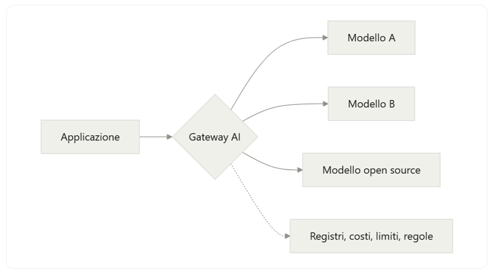
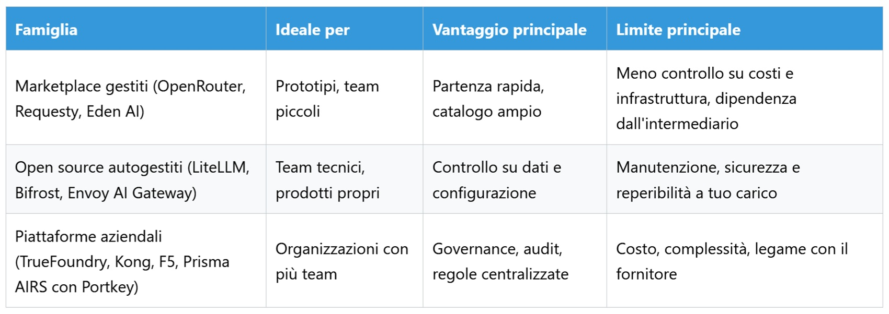
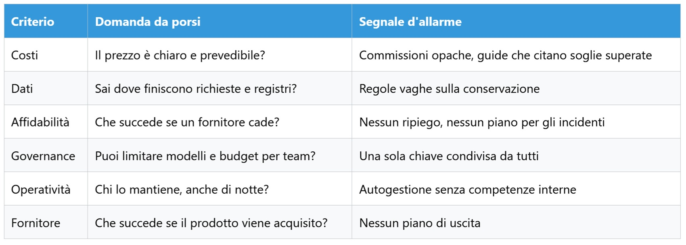

# Leitfaden zur Auswahl eines KI-Gateways

*Ein Gateway ist der zentrale Engpass, durch den API-Schlüssel, Nutzdaten und Infrastrukturkosten Ihrer Anwendung fließen. Im Jahr 2026 wurden einige der bekanntesten Branchengrößen übernommen oder in den Wartungsmodus versetzt: Hier erfahren Sie, wie Sie die richtige Wahl treffen, ohne sich allein vom Einstiegspreis leiten zu lassen. Ein professionelles Softwareprodukt stützt sich heute selten auf ein einziges Modell. Man kombiniert OpenAI, Anthropic, Google, Mistral, offene Gewichte wie jene von Meta und zuweilen spezialisierte Modellanbieter – jeder mit eigenen Anfrageformaten, Zugangsdaten und Monatsrechnungen. Das Resultat ist ein betriebliches Dickicht: Kosten lassen sich schwer einzelnen Teams zuordnen, bei Ausfällen fehlt ein automatischer Plan B, und es mangelt an Transparenz über Latenzen und Fehlerquoten. Ein KI-Gateway schaltet sich zwischen Ihre Anwendung und die Modelle und bietet eine zentrale Leitstelle für das Routing von Anfragen, den Schutz von Schlüsseln, die Ausgabenkontrolle und die Aufbewahrung revisionssicherer Protokolle.*

Die Kernbotschaft dieses Leitfadens ist einfach und ein wenig unbequem: Es gibt kein universell überlegenes Gateway; es gibt lediglich jenes, das zu Ihrer technischen Reife, Ihrem Budget und dem Kontrollniveau passt, das Sie zwingend behalten müssen. Im Jahr 2026 tritt ein zweiter Faktor hinzu: Auch die finanzielle Solidität und die Zukunftsperspektive des Anbieters sind entscheidend, da sich der Markt innerhalb weniger Monate drastisch konsolidiert hat. Ebenso verzichten wir auf pauschale Heilsversprechen: Ein Gateway senkt die Kosten nicht automatisch; in vielen Szenarien kommt vielmehr ein zusätzlicher Ausgabenposten hinzu.

## Was es in der Praxis tatsächlich leistet

Sieben Kernfunktionen bestimmen den praktischen Wert eines KI-Gateways, am besten veranschaulicht an einem realen Szenario. Stellen Sie sich den Kundenservice-Chatbot eines Unternehmens vor: Für triviale Fragen nutzt er ein kostengünstiges Modell, für anspruchsvolle Geschäftsanalysen schaltet er auf ein leistungsstärkeres Spitzenmodell um. Ohne Gateway liegt diese Routing-Logik verstreut im Programmcode. Mit einem Gateway wird daraus eine deklarative, zentral konfigurierbare Richtlinie.

Die erste Kernfunktion ist die vereinheitlichte Schnittstelle: ein standardisiertes Anfrageformat – zumeist kompatibel mit der OpenAI-Spezifikation –, um unterschiedlichste Modellanbieter anzusprechen. [LiteLLM](https://docs.litellm.ai/index.md) beschreibt dies als einen einzigen API-Aufruf für über einhundert verschiedene Plattformen. Die zweite ist das intelligente Routing: die automatisierte Auswahl, welches Modell welche Anfrage bedient – gesteuert nach Kosten, Latenz oder Ausgabequalität. Die dritte ist das automatisierte Failover (*Fallback*): Antwortet der primäre Anbieter nicht oder erreicht er ein Ratelimit, wird die Anfrage nahtlos an eine Alternative weitergereicht. Wie [der technische Leitfaden von Requesty](https://www.requesty.ai/blog/what-is-an-llm-gateway) hervorhebt, nützt ein Fallback-Mechanismus nur dann, wenn das Ersatzmodell funktionell vergleichbare Fähigkeiten besitzt – was verlangt, dass man Fehlerzustände vorab durch gezielte Stresstests erprobt, bevor ein realer Ausfall eintritt.

Die vierte Funktion ist die Observability – ein Fachbegriff für essenzielle Telemetrie: verbrauchte Tokens, Antwortzeiten, Fehlerraten und Kosten sichtbar zu machen, aufgeschlüsselt nach Entwicklerteams. Die fünfte ist das Caching von Antworten: Eine bereits gestellte Frage kann direkt aus dem Zwischenspeicher bedient werden, ohne das Modell erneut aufzurufen. [Cloudflare](https://developers.cloudflare.com/ai-gateway/features/) wendet dies auf identische Anfragen an, während [Kong](https://developer.konghq.com/ai-gateway) bis zum semantischen Caching geht, das inhaltlich ähnliche Fragen erkennt: Das bringt mehr Einsparungen, birgt jedoch das Risiko, eine Antwort auszugeben, die nicht ganz exakt zur Nuance der Anfrage passt. Die sechste Funktion sind virtuelle API-Schlüssel mit Quotas: Jedes Team erhält eigene Zugangsdaten mit festem Ausgabenlimit und einer Liste zugelassener Modelle, während der echte Providerschlüssel sicher im Secret-Store verwahrt bleibt. Die siebte umfasst Sicherheitsfilter für Prompts und Ausgaben, beispielsweise die automatisierte Schwärzung personenbezogener Daten (PII), bevor diese die Unternehmensgrenzen verlassen.

Hier verläuft die Trennlinie für Entscheider: Der Zugriff auf zahlreiche Modelle ist ein reiner Entwicklerkomfort; der verlässliche Produktivbetrieb von Unternehmens-KI ist eine ganz andere ingenieurtechnische Disziplin.

## Drei Modellfamilien mit fließenden Grenzen

Um sich zu orientieren, bedarf es einer Landkarte, sofern man sie als Richtschnur und nicht als starres Schema begreift. Verwaltete Marktplätze bieten ein einziges Konto, einen zentralen Schlüssel und einen riesigen Modellkatalog. Selbst gehostete Open-Source-Gateways laufen auf Ihrer eigenen Infrastruktur. Enterprise-Plattformen setzen ihren Schwerpunkt auf Sicherheitsregeln, Audit-Trails und die Verwaltung verteilter Teams. Die Entscheidung reduziert sich auf drei Leitfragen: Wollen Sie maximale Einfachheit oder absolute Kontrolle, möchten Sie die Infrastruktur delegieren oder selbst betreiben, und unterliegen Sie strengen Compliance-Vorgaben bei mehreren Teams?

Die Grenzen zwischen den Kategorien sind fließend. Portkey stellte den Kern seines Produktions-Gateways unter eine Open-Source-Lizenz und wurde wenige Wochen später von einem führenden Sicherheitskonzern übernommen; TrueFoundry lässt sich als Managed Service ebenso wie in der eigenen Cloud betreiben; und ein Entwicklerprojekt wie LiteLLM bietet inzwischen auch eine gehostete Cloud-Variante an. Diese Tabelle sollte daher als Orientierungskompass und nicht als starre Schublade verstanden werden.

## Die Verlockung verwalteter Marktplätze

Der verwaltete Marktplatz bietet die niedrigste Einstiegshürde. [OpenRouter](https://openrouter.ai/pricing) stellt über sechshundert Modelle von mehr als achtzig Anbietern hinter einem einzigen Endpunkt bereit – was erklärt, warum es die Standardanlaufstelle für Prototypen ist. [Requesty](https://requesty.ai/glossary) positioniert sich als gehostete Alternative mit fein konfigurierbaren Fallback-Kriterien und laut Dokumentation mit europäischem Routing über Frankfurt. [Eden AI](https://docs.edenai.co/v3/overview/ai-gateway) verfolgt einen breiteren Ansatz: Neben Sprachmodellen bündelt es spezialisierte Dienste wie optische Zeichenerkennung (OCR), Audiotranskription und maschinelle Übersetzung und aggregiert über fünfhundert Modelle von mehr als fünfzig Anbietern.

Diese Bequemlichkeit hat ihren Preis – ein Thema, bei dem gängige Leitfäden häufig Verwirrung stiften. Laut [detaillierten Tarifanalysen](https://www.maximem.ai/blog/openrouter-pricing-2026) entspricht der Tokenpreis auf OpenRouter den offiziellen Anbieterpreisen, während sich die Plattform über eine prozentuale Gebühr beim Erwerb von Guthaben finanziert: [Die offizielle Preisseite](https://openrouter.ai/pricing) weist 5,5 % im Standard- und 8 % im Business-Tarif aus. Wer eigene API-Schlüssel mitbringt (BYOK, *Bring Your Own Key*), spart sich diese Aufschläge bis zu einem monatlichen Freibetrag, der auf Basis der Listenpreise berechnet wird; darüber hinaus greift eine Gebühr von 5 %.

An dieser Stelle ist eine deutliche Warnung vor veralteten Dokumentationen geboten. Mehrere noch abrufbare Leitfäden – darunter [einer von Ende Juni](https://www.truefoundry.com/blog/openrouter-pricing) – sprechen von einer Million kostenloser Anfragen mit eigenen Schlüsseln. Diese Regelung wurde jedoch [laut aktuellen Branchenberichten](https://www.truefoundry.com/blog/openrouter-byok-explained-cheaper-often-faster-and-changing) bereits im Juli eingestellt. Das ist der Grund, warum Sie hier keine statischen Preislisten finden: Maßgeblich sind stets die offiziellen Angaben der Anbieter. Für Requesty und Eden AI weisen [unabhängige Übersichten](https://www.getmaxim.ai/articles/requesty-alternatives.md) und [Branchenverzeichnisse](https://www.everydev.ai/tools/eden-ai) Aufschläge in ähnlicher Größenordnung aus, die vor Vertragsschluss direkt zu prüfen sind.

Beim Datenschutz zeigt die Preistabelle von OpenRouter, dass datenschutzkonformes Routing erst ab dem Standard-Tarif verfügbar ist, regionales Routing (EU oder USA) dem Business-Tarif vorbehalten bleibt und vertragliche Service Level Agreements (SLAs) erst im Enterprise-Segment greifen. Die Bedingungen zur Protokollierung und Datenspeicherung in der [Datenschutzdokumentation](https://openrouter.ai/docs/guides/privacy/provider-logging) sollten sorgfältig geprüft werden, da der Datenfluss nicht an der Zwischenstation des Brokers endet.

Wenn Sie einen Prototyp bauen und GPT, Claude, Gemini und Llama vergleichen möchten, ohne vier verschiedene Unternehmenskonten einzurichten, ist ein verwalteter Marktplatz pragmatisch die beste Wahl. Die Kehrseite ist die Abhängigkeit von einem Intermediär bei Authentifizierung, Abrechnung und Verfügbarkeit, gepaart mit einer deutlich schlankeren Governance als in Konzernumgebungen üblich.

## Der reale Preis der Selbstverwaltung

Ein Gateway selbst zu hosten bedeutet, dass die Proxy-Software auf Ihren eigenen Servern oder in Ihrer privaten Cloud-VPC betrieben wird, statt Nutzdaten über Drittanbieter zu leiten. Dies ist der zwingende Pfad für Organisationen, die vertrauliche Daten keinesfalls über externe Vermittler leiten dürfen, oder für Ingenieurteams, die Transaktionsgebühren vermeiden und das Laufzeitverhalten maßschneidern wollen.

[LiteLLM](https://docs.litellm.ai/index.md) ist die populärste Open-Source-Lösung und tritt in zwei Formen auf, die man nicht verwechseln darf: als Python-Bibliothek, die direkt in den Anwendungscode eingebunden wird, und als eigenständiger Proxy-Server, den alle Teams gemeinsam ansteuern – inklusive virtueller Schlüssel, Budgets und zentraler Kostenkontrolle. Letzteres erfordert eine PostgreSQL-Datenbank und bei verteilten Hochverfügbarkeits-Instanzen einen gemeinsamen Redis-Cache, wie [ein technischer Leitfaden](https://www.truefoundry.com/blog/what-is-litellm) detailliert darlegt. [Bifrost](https://github.com/maximhq/bifrost), entwickelt in Go von Maxim AI unter Apache-2.0-Lizenz, setzt auf minimale Latenz, wobei die am häufigsten zitierten Durchsatz-Benchmarks vom Hersteller selbst stammen und [bislang nicht unabhängig verifiziert wurden](https://dev.co/ai/frameworks/bifrost).

Bis vor wenigen Monaten wäre es selbstverständlich gewesen, an dieser Stelle auch Helicone aufzuführen. Nach der [Übernahme durch Mintlify im März](https://www.mintlify.com/blog/mintlify-acquires-helicone) befindet sich der Dienst jedoch im Wartungsmodus: Es gibt Sicherheitskorrekturen und Updates für neue Modelle, aber keine Weiterentwicklung von Kernfunktionen mehr. Das Tool funktioniert weiterhin stabil, doch wer es heute für eine mehrjährige Enterprise-Architektur auswählt, geht eine unnötige Wette ein. Teams, die primär Observability suchen, können auf [Langfuse](https://clickhouse.com/blog/clickhouse-acquires-langfuse-open-source-llm-observability) setzen, das laut offizieller Mitteilung auch nach dem Kauf durch ClickHouse in den Basisfunktionen als Open-Source-Lösung unter MIT-Lizenz verbleibt.

Selbstverwaltung schützt jedoch keineswegs vor betrieblichen Sicherheitsrisiken, wie das Jahr 2026 eindrücklich belegte. Am 24. März enthielten zwei auf PyPI – dem offiziellen Paketindex für Python – veröffentlichte Versionen von LiteLLM Schadcode, der API-Schlüssel und Zugangsdaten abgriff. Die [offizielle Sicherheitswarnung](https://docs.litellm.ai/blog/security-update-march-2026) bezifferte die kompromittierten Versionen auf 1.82.7 und 1.82.8, ging vom Diebstahl eines Maintainer-Zugangs aus und stellte klar, dass Nutzer des offiziellen Docker-Images unberührt blieben, da dieses auf feste Abhängigkeiten setzt. Am 30. März folgte die bereinigte Version 1.83.0. Über das Zeitfenster der Exposition gehen die Darstellungen auseinander: Das Projekt sprach von etwa vierzig Minuten, während [unabhängige Sicherheitsanalysen](https://letsdatascience.com/news/litellm-breach-exposes-ai-supply-chain-risk-69f3c6f7) von mehreren Stunden ausgingen. Laut [einem Audit von Comet](https://www.comet.com/site/blog/litellm-supply-chain-attack/) blieben Infrastrukturen mit strikt fixierten Lockfiles geschützt, während dynamische Build-Pipelines verwundbar waren.

Ein KI-Gateway verwahrt die Generalschlüssel zu sämtlichen Modellanbietern: Wer es selbst betreibt, muss es wie einen Secret-Vault behandeln; das strikte Festschreiben von Paketversionen ist das absolute Minimum. Auch die Betriebskosten sind real: Server, Datenbanken, Entwicklerarbeitszeit und nächtliche Rufbereitschaften müssen in die Gesamtrechnung einfließen.

## Governance im Enterprise-Maßstab

Wenn die Herausforderung nicht mehr darin besteht, Modelle anzubinden, sondern ihren unternehmensweiten Einsatz zu reglementieren, liegt der strategische Wert in Richtlinien, Revisionssicherheit und rollenbasierter Zugriffskontrolle und nicht mehr im simplen Routing. Ein Finanzinstitut mit Dutzenden Entwicklerteams, streng vertraulichen Daten und regulatorischen Prüfpflichten verlangt weit mehr als einen simplen Weiterleitungs-Proxy.

Die Entwicklung von Portkey liefert das anschaulichste Beispiel. Im März [wurde das Gateway als Open-Source-Projekt freigegeben](https://latent.space/wiki/portkey-ai-5b678cc2/); am 29. Mai folgte die [Übernahme durch Palo Alto Networks](https://www.paloaltonetworks.com/company/press/2026/palo-alto-networks-completes-acquisition-of-portkey-to-secure-ai-agents.html), wo es zum operativen Gateway der Sicherheitsplattform Prisma AIRS ausgebaut wurde. Aus den [bei der US-Börsenaufsicht SEC eingereichten Unterlagen](https://www.sec.gov/Archives/edgar/data/0001327567/000132756726000023/panw-20260731.htm) geht ein Kaufpreis von 117 Millionen Dollar hervor. Das Open-Source-Gateway ist zwar [weiterhin öffentlich verfügbar](https://www.deepinspect.ai/blog/best-ai-gateway-2026), doch für Bestandskunden bleibt eine strategische Kernfrage offen: Werden künftige Entwicklungsschwerpunkte den Bedürfnissen von Entwicklern folgen oder den Sicherheitsanforderungen eines Großkonzerns untergeordnet?

[TrueFoundry](https://truefoundry.com/docs/gateway) verknüpft Gateway-Funktionen direkt mit dem Infrastrukturmanagement, ermöglicht Ausgabenlimits für [Benutzer, Teams oder virtuelle Konten](https://docs.truefoundry.com/gateway/budgetlimiting) und unterstützt sowohl SaaS-Modelle als auch Deployments in der unternehmenseigenen VPC. [Kong](https://developer.konghq.com/ai-gateway) ist die natürliche Lösung für Organisationen, die bereits dessen API-Gateway betreiben, da es gewohnte Netzwerkfunktionen um KI-Plugins wie automatische PII-Schwärzung erweitert. Auf Open-Source-Ebene [erreichte Envoy AI Gateway im Juni Version 1.0](https://itbrief.co.uk/story/envoy-ai-gateway-reaches-1-0-for-production-ai-use), getragen von Bloomberg, Nutanix und Tetrate, während [agentgateway](https://agentgateway.dev/docs/standalone/latest/about/) – hervorgegangen aus Solo.io und heute Teil der Linux Foundation – Modellverkehr, MCP-Werkzeuge und Inter-Agenten-Kommunikation unter einem gemeinsamen Dach bündelt. Der Name Gloo Gateway, der mitunter noch in Übersichten auftaucht, bezeichnet ältere Stände; das maßgebliche KI-Projekt von Solo.io ist agentgateway. F5 kündigte im Juni eine [Sicherheitsplattform für KI](https://www.helpnetsecurity.com/2026/06/23/f5-launches-ai-security-platform-to-uncover-and-secure-shadow-ai/) an und hat [im August sein AI Gateway erweitert](https://itbrief.co.nz/story/f5-expands-ai-gateway-to-curb-costs-secure-agents), um automatisierte Sicherheitsprüfungen durchzuführen.

Die Gewinner dieser Entwicklung sind Sicherheits- und Netzwerkanbieter, die das Gateway zum zentralen Kontrollpunkt für Unternehmensrichtlinien machen, sowie Großkonzerne, die ein einheitliches Kontrollzentrum erhalten. Größeren Risiken sind kleinere Teams ausgesetzt, die zu überdimensionierten Tools greifen, sowie all jene, die von Software abhängen, deren Roadmap nach einer Übernahme neu ausgerichtet wird.

## Wenn die Hosting-Plattform genügt

Es gibt eine vollkommen legitime Abkürzung: das integrierte KI-Gateway jener Plattform zu nutzen, auf der Ihre Anwendungen ohnehin laufen. [Vercel AI Gateway](https://vercel.com/docs/ai-gateway/pricing) wirbt mit null Prozent Aufschlag auf Tokens – selbst bei Verwendung eigener Schlüssel –, wenngleich [Zahlungsabwicklungsgebühren anfallen können](https://vercel.com/ai-gateway). [Cloudflare AI Gateway](https://developers.cloudflare.com/ai-gateway) liefert integrierte Analysen, Caching, Rate Limiting, Audit-Logs und Modell-Fallback, ergänzt um Inhaltsfilter gemäß der [Feature-Dokumentation](https://developers.cloudflare.com/ai-gateway/features/).

Der Vorteil ist strategischer Natur: keine zusätzlichen Dienstleister, weniger eigenständig zu wartende Systeme und ein nahtloser Workflow mit dem bestehenden Stack. Die Kehrseite ist der Plattform-Lock-in. Ein anbietergebundenes Gateway ist hervorragend, solange Ihre Rechenlast dort liegt; es wird zur Wechselbarriere, wenn Sie migrieren möchten. Es ist selten die richtige Wahl, wenn Ihr operativer Schwerpunkt andernorts angesiedelt ist.

## Die entscheidenden Auswahlkriterien

Diese neun Faktoren sollten vor jeder verbindlichen Architekturentscheidung systematisch geprüft werden: Datenhoheit (wohin fließen Prompts, Antworten und Logs, und wie lange werden sie gespeichert?); Kostenmodell (prozentuale Gebühr, Pauschalabonnement oder reine Infrastrukturkosten, und wie kalkulierbar ist das Modell?); Observability (sind Kosten, Fehler und Latenzen granular pro Team oder Funktion einsehbar?); Ausfallsicherheit (sind automatisches Failover, Wiederholungsversuche und Circuit-Breaker vorhanden und praxisnah erprobt?); Sicherheitsarchitektur (wer verwahrt die echten Masterschlüssel, und gibt es Schutz vor Datenabfluss wie PII-Maskierung?); Systemkompatibilität (unterstützt das Gateway Ihre vorhandenen SDKs und Frameworks?); Skalierbarkeit (hält das Gateway Lastspitzen und wachsenden Teams stand?); Betriebsaufwand (wie viel Ingenieurzeit bindet die laufende Wartung?); und Anbieterrisiko (was passiert bei einer Firmenübernahme oder Einstellung des Dienstes, und können Sie ohne Neuentwicklung migrieren?).

Die letzte Zeile fasst die zentrale Erfahrung des Jahres 2026 zusammen. [Langfuse im Januar](https://clickhouse.com/blog/clickhouse-acquires-langfuse-open-source-llm-observability), [Helicone im März](https://www.mintlify.com/blog/mintlify-acquires-helicone), [Portkey im Mai](https://www.paloaltonetworks.com/company/press/2026/palo-alto-networks-completes-acquisition-of-portkey-to-secure-ai-agents.html): Innerhalb von fünf Monaten wechselten drei maßgebliche Tools den Besitzer. Das bedeutet nicht zwangsläufig einen Qualitätsverlust, zeigt aber, dass langfristige Architekturentscheidungen immer einen Notausstieg beinhalten müssen. Wer auf standardisierte OpenAI-kompatible Schnittstellen setzt und seine primären API-Schlüssel außerhalb des Gateways verwaltet, hält den Migrationsaufwand im Ernstfall minimal.

## Vier reale Einsatzszenarien

Für ein Startup oder einen frühen Prototyp zählen Umsetzungsgeschwindigkeit und die Flexibilität, Modelle ad hoc zu wechseln. Pragmatische Optionen sind OpenRouter, Requesty oder Eden AI, stets mit Blick auf künftige Margen und Plattformabhängigkeiten. Es empfiehlt sich, frühzeitig eigene API-Schlüssel zu nutzen (BYOK), um sich Wechseloptionen offenzuhalten.

Für ein wachsendes Softwareprodukt rücken Stabilität, wirtschaftliche Skalierbarkeit und detaillierte Telemetrie in den Fokus. Sinnvolle Optionen sind ein sauber abgesichertes LiteLLM (mit festgeschriebenen Docker-Images und Lockfiles), Bifrost oder die Gateways von Vercel bzw. Cloudflare, falls man dort bereits hostet, flankiert von einer separaten Observability-Lösung. Achten Sie auf die Qualität der Systemprotokolle mehr als auf Markennamen.

Für Unternehmen mit sensiblen Daten stehen Datenschutz, Netzwerkisolation und revisionssichere Nachvollziehbarkeit an erster Stelle. Zuverlässige Wege führen über selbst gehostete Gateways wie LiteLLM, Bifrost oder Envoy AI Gateway oder über TrueFoundry in der eigenen Cloud-VPC. Dieser Ansatz erfordert internes DevOps-Know-how und die Bereitschaft, Sicherheitsverantwortung zu tragen, die kein Dienstleistungsvertrag abnehmen kann.

Für Großunternehmen mit vielen Teams sind Governance, Budgetüberwachung und Compliance zwingend. Infrage kommen TrueFoundry, Kong, F5, Prisma AIRS mit Portkey oder offene Systeme wie Envoy AI Gateway und agentgateway. Der Preis dafür sind höhere Architekturkomplexität, Lizenzkosten und längere Einführungszeiten; fordern Sie schriftliche Zusagen über die Roadmap im Falle von Übernahmen ein.

Dies sind praxistaugliche Szenarien, keine dogmatischen Vorgaben: Der konkrete organisatorische Kontext wiegt stets schwerer als das Produktmarketing.

## Kostspielige Fehlentscheidungen

Der erste Fehler ist eine Auswahl, die sich ausschließlich am Preis orientiert, was die tatsächlichen Kosten fast immer in Form von Entwicklerarbeitszeit oder Betriebsrisiken zurückholt. Der zweite Fehler ist die Verwechslung von bloßem Modellzugang mit verlässlicher Produktionskontrolle: Ohne teambezogene Ausgabenlimits und detaillierte Protokolle trifft die erste Kostenexplosion das Budget völlig unvorbereitet. Der dritte Fehler ist das Übersehen versteckter Transaktionsgebühren oder das Vertrauen auf veraltete Fachartikel: Eine Fehlkalkulation auf Basis überholter Konditionen wirft Quartalsbudgets über den Haufen.

Der vierte Fehler besteht darin, ein Gateway ohne ausreichende Betriebsressourcen selbst zu hosten: Ein Gateway ohne kontinuierliche Sicherheitsupdates oder mit ungesicherten Paketabhängigkeiten gefährdet Ihre Unternehmensschlüssel wie eine ungeschützte Datenbank – wie der Zwischenfall bei LiteLLM gezeigt hat. Der fünfte Fehler ist das Aufschieben von Monitoring, Budgetgrenzen und Ausfallregeln auf die Zeit nach dem Go-live: Eine nachträgliche Rekonstruktion historischer Kostenströme ist nahezu unmöglich. Der bewährte Ansatz lautet: Starten Sie mit der einfachsten Lösung, messen Sie Kosten und Ausgabequalität kontinuierlich, und steigen Sie erst dann auf komplexere Plattformen um, wenn die organisatorischen Anforderungen dies zwingend erfordern.

## Verhältnismäßigkeit statt Hype

Ein KI-Gateway ist kein austauschbares Beiwerk, sondern eine fundamentale Architekturentscheidung, da es Ihre Zugangsdaten, Nutzdaten und Budgets steuert. Die praxisnahe Richtschnur lässt sich in vier pragmatischen Grundsätzen zusammenfassen: Für Prototypen ein verwalteter Marktplatz; für wachsende Produkte ein Proxy mit solider Observability und Failover; für sensible Daten ein selbst gehosteter oder privater Cloud-Betrieb; für komplexe Konzerne eine zentrale Governance-Plattform. Prüfen Sie Ihren konkreten Anwendungsfall, bevor Sie Produkte vergleichen.

Wichtige strategische Fragen bleiben offen: Welchen Kurs wird Palo Alto Networks für das Open-Source-Gateway von Portkey einschlagen? Wie lange bleibt Helicone eine tragfähige Option für den Produktiveinsatz? Und vor allem: Welchen Wert hat eine Architektur, bei der Sie das Gateway austauschen können, ohne eine einzige Zeile Anwendungscode umschreiben zu müssen? Wer diese letzte Frage für sich beantworten kann, hat die schwierigste Entscheidung bereits gemeistert.

---

*Technischer Hinweis: Datenstand geprüft zum 4. November 2026 anhand offizieller Dokumentationen und Unternehmensmitteilungen, soweit zugänglich. Verweise auf Berichte von Wettbewerbern (TrueFoundry, Maxim, Tetrate, Solo.io) sind als solche deklariert. Konditionen und Gebühren ändern sich häufig: Bitte prüfen Sie stets die offiziellen Angaben der Anbieter.*
