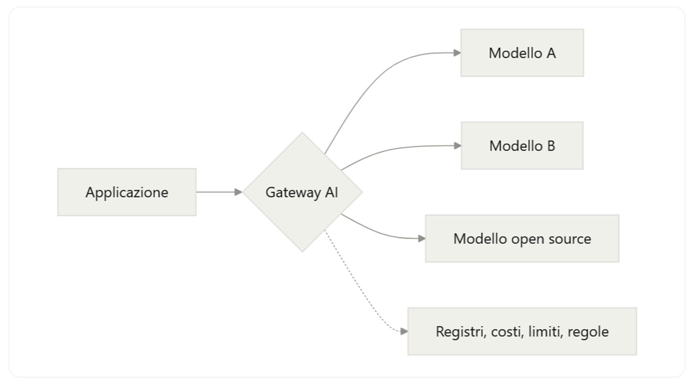
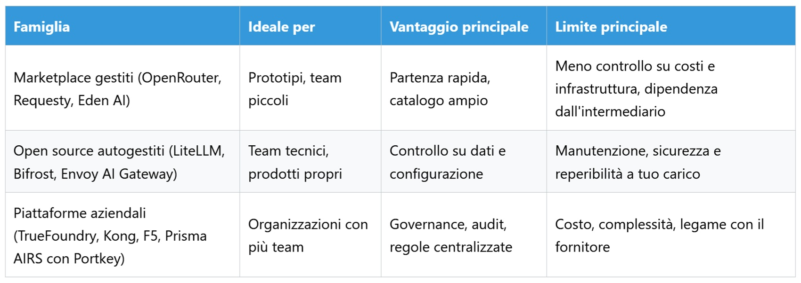
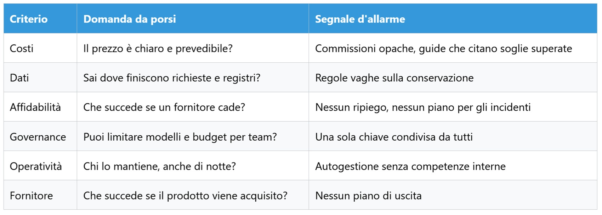

# A Practical Guide to Choosing an AI Gateway

*A gateway is the checkpoint through which your application's API keys, user payloads, and cloud expenses flow. In 2026, several prominent industry solutions were acquired or placed into maintenance mode: here is how to navigate the selection process without letting price alone dictate your architectural strategy. Modern production systems rarely depend on a single AI provider. Teams combine OpenAI, Anthropic, Google, Mistral, open weights from Meta, and specialized hosting endpoints—each bringing distinct payload schemas, authentication keys, and monthly invoices. The result is operational chaos: attribution challenges across departments, zero resiliency if a provider suffers an outage, and poor visibility into latency spikes and runtime error rates. An AI gateway positions itself cleanly between your application layer and upstream models, establishing a single control plane to route requests, secure credentials, track spend, and retain audit logs.*

The thesis of this guide is straightforward and somewhat counterintuitive: there is no universally superior gateway—there is only the solution calibrated to your technical maturity, operational budget, and required degree of control. In 2026, a second imperative emerges: vendor durability and corporate ownership matter just as much, as market consolidation reshaped the ecosystem in mere months. We must also discard sweeping promises: adopting an AI gateway does not guarantee cost reductions; in many configurations, it introduces an additional operational line item.

## What It Actually Does

Seven core capabilities define the architectural value of an AI gateway, best understood through a practical scenario. Consider an enterprise customer support bot: simple queries route to a lightweight, cost-effective model, while complex analytical tasks escalate to a flagship frontier model. Without an AI gateway, routing heuristics remain scattered across codebase repositories. With a gateway, this logic consolidates into a declarative, centrally configured policy.

The first capability is a unified interface: standardizing requests around a single schema—typically OpenAI-compatible—to communicate across diverse model providers. [LiteLLM](https://docs.litellm.ai/index.md) frames this as a single API call abstracting over one hundred model endpoints. The second is intelligent routing: directing payloads dynamically based on budget constraints, response latency thresholds, or output quality requirements. The third is automated fallback: should your primary provider encounter rate limits or service degradation, requests immediately pivot to a secondary target. As noted in [Requesty's technical guide](https://www.requesty.ai/blog/what-is-an-llm-gateway), automated fallback provides true resiliency only if the backup model matches the operational capabilities of the primary, requiring proactive fault-injection testing long before an actual outage occurs.

The fourth is observability—a fancy term for essential telemetry: visualizing token consumption, response latency distributions, error codes, and dollar expenditures segmented by engineering squad. The fifth is response caching: serving identical queries locally without invoking upstream providers. [Cloudflare](https://developers.cloudflare.com/ai-gateway/features/) applies exact-match caching, while [Kong](https://developer.konghq.com/ai-gateway) incorporates semantic caching to identify conceptually similar queries: delivering higher compute savings, but introducing the subtle operational risk of returning slightly misaligned responses. The sixth comprises virtual API keys paired with granular governance: each development team receives unique credentials governed by spend quotas and model allowlists, while master provider keys remain securely vault-protected. The seventh encompasses security guardrails applied to prompts and completions, such as automated redaction of personally identifiable information (PII) before payloads exit corporate network boundaries.

Here lies the fundamental distinction for decision-makers: accessing dozens of models via an aggregator is a developer convenience; governing enterprise AI in mission-critical production is a distinct architectural discipline.

## Three Architectural Archetypes, Blurring Boundaries

Navigating the landscape requires a taxonomy, understood as an orienting map rather than rigid categorization. Managed marketplaces provide unified accounts, single API credentials, and sprawling model directories. Self-hosted open-source gateways run directly on your own infrastructure. Enterprise governance platforms emphasize policy engines, compliance audits, and multi-team tenancy. The evaluation hinges on three strategic questions: do you prioritize rapid setup or absolute control; do you prefer delegating infrastructure maintenance or managing it internally; and do you face strict compliance mandates across multi-tenant teams?

Architectural boundaries remain porous. Portkey open-sourced its production gateway core weeks before being acquired by a major cybersecurity conglomerate; TrueFoundry deploys both as a fully managed SaaS and as a VPC-native data plane; and developer-focused projects like LiteLLM now operate hosted cloud variants alongside their open-source libraries. This taxonomy should serve as an operational compass rather than a definitive directory.

## The Appeal of Managed Marketplaces

Managed marketplaces represent the lowest barrier to entry. [OpenRouter](https://openrouter.ai/pricing) exposes more than six hundred models spanning over eighty providers behind a unified endpoint, explaining why it remains the default sandbox for rapid prototyping. [Requesty](https://requesty.ai/glossary) offers a hosted alternative featuring granular fallback logic and, according to official documentation, EU-localized request routing anchored in Frankfurt. [Eden AI](https://docs.edenai.co/v3/overview/ai-gateway) adopts a broader mandate: alongside large language models, it unifies specialized multimodal APIs—including optical character recognition (OCR), speech transcription, and neural translation—aggregating more than five hundred models across fifty providers.

Convenience carries a financial premium—an aspect where available guides often present confusing analysis. According to [pricing breakdowns](https://www.maximem.ai/blog/openrouter-pricing-2026), base token pricing on OpenRouter matches official provider list rates, with platform revenue derived from credit purchase transaction fees: [official pricing documentation](https://openrouter.ai/pricing) indicates a 5.5% markup on Standard tiers and 8% on Business tiers. Teams bringing their own provider credentials (BYOK) bypass markup fees up to a monthly volume threshold calculated against standard list prices, above which a 5% platform fee takes effect.

A critical note regarding documentation freshness: numerous technical articles still circulating online—including [guides published in late June](https://www.truefoundry.com/blog/openrouter-pricing)—reference a free monthly tier of one million BYOK requests, a concession that [industry analyses confirm](https://www.truefoundry.com/blog/openrouter-byok-explained-cheaper-often-faster-and-changing) was discontinued in July. This volatility illustrates why static rate sheets are omitted here: teams must verify commercial terms directly on provider portals. For Requesty and Eden AI, [independent analyses](https://www.getmaxim.ai/articles/requesty-alternatives.md) and [industry directories](https://www.everydev.ai/tools/eden-ai) report comparable fee structures, subject to direct verification.

Regarding data governance, OpenRouter's published tiers show that policy-based routing enforcing data-handling restrictions begins on the Standard tier, regional data residency (EU or US) requires the Business tier, and formal Service Level Agreements (SLAs) are restricted to Enterprise contracts. Data retention policies detailed in [official documentation](https://openrouter.ai/docs/guides/privacy/provider-logging) warrant careful legal review, as data transit pipelines do not terminate at the proxy layer.

For teams building early prototypes seeking to benchmark GPT, Claude, Gemini, and Llama without provisioning multiple billing accounts, a managed marketplace remains the most pragmatically efficient choice. The structural trade-off is organizational dependency on an external intermediary for authentication, billing continuity, and platform availability, backed by lighter governance capabilities than dedicated enterprise platforms provide.

## The Operational Cost of Control

Self-hosting an AI gateway means running the proxy binary on your own compute instances or private cloud VPC rather than routing payloads through third-party infrastructure. This represents the default path for organizations legally barred from transmitting sensitive prompts through external aggregators, or for engineering teams seeking to eliminate platform surcharges while customizing runtime behavior.

[LiteLLM](https://docs.litellm.ai/index.md) stands as the most widely adopted open-source solution, presenting two architectural modes that must not be conflated: a lightweight Python library imported directly into application runtimes, and a centralized proxy gateway serving multiple teams with virtual keys, spending budgets, and centralized usage metering. The centralized proxy architecture requires a persistent PostgreSQL database and, across multi-replica deployments, a shared Redis cache—as detailed in [technical architectural reviews](https://www.truefoundry.com/blog/what-is-litellm). [Bifrost](https://github.com/maximhq/bifrost), developed in Go by Maxim AI under the Apache 2.0 license, emphasizes minimal latency overhead, though widely cited throughput benchmarks originate from the vendor and [await independent verification](https://dev.co/ai/frameworks/bifrost).

Until recently, technical discussions routinely included Helicone. However, following its [acquisition by Mintlify in March](https://www.mintlify.com/blog/mintlify-acquires-helicone), the service operates in maintenance mode: providing security patches and updates for newly released models, but discontinuing active feature development. While the platform remains functional, adopting it today for multi-year enterprise roadmaps represents an unnecessary architectural gamble. Teams seeking dedicated observability can evaluate [Langfuse](https://clickhouse.com/blog/clickhouse-acquires-langfuse-open-source-llm-observability), which retains an open-source core under the MIT license following its acquisition by ClickHouse, according to official statements.

Self-hosting, however, does not eliminate systemic risk—a reality starkly demonstrated in early 2026. On March 24, two malicious versions of LiteLLM published to the public PyPI repository contained credential-harvesting code. [Official project advisories](https://docs.litellm.ai/blog/security-update-march-2026) identified tainted releases 1.82.7 and 1.82.8, attributing the breach to a compromised maintainer account while confirming that deployments utilizing official Docker images were unaffected due to locked dependency trees. A sanitized release, version 1.83.0, was published on March 30. Exposure timelines remain contested across post-mortems: the maintainers cited a forty-minute window, while [external technical investigations](https://letsdatascience.com/news/litellm-breach-exposes-ai-supply-chain-risk-69f3c6f7) estimated vulnerability windows spanning several hours. According to [a supply chain audit by Comet](https://www.comet.com/site/blog/litellm-supply-chain-attack/), environments using immutable lockfiles and pinned container builds remained entirely insulated, while dynamic CI/CD pipelines suffered exposure.

An AI gateway consolidates administrative credentials for every upstream AI provider: organizations choosing to self-host must treat the gateway with the rigor reserved for secrets management vaults, where dependency pinning is a non-negotiable baseline. Furthermore, total cost of ownership is never zero: compute instances, high-availability databases, engineering maintenance hours, and on-call rotations must be factored into the economic calculus.

## Governance at Scale

When the primary architectural challenge shifts from calling models to governing their organizational footprint, enterprise value shifts toward policy enforcement, compliance audit trails, and role-based access control rather than simple routing logic. A regulated financial institution managing dozens of engineering squads, sensitive client records, and statutory audit obligations requires far more than a request forwarder.

The trajectory of Portkey provides an instructive case study. In March, the company [open-sourced its core production gateway](https://latent.space/wiki/portkey-ai-5b678cc2/); on May 29, it was [acquired by Palo Alto Networks](https://www.paloaltonetworks.com/company/press/2026/palo-alto-networks-completes-acquisition-of-portkey-to-secure-ai-agents.html) to serve as the gateway foundation for its Prisma AIRS platform. [SEC regulatory filings](https://www.sec.gov/Archives/edgar/data/0001327567/000132756726000023/panw-20260731.htm) reported an acquisition valuation of $117 million. While the standalone open-source repository remains [publicly maintained](https://www.deepinspect.ai/blog/best-ai-gateway-2026), enterprise customers face an enduring strategic question: will future engineering priorities reflect developer agility or the compliance requirements of a corporate security giant?

[TrueFoundry](https://truefoundry.com/docs/gateway) integrates gateway proxying directly with compute infrastructure management, offering quota controls mapped across [users, engineering teams, and virtual accounts](https://docs.truefoundry.com/gateway/budgetlimiting), supporting managed SaaS, customer-hosted storage, or complete in-VPC data planes. [Kong](https://developer.konghq.com/ai-gateway) represents the natural choice for organizations already anchored on its enterprise API gateway, extending mature networking capabilities with AI-native plugins such as real-time PII redaction. In the open ecosystem, [Envoy AI Gateway reached version 1.0 in June](https://itbrief.co.uk/story/envoy-ai-gateway-reaches-1-0-for-production-ai-use) backed by contributions from Bloomberg, Nutanix, and Tetrate, while [agentgateway](https://agentgateway.dev/docs/standalone/latest/about/)—incubated by Solo.io and transitioned to the Linux Foundation—manages model traffic, Model Context Protocol (MCP) tooling, and inter-agent communication within a unified proxy fabric. The name Gloo Gateway, occasionally cited in older compilations, reflects legacy branding; Solo.io's active open-source AI architecture is anchored on agentgateway. Meanwhile, F5 announced an [AI security platform in June](https://www.helpnetsecurity.com/2026/06/23/f5-launches-ai-security-platform-to-uncover-and-secure-shadow-ai/) and [expanded its enterprise AI Gateway in August](https://itbrief.co.nz/story/f5-expands-ai-gateway-to-curb-costs-secure-agents) to enforce automated threat inspection.

The primary beneficiaries of this enterprise wave are cybersecurity and networking vendors, who position the gateway as the policy enforcement point for corporate AI traffic, alongside large enterprises gaining a centralized management plane. Those assuming the greatest risk are smaller teams tempted by over-engineered tooling, alongside any organization dependent on a product roadmap subject to post-acquisition realignment.

## When Existing Cloud Platforms Suffice

A legitimate architectural shortcut exists: adopting the integrated AI gateway provided by your current edge or hosting platform. [Vercel AI Gateway](https://vercel.com/docs/ai-gateway/pricing) advertises zero token markups, including for BYOK configurations, though [standard payment processing fees may apply](https://vercel.com/ai-gateway). [Cloudflare AI Gateway](https://developers.cloudflare.com/ai-gateway) delivers native edge analytics, response caching, rate limiting, logging, and model fallback, accompanied by content moderation filters detailed in its [platform feature documentation](https://developers.cloudflare.com/ai-gateway/features/).

The operational advantage is strategic: zero net-new vendor relationships, fewer operational components to patch, and an intuitive developer experience aligned with your existing hosting stack. The constraint is architectural lock-in. A platform-native gateway proves highly effective as long as your application compute remains colocated; it becomes an operational anchor should you decide to migrate. It rarely represents the ideal choice if your primary data plane resides elsewhere.

## Core Architectural Criteria

The following evaluation matrix outlines nine critical criteria engineering leaders must systematically examine prior to vendor selection: data sovereignty (where are payloads, completions, and logs retained, and for what duration?); cost modeling (transaction markups, flat platform subscriptions, or open-source infrastructure overhead?); observability depth (can telemetry isolate latency, error states, and token spend per team or functional endpoint?); fault tolerance (are automated retries, fallback tiers, and circuit breakers proven under chaos testing?); security posture (who maintains root provider credentials, and is real-time PII masking supported?); framework interoperability (does the gateway support your existing SDKs and libraries?); scale endurance (will proxy throughput withstand projected concurrency?); operational overhead (what is the engineering cost of continuous maintenance?); and vendor longevity (can you migrate seamlessly if the vendor is acquired or deprecated?).

The final dimension reflects the defining reality of 2026. [Langfuse acquired in January](https://clickhouse.com/blog/clickhouse-acquires-langfuse-open-source-llm-observability), [Helicone acquired in March](https://www.mintlify.com/blog/mintlify-acquires-helicone), [Portkey acquired in May](https://www.paloaltonetworks.com/company/press/2026/palo-alto-networks-completes-acquisition-of-portkey-to-secure-ai-agents.html): within five months, three foundational industry tools shifted ownership. This does not imply product degradation; it demonstrates that multi-year architectural decisions require a clear exit strategy from day one. Standardizing application code around an OpenAI-compatible interface while maintaining provider API keys in an external secrets vault makes migrating between gateways remarkably painless.

## Four Real-World Architectural Scenarios

For a seed-stage startup or prototyping team, development velocity and model optionality are paramount. Pragmatic choices include OpenRouter, Requesty, or Eden AI, monitoring long-term consumption fees and avoiding proprietary SDK lock-in. Adopting a BYOK model early preserves long-term migration flexibility.

For a scaling software product, operational reliability, unit economics, and deep telemetry become decisive. Viable paths include self-hosting LiteLLM via pinned releases (immutable Docker builds and lockfiles), deploying Bifrost, or utilizing platform gateways from Vercel or Cloudflare if already within their ecosystems, paired with an independent observability backend. Prioritize robust logging formats over brand prestige.

For an organization handling strictly regulated data, privacy boundaries, network isolation, and auditability take precedence. Viable options include self-hosting LiteLLM, Bifrost, or Envoy AI Gateway within private network perimeters, or deploying TrueFoundry within an internal VPC. This path demands dedicated internal DevOps bandwidth and ultimate security accountability that no commercial contract can offload.

For a large enterprise with distributed teams, the mandate focuses on governance, automated spend quotas, and regulatory compliance. Viable architectures include TrueFoundry, Kong, F5, Prisma AIRS via Portkey, or open enterprise fabrics like Envoy AI Gateway or agentgateway. This path incurs substantial operational complexity, licensing fees, and longer integration timelines; teams should secure written roadmap commitments regarding post-acquisition support.

These scenarios represent defensible archetypes rather than dogmatic rules: organizational workflow context invariably outweighs vendor branding.

## High-Cost Architectural Pitfalls

The first common pitfall is optimizing strictly for nominal price, which invariably shifts expenses into engineering maintenance hours or operational risk. The second is confusing broad model directory access with production runtime governance: lacking per-team spending quotas and immutable logging, organizations inevitably face unexpected cloud billing shocks without diagnostic visibility. The third is overlooking hidden transaction markups or relying on outdated documentation: architectural budgets modeled on obsolete pricing tiers can derail quarterly projections.

The fourth is self-hosting without adequate operational resources: an unpatched gateway or one upgraded without strict dependency pinning exposes corporate API credentials like an unprotected database—as the LiteLLM supply chain incident highlighted. The fifth is deferring observability, cost governance, and automated fallbacks until after deployment: reconstructing telemetry and auditing usage retrospectively is an operational nightmare. The pragmatic rule of thumb: start with the simplest architecture that satisfies current requirements, rigorously audit cost and output quality, and transition to heavier governance platforms only when organizational scale demands it.

## Proportionality Over Hype

An AI gateway is not an optional utility; it is a foundational architectural decision that governs organizational credentials, sensitive user data, and infrastructure spend. The guiding heuristic distills into four pragmatic principles: for early prototypes, leverage a managed marketplace; for scaling products, deploy an observability-backed proxy with automated fallback; for confidential workloads, insist on self-hosted or VPC-isolated infrastructure; for complex enterprise environments, invest in a dedicated governance platform. Evaluate your internal constraints before evaluating vendor feature sheets.

Strategic questions remain unresolved. How will Palo Alto Networks steward Portkey's open-source gateway? How long will Helicone remain a viable production option? And above all: in an industry where AI gateway providers are acquired in rapid succession, what is the architectural value of being able to swap your gateway without refactoring a single line of application code? Teams that can answer that final question have already resolved the hardest part of the decision.

---

*Technical note: Market data verified as of November 4, 2026, against official documentation and corporate announcements where available. Content referencing competing vendor analyses (TrueFoundry, Maxim, Tetrate, Solo.io) is identified accordingly. Commercial fee structures and platform terms change frequently: always consult official vendor portals directly.*
