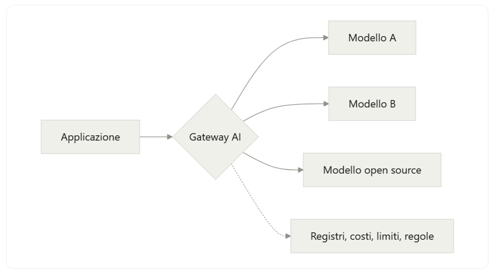
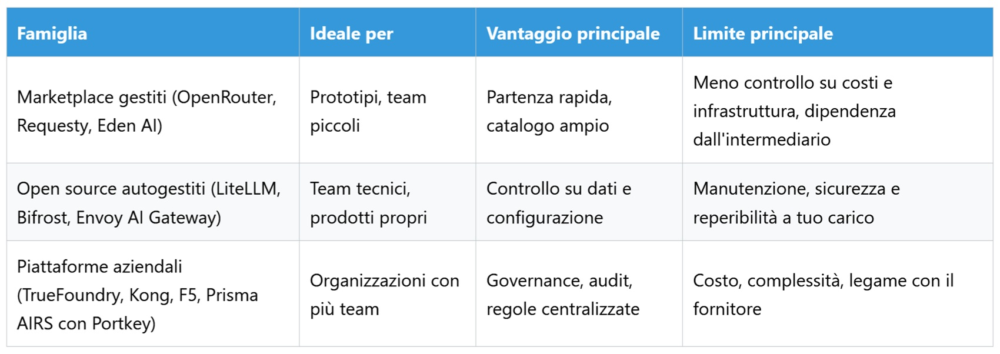
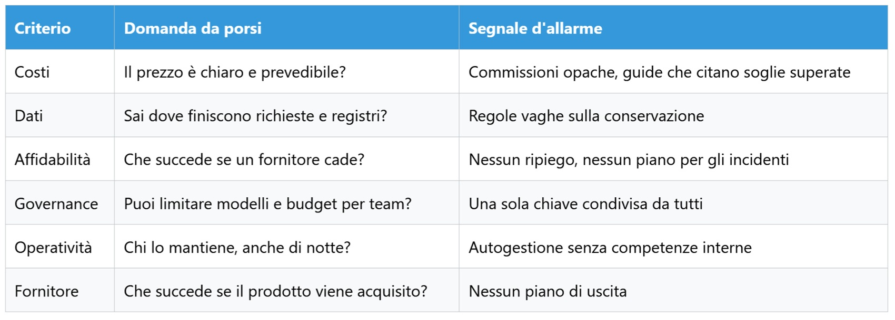

# Guía para elegir un gateway de IA

*Un gateway es el punto de paso obligatorio por el que transitan las claves, los datos y los costes de vuestra aplicación. En 2026, algunos de los nombres más representativos del sector han sido adquiridos o congelados en fase de mantenimiento: he aquí cómo elegir sin dejaros deslumbrar exclusivamente por el precio. En la actualidad, un producto tecnológico riguroso rara vez se vincula a un único modelo. Se combinan OpenAI, Anthropic, Google, Mistral, pesos abiertos como los de Meta y, en ocasiones, proveedores especializados, cada uno con esquemas de petición, credenciales y facturaciones independientes. El desenlace es un laberinto operativo: costes difíciles de imputar, ausencia de redundancia si un proveedor sufre una caída de servicio y escasa visibilidad sobre latencias y errores de ejecución. El gateway se interpone entre la aplicación y los modelos, facilitando un punto de control unificado para encaminar las solicitudes (el *routing*), custodiar las claves, fiscalizar el gasto y preservar los registros de auditoría.*

La tesis central de este artículo es nítida y moderadamente incómoda: no existe el gateway perfecto en términos universales; existe aquel que resulta proporcional a vuestra madurez técnica, a vuestro presupuesto y al nivel de gobernanza que debáis retener. En 2026 se impone una segunda consideración: importan de igual modo la solvencia corporativa y el rumbo estratégico de la entidad proveedora, pues el mercado se ha transformado sustancialmente en cuestión de meses. Asimismo, conviene desechar promesas categóricas: un gateway no siempre reduce la factura; en no pocas configuraciones añade una partida presupuestaria complementaria.

## Qué resuelve en la práctica

Siete funcionalidades troncales estructuran el valor de un gateway de IA, comprensibles de inmediato mediante un caso práctico. Imaginad el asistente conversacional de soporte de una corporación: para consultas elementales recurre a un modelo económico, mientras que para análisis de negocio avanzados deriva la carga a un modelo fundacional de referencia. Sin un gateway, esa lógica se dispersa caóticamente por las líneas de código. Con un gateway, se transforma en una directriz declarativa y configurable.

La primera prestación reside en la interfaz unificada: un formato de petición estandarizado —por lo general alineado con la especificación de OpenAI— para dialogar con modelos heterogéneos. [LiteLLM](https://docs.litellm.ai/index.md) lo resume como una llamada unificada que abstrae más de un centenar de plataformas. La segunda es el enrutamiento inteligente, esto es, discernir qué modelo asume cada petición en función del coste, la latencia de respuesta o la exigencia de precisión. La tercera es la conmutación por error o respaldo automático (*fallback*): si el proveedor titular no responde o sufre saturación, la petición se desvía sin fricción hacia una alternativa. Tal como advierte [la guía técnica de Requesty](https://www.requesty.ai/blog/what-is-an-llm-gateway), el mecanismo de contingencia solo aporta valor si el modelo de respaldo posee una competencia funcional equivalente, lo que exige someter el sistema a pruebas de fallo inducido antes de que surja una interrupción real.

La cuarta es la observabilidad, término técnico para una necesidad elemental: monitorizar el consumo de tokens, los tiempos de procesamiento, los códigos de error y los importes económicos, desglosados por equipos de desarrollo. La quinta es la memoria intermedia de respuestas (*caching*): una consulta idéntica previa puede despacharse localmente sin invocar de nuevo al modelo. [Cloudflare](https://developers.cloudflare.com/ai-gateway/features/) implementa almacenamiento en caché por concordancia exacta, mientras que [Kong](https://developer.konghq.com/ai-gateway) incorpora capacidades semánticas capaces de asociar preguntas análogas: mayor contención del gasto, pero con el riesgo latente de devolver una respuesta sutilmente desalineada. La sexta radica en las claves virtuales con topes de consumo: cada equipo de ingeniería dispone de credenciales propias vinculadas a un límite presupuestario y a un catálogo de modelos autorizados, mientras la clave maestra de la API permanece resguardada en el almacén de secretos. La séptima abarca los filtros perimetrales de seguridad en entradas y salidas, ejemplificados en la ofuscación en tiempo real de datos personales antes de que abandonen la infraestructura corporativa.

En esta distinción descansa la decisión estratégica: acceder a una pluralidad de modelos es una ventaja funcional; gobernar la IA en entornos críticos de producción constituye una disciplina arquitectónica sustancialmente distinta.

## Tres familias, fronteras permeables

Para situarse en este ecosistema conviene recurrir a un mapa taxonómico, entendido como una orientación metodológica y no como un compartimento estanco. Los marketplaces gestionados facilitan una cuenta global, una credencial unificada y un catálogo masivo. Los gateways de código abierto autoalojados (*self-hosted*) se ejecutan bajo vuestro control directo. Las plataformas corporativas de gobernanza priorizan las políticas de seguridad, las pistas de auditoría y la gestión multi-tenant de múltiples equipos. La elección se sintetiza en tres dilemas: ¿buscáis inmediatez o control absoluto?, ¿preferís externalizar la infraestructura o administrarla internamente?, ¿afrontáis requerimientos regulatorios estrictos y múltiples áreas técnicas?

Las delimitaciones son fluidas. Portkey liberó el código fuente de su núcleo productivo apenas semanas antes de ser absorbida por un gigante de la ciberseguridad; TrueFoundry puede desplegarse tanto como solución SaaS gestionada como en el plano de datos de vuestra propia VPC; y un proyecto enfocado a desarrolladores como LiteLLM comercializa en la actualidad modalidades gestionadas en la nube junto a su librería de código abierto. Conviene interpretar la tabla como una brújula analítica y no como un inventario inmutable.

## La seducción del marketplace gestionado

El marketplace gestionado constituye la vía de menor fricción operativa. [OpenRouter](https://openrouter.ai/pricing) expone más de seiscientos modelos procedentes de más de ochenta suministradores bajo un único punto de acceso, lo que explica su hegemonía como entorno predilecto para el desarrollo de prototipos. [Requesty](https://requesty.ai/glossary) se postula como una alternativa gestionada dotada de políticas de redundancia configurables y, conforme a su documentación técnica, con enrutamiento de peticiones localizado en la Unión Europea a través de su nodo en Fráncfort. [Eden AI](https://docs.edenai.co/v3/overview/ai-gateway) abraza un alcance complementario: además de modelos lingüísticos, congrega mediante una única integración APIs de visión artificial (OCR), transcripción fonética y traducción neuronal, agregando más de quinientos modelos de medio centenar de fabricantes.

Esta comodidad operativa acarrea un sobrecoste financiero, aspecto en el que muchas publicaciones suelen incurrir en imprecisiones. De acuerdo con [los análisis económicos especializados](https://www.maximem.ai/blog/openrouter-pricing-2026), en OpenRouter el importe por token coincide con el baremo oficial del proveedor, financiándose la plataforma mediante comisiones aplicadas a la recarga de saldo: [la página oficial de tarifas](https://openrouter.ai/pricing) especifica un 5,5% en el nivel Standard y un 8% en el Business. Aquellas organizaciones que aportan sus propias credenciales de acceso (BYOK, *Bring Your Own Key*) eluden este recargo hasta alcanzar un umbral de facturación mensual indexado a las tarifas estándar, rebasado el cual se devenga una tasa del 5%.

Procede introducir aquí una llamada de cautela sobre la caducidad documental. Diversos análisis que aún continúan accesibles en la red —incluidas [guías publicadas a finales de junio](https://www.truefoundry.com/blog/openrouter-pricing)— aluden a un cupo gratuito de un millón de peticiones en modalidad BYOK, prerrogativa que [estudios posteriores constatan](https://www.truefoundry.com/blog/openrouter-byok-explained-cheaper-often-faster-and-changing) que fue revocada formalmente en julio. He ahí el motivo por el cual omitimos tablas estáticas de precios en este análisis: la recomendación imperativa es acudir directamente a los portales oficiales de cada firma. En cuanto a Requesty y Eden AI, [revisiones sectoriales independientes](https://www.getmaxim.ai/articles/requesty-alternatives.md) y [catálogos del sector](https://www.everydev.ai/tools/eden-ai) reportan márgenes comisionales en franjas equiparables, sujetos a confirmación contractual.

En el plano del gobierno del dato, el cuadro tarifario de OpenRouter evidencia que el enrutamiento supeditado a políticas de privacidad entra en juego a partir del nivel Standard, la residencia geográfica de datos (UE o EE. UU.) exige la suscripción Business, y los Acuerdos de Nivel de Servicio (SLA) vinculantes quedan circunscritos a la modalidad Enterprise. Las cláusulas de retención de telemetría descritas en su [documentación de privacidad](https://openrouter.ai/docs/guides/privacy/provider-logging) reclaman un análisis sosegado, puesto que el trayecto de los datos no se detiene en el intermediario.

Si os halláis en fase de prototipado y deseáis comparar GPT, Claude, Gemini y Llama sin tramitar cuatro acuerdos comerciales aislados, un marketplace gestionado encarna la solución más eficiente. La contrapartida estriba en la servidumbre operativa respecto a un tercero para la autenticación, la facturación y la continuidad de servicio, disponiendo de unas capacidades de gobernanza más livianas que las exigidas en entornos corporativos maduros.

## El precio del control directo

Autoalojar un gateway de IA implica que el binario de intermediación se ejecuta en vuestras propias instancias computacionales o en una nube privada, evitando el tránsito de tráfico sensible por servidores ajenos. Constituye el itinerario obligado para corporaciones jurídicamente impedidas de cursar datos por agregadores externos, o para departamentos técnicos decididos a erradicar comisiones por consumo y parametrizar la lógica interna del proxy.

[LiteLLM](https://docs.litellm.ai/index.md) se erige en la opción de código abierto con mayor tracción, articulada en dos modalidades que conviene no mezclar: una librería de Python embebida directamente en el código de vuestra aplicación, y un proxy centralizado al que se conectan de forma concurrente múltiples servicios, dotado de claves virtuales, asignación presupuestaria y contabilidad analítica. Esta última arquitectura demanda una base de datos relacional y, en topologías distribuidas de alta concurrencia, una memoria compartida en Redis, tal como pormenoriza [la documentación técnica especializada](https://www.truefoundry.com/blog/what-is-litellm). Por su parte, [Bifrost](https://github.com/maximhq/bifrost), desarrollado en lenguaje Go por Maxim AI bajo licencia Apache 2.0, persigue minimizar la latencia de intermediación, si bien los índices de rendimiento más difundidos proceden de la propia compañía y [carecen de validación independiente concluyente](https://dev.co/ai/frameworks/bifrost).

Hasta hace escasos meses habría resultado preceptivo incluir en este grupo a Helicone. Sin embargo, [su absorción por parte de Mintlify en marzo](https://www.mintlify.com/blog/mintlify-acquires-helicone) relegó el servicio a un régimen de estricto mantenimiento: parches correctivos de seguridad y homologación de nuevos modelos, pero sin desarrollo de nuevas capacidades. El producto permanece operativo y no suscita alarmas inmediatas, pero seleccionarlo hoy para una hoja de ruta plurianual constituye una apuesta incierta. Quienes demanden exclusivamente observabilidad analítica pueden valorar [Langfuse](https://clickhouse.com/blog/clickhouse-acquires-langfuse-open-source-llm-observability), que tras su compra por parte de ClickHouse conserva su núcleo libre bajo licencia MIT para sus módulos troncales, según los comunicados institucionales.

Ahora bien, la autogestión no está exenta de contingencias operativas, y el ejercicio de 2026 brindó una advertencia palmaria. El 24 de marzo, dos versiones de LiteLLM publicadas en PyPI —el índice oficial de paquetes de Python— contenían código malicioso destinado a la sustracción de credenciales. El [aviso de seguridad oficial](https://docs.litellm.ai/blog/security-update-march-2026) precisó que las versiones comprometidas eran la 1.82.7 y la 1.82.8, apuntando a una intrusión en la cuenta de un mantenedor, y puntualizando que aquellos entornos que utilizaban las imágenes Docker oficiales no se vieron afectados al contar con árboles de dependencias inmutables. El 30 de marzo se distribuyó una versión saneada (1.83.0). En cuanto al intervalo de exposición, las fuentes discrepan: el proyecto estimó una brecha de unos cuarenta minutos, mientras que [investigaciones de seguridad independientes](https://letsdatascience.com/news/litellm-breach-exposes-ai-supply-chain-risk-69f3c6f7) dilataron la ventana a varias horas. Según [una auditoría técnica de Comet](https://www.comet.com/site/blog/litellm-supply-chain-attack/), las infraestructuras con dependencias estrictamente fijadas mediante archivos de bloqueo (*lockfiles*) salieron indemnes, en contraste con aquellas sujetas a construcciones dinámicas.

Un gateway custodia las credenciales maestras de todas vuestras suscripciones de IA: quien opte por el autoalojamiento está obligado a blindarlo con las precauciones propias de un gestor de secretos, siendo el anclaje estricto de versiones un requisito de partida insoslayable. Asimismo, su coste real no es neutro: servidores, bases de datos de soporte, dedicación técnica y guardias operativas deben computarse en el balance financiero.

## Gobernanza a gran escala

Cuando la prioridad estriba no ya en interconectar modelos, sino en gobernar su despliegue institucional, el valor diferencial reside en la imposición de directivas, la trazabilidad estricta y el control granular de accesos más que en el mero arbitraje de peticiones. Una entidad financiera con decenas de células operativas, tráfico confidencial y obligaciones de cumplimiento normativo precisa un instrumental mucho más avanzado que un simple conmutador.

La evolución de Portkey constituye el caso más ilustrativo. En marzo [abrió el código de su pasarela de producción](https://latent.space/wiki/portkey-ai-5b678cc2/); el 29 de mayo se formalizó su [adquisición por parte de Palo Alto Networks](https://www.paloaltonetworks.com/company/press/2026/palo-alto-networks-completes-acquisition-of-portkey-to-secure-ai-agents.html), convirtiéndose en la pieza de enrutamiento de su plataforma de ciberseguridad Prisma AIRS. Los [informes financieros depositados ante la SEC](https://www.sec.gov/Archives/edgar/data/0001327567/000132756726000023/panw-20260731.htm) cuantificaron la operación en 117 millones de dólares. El repositorio de código abierto [se mantiene activo públicamente](https://www.deepinspect.ai/blog/best-ai-gateway-2026), si bien planea una incógnita estratégica de hondo calado para sus usuarios: ¿estarán las prioridades de desarrollo alineadas con las demandas de los desarrolladores o supeditadas a los requerimientos de seguridad perimetral de una gran corporación?

[TrueFoundry](https://truefoundry.com/docs/gateway) conjuga la pasarela de enrutamiento con la gobernanza de recursos computacionales, habilitando cuotas presupuestarias distribuidas entre [usuarios, departamentos o cuentas virtuales](https://docs.truefoundry.com/gateway/budgetlimiting), con opciones SaaS, almacenamiento propio o despliegues íntegros en la VPC corporativa. [Kong](https://developer.konghq.com/ai-gateway) encarna la alternativa natural para aquellas organizaciones que ya operan su gateway de APIs empresariales, extendiendo sus capacidades de red consolidadas con complementos nativos de IA como la ofuscación automatizada de datos sensibles. En el ámbito abierto, [Envoy AI Gateway alcanzó su versión 1.0 en junio](https://itbrief.co.uk/story/envoy-ai-gateway-reaches-1-0-for-production-ai-use) con el respaldo de organizaciones como Bloomberg, Nutanix y Tetrate, mientras que [agentgateway](https://agentgateway.dev/docs/standalone/latest/about/) —gestado en Solo.io y cedido a la Linux Foundation— gestiona de forma simultánea el tráfico de inferencia, herramientas bajo el protocolo MCP y la comunicación inter-agentes. La denominación Gloo Gateway, habitual en recopilaciones pretéritas, responde a nomenclaturas previas; el referente operativo vigente de Solo.io para la IA es agentgateway. En paralelo, F5 presentó en junio una [plataforma de seguridad integral para IA](https://www.helpnetsecurity.com/2026/06/23/f5-launches-ai-security-platform-to-uncover-and-secure-shadow-ai/) y [expandió su AI Gateway en agosto](https://itbrief.co.nz/story/f5-expands-ai-gateway-to-curb-costs-secure-agents) integrando inspección automatizada contra amenazas.

Los grandes beneficiarios de este movimiento son los fabricantes de seguridad y redes, que erigen el gateway en el punto neurálgico de aplicación de políticas para el tráfico corporativo, junto a las grandes corporaciones, que unifican el control en una única consola. Quienes asumen mayor exposición son los equipos pequeños, propensos a sobrecargar su arquitectura con herramientas sobredimensionadas, y cualquier organización sujeta a la incertidumbre de una hoja de ruta condicionada por adquisiciones empresariales.

## Cuando la plataforma de alojamiento es suficiente

Existe un atajo arquitectónico plenamente legítimo: recurrir al gateway gestionado de la propia plataforma sobre la que ya se despliega vuestra aplicación. [Vercel AI Gateway](https://vercel.com/docs/ai-gateway/pricing) declara cero recargos sobre los tokens, incluso cuando se opera con claves propias, al margen de que [puedan subsistir comisiones por procesamiento de cobros](https://vercel.com/ai-gateway). [Cloudflare AI Gateway](https://developers.cloudflare.com/ai-gateway) provee métricas de latencia, memoria caché distribuida, limitación de frecuencia (*rate limiting*), registro de eventos y redundancia de modelos, con políticas de filtrado y protección documental descritas en su [directorio de funcionalidades](https://developers.cloudflare.com/ai-gateway/features/).

La ventaja estratégica es evidente: neutraliza la dispersión de proveedores, ahorra mantenimiento de piezas auxiliares y ofrece una integración armónica con el resto de vuestro stack de despliegue. Su contrapartida reside en la dependencia de ecosistema. Un gateway vinculado a la plataforma resulta impecable mientras vuestra lógica informática resida allí; muta en un lastre operativo si decidís migrar. No constituye la alternativa idónea si vuestro centro de operaciones radica en otro entorno.

## Los criterios de evaluación decisivos

Este compendio resume los nueve factores estructurales que conviene situar sobre la mesa antes de formalizar cualquier compromiso: soberanía del dato (¿dónde se almacenan prompts, respuestas y registros, y durante cuánto tiempo?); esquema de tarificación (¿se abonan comisiones por volumen, cuotas planas de suscripción o costes de infraestructura abierta?); profundidad analítica (¿permite segregar costes, errores y latencias por departamento o funcionalidad?); tolerancia a fallos (¿cuenta con mecanismos probados de reintento, conmutación automática y monitorización activa?); seguridad perimetral (¿dónde residen las claves maestras y se contempla el anonimizado de datos personales?); interoperabilidad (¿garantiza compatibilidad con vuestras librerías y esquemas vigentes?); escalabilidad (¿soportará picos concurrentes de carga y nuevos equipos?); sobrecoste operativo (¿cuántas horas de ingeniería requerirá su soporte continuado?); y riesgo corporativo del suministrador (¿qué ocurre si la compañía es absorbida o descontinúa el soporte, y cómo de compleja sería la migración?).

La última consideración encierra la gran lección de 2026. [Langfuse en enero](https://clickhouse.com/blog/clickhouse-acquires-langfuse-open-source-llm-observability), [Helicone en marzo](https://www.mintlify.com/blog/mintlify-acquires-helicone), [Portkey en mayo](https://www.paloaltonetworks.com/company/press/2026/palo-alto-networks-completes-acquisition-of-portkey-to-secure-ai-agents.html): en cinco meses, tres de las herramientas de mayor calado cambiaron de manos. Ello no denota una merma funcional inmediata, pero evidencia que cualquier apuesta tecnológica a medio plazo debe incorporar una estrategia de salida preconcebida. Una interfaz estandarizada según las especificaciones de OpenAI y el mantenimiento de vuestras credenciales maestras fuera del gateway reducen drásticamente la fricción ante una eventual migración.

## Cuatro escenarios operativos reales

Para una startup o un prototipo inicial priman la velocidad de desarrollo y la flexibilidad para pivotar de modelo. Las opciones más recomendables son OpenRouter, Requesty o Eden AI, vigilando las comisiones por volumen y eludiendo dependencias rígidas. Conviene adoptar tempranamente la modalidad BYOK para salvaguardar la autonomía operativa.

Para un producto de software en crecimiento entran en liza la estabilidad, la optimización unitaria y la telemetría granular. Las alternativas sólidas comprenden un despliegue controlado de LiteLLM (con versiones y contenedores estrictamente anclados), Bifrost, o bien los gateways de Vercel o Cloudflare si vuestra operativa reside ya en sus redes, combinados con un módulo analítico independiente. Priorizad la robustez de los registros de auditoría por encima de la notoriedad de marca.

Para una corporación que procesa datos confidenciales son irrenunciables la privacidad, el aislamiento de red y la auditabilidad estricta. Las vías solventes pasan por gateways autoalojados como LiteLLM, Bifrost o Envoy AI Gateway, o el despliegue de TrueFoundry en vuestra propia nube privada. Este enfoque demanda solvencia técnica interna y la asunción de una responsabilidad de seguridad que ningún contrato permite delegar.

Para una organización compleja con múltiples áreas se imponen la gobernanza corporativa, el control presupuestario y el cumplimiento regulatorio. Las opciones idóneas abarcan TrueFoundry, Kong, F5, Prisma AIRS con Portkey, o los entramados abiertos de Envoy AI Gateway y agentgateway. Conlleva mayor complejidad arquitectónica, costes directos de licencia e itinerarios de implantación dilatados; resulta prudente exigir compromisos contractuales explícitos acerca de la evolución del producto ante escenarios de adquisición.

Constituyen arquetipos metodológicos y no veredictos categóricos: las singularidades del entorno productivo prevalecen siempre sobre la denominación de la herramienta.

## Errores de alto impacto económico

El primer desliz estriba en guiarse exclusivamente por el precio de partida, inclinación que suele derivar en sobrecostes imprevistos de ingeniería o en una mayor exposición operativa. El segundo es equiparar el acceso masivo a modelos con el control del entorno productivo: sin topes de consumo por departamento y sin registros exhaustivos, la primera anomalía presupuestaria se manifestará sin trazabilidad posible. El tercero consiste en soslayar márgenes comisionales o fundamentar cálculos en documentación desactualizada: proyectar costes sobre reglas tarifarias caducadas compromete la planificación financiera de meses.

El cuarto radica en asumir el autoalojamiento sin recursos operativos suficientes: un gateway desprovisto de mantenimiento o actualizado sin fijar estrictamente sus dependencias expone vuestras credenciales como un repositorio desprotegido, tal como evidenció el incidente de LiteLLM. El quinto consiste en postergar la observabilidad, las directivas presupuestarias y los protocolos de contingencia: reconstruir el historial financiero a posteriori resulta una tarea casi inabarcable. La regla cardinal radica en comenzar con la solución más simple que solvente vuestra operativa actual, fiscalizar métricas y calidad de inferencia, y escalar hacia plataformas complejas únicamente cuando la demanda organizativa lo justifique.

## Proporción frente a precipitación

Un gateway de IA no es un accesorio secundario; encarna una determinación de diseño arquitectónico estructural al canalizar credenciales, datos de usuarios y facturación tecnológica. El criterio directivo se condensa en cuatro principios pragmáticos: para prototipos, un marketplace gestionado; para soluciones en expansión, un proxy dotado de observabilidad y redundancia; para datos regulados, autoalojamiento o nubes privadas controladas; para estructuras corporativas complejas, una plataforma transversal de gobernanza. Con carácter previo a la elección del producto, evaluad vuestras restricciones internas.

Las incógnitas estratégicas permanecen abiertas: ¿Qué destino reservará Palo Alto Networks al núcleo abierto de Portkey? ¿Hasta cuándo conservará Helicone su vigencia productiva? Y de manera primordial: en un mercado donde los proveedores de gateway se adquieren a este ritmo vertiginoso, ¿cuál es el valor de disponer de una arquitectura que permita sustituir vuestro gateway sin necesidad de reescribir una sola línea de vuestra aplicación? Quien resuelva esta última cuestión habrá solventado ya la decisión más compleja.

---

*Nota técnica: datos comprobados a fecha de 4 de noviembre de 2026 a partir de documentación oficial y anuncios corporativos en la medida de lo posible. Las citas referidas a análisis de competidores (TrueFoundry, Maxim, Tetrate, Solo.io) se indican como tales. Las condiciones comerciales y comisiones cambian con frecuencia: consultad invariablemente los portales oficiales.*
