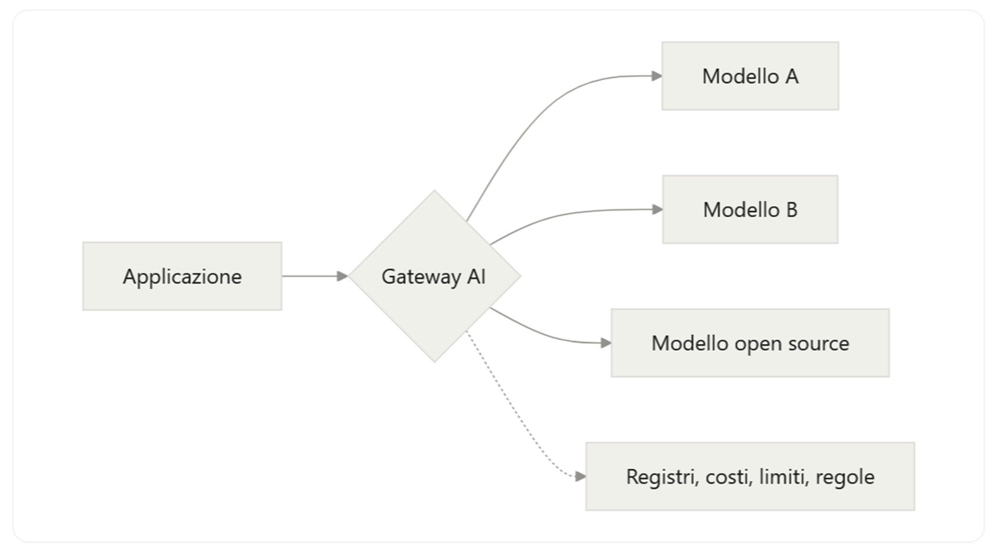
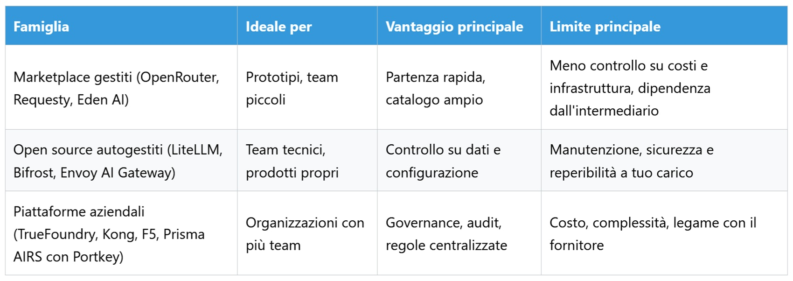
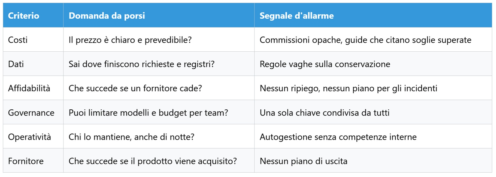

# Guide pour choisir une passerelle d'IA

*Une passerelle est le point de passage névralgique par lequel transitent les clés d'API, les charges utiles et les coûts d'infrastructure de votre application. En 2026, plusieurs acteurs de premier plan ont été rachetés ou placés en mode maintenance : voici comment faire votre choix sans vous laisser guider uniquement par les prix d'appel. Aujourd'hui, un produit technologique abouti s'appuie rarement sur un modèle unique. On combine OpenAI, Anthropic, Google, Mistral, des poids ouverts comme ceux de Meta et parfois des fournisseurs spécialisés, chacun imposant ses formats de requête, ses clés et sa propre facturation. Il en résulte un imbroglio opérationnel : des dépenses difficiles à imputer, aucun plan de secours en cas de panne d'un tiers, et une visibilité médiocre sur la latence et les erreurs d'exécution. La passerelle (ou gateway) s'intercale entre votre couche applicative et les modèles, offrant un point de contrôle unique pour acheminer les requêtes (le *routing*), sécuriser les identifiants, comptabiliser les dépenses et conserver les journaux d'audit.*

La thèse centrale de ce guide est directe et un brin inconfortable : il n'existe pas de passerelle idéale absolue ; il existe celle adaptée à votre maturité technique, à votre budget et au niveau de contrôle que vous devez préserver. En 2026 s'ajoute un second impératif : la pérennité financière et la trajectoire stratégique de l'éditeur comptent tout autant, tant le marché s'est restructuré en l'espace de quelques mois. Écartons également les illusions : adopter une passerelle d'IA ne réduit pas systématiquement vos dépenses ; elle introduit parfois une ligne de coût d'exploitation supplémentaire.

## Ce qu'elle apporte concrètement

Sept fonctionnalités clés structurent la valeur d'une passerelle d'IA, plus faciles à appréhender à travers un scénario concret. Imaginez le robot d'assistance d'une entreprise : pour les questions courantes, il sollicite un modèle économique ; pour les analyses décisionnelles pointues, il sollicite un modèle frontière plus robuste. Sans passerelle, ces arbitrages restent dispersés au cœur du code source. Avec une passerelle, ils se transforment en une politique déclarative et centralisée.

La première fonction est l'interface unifiée : un schéma de requête standardisé — le plus souvent calqué sur la norme OpenAI — pour communiquer avec des fournisseurs hétérogènes. [LiteLLM](https://docs.litellm.ai/index.md) synthétise cela en un appel API unique capable d'abstraire plus d'une centaine d'infrastructures. La deuxième est l'acheminement intelligent, à savoir la sélection dynamique du modèle destinataire selon des critères de coût, de latence ou de qualité. La troisième est la bascule automatique de secours (*fallback*) : si le fournisseur principal ne répond pas ou sature ses quotas, la requête bascule instantanément vers un modèle de réserve. Comme le souligne [le guide technique de Requesty](https://www.requesty.ai/blog/what-is-an-llm-gateway), ce mécanisme de secours n'a d'intérêt que si le modèle alternatif dispose d'aptitudes fonctionnelles équivalentes, ce qui implique de valider le comportement par injection de pannes avant qu'un incident réel ne survienne.

La quatrième est l'observabilité, terme technique désignant une réalité élémentaire : visualiser la consommation de tokens, les courbes de latence, les erreurs et les coûts, segmentés par équipe de développement. La cinquième est la mémoire cache des réponses (*caching*) : une requête déjà formulée peut être servie localement sans relancer le modèle. [Cloudflare](https://developers.cloudflare.com/ai-gateway/features/) applique une mise en cache à l'identique, tandis que [Kong](https://developer.konghq.com/ai-gateway) pousse la logique jusqu'au cache sémantique, qui identifie des requêtes proches sans être strictement identiques : davantage d'économies de calcul, mais avec le risque d'apporter une réponse légèrement décalée. La sixième réside dans les clés virtuelles assorties de quotas : chaque équipe dispose d'identifiants propres rattachés à un plafond de dépenses et à une liste de modèles autorisés, tandis que la clé d'API maîtresse du fournisseur reste isolée dans un gestionnaire de secrets. La septième concerne les filtres de sécurité appliqués aux requêtes et aux réponses, comme l'anonymisation automatique des données personnelles avant qu'elles ne quittent le périmètre de l'entreprise.

C'est là que réside l'arbitrage pour les décideurs : accéder commodément à un catalogue de modèles est un confort de prototypage ; gouverner l'IA en production relève d'une discipline d'ingénierie distincte.

## Trois familles aux frontières mouvantes

Pour s'orienter, une grille de lecture s'impose, à condition de la considérer comme une boussole opérationnelle et non comme un carcan rigide. Les places de marché managées fournissent un compte centralisé, une clé unifiée et un catalogue exhaustif. Les passerelles open source auto-hébergées s'exécutent sur vos propres serveurs. Les plateformes de gouvernance d'entreprise se focalisent sur les règles de conformité, la gestion des accès et l'orchestration multi-équipes. Le choix se résume à trois arbitrages : privilégiez-vous la rapidité de mise en œuvre ou le contrôle total, préférez-vous déléguer l'exploitation ou l'administrer en interne, devez-vous respecter des contraintes réglementaires strictes auprès de multiples équipes ?

Les frontières demeurent poreuses. Portkey a publié le code source de sa passerelle de production quelques semaines avant d'être absorbée par un mastodonte de la cybersécurité, TrueFoundry peut être déployée en mode managé ou dans votre propre cloud privé, et un outil historiquement destiné aux développeurs comme LiteLLM propose désormais une offre hébergée. Il convient donc de lire ce tableau comme un guide de discernement plutôt que comme une nomenclature figée.

## L'attrait des places de marché managées

La place de marché managée représente la porte d'entrée la plus accessible. [OpenRouter](https://openrouter.ai/pricing) propose plus de six cents modèles issus de plus de quatre-vingts fournisseurs derrière une interface unique, ce qui en fait le banc d'essai par excellence des phases de prototypage. [Requesty](https://requesty.ai/glossary) offre une alternative hébergée dotée de stratégies de bascule paramétrables et, d'après sa documentation, d'un routage vers l'Europe via Francfort. [Eden AI](https://docs.edenai.co/v3/overview/ai-gateway) affiche un positionnement différent : en plus des modèles de langage, elle fédère sous une même intégration des services d'OCR, de transcription audio et de traduction, totalisant plus de cinq cents modèles de plus de cinquante éditeurs.

Cette simplicité opérationnelle a un coût, sujet sur lequel la documentation en ligne engendre souvent des malentendus. D'après les [analyses détaillées des grilles tarifaires](https://www.maximem.ai/blog/openrouter-pricing-2026), le coût du token sur OpenRouter s'aligne sur le prix officiel du fournisseur, la plateforme se rémunérant via une commission sur l'achat de crédits : [la page officielle](https://openrouter.ai/pricing) indique 5,5 % sur l'offre Standard et 8 % sur l'offre Business. Les équipes qui apportent leurs propres clés d'API (BYOK, *Bring Your Own Key*) évitent cette commission jusqu'à un plafond mensuel calculé sur le prix catalogue, au-delà duquel s'applique un prélèvement de 5 %.

Une mise en garde s'impose quant à l'obsolescence des documentations techniques. Plusieurs publications encore consultables sur le web — dont [une parue fin juin](https://www.truefoundry.com/blog/openrouter-pricing) — évoquent un quota d'un million de requêtes gratuites avec ses propres clés, un avantage qui, [d'après d'autres analyses](https://www.truefoundry.com/blog/openrouter-byok-explained-cheaper-often-faster-and-changing), a été supprimé en juillet. C'est pourquoi nous ne mentionnons pas de grille tarifaire figée : la recommandation impérative est de vérifier systématiquement les conditions contractuelles à la source. Pour Requesty et Eden AI, des [analyses sectorielles](https://www.getmaxim.ai/articles/requesty-alternatives.md) et des [annuaires spécialisés](https://www.everydev.ai/tools/eden-ai) font état de commissions du même ordre de grandeur, à valider contractuellement.

Sur le plan de la protection des données, la grille d'OpenRouter indique que le routage soumis à des règles de confidentialité strictes n'est accessible qu'à partir du forfait Standard, la localisation géographique des traitements (UE ou États-Unis) requiert le forfait Business, tandis que les garanties d'accords de niveau de service (SLA) sont réservées à l'offre Enterprise. Les conditions de conservation des requêtes précisées dans [la documentation de confidentialité](https://openrouter.ai/docs/guides/privacy/provider-logging) méritent un examen approfondi, car le trajet des flux applicatifs ne s'interrompt pas à la passerelle intermédiaire.

Si vous construisez un prototype et souhaitez comparer GPT, Claude, Gemini et Llama sans ouvrir quatre comptes de facturation distincts, une place de marché managée demeure la voie la plus rationnelle. En contrepartie, vous vous exposez à une dépendance structurelle envers un tiers pour l'authentification, la facturation et la disponibilité opérationnelle, avec une gouvernance plus légère que celle exigée en milieu bancaire ou industriel.

## Le coût de l'autonomie opérationnelle

Auto-héberger une passerelle signifie faire tourner le logiciel sur vos propres instances informatiques ou dans votre cloud privé au lieu de faire transiter vos flux par une plateforme tierce. C'est l'itinéraire obligé pour les organisations juridiquement tenues d'interdire le transit de données sensibles chez un intermédiaire, ou pour les équipes d'ingénierie désireuses d'éliminer les marges d'intermédiation tout en personnalisant le comportement de leur proxy.

[LiteLLM](https://docs.litellm.ai/index.md) s'impose comme la référence open source la plus répandue, disponible sous deux formes qu'il convient de ne pas confondre : une bibliothèque Python importée au sein du code applicatif, et une passerelle partagée (*proxy*) vers laquelle convergent tous les services, dotée de clés virtuelles, de budgets et d'un suivi de la dépense. Cette dernière architecture requiert une base de données relationnelle et, sur les déploiements distribués à forte concurrence, une mémoire partagée Redis, comme l'explique [un guide technique](https://www.truefoundry.com/blog/what-is-litellm). De son côté, [Bifrost](https://github.com/maximhq/bifrost), développé en langage Go par Maxim AI sous licence Apache 2.0, mise sur une latence minimale, bien que les bancs d'essai de débit les plus relayés proviennent de son éditeur et [ne fassent pas l'objet d'une validation indépendante](https://dev.co/ai/frameworks/bifrost).

Il y a peu, il aurait été naturel de citer Helicone dans cette catégorie. Cependant, [Mintlify en a finalisé l'acquisition en mars](https://www.mintlify.com/blog/mintlify-acquires-helicone), plaçant le service en mode de maintenance : correctifs de sécurité et prise en charge des nouveaux modèles, mais gel des nouvelles fonctionnalités. Le système fonctionne et ne présente pas d'urgence immédiate, mais le retenir aujourd'hui pour un projet pluriannuel constitue un pari risqué. Pour les équipes en quête exclusive d'observabilité, [Langfuse](https://clickhouse.com/blog/clickhouse-acquires-langfuse-open-source-llm-observability) demeure une option : suite à son rachat par ClickHouse, ses fonctionnalités fondamentales restent maintenues sous licence MIT open source, selon les déclarations officielles.

L'auto-hébergement n'élimine pas les risques opérationnels, et l'année 2026 en a apporté la démonstration éclatante. Le 24 mars, deux versions de LiteLLM diffusées sur PyPI — le registre public des paquets Python — contenaient du code malveillant conçu pour siphonner les identifiants de connexion. Le [bulletin de sécurité officiel](https://docs.litellm.ai/blog/security-update-march-2026) a identifié les versions 1.82.7 et 1.82.8, évoquant la compromission du compte d'un mainteneur, tout en soulignant que les environnements déployés via l'image Docker officielle n'avaient subi aucun impact grâce au verrouillage des arbres de dépendances. Le 30 mars, une version assainie (1.83.0) était mise à disposition. Sur la durée de l'exposition, les sources divergent : le projet évoque une fenêtre d'environ quarante minutes, tandis que des [reconstitutions techniques indépendantes](https://letsdatascience.com/news/litellm-breach-exposes-ai-supply-chain-risk-69f3c6f7) font état de plusieurs heures. D'après [un audit de sécurité de Comet](https://www.comet.com/site/blog/litellm-supply-chain-attack/), les projets ayant fixé leurs versions via un fichier de verrouillage (*lockfile*) sont restés protégés, contrairement aux déploiements soumis à des constructions dynamiques.

Une passerelle d'IA regroupe les clés d'accès de tous vos fournisseurs de calcul : une organisation qui l'administre en propre doit la traiter avec les exigences de sécurité applicables à un coffre-fort d'identifiants, le gel strict des versions étant un impératif absolu. De surcroît, le coût réel n'est pas nul : serveurs, bases de données, temps d'ingénierie et astreintes nocturnes doivent être intégrés au bilan économique global.

## Gouvernance à l'échelle de l'entreprise

Lorsque l'enjeu ne consiste plus seulement à interroger des modèles, mais à encadrer leur déploiement à grande échelle, la valeur stratégique réside dans l'application de règles, la traçabilité des flux et le cloisonnement des accès bien plus que dans le routage élémentaire. Une institution financière gérant des dizaines d'équipes, des données bancaires sensibles et des obligations d'audit réglementaires a besoin de bien plus qu'un simple répartiteur de requêtes.

L'évolution de Portkey est particulièrement instructive. En mars, elle a [ouvert le code de sa passerelle de production](https://latent.space/wiki/portkey-ai-5b678cc2/) ; le 29 mai, elle a été [rachetée par Palo Alto Networks](https://www.paloaltonetworks.com/company/press/2026/palo-alto-networks-completes-acquisition-of-portkey-to-secure-ai-agents.html), qui en a fait la brique d'accès de sa plateforme de sécurité Prisma AIRS. Les [déclarations financières déposées auprès de la SEC](https://www.sec.gov/Archives/edgar/data/0001327567/000132756726000023/panw-20260731.htm) font état d'une transaction de 117 millions de dollars. Si le dépôt open source [demeure consultable publiquement](https://www.deepinspect.ai/blog/best-ai-gateway-2026), une interrogation stratégique se pose pour les utilisateurs : les priorités de développement futures resteront-elles centrées sur l'agilité des développeurs, ou basculeront-elles vers les exigences de conformité d'un grand éditeur de cybersécurité ?

[TrueFoundry](https://truefoundry.com/docs/gateway) associe passerelle d'accès et orchestration d'infrastructure, avec des plafonds budgétaires attribuables par [utilisateur, équipe ou compte virtuel](https://docs.truefoundry.com/gateway/budgetlimiting), sous forme d'offres managées ou d'installations hébergées dans votre propre cloud. [Kong](https://developer.konghq.com/ai-gateway) s'avère le choix logique pour les structures exploitant déjà sa passerelle d'API traditionnelle, en étendant ses fonctionnalités réseau éprouvées à des modules d'IA comme l'anonymisation des données personnelles. Sur le front du logiciel libre, [Envoy AI Gateway a franchi le cap de la version 1.0 en juin](https://itbrief.co.uk/story/envoy-ai-gateway-reaches-1-0-for-production-ai-use) avec l'appui de Bloomberg, Nutanix et Tetrate, tandis qu'[agentgateway](https://agentgateway.dev/docs/standalone/latest/about/), initié par Solo.io et transféré sous l'égide de la Linux Foundation, orchestre sur un plan unique le trafic des modèles, les outils MCP et la communication inter-agents. L'appellation Gloo Gateway, relevée dans certains inventaires, correspond à une dénomination ancienne ; le projet de référence actif chez Solo.io pour l'IA est agentgateway. Parallèlement, F5 a dévoilé en juin une [plateforme de sécurité dédiée à l'IA](https://www.helpnetsecurity.com/2026/06/23/f5-launches-ai-security-platform-to-uncover-and-secure-shadow-ai/) et a [étendu sa propre passerelle d'IA en août](https://itbrief.co.nz/story/f5-expands-ai-gateway-to-curb-costs-secure-agents) en y intégrant un filtrage avancé des menaces.

Les grands gagnants de cette consolidation sont les éditeurs de sécurité et d'infrastructure réseau, qui érigent la passerelle en point d'application de la politique d'entreprise, ainsi que les grandes organisations qui bénéficient d'une console d'administration unifiée. Les structures les plus vulnérables sont les équipes réduites tentées par des outils surdimensionnés, ainsi que toute organisation dépendante d'un produit dont la feuille de route dépend des priorités d'un acquéreur.

## Quand la plateforme d'hébergement suffit

Il existe une voie médiane parfaitement légitime : s'en remettre à la passerelle intégrée de la plateforme sur laquelle vos applications sont déjà déployées. [Vercel AI Gateway](https://vercel.com/docs/ai-gateway/pricing) annonce l'absence totale de marge sur les tokens, y compris en apportant ses propres clés, bien que [des frais de traitement des paiements puissent subsister](https://vercel.com/ai-gateway). [Cloudflare AI Gateway](https://developers.cloudflare.com/ai-gateway) intègre le suivi analytique, la mise en mémoire cache, la limitation de débit (*rate limiting*), la journalisation et la tolérance aux pannes, avec des mécanismes de filtrage présentés dans sa [documentation fonctionnelle](https://developers.cloudflare.com/ai-gateway/features/).

L'intérêt est éminemment stratégique : aucun contrat tiers supplémentaire à signer, moins de composants à maintenir et une cohérence avec le reste de votre infrastructure de production. La contrepartie réside dans l'adhérence technique. Une passerelle liée à votre hébergeur est une aubaine tant que votre infrastructure s'y trouve ; elle devient une contrainte le jour où vous souhaitez migrer. Ce n'est pas le choix pertinent si le cœur de votre système réside ailleurs.

## Les critères d'évaluation décisifs

Voici les neuf critères structurels à examiner méthodiquement avant tout engagement : la souveraineté sur les données (où transitent et sont conservées les requêtes et les journaux, et pour quelle durée ?) ; le modèle économique (commission sur le volume, abonnement forfaitaire ou coûts d'infrastructure interne ?) ; l'observabilité opérationnelle (pouvez-vous isoler les coûts, la latence et les erreurs par équipe ou par service ?) ; la résilience (disposez-vous de mécanismes de réessai, de bascule automatique et de supervision continue validés en conditions réelles ?) ; la posture de sécurité (qui détient les clés d'API et le masquage des données sensibles est-il géré ?) ; l'interopérabilité applicative (la passerelle supporte-t-elle vos bibliothèques et vos interfaces actuelles ?) ; la scalabilité (encaissera-t-elle la montée en charge des requêtes et la multiplication des équipes ?) ; la charge d'exploitation (combien d'heures d'ingénierie mobilisera sa maintenance quotidienne ?) ; et le risque lié au fournisseur (que se passe-t-il si l'éditeur est racheté ou abandonne le projet, et pouvez-vous migrer sans refonte intégrale ?).

Cette dernière ligne constitue la grande leçon de l'année 2026. [Langfuse en janvier](https://clickhouse.com/blog/clickhouse-acquires-langfuse-open-source-llm-observability), [Helicone en mars](https://www.mintlify.com/blog/mintlify-acquires-helicone), [Portkey en mai](https://www.paloaltonetworks.com/company/press/2026/palo-alto-networks-completes-acquisition-of-portkey-to-secure-ai-agents.html) : en cinq mois, trois outils très répandus ont changé d'actionnaire. Cela ne signifie pas qu'ils sont devenus inefficaces, mais cela rappelle qu'un choix d'architecture pluriannuel doit impérativement prévoir une porte de sortie. Une interface strictement conforme aux spécifications d'OpenAI et des clés d'API gérées en dehors de la passerelle rendent toute migration ultérieure infiniment moins complexe.

## Quatre scénarios d'architecture réels

Pour une startup ou une phase de prototypage, la vitesse d'itération et la liberté d'expérimenter de nouveaux modèles sont primordiales. Les options les plus adaptées sont OpenRouter, Requesty ou Eden AI, en surveillant l'évolution des commissions et en évitant les verrous logiciels propriétaires. L'adoption rapide du mode BYOK permet de préserver votre liberté d'action.

Pour un produit logiciel en phase d'accélération, la stabilité, la maîtrise des coûts marginaux et la télémétrie deviennent cruciales. Les solutions indiquées comprennent un déploiement maîtrisé de LiteLLM (avec versions et conteneurs strictement verrouillés), Bifrost, ou bien les passerelles natives de Vercel ou Cloudflare si vous y opérez déjà, adossées à un outil d'observabilité indépendant. Accordez la priorité à la qualité des journaux d'audit plutôt qu'au prestige de la marque.

Pour une entreprise manipulant des données confidentielles, le respect de la vie privée, le cloisonnement réseau et l'auditabilité sont non négociables. Les options viables reposent sur des passerelles auto-hébergées comme LiteLLM, Bifrost ou Envoy AI Gateway, ou sur un déploiement de TrueFoundry au sein de votre propre cloud privé. Cette approche exige une compétence technique interne avérée et engage une responsabilité de sécurité qu'aucun contrat commercial ne permet d'évacuer.

Pour une grande organisation multi-équipes, la priorité absolue porte sur la gouvernance d'entreprise, le contrôle budgétaire et la conformité légale. Les solutions pertinentes regroupent TrueFoundry, Kong, F5, Prisma AIRS avec Portkey, ou les briques ouvertes comme Envoy AI Gateway et agentgateway. Cela implique une complexité technique accrue, des coûts de licence et des délais de déploiement plus longs ; il convient d'exiger des engagements écrits sur la continuité de la feuille de route en cas d'acquisition.

Ce sont des scénarios méthodologiques, non des sentences immuables : les réalités de votre système d'information prévalent toujours sur la notoriété d'un outil.

## Les erreurs techniques coûteuses

La première erreur consiste à décider uniquement en fonction du tarif affiché, ce qui déplace systématiquement la dépense vers le temps d'ingénierie ou le risque opérationnel. La deuxième est d'assimiler l'accès à un large catalogue de modèles au contrôle de l'environnement de production : sans plafonds budgétaires par équipe et sans traçabilité complète, les premières dérives de facturation se produiront sans explication possible. La troisième est d'ignorer les commissions d'intermédiation ou de s'en remettre à des documentations obsolètes : un budget calculé sur des hypothèses tarifaires périmées fausse les prévisions sur plusieurs trimestres.

La quatrième réside dans l'auto-hébergement sans ressources dédiées : une passerelle délaissée sans correctifs ou mise à jour sans figer ses dépendances expose vos clés d'API au même titre qu'une base de données vulnérable, comme l'a illustré la faille de sécurité survenue chez LiteLLM. La cinquième est d'ajourner la mise en place de l'observabilité, des budgets et des stratégies de bascule : reconstituer l'historique financier et technique a posteriori relève de la gageure. La règle pratique consiste à débuter par une architecture sobre, à mesurer en continu coûts et qualité, et à ne basculer vers des plateformes complexes que lorsque le besoin organisationnel l'exige impérativement.

## Proportionnalité plutôt qu'effet de mode

Une passerelle d'IA n'est pas un composant secondaire ; elle engage une décision d'architecture fondatrice parce qu'elle voit transiter vos clés, vos données et vos budgets d'infrastructure. La règle générale tient en quatre lignes de bon sens : pour un prototype, une place de marché managée ; pour un produit en expansion, une passerelle avec observabilité et bascule automatique ; pour des données confidentielles, l'auto-hébergement ou un cloud privé souverain ; pour des structures complexes, une plateforme de gouvernance globale. Avant de choisir un produit, évaluez la maturité de votre contexte technique.

Des questions stratégiques restent en suspens : quel cap Palo Alto Networks imprimera-t-elle au projet open source de Portkey ? Combien de temps Helicone restera-t-elle une option pertinente en production ? Et par-dessus tout : sur un marché où les éditeurs de passerelles sont rachetés à une telle cadence, quelle est la valeur d'une architecture capable de remplacer sa passerelle sans modifier une seule ligne de son application ? Quiconque sait répondre à cette dernière interrogation a déjà tranché la partie la plus difficile du problème.

---

*Note technique : données arrêtées au 4 novembre 2026 d'après la documentation officielle et les communications des éditeurs dans la mesure du possible. Les sources émanant d'acteurs concurrents (TrueFoundry, Maxim, Tetrate, Solo.io) sont explicitement signalées. Les conditions commerciales et les commissions évoluant fréquemment, consultez systématiquement les portails officiels.*
