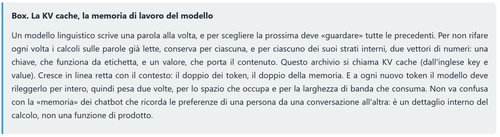
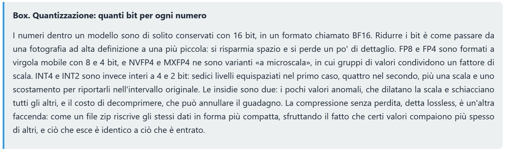
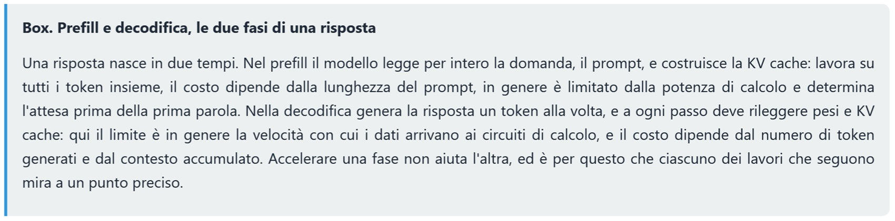
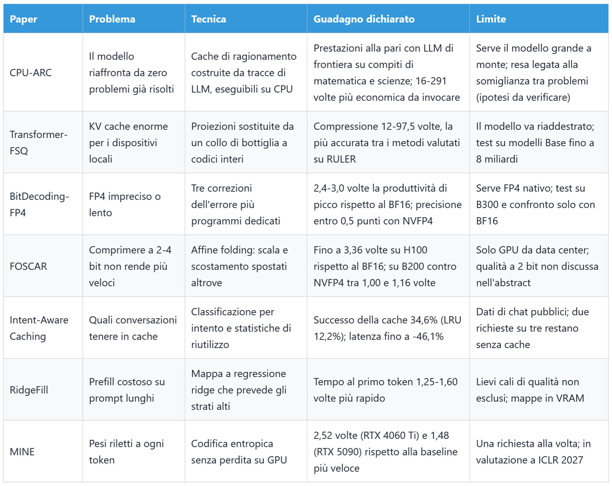

# Il peso della memoria: sette modi per alleggerire gli LLM

*Dal riutilizzo del ragionamento alla compressione dei pesi: sette lavori pubblicati lo stesso giorno, senza alcun coordinamento tra loro, raccontano la corsa a far girare i modelli linguistici con meno hardware. Un modello linguistico che genera testo per scrivere ogni nuova parola deve tenere a portata di mano un appunto su ciascuna parola precedente, rileggerlo ogni volta, e quegli appunti crescono con la lunghezza della conversazione. Più il modello diventa capace e più contesto gli chiediamo di gestire, più il conto si sposta dal calcolo puro alla memoria occupata e ai dati da spostare.*

Venerdì 6 novembre 2026, nell'arco di poco più di sei ore, sono comparsi su arXiv sette articoli che affrontano questo conto da angolazioni diverse. Il primo è stato inviato alle 12:51 ora universale, l'ultimo alle 18:58. Sono gruppi diversi, con obiettivi e hardware diversi, e nessuno si è coordinato con gli altri: è una coincidenza, e a me è parsa una coincidenza istruttiva. Va detto con chiarezza che l'idea di leggerli insieme è di chi scrive, e che il campione è scelto per affinità di tema, non è una rassegna sistematica di tutto ciò che quel giorno è uscito sull'argomento. Va detto anche che si tratta di testi appena pubblicati, in gran parte non ancora vagliati da revisori, e che i risultati citati sono quelli dichiarati dagli autori su modelli e macchine specifici, quindi non automaticamente trasferibili altrove.

La tesi che regge questo pezzo è semplice: l'efficienza ha smesso di essere un dettaglio da ingegneri e decide dove un modello potrà vivere, se su un server economico, su un computer personale o dietro un servizio con migliaia di utenti. Un numero la rende concreta. Gli autori di [Transformer-FSQ](https://arxiv.org/abs/2611.09598) calcolano che, per Qwen3-1.7B-Base, un modello piccolo per gli standard attuali, conservare duecentomila token di contesto richiede 21 GiB di appunti, 6,6 volte lo spazio occupato dal modello stesso.

I sette lavori si dispongono lungo una catena. All'inizio c'è chi vuole evitare di ripetere ragionamenti già fatti, poi chi comprime la memoria di lavoro, infine chi organizza meglio il servizio e l'esecuzione, dalla cache delle conversazioni al calcolo del prompt fino alla compressione dei pesi. «Memoria» assume quindi tre significati diversi, e vale la pena tenerli separati.

## Ragionare una volta sola

### CPU-ARC: il ragionamento in cache

In Outer Wilds, il videogioco in cui un sistema solare resta intrappolato in un ciclo di ventidue minuti, a ogni ripartenza si perde tutto tranne ciò che il giocatore ha capito. Scoperto come raggiungere un certo luogo, rifarlo è questione di pochi gesti: la fatica vera, la scoperta, si paga una volta sola. È l'intuizione da cui parte [CPU-ARC](https://arxiv.org/abs/2611.09891), rapporto tecnico di Peter Belcak, Greg Heinrich, Saurav Muralidharan, Shizhe Diao e Pavlo Molchanov. I modelli linguistici, sostengono gli autori, confondono il risolvere un problema con l'eseguirne la soluzione, e così ripartono da zero anche quando la procedura è già stata trovata.

La proposta si chiama agentic reasoning caching: dalle tracce di ragionamento prodotte da un modello si costruiscono delle cache, dette ARC, che possono essere eseguite su un normale processore, senza GPU. La fase in cui si capisce come risolvere una classe di problemi resta al modello grande, mentre quella in cui si applica la soluzione a un caso nuovo richiede pochissimo intervento di un modello linguistico. Stando ai risultati dichiarati, le ARC raggiungono prestazioni alla pari con i modelli di frontiera su una serie di compiti difficili di matematica e scienze, sono interamente spiegabili, si aggiornano nel tempo, resistono a piccole perturbazioni dell'input e costano da 16 a 291 volte meno del modello d'origine per ogni invocazione.

Qui la lettura deve essere attenta. Il confronto di costo riguarda l'uso della cache, non la sua costruzione, che richiede comunque il modello grande a monte, e l'abstract non dice quanto valgano le ARC su problemi diversi da quelli già incontrati. È ragionevole attendersi che il vantaggio cresca dove i problemi si somigliano, come negli assistenti tecnici, nell'analisi di documenti o nei flussi di lavoro aziendali ripetitivi, ma è una nostra ipotesi, non un risultato del lavoro. Chi potrebbe guadagnarci è chi esegue molte volte compiti simili e vuole costi prevedibili e passaggi verificabili; chi dovrebbe guardare con attenzione è chi vende ragionamento a consumo, perché un compito ripetuto che non richiede più il modello grande è un compito che smette di generare token a pagamento. Anche questa è una lettura, non un dato.

## Stringere la memoria

Comprimere la KV cache non è un'idea nata il 6 novembre. A marzo Google Research ha presentato [TurboQuant](https://aitalk.it/it/turboquant.html), metodo presentato a ICLR 2026 che dichiara una riduzione di almeno sei volte della memoria della KV cache, a circa tre bit per valore, senza perdita di accuratezza sui test di lungo contesto riportati. Sul fronte della pratica quotidiana, un riferimento più modesto è la KV cache in FP8, che [vLLM supporta in modo nativo](https://spheron.network/blog/google-turboquant-llm-compression-gpu-cloud) con una compressione di circa due volte rispetto al formato standard. Dentro questo quadro, i tre lavori che seguono scelgono strade diverse: cambiare il modello perché ricordi in modo più compatto, comprimere l'archivio esistente senza perdere precisione, oppure rendere la compressione davvero veloce da leggere.

### Transformer-FSQ: compressione estrema

Se l'obiettivo è far girare un modello personale e privato su un dispositivo di tutti i giorni, il conto della KV cache diventa subito impietoso, ed è l'osservazione da cui parte [Transformer-FSQ](https://arxiv.org/abs/2611.09598), firmato da Szecsenyi, Lee, Shaj, Crowley e Storkey. Gli autori notano che i metodi di compressione da loro misurati cedono oltre rapporti moderati. La risposta è più radicale di una semplice riduzione dei bit: sostituire le proiezioni che producono chiavi e valori con un collo di bottiglia di quantizzazione scalare finita. In pratica il modello impara a scrivere ogni token in una stenografia, un breve vettore di codici interi tratti da un catalogo limitato, senza il corredo di metadati di scala per token che appesantisce altri schemi, e a rileggerla con la stessa stenografia.

Il prezzo è chiaro: non è un trucco applicabile a qualunque modello già scaricato. La conversione richiede di riaddestrare soltanto le nuove proiezioni, con 0,25 token per ogni parametro originale, che per un modello da 8 miliardi significa, a spanne, due miliardi di token. Gli autori hanno confrontato il metodo con cinque famiglie di approcci concorrenti, su modelli da 0,6 a 8 miliardi di parametri. Su RULER, un test che misura il recupero di informazioni in testi lunghi, con compressioni da 12 a 97,5 volte Transformer-FSQ è il metodo più accurato tra quelli valutati, a tutte le scale. Un programma per GPU scritto in Triton legge direttamente i codici: a compressione 32 volte la velocità in decodifica è pari a quella dell'attenzione standard senza compressione (1,01 volte, con intervallo di confidenza da 0,98 a 1,05, su Qwen3-8B-Base), e a 97,5 volte arriva a 1,54 volte. Applicando in modo meccanico il rapporto 32 all'esempio d'apertura, i 21 GiB scenderebbero a poco meno di 700 MiB, ma è un calcolo nostro, non del lavoro.

Le cautele sono quattro. I modelli provati sono di tipo Base, non versioni addestrate al dialogo. La misura di qualità citata nell'abstract è il recupero di informazioni, quindi non sappiamo da lì come reggano ragionamento o scrittura lunga. Il lavoro si ferma a 8 miliardi di parametri. E l'hardware su cui gira il programma non è indicato nell'abstract, quindi l'immagine del portatile con contesti lunghissimi resta, per ora, una prospettiva degli autori più che un test documentato. Una domanda aperta riguarda chi produce i modelli: se non li rilascia già convertiti, il vantaggio per gli utenti finali resta teorico.

### BitDecoding-FP4: quattro bit, pochi errori

Un formato a quattro bit promette molto, e [BitDecoding-FP4](https://arxiv.org/abs/2611.09825) parte da un'osservazione scomoda: i sistemi che usano la KV cache in FP4 con una quantizzazione ingenua perdono troppa precisione, mentre gli algoritmi accurati si appoggiano a dizionari di codici la cui consultazione rallenta la decodifica. Gli autori attaccano tre fonti d'errore. La prima sono le domande che il modello rivolge alla memoria, le query: le dividono in due tensori FP4, con una logica da residuo, come suggerisce il nome, in cui il secondo corregge ciò che il primo non coglie, un po' come misurare con un righello grossolano e poi ripassare con un secondo la parte avanzata. L'errore sui punteggi scende, dichiarano, dal 60% all'1%. La seconda è un guaio di rappresentazione: con contesti molto lunghi ogni probabilità è minuscola, e le scale in formato E4M3 la arrotondano a zero, come se in un libro di mille pagine il peso di ciascuna pagina diventasse nullo, e una correzione di scala lo evita. La terza sono i valori anomali nelle chiavi, contrastati con livellamento statico, rotazioni di Hadamard, che spargono l'anomalia su molte componenti, e ricerca della scala migliore.

Sul versante del sistema, il passaggio che trasforma i punteggi in probabilità, la softmax, diventava il collo di bottiglia, e viene riorganizzato in forma trasposta con la quantizzazione delle probabilità fusa nello stesso calcolo; le query vengono impilate per sfruttare i Tensor Core, i circuiti della GPU specializzati nel moltiplicare matrici, su una KV cache suddivisa in pagine. È co-progettazione tra algoritmo e hardware: non basta comprimere i numeri, il formato scelto deve essere comodo per le unità che lo leggono.

I risultati dichiarati coprono modelli densi e a esperti misti, con le due varianti di attenzione GQA e MLA. La precisione resta entro 0,5 punti da quella con KV cache in BF16 usando NVFP4, ed entro 1 punto con MXFP4, e il metodo segue il BF16 anche nelle fasi di generazione dell'addestramento per rinforzo. Nel servizio completo su GPU NVIDIA B300, con Qwen3-4B e Qwen3-30B-A3B, la produttività di picco è da 2,4 a 3,0 volte quella con KV cache in BF16. Il [codice è aperto](https://github.com/OpenBitSys/BitDecoding-FP4). Tre cautele: il termine di paragone è il BF16, non altri schemi a pochi bit; «di picco» indica il punto più favorevole della curva, non la media; e servono Tensor Core con FP4 nativo, come quelli della B300 usata nei test, quindi è una storia di data center più che di personal computer.

### FOSCAR: comprimere non basta

Comprimere la KV cache a 2 o 4 bit riduce i dati da spostare, ma non rende automaticamente più veloce la generazione. [FOSCAR](https://arxiv.org/abs/2611.09722) parte da un dato: i programmi esistenti per la decodifica a 2 bit sfruttavano meno del 31% della banda di picco della memoria HBM sulle H100 e meno del 15% sulle B200. Il motivo, spiegano gli autori, è che convertire ogni valore e applicare scala e scostamento prima di passarlo ai Tensor Core consuma istruzioni, e le istruzioni sono la risorsa scarsa delle GPU moderne.

La soluzione, battezzata affine folding, si spiega con un'analogia contabile: se devi convertire mille prezzi da euro a dollari e poi sommarli, conviene sommare in euro e convertire il totale una volta sola. Invece di applicare scala e scostamento a ogni valore, FOSCAR li applica all'altro operando o al risultato del prodotto tra matrici dell'attenzione, riducendo quelle operazioni fino a due ordini di grandezza. Il risultato dell'attenzione dequantizzata resta identico in aritmetica esatta, e qui occorre non leggere «senza perdita»: coincide con quello del metodo tradizionale, ma la quantizzazione a 2 e 4 bit ha già tolto informazione a monte. Con manipolazioni a livello di bit bastano poi 1 e 0,19 istruzioni aritmetiche per elemento INT2 su H100 e B200, con pipeline specifiche per le due architetture.

Rispetto a FlashInfer in BF16 la velocità media geometrica sale di 3,36 volte con INT2 e 2,83 con INT4 su H100, e di 2,67 e 2,30 su B200. Il quadro cambia scegliendo avversari più forti: contro TensorRT-LLM in FP8 i guadagni sono 2,03 e 1,71 volte su H100 e 1,48 e 1,28 su B200, mentre contro TensorRT-LLM in NVFP4 su B200 scendono a 1,16 e 1,00, cioè parità per l'INT4. Integrato in SGLang, il sistema alza la produttività aggregata di picco fino al 170% rispetto a una base a 2 bit e fino al 341% rispetto a una a 16 bit. La [libreria di programmi per GPU è aperta](https://github.com/FutureMLS-Lab). Due note: l'abstract parla di velocità e non discute l'effetto sulla qualità delle risposte a 2 bit, e i test riguardano GPU da data center. Il filo che lega FOSCAR a BitDecoding-FP4 è comunque chiaro: la compressione, da sola, è mezza battaglia, l'altra metà è rendere economico decomprimere.

## Servire meglio, calcolare meno

### Intent-Aware Caching: chi tornerà?

Nelle conversazioni a più turni, un servizio può conservare la KV cache dei turni precedenti, tecnica detta prefix caching, per non rifare il prefill quando l'utente risponde. Ma la memoria è finita e serve decidere cosa buttare. La regola più comune, LRU, scarta ciò che è stato usato meno di recente, ignorando che le conversazioni non hanno tutte la stessa probabilità di continuare né lo stesso ritmo. [Intent-Aware Caching](https://arxiv.org/abs/2611.09715), di Arif, Yoon, Nikolopoulos, Vandierendonck, John e Ji, parte proprio da qui: classifica le richieste per intento, impara dai log recenti statistiche leggere di riutilizzo, cioè quanto è probabile che la conversazione prosegua e dopo quanto tempo, e le usa per guidare una politica di sfratto ispirata a un oracolo, la strategia ideale che conoscesse il futuro e tenesse sempre ciò che sta per tornare. Per fare un esempio ipotetico, e solo tale: chi chiede una ricetta tende a non tornare, chi corregge un programma risponde dopo pochi minuti. Il lavoro misura questi comportamenti su dati reali.

Sui dati di WildChat e ShareChat, due raccolte di conversazioni reali, il tasso di successo della cache arriva al 34,6%, contro il 18,8% del precedente approccio basato sull'apprendimento e il 12,2% di LRU, e la latenza media del servizio cala fino al 46,1%. Quasi il triplo di LRU, ma anche un promemoria: con il 34,6%, due richieste su tre non trovano nulla in cache. Nei commenti arXiv il lavoro è indicato come «NeurIPS 2026», senza precisarne lo stato, e il [codice è pubblico](https://github.com/hasanar1f/intent-aware-caching). Un'avvertenza di prospettiva: classificare l'intento significa, in qualche forma, guardare cosa chiede l'utente, e l'abstract parla di statistiche leggere; chi gestisce un servizio dovrà comunque chiedersi dove vivano quei dati e per quanto. Il paper è il più vicino a chat, assistenza clienti e assistenti a più turni, e mostra che anche una cache può diventare intelligente, imparando dai modelli d'uso.

### RidgeFill: saltare gli strati alti

Quando si dà a un modello un contratto di cento pagine o un'intera base di codice, il prefill pesa. [RidgeFill](https://arxiv.org/abs/2611.09709), di Dylan Johnston e Robert P. Smith, propone di non calcolare la maggior parte degli strati alti del modello per il prompt. Gli strati bassi lavorano normalmente fino a un punto di divisione; da lì, una mappa per ciascuno strato successivo prevede cosa avrebbe ricevuto in ingresso, e ogni strato alto scrive la propria cache a partire da quella previsione. È una catena di montaggio in cui, dopo la stazione intermedia, gli ultimi reparti non lavorano il pezzo e compilano la scheda sulla base di una stima. L'idea esiste già in modelli addestrati apposta, come YOCO; la novità è applicarla a posteriori a modelli che non nascono per questo.

La mappa è una regressione ridge, tecnica statistica classica, calcolata una sola volta in forma chiusa con un passaggio su un testo di calibrazione: nessun addestramento, nessun token scartato, proiezioni originali intatte. Le ultime migliaia di token del prompt e ogni passo di generazione, però, girano sul modello completo, quindi il guadagno riguarda il tempo al primo token e non la generazione. Su Qwen3.8-27B, il modello denso da 27 miliardi di parametri uscito ad agosto con licenza Apache 2.0 ([Vedi test](https://aitalk.it/it/qwen38-27b.html)), in una versione modificata di llama.cpp su una GPU A100, il tempo al primo token migliora di 1,25-1,31 volte con contesti da 16.000 a 120.000 token, con le mappe in VRAM. RULER cala di 1,2 e 1,4 punti, LongBench v2 di 1,4, e gli intervalli di confidenza al 95% includono lo zero ma non escludono perdite di qualche punto. Su Qwen3.8-Flash-Next in vLLM il miglioramento è di 1,50-1,60 volte tra 9.000 e 32.000 token, con le prove di ricerca dell'ago nel pagliaio di RULER a 99,8 contro 100,0 e una perplessità sui token nuovi più alta del 2,65% (intervallo da -0,02% a +4,93%).

Forse il pregio più prezioso del lavoro è metodologico: gli autori mostrano che la perdita mediata su tutti i token nasconde l'errore, e ricorrono a prove mirate per capire cosa si rompe, e dove. Su tre modelli di riferimento da 8-9 miliardi, rispetto a una sostituzione ingenua la mappa recupera circa 49 punti RULER in più nella zona riempita sui due modelli densi, con la riserva che su Llama, a quel punto di divisione, la perdita risulta peggiore, e la perdita su documenti lunghi resta entro 0,03 nat, l'unità di misura della perdita, da quella di un checkpoint SwiftKV, addestrato apposta per questo scopo. È la soluzione più pragmatica per chi ha già un modello e vuole accelerarlo senza riaddestrarlo, a patto di accettare qualche rischio di qualità e di ospitare le mappe in memoria. Due autori, 50 pagine, 38 tabelle, [dati e codice pubblici](https://github.com/Approximate-Science/ridgefill-data).

### MINE: pesi senza perdite

Chi ha una sola scheda grafica e una sola richiesta da servire, cioè il caso del modello locale, ha un problema diverso: a ogni parola generata ogni peso del modello deve essere letto dalla memoria, e senza raggruppare più richieste in lotti non c'è modo di spalmare il costo. [MINE](https://arxiv.org/abs/2611.09424), di Emil Schätzle e Markus Püschel, attacca proprio questo con una compressione senza perdita. I Disintegration Loops di William Basinski nascono da nastri magnetici che si consumano a ogni passaggio sotto la testina: ogni riproduzione toglie un po' di materiale e ciò che si perde non torna. È la compressione con perdita. MINE è un archivio: come un file zip, riscrive gli stessi dati in forma più compatta e li restituisce identici.

Il nucleo è dtANS-LLM, uno schema di codifica entropica per GPU adattato da uno precedente: sfrutta il fatto che i pesi non sono distribuiti in modo uniforme, e che la distribuzione resta sbilenca anche dopo la quantizzazione, per assegnare codici più corti ai valori frequenti. Espone parametri che bilanciano rapporto di compressione e costo di decodifica, li regola da solo per ogni tensore e ogni scheda ottenendo la curva dei migliori compromessi tra dimensione del modello e latenza, ed è integrato in vLLM come estensione, scegliendo la configurazione migliore per un dato budget di memoria. Gli autori ricordano che i metodi senza perdita esistenti accelerano soltanto con certi formati, come il BF16, e sotto ipotesi aggiuntive.

Il risultato dichiarato riguarda Llama 3.1 8B Instruct, con un checkpoint a 2,1 bit prodotto con il metodo EntQuant: accelerazione di 2,52 volte su una RTX 4060 Ti e di 1,48 su una RTX 5090 rispetto alla baseline più veloce, con bitrate effettivi di 2,24 e 3,43 bit per peso. Il compromesso tra dimensione e velocità dipende dalla scheda, e MINE lo regola da sé. Il [materiale è disponibile](https://doi.org/10.5281/zenodo.23885927) in codice aperto. Le cautele: l'abstract non dice quale sia la baseline più veloce; il vantaggio vale per una richiesta alla volta e nulla è dichiarato per il servizio a lotti; la qualità resta quella del checkpoint a 2,1 bit, che MINE per costruzione non migliora, perché non restaura ciò che la quantizzazione ha tolto ed evita soltanto di perdere altro; e il lavoro è stato inviato a ICLR 2027, quindi è in valutazione. È il più vicino al mondo dei personal computer: schede consumer, appassionati, sviluppatori, piccole imprese.

**In sintesi**

## Chi ci guadagna davvero

I sette lavori si raggruppano in tre famiglie: il riuso del calcolo (CPU-ARC), la compressione della KV cache (Transformer-FSQ, BitDecoding-FP4, FOSCAR) e l'ottimizzazione del servizio e dell'esecuzione (Intent-Aware Caching, RidgeFill, MINE). Non sono soluzioni concorrenti ma anelli della stessa catena, dal ragionamento ripetuto alla memoria temporanea, fino al programma sulla GPU e alla compressione dei pesi. Bisogna però resistere alla tentazione di moltiplicare i guadagni: ogni numero viene da modelli, schede e termini di paragone diversi, e nessuno dei lavori, stando agli abstract, prova le combinazioni. Lo stato di maturità è eterogeneo: CPU-ARC è un rapporto tecnico; BitDecoding-FP4, FOSCAR, RidgeFill e Transformer-FSQ sono preprint che non dichiarano una sede; Intent-Aware Caching riporta «NeurIPS 2026» nei commenti; MINE è stato inviato a ICLR 2027. E i test sono condotti su hardware e modelli specifici, quindi i risultati non sono automaticamente generalizzabili.

Chi ne beneficia dipende da quale riga della tabella si guarda. I grandi operatori cloud sono i candidati più naturali: BitDecoding-FP4, FOSCAR e Intent-Aware Caching servono a far stare più utenti e contesti più lunghi sulla stessa GPU, e conviene a chi ha già le macchine più recenti, perché FP4 nativo vuol dire Blackwell. Se questo si traduca in prezzi più bassi o in margini più alti è una questione aperta, e resta l'antico dubbio che servizi più economici spingano a consumarne molti di più, lasciando il conto complessivo dov'era. Le imprese con flussi di lavoro ripetitivi possono guardare a CPU-ARC e RidgeFill, a patto di misurare sul proprio caso. E gli utenti che vogliono modelli privati sul proprio hardware? MINE lavora già su schede consumer, ma con vLLM e una richiesta alla volta; Transformer-FSQ è la promessa più grande per il locale, ma richiede che chi produce i modelli lo integri e li riaddestri, quindi per ora non è qualcosa che si scarica e si applica. Sul fronte della riservatezza, infine, strumenti come la cache per intento ricordano che ottimizzare un servizio significa anche imparare dai comportamenti di chi lo usa.

Nelle Lezioni americane Italo Calvino apre proprio con la leggerezza e la difende dall'accusa di superficialità: alleggerire, per lui, significa togliere peso alla struttura senza toglierle sostanza, e richiama Valéry per ricordare che bisogna essere leggeri come l'uccello, non come la piuma. È un buon criterio per leggere queste sette ricerche. Alleggerire un modello è facile; farlo senza perdere ciò che lo rende utile è il lavoro vero, e ogni cifra va letta con una domanda accanto: che cosa si è perso, e per chi. Resta aperta la domanda da cui siamo partiti: se i modelli diventeranno molto più leggeri, chi riuscirà a portarsene a casa uno davvero suo, e chi invece vedrà soltanto calare il prezzo di un servizio che resta altrui?