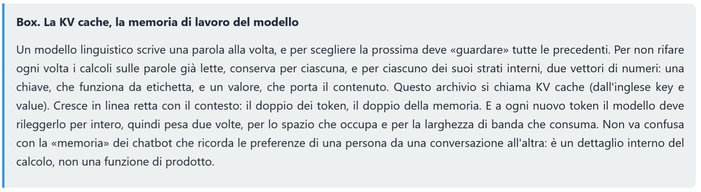
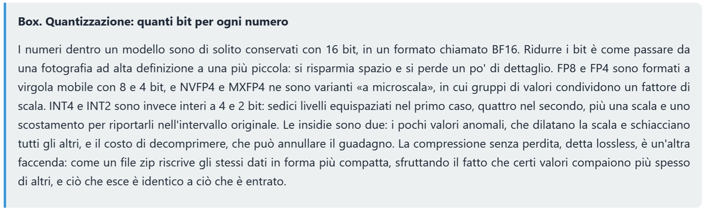
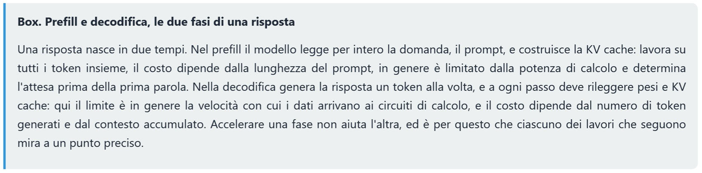
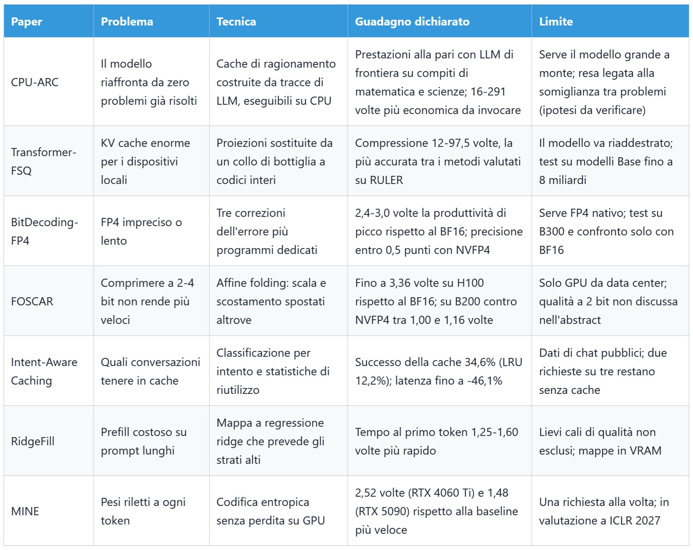

# Die Last des Speichers: Sieben Wege zur Entlastung von LLMs

*Von der Wiederverwendung von Denkprozessen bis zur Kompression der Modellgewichte: Sieben Forschungsarbeiten, die am selben Tag ohne jede vorherige Absprache veröffentlicht wurden, spiegeln den Wettlauf wider, große Sprachmodelle mit deutlich schlankerer Hardware zu betreiben. Wenn ein Sprachmodell Text Wort für Wort generiert, muss es für jedes vorangegangene Wort eine Notiz griffbereit halten und diese bei jedem Schritt erneut lesen – und diese Notizen wachsen linear mit der Länge der Konversation. Je leistungsfähiger ein Modell wird und je längere Kontexte wir ihm abverlangen, desto deutlicher verschiebt sich die Hauptlast von der reinen Rechenleistung hin zum belegten Speicher und zur Datenübertragungsbandbreite.*

Am Freitag, dem 6. November 2026, erschienen auf arXiv innerhalb von kaum mehr als sechs Stunden sieben Preprints, die diese Herausforderung aus unterschiedlichen Blickwinkeln angehen. Das erste Papier ging um 12:51 Uhr UTC ein, das letzte um 18:58 Uhr. Sie stammen von unterschiedlichen Forschungsgruppen mit unterschiedlichen Zielen und Hardware-Umgebungen, die sich untereinander nicht koordinierten: ein zeitlicher Zufall, der mir überaus aufschlussreich erschien. Es sei unmissverständlich klargestellt, dass die Idee, diese Arbeiten gemeinsam zu betrachten, auf das redaktionelle Urteil des Autors zurückgeht und die Auswahl aus einer thematischen Nähe erwuchs, ohne den Anspruch auf einen vollständigen Überblick über sämtliche Veröffentlichungen jenes Tages zu erheben. Ebenso muss betont werden, dass es sich um brandneue Preprints handelt, die größtenteils noch kein formales Peer-Review-Verfahren durchlaufen haben, und dass die genannten Ergebnisse den Eigenauskünften der Autoren auf spezifischen Modellen und Testumgebungen entsprechen, weshalb sie sich nicht unbesehen verallgemeinern lassen.

Die Leitidee dieses Beitrags ist einfach: Die Inferenz-Effizienz ist längst kein nebensächliches Detail für Entwickler mehr, sondern entscheidet darüber, wo ein Modell überhaupt eingesetzt werden kann – ob auf einem günstigen Cloud-Server, einem Arbeitsplatzrechner oder hinter einem Dienst mit tausenden gleichzeitigen Nutzern. Eine einzige Zahl macht das Ausmaß greifbar: Die Autoren von [Transformer-FSQ](https://arxiv.org/abs/2611.09598) rechnen vor, dass beim Modell Qwen3-1.7B-Base – nach heutigen Maßstäben ein kleines Modell – das Vorhalten eines Kontexts von 200.000 Tokens 21 GiB an KV-Cache-Speicher belegt, was dem 6,6-Fachen des Speicherbedarfs der eigentlichen Modellgewichte entspricht.

Die sieben Arbeiten lassen sich entlang einer zusammenhängenden Kette anordnen. Am Anfang stehen Ansätze, die das Wiederholen bereits erfolgter Denkschritte vermeiden; in der Mitte jene, die den aktiven Arbeitsspeicher komprimieren; am Ende schließlich jene, die den Produktivbetrieb und die Ausführung optimieren – vom Caching ganzer Konversationen über die Beschleunigung des Prefills bis hin zur verlustfreien Gewichtskompression. Der Begriff „Speicher“ nimmt dabei drei grundlegend verschiedene Bedeutungen an, die man sauber voneinander trennen muss.

## Nur ein einziges Mal nachdenken

### CPU-ARC: Nachdenken im Zwischenspeicher

Im Independent-Spiel *Outer Wilds*, in dem ein Sonnensystem in einer unabänderlichen Zeitschleife von zweiundzwanzig Minuten gefangen ist, geht bei jedem Neustart alles verloren – außer dem Wissen, das der Spieler verinnerlicht hat. Hat man einmal herausgefunden, wie ein verborgener Ort erreicht werden kann, gelingt der Weg dorthin beim nächsten Mal in wenigen Handgriffen: Die eigentliche Anstrengung, die Entdeckung, bezahlt man nur ein einziges Mal. Genau an dieser Intuition setzt [CPU-ARC](https://arxiv.org/abs/2611.09891) an, ein technischer Bericht von Peter Belcak, Greg Heinrich, Saurav Muralidharan, Shizhe Diao und Pavlo Molchanov. Sprachmodelle, so argumentieren die Autoren, verwechseln systematisch das Lösen eines Problems mit dem Ausführen seiner Lösung, und beginnen deshalb jedes Mal von vorn, selbst wenn das grundlegende Verfahren längst gefunden wurde.

Ihr Lösungsansatz nennt sich *Agentic Reasoning Caching*: Aus den von einem Modell erzeugten Gedankengängen werden Cache-Strukturen, sogenannte ARCs, gebildet, die sich auf einem herkömmlichen Prozessor (CPU) ohne GPU-Bedarf ausführen lassen. Die rechenintensive Phase, in der das Modell begreift, wie eine Problemklasse zu lösen ist, verbleibt beim großen Modell, während die spätere Übertragung dieser Lösung auf einen neuen Einzelfall kaum noch die Intervention eines Sprachmodells verlangt. Den veröffentlichten Werten zufolge erreichen ARCs bei anspruchsvollen Mathematik- und Wissenschaftsaufgaben eine Genauigkeit auf Augenhöhe mit Spitzenmodellen, sind lückenlos nachvollziehbar, passen sich im Laufe der Zeit an, widerstehen kleineren Eingabestörungen und kosten pro Aufruf 16- bis 291-mal weniger als das Ursprungsmodell.

Hier ist eine differenzierte Einordnung geboten. Der Kostenvorteil bezieht sich ausschließlich auf die spätere Nutzung des Caches, nicht auf dessen initiale Erstellung, die nach wie vor ein großes Modell im Vorfeld voraussetzt. Auch verrät der Abstract nicht, wie gut ARCs bei Problemen abschneiden, die stark von den bekannten Mustern abweichen. Es liegt nahe anzunehmen, dass der Hebel dort am größten ist, wo sich Aufgaben stark ähneln – etwa bei IT-Support-Assistenten, der wiederkehrenden Dokumentenanalyse oder standardisierten Unternehmensprozessen –, doch das bleibt unsere eigene Schlussfolgerung und kein belegtes Ergebnis der Arbeit. Profitieren dürften Unternehmen mit stark repetitiven Arbeitsabläufen, die planbare Kosten und nachprüfbare Zwischenschritte verlangen; aufmerksam hinsehen sollten hingegen jene, die Rechenzeit für Denkprozesse nach Verbrauch abrechnen, denn ein wiederkehrender Arbeitsablauf, der kein großes Modell mehr benötigt, generiert folglich keine kostenpflichtigen Tokens mehr. Auch dies ist eine ökonomische Interpretation, keine feststehende Tatsache.

## Den Arbeitsspeicher komprimieren

Die Kompression des KV-Caches ist keine Erfindung des 6. Novembers. Im März stellte Google Research mit [TurboQuant](https://aitalk.it/it/turboquant.html) ein auf der ICLR 2026 präsentiertes Verfahren vor, das eine Reduktion des KV-Cache-Speicherbedarfs um mindestens das Sechsfache auf etwa drei Bit pro Wert verspricht, ohne dass die Genauigkeit in den dokumentierten Long-Context-Tests einbrach. Im praktischen Alltag dient der FP8-KV-Cache als pragmatischer Richtwert, [den vLLM nativ unterstützt](https://spheron.network/blog/google-turboquant-llm-compression-gpu-cloud) und der eine Verkleinerung um etwa das Zweifache gegenüber Standardformaten ermöglicht. Vor diesem Hintergrund beschreiten die drei folgenden Arbeiten unterschiedliche Wege: die Architektur des Modells anzupassen, damit es kompakter speichert; den bestehenden Cache ohne Präzisionsverlust zu komprimieren; oder aber die Dekompression so zu beschleunigen, dass das Lesen keinen Flaschenhals mehr darstellt.

### Transformer-FSQ: Extreme Kompression

Soll ein privates, lokal betriebenes Modell auf handelsüblicher Hardware laufen, wird der Speicherbedarf des KV-Caches schnell zum Ausschlusskriterium – der Ausgangspunkt von [Transformer-FSQ](https://arxiv.org/abs/2611.09598), verfasst von Szecsenyi, Lee, Shaj, Crowley und Storkey. Die Autoren beobachten, dass gängige Post-Training-Quantisierungsverfahren jenseits moderater Kompressionsraten drastisch an Genauigkeit einbüßen. Ihre Antwort ist radikaler als ein bloßes Absenken der Bitbreite: Sie ersetzen die linearen Projektionen für Keys und Values vollständig durch einen Bottleneck basierend auf finiter skalarer Quantisierung (*Finite Scalar Quantization*, FSQ). In der Praxis lernt das Modell, jeden Token in eine Art Vektor-Stenografie aus ganzzahligen Indizes eines begrenzten Katalogs zu übersetzen – ganz ohne die Skalierungsmetadaten pro Token, die andere Verfahren aufblähen – und diese direkt wieder einzulesen.

Der Preis dafür ist offenkundig: Es handelt sich um keinen Trick, den man unmittelbar auf ein beliebiges heruntergeladenes Modell anwenden kann. Die Umwandlung erfordert ein Nachtraining der neu eingefügten Projektionsschichten mit rund 0,25 Tokens pro ursprünglichem Modellparameter – was bei einem Modell mit 8 Milliarden Parametern überschlägig zwei Milliarden Trainingstokens bedeutet. Die Autoren verglichen ihr Verfahren mit fünf etablierten Methoden auf Modellen von 0,6 bis 8 Milliarden Parametern. Auf dem RULER-Benchmark zur Informationsabfrage in langen Texten erwies sich Transformer-FSQ bei Kompressionsraten vom 12- bis zum 97,5-Fachen über alle Modellgrößen hinweg als das präziseste Verfahren. Ein in Triton geschriebener GPU-Kernel verarbeitet die Codes direkt: Bei 32-facher Kompression entspricht die Dekodiergeschwindigkeit der unkomprimierten Standard-Attention (1,01-fach, 95-%-Konfidenzintervall von 0,98 bis 1,05, auf Qwen3-8B-Base) und erreicht bei 97,5-facher Kompression das 1,54-Fache. Wendet man den Faktor 32 rechnerisch auf das Eingangsbeispiel an, würden die 21 GiB auf knapp unter 700 MiB schrumpfen – wobei dies unsere eigene Veranschaulichung ist und keine Messung aus dem Papier.

Vier Einschränkungen sind zu beachten: Die getesteten Modelle sind reine Base-Checkpoints, keine auf Dialoge abgestimmten Chat-Varianten. Der im Abstract genannte Qualitätsmaßstab ist reine Informationsabfrage, weshalb sich daraus nicht ableiten lässt, wie sich komplexes logisches Denken oder lange Textausgaben verhalten. Die Tests enden bei Modellen mit 8 Milliarden Parametern. Schließlich nennt der Abstract die zugrunde liegende Hardware nicht, weshalb das Bild des Notebooks mit gigantischen Kontexten vorerst eine Zukunftsperspektive der Autoren bleibt und noch keine dokumentierte Realität ist. Eine offene Frage betrifft die Modellanbieter: Veröffentlichen sie ihre Modelle nicht bereits konvertiert, bleibt der Nutzen für Endanwender rein theoretisch.

### BitDecoding-FP4: Vier Bit mit minimalem Verlust

Vier-Bit-Formate versprechen enorme Speichereinsparungen, doch [BitDecoding-FP4](https://arxiv.org/abs/2611.09825) setzt an einer ernüchternden Realität an: Naive FP4-Quantisierungen des KV-Caches kosten zu viel Präzision, während algorithmisch exakte Verfahren auf Codebücher zurückgreifen, deren Abfrage die Inferenzgeschwindigkeit einbrechen lässt. Die Forscher packen drei Fehlerquellen an der Wurzel. Erstens die Anfragen an den Speicher (*Queries*): Sie zerlegen diese in zwei FP4-Tensoren nach einem Residuen-Prinzip, bei dem der zweite Tensor korrigiert, was der erste nicht erfasst – ähnlich wie wenn man eine grobe Messung mit einem Maßband vornimmt und den verbleibenden Millimeter mit einer Schieblehre nachmisst. Der Fehler bei den Attention-Scores sinkt dadurch laut Autoren von 60 % auf 1 %. Zweitens ein Problem der numerischen Auflösung: Bei extrem langen Kontexten werden die Wahrscheinlichkeiten winzig klein, sodass E4M3-Skalierungen sie zu null runden; eine angepasste Skalierungskorrektur verhindert diesen Unterlauf. Drittens werden Ausreißer in den Keys durch statisches Glätten der Kanäle, Hadamard-Transformationen zur gleichmäßigen Streuung extremer Werte über mehrere Dimensionen und eine iterative Skalierungsoptimierung neutralisiert.

Auf Systemebene wurde die Softmax-Operation – die häufig durch die Speicherbandbreite ausgebremst wird – in transponierter Form umstrukturiert und mit der Quantisierung der Wahrscheinlichkeiten im selben Rechenschritt verschmolzen; die Queries werden gestapelt, um die Tensor Cores auf einem seitenbasierten KV-Cache voll auszulasten. Das ist gelebtes Co-Design aus Algorithmus und Hardware: Reine mathematische Kompression nützt wenig, wenn das gewählte Datenformat nicht nahtlos zu den ausführenden Recheneinheiten passt.

Die berichteten Ergebnisse umfassen dichte Modelle ebenso wie Mixture-of-Experts-Architekturen (MoE) unter GQA und MLA. Die Genauigkeit weicht bei Nutzung von NVFP4 um weniger als 0,5 Punkte von unkomprimiertem BF16 ab und bleibt mit MXFP4 innerhalb eines Punktes, wobei das Verfahren selbst in den Generierungsphasen des Reinforcement Learnings stabil bleibt. Im Produktivbetrieb auf NVIDIA-B300-GPUs erzielte das System bei Qwen3-4B und Qwen3-30B-A3B einen Spitzen-Durchsatz, der um das 2,4- bis 3,0-Fache über jenem mit BF16-KV-Cache lag. Der [Code ist öffentlich verfügbar](https://github.com/OpenBitSys/BitDecoding-FP4). Drei Vorbehalte: Der Vergleichsmaßstab ist unkomprimiertes BF16 und kein anderes Niedrigbit-Verfahren; „Spitzen-Durchsatz“ bezeichnet das Optimum der Auslastungskurve und keinen Durchschnittswert; und es werden zwingend Tensor Cores mit nativer FP4-Unterstützung benötigt, was den Einsatz primär in modernen Rechenzentren und nicht auf Client-Geräten verortet.

### FOSCAR: Komprimieren ist erst die halbe Miete

Die Reduktion des KV-Caches auf 2 oder 4 Bit verringert zwar die zu bewegende Datenmenge drastisch, beschleunigt die Textgenerierung jedoch keineswegs automatisch. [FOSCAR](https://arxiv.org/abs/2611.09722) geht von einem ernüchternden Befund aus: Bestehende 2-Bit-Dekodier-Kernel nutzten weniger als 31 % der Spitzenbandbreite des HBM-Speichers auf H100-GPUs und weniger als 15 % auf B200-Systemen. Die Ursache: Das Dekuantisieren jedes einzelnen Werts sowie das Anwenden von Skalierung und Nullpunktverschiebung vor der Übergabe an die Tensor Cores verschlingt Unmengen an Instruktionen – und Rechenbefehle sind der eigentliche Engpass moderner GPU-Architekturen.

Die Lösung namens *Affine Folding* lässt sich mit einer buchhalterischen Analogie beschreiben: Wenn Sie tausend Einzelbeträge von Euro in Dollar umrechnen und addieren müssen, ist es weitaus ökonomischer, die Beträge zunächst in Euro zu summieren und erst das Gesamtergebnis umzurechnen. Statt jeden Matrixwert einzeln zu dekuantisieren, wendet FOSCAR die affinen Skalierungs- und Verschiebeoperationen auf den komplementären Operanden oder das Ergebnis der Matrixmultiplikation an, was diese Zwischenschritte um bis zu zwei Größenordnungen reduziert. Das Ergebnis der dekuantisierten Attention bleibt in exakter Arithmetik mathematisch identisch – was keinesfalls als „verlustfrei“ missverstanden werden darf: Die Berechnung entspricht exakt der herkömmlichen Methode, doch die vorangegangene 2- oder 4-Bit-Quantisierung hat bereits zuvor Information verworfen. Durch Bit-Instruktionsoptimierung genügen 1,0 bzw. 0,19 Rechenbefehle pro INT2-Element auf H100 und B200, gestützt auf maßgeschneiderte Ausführungspipelines für beide Architekturen.

Gegenüber FlashInfer in BF16 steigt die mittlere geometrische Dekodiergeschwindigkeit auf H100 um das 3,36-Fache bei INT2 und das 2,83-Fache bei INT4, auf B200 um das 2,67- bzw. 2,30-Fache. Gegenüber anspruchsvolleren Referenzen fallen die Zuwächse moderater aus: Gegenüber TensorRT-LLM in FP8 betragen die Beschleunigungen das 2,03- und 1,71-Fache auf H100 sowie das 1,48- und 1,28-Fache auf B200; gegenüber TensorRT-LLM in nativem NVFP4 auf B200 verringert sich der Vorsprung auf das 1,16-Fache für INT2, während INT4 gleichauf liegt (1,00x). Eingebunden in SGLang steigert das System den aggregierten Spitzendurchsatz um bis zu 170 % gegenüber einer 2-Bit-Basis und um bis zu 341 % gegenüber einer 16-Bit-Referenz. Die [GPU-Kernel-Bibliothek ist quelloffen](https://github.com/FutureMLS-Lab). Zwei Einschränkungen: Der Abstract fokussiert rein auf Durchsatz und schweigt zu den qualitativen Auswirkungen auf die Antworten bei 2-Bit-Quantisierung, und die Benchmarks beziehen sich auf High-End-Server-GPUs. Die Verbindung zwischen FOSCAR und BitDecoding-FP4 ist dennoch offenkundig: Reine Datenkompression ist nur die halbe Miete; die andere Hälfte besteht darin, die Dekompression rechentechnisch spottbillig zu machen.

## Klüger bereitstellen, weniger rechnen

### Intent-Aware Caching: Wer kommt wieder?

Bei mehrstufigen Dialogen behält ein Inferenzdienst häufig den KV-Cache vorangegangener Gesprächsrunden im Speicher – ein Verfahren namens *Prefix Caching* –, um die Prefill-Phase nicht erneut berechnen zu müssen, wenn der Nutzer antwortet. Doch VRAM ist begrenzt und erzwingt das Verwerfen alter Sitzungen. Die Standardstrategie LRU (Least Recently Used) wirft jene Sitzungen hinaus, die am längsten inaktiv waren – und ignoriert dabei völlig, dass Konversationen weder dieselbe Fortführungswahrscheinlichkeit noch denselben Zeittakt aufweisen. [Intent-Aware Caching](https://arxiv.org/abs/2611.09715), entwickelt von Arif, Yoon, Nikolopoulos, Vandierendonck, John und Ji, setzt genau hier an: Es klassifiziert Anfragen nach ihrer Nutzerabsicht, lernt aus Telemetriedaten schlanke Heuristiken zur Wiederverwendung (Fortführungswahrscheinlichkeit und Pausendauer) und steuert damit eine an einem theoretischen Orakel orientierte Cache-Verdrängungsstrategie. Zur Veranschaulichung: Wer nach einem Kochrezept fragt, meldet sich selten unmittelbar wieder; wer hingegen ein Skript debuggt, tippt oft binnen Minuten den nächsten Prompt. Die Arbeit quantifiziert diese Verhaltensmuster anhand realer Nutzungsdaten.

Auf den realen Konversationsdatensätzen WildChat und ShareChat klettert die Cache-Trefferquote auf 34,6 %, verglichen mit 18,8 % bei bisherigen lernbasierten Ansätzen und 12,2 % bei traditionellem LRU, was die durchschnittliche Antwortlatenz des Gesamtsystems um bis zu 46,1 % senkt. Auch wenn eine Verdreifachung gegenüber LRU beachtlich ist, bleibt die Kehrseite: Bei einer Trefferquote von 34,6 % finden zwei von drei Anfragen nach wie vor nichts im Cache vor. Auf arXiv ist die Arbeit mit dem Hinweis „NeurIPS 2026“ versehen, und der [Code ist öffentlich zugänglich](https://github.com/hasanar1f/intent-aware-caching). Ein Hinweis zur Governance: Nutzerabsichten zu erfassen setzt voraus, die Prompts inhaltlich auszuwerten; auch wenn die Autoren von leichtgewichtigen Metadaten sprechen, müssen Plattformbetreiber prüfen, wo diese Telemetriedaten gespeichert werden und welchen Aufbewahrungsfristen sie unterliegen. Diese Forschung betrifft Chatbots, Kundensupport und Agenten direkt und zeigt, dass Caching-Schichten vorausschauend agieren können, indem sie Nutzungsgewohnheiten erlernen.

### RidgeFill: Die oberen Schichten überspringen

Wird einem Modell ein hundertseitiger Vertrag oder ein komplettes Software-Repository übergeben, erzeugt die anfängliche Prefill-Phase beträchtliche Wartezeiten. [RidgeFill](https://arxiv.org/abs/2611.09709), von Dylan Johnston und Robert P. Smith, schlägt vor, die Berechnung des Großteils der oberen Modellschichten für die Prompt-Tokens schlicht auszulassen. Die unteren Schichten rechnen regulär bis zu einem Schnittpunkt; ab dort prognostiziert eine Abbildungsfunktion für jede Folgeschicht deren Eingangsaktivierungen, sodass die oberen Schichten ihren KV-Cache direkt aus dieser Vorhersage füllen können. Man kann sich das wie eine Fertigungsstraße vorstellen, bei der die Endabteilungen das Werkstück nicht mehr selbst bearbeiten, sondern den Begleitschein auf Basis statistischer Näherungswerte ausfüllen. Dieses Prinzip existiert bereits bei von Grund auf darauf trainierten Modellen wie YOCO; das Neue an RidgeFill ist, dies nachträglich auf beliebige bestehende Modelle anzuwenden.

Die Abbildung basiert auf einer klassischen statistischen Ridge-Regression, die in geschlossener Form über einen Kalibrierungstext berechnet wird: ganz ohne Gradientenabstieg, ohne Tokenverlust und unter Beibehaltung der ursprünglichen Gewichte. Die letzten tausend Tokens des Prompts sowie alle nachfolgenden Dekodierschritte laufen jedoch über das vollständige Modell, weshalb der Zeitgewinn ausschließlich die Time to First Token (TTFT) und nicht die anschließende Generierungsgeschwindigkeit betrifft. Getestet auf Qwen3.8-27B – dem im August unter Apache-2.0-Lizenz erschienenen dichten Modell mit 27 Milliarden Parametern ([siehe Testbericht](https://aitalk.it/it/qwen38-27b.html)) – in einer modifizierten Version von llama.cpp auf einer NVIDIA A100 GPU verbesserte sich die TTFT um das 1,25- bis 1,31-Fache bei Kontexten von 16.000 bis 120.000 Tokens mit den Regressionsmatrizen im VRAM. Die RULER-Genauigkeit sank um 1,2 bis 1,4 Punkte, LongBench v2 fiel um 1,4 Punkte, wobei die 95-%-Konfidenzintervalle die Null einschlossen, geringe Qualitätseinbußen jedoch nicht ausschlossen. Bei Qwen3.8-Flash-Next in vLLM betrug der Geschwindigkeitsgewinn das 1,50- bis 1,60-Fache zwischen 9.000 und 32.000 Tokens, bei einer Nadel-im-Heuhaufen-Erkennungsrate auf RULER von 99,8 % gegenüber 100,0 % und einem Perplexitätsanstieg von 2,65 % (Intervall von -0,02 % bis +4,93 %).

Der methodisch wertvollste Aspekt der Studie besteht darin, dass die Autoren aufzeigen, wie ein über alle Tokens gemittelter Verlust lokale Ausreißer maskiert; daher nutzen sie gezielte Sondierungen, um präzise aufzudecken, an welcher Stelle semantische Zusammenhänge reißen. Bei drei Referenzmodellen mit 8 bis 9 Milliarden Parametern holte die Ridge-Abbildung im genäherten Bereich rund 49 zusätzliche RULER-Punkte gegenüber einfacher Trunkierung auf; der Verlust bei langen Dokumenten blieb innerhalb von 0,03 Nats im Vergleich zu SwiftKV-Checkpoints, die eigens für diesen Zweck trainiert wurden. Es ist der pragmatischste Weg, um produktive Modelle ohne Nachtraining beim Prefill zu beschleunigen – vorausgesetzt, man akzeptiert geringfügige Qualitätsrisiken und reserviert Speicherplatz für die Regressionsmatrizen. Eine 50-seitige Arbeit mit 38 Tabellen, [Daten und Code frei verfügbar](https://github.com/Approximate-Science/ridgefill-data).

### MINE: Verlustfreie Kompression für Gewichte

Wer mit einer einzelnen Consumer-Grafikkarte arbeitet und eine einzelne Anfrage bedient – das typische Szenario des lokalen KI-Nutzers –, steht vor einer ganz anderen physikalischen Grenze: Für jedes einzelne generierte Wort müssen sämtliche Modellgewichte sequenziell aus dem VRAM in die Rechenkerne gestreamt werden; ohne gleichzeitige Stapelverarbeitung (Batching) hängt die Ausführungsgeschwindigkeit unmittelbar an der Speicherbandbreite. [MINE](https://arxiv.org/abs/2611.09424), von Emil Schätzle und Markus Püschel, packt genau dieses Problem mit echter verlustfreier Kompression an. William Basinskis *The Disintegration Loops* entstanden aus Tonbändern, die bei jedem Durchlauf unter dem Tonkopf physisch zerfielen: Jeder Abspielvorgang trug Material ab, und was verloren war, ließ sich nicht wiederherstellen – das akustische Pendant zur verlustbehafteten Kompression. MINE agiert hingegen wie ein ZIP-Archiv: Es kodiert dieselben Daten kompakter und rekonstruiert sie Bit für Bit vollkommen identisch.

Das Kernstück ist dtANS-LLM, ein für Grafikprozessoren optimiertes asymmetrisches Ziffernsystem (ANS) zur Entropiekodierung: Es nutzt den Umstand aus, dass Gewichtsmatrizen keineswegs gleichverteilt sind – eine Asymmetrie, die selbst nach der Quantisierung fortbesteht –, um häufigen Zahlenwerten kürzere Bitfolgen zuzuweisen. Das Framework bietet Parameter, die Kompressionsrate und Dekodieraufwand gegeneinander abwägen, kalibriert diese für jeden Tensor und jede Grafikkartenarchitektur automatisch und bildet so die Pareto-Grenze zwischen Speicherplatz und Latenz ab. Eingebunden als vLLM-Erweiterung wählt es die optimale Konfiguration für ein vorgegebenes Speicherbudget. Die Autoren betonen, dass bisherige verlustfreie GPU-Kompressoren nur bei speziellen Formaten wie BF16 und unter restriktiven Annahmen Tempozuwächse erzielten.

Die veröffentlichten Resultate beziehen sich auf Llama 3.1 8B Instruct mit einem über das EntQuant-Verfahren quantisierten 2,1-Bit-Checkpoint: Sie zeigen eine 2,52-fache Beschleunigung auf einer RTX 4060 Ti und das 1,48-Fache auf einer RTX 5090 gegenüber der schnellsten Referenz, bei effektiven Bitraten von 2,24 bzw. 3,43 Bit pro Parameter. Das optimale Verhältnis von Modellgröße zu Geschwindigkeit hängt von der jeweiligen Karte ab und wird von MINE eigenständig ermittelt. Das [Projekt ist als Open Source zugänglich](https://doi.org/10.5281/zenodo.23885927). Ein paar Vorbehalte: Der Abstract spezifiziert die genaue Baseline nicht; die Beschleunigung gilt strikt für Einzelabfragen (Batch-Größe 1) ohne Belege für Mehrbenutzerbetrieb; die Ausgabequalität bleibt an den 2,1-Bit-Ausgangs-Checkpoint gebunden (MINE arbeitet verlustfrei, kann aber Information, die bei der Quantisierung verworfen wurde, nicht herbeizaubern); und das Papier ist bei der ICLR 2027 zur Begutachtung eingereicht. Es ist der Forschungsstrang, der lokalen Entwicklern, Workstations und kleineren Setups am nächsten steht.

**Systematische Übersicht**

## Wer am Ende wirklich profitiert

Die sieben vorgestellten Arbeiten lassen sich in drei Kernbereiche unterteilen: die Vermeidung doppelter Rechenarbeit (CPU-ARC), die Kompression des KV-Caches (Transformer-FSQ, BitDecoding-FP4, FOSCAR) und die Optimierung des Inferenzbetriebs (Intent-Aware Caching, RidgeFill, MINE). Sie stehen nicht in Konkurrenz zueinander, sondern bilden Glieder derselben Optimierungskette: von der Wiederverwendung logischer Schlüsse über den transienten Speicher bis hin zum GPU-Kernel und dem Packen der Gewichte. Man sollte jedoch der Versuchung widerstehen, die Zuwächse rechnerisch zu multiplizieren: Jeder Wert entstammt isolierten Modellen, Testumgebungen und Baselines; keine der Arbeiten testet die Verfahren in Kombination. Auch der akademische Reifegrad variiert: CPU-ARC ist ein technischer Bericht; BitDecoding-FP4, FOSCAR, RidgeFill und Transformer-FSQ sind Preprints; Intent-Aware Caching verweist auf die NeurIPS 2026; MINE durchläuft die Begutachtung für die ICLR 2027.

Wer am Ende profitiert, hängt davon ab, welche Schicht man betrachtet. Große Cloud-Anbieter sind die naheliegendsten Nutznießer: BitDecoding-FP4, FOSCAR und Intent-Aware Caching erlauben es, deutlich mehr Nutzer und längere Kontexte auf derselben GPU unterzubringen – ein Vorteil vor allem für Betreiber neuester Blackwell-Architekturen mit nativer FP4-Unterstützung. Ob sich diese Skaleneffekte in sinkenden Endnutzerpreisen oder höheren Betreibermargen niederschlagen, bleibt abzuwarten, begleitet von Jevons’ Paradoxon: Günstigere Inferenz könnte die Nachfrage derart anheizen, dass die Gesamtausgaben konstant bleiben. Unternehmen mit standardisierten Prozessen finden in CPU-ARC und RidgeFill vielversprechende Ansätze, sofern sie diese an eigenen Workflows validieren. Und was bedeutet das für Anwender, die private Modelle lokal betreiben wollen? MINE bietet auf Consumer-GPUs spürbare Beschleunigung im Einzelbetrieb unter vLLM; Transformer-FSQ birgt das größte Potenzial für den lokalen Einsatz, setzt aber voraus, dass Modellanbieter die Architektur bereits beim Vortraining berücksichtigen. Im Hinblick auf Datenschutz erinnert Intent-Aware Caching schließlich daran, dass die Optimierung von Inferenz immer auch bedeutet, das Verhalten der Nutzer statistisch zu vermessen.

In seinen *Sechs Memos für das nächste Jahrtausend* eröffnet Italo Calvino seine Betrachtungen mit dem Lob der Leichtigkeit und verteidigt sie gegen den Vorwurf der Oberflächlichkeit: Erleichtern bedeutet für ihn, einer Struktur Ballast zu nehmen, ohne ihr die Substanz zu rauben – getreu Paul Valérys Sentenz, man müsse leicht sein wie der Vogel, nicht wie die Feder. Dies ist ein treffender Maßstab zur Beurteilung dieser sieben Forschungsbeiträge. Ein Modell abzuspecken ist mathematisch keine Kunst; dies zu tun, ohne jene Fähigkeiten zu opfern, die es überhaupt erst nützlich machen, ist die wahre ingenieurtechnische Leistung. Jede Performancemetrik muss daher von der Frage begleitet werden: Was wurde aufgegeben – und wer trägt die Einbuße? Es bleibt die eingangs aufgeworfene Frage: Wenn Sprachmodelle drastisch leichter werden – wer wird dann in der Lage sein, ein wirklich eigenes Modell auf eigener Hardware zu betreiben, und wer sieht lediglich die Preise eines Dienstes sinken, der weiterhin in fremder Hand verbleibt?
