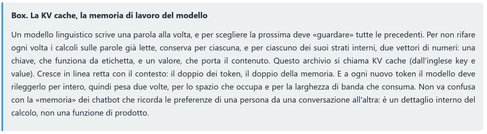
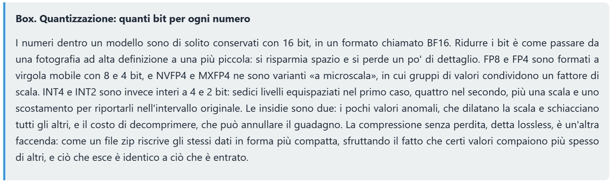
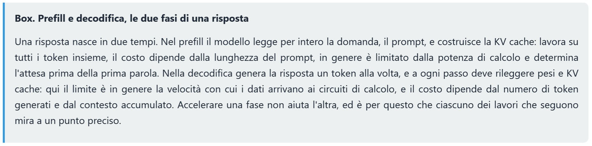
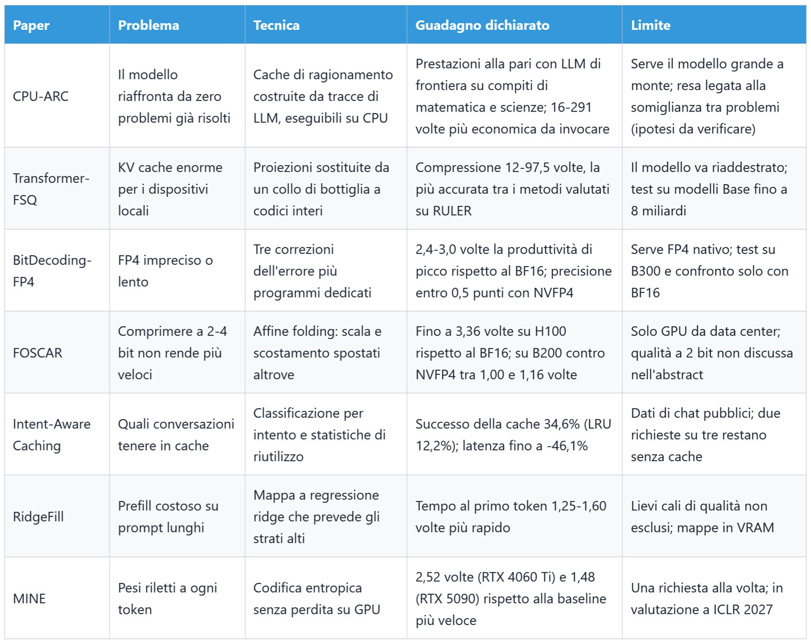

# The Burden of Memory: Seven Ways to Lighten Large Language Models

*From reusing reasoning traces to compressing model weights: seven research papers published on the exact same day, without any prior coordination, capture the race to run large language models on significantly leaner hardware. When generating text, an autoregressive language model must retain an ongoing scratchpad of every preceding token to predict the next word, re-reading that state at every step—and those notes expand linearly with conversation length. As models grow more capable and we demand longer context windows, the primary operational bottleneck shifts decisively from raw compute to memory capacity and data movement bandwidth.*

On Friday, November 6, 2026, within a window of just over six hours, seven distinct preprints appeared on arXiv tackling this exact challenge from complementary angles. The first landed at 12:51 UTC, the final submission at 18:58. They originate from distinct research labs, targeting different operational goals and hardware architectures, without any cross-coordination: an accidental convergence that strikes me as deeply instructive. To be transparent, synthesizing these papers under a unified lens is entirely my editorial framing, and this sample reflects topical thematic affinity rather than an exhaustive survey of everything posted to the preprint server that day. Furthermore, these are newly published preprints, largely unvetted by formal peer review, with reported benchmarks reflecting self-reported figures across specific model checkpoints and hardware rigs that may not generalize unconditionally.

The central thesis running through this analysis is straightforward: inference efficiency has ceased to be an esoteric engineering optimization and now dictates where a model can realistically reside—whether on a cost-effective cloud node, a local workstation, or behind a multi-tenant API serving thousands of concurrent users. A single statistic highlights the stakes: the authors of [Transformer-FSQ](https://arxiv.org/abs/2611.09598) calculate that for Qwen3-1.7B-Base—a modest model by current standards—maintaining a 200,000-token context window demands 21 GiB of KV cache memory, which is 6.6 times the memory footprint of the model parameters themselves.

These seven papers organize neatly along an architectural pipeline. At the front end, researchers aim to avoid re-generating redundant reasoning traces; in the middle, they compress active runtime working memory; and at the execution layer, they streamline serving infrastructure—spanning conversational session caching, prefill acceleration, and lossless weight compression. "Memory" thus carries three distinct operational meanings across this pipeline, and separating them is essential.

## Reasoning Only Once

### CPU-ARC: Caching Agentic Reasoning

In the indie game *Outer Wilds*, where a solar system is trapped inside an immutable twenty-two-minute time loop, every cycle resets completely except for the conceptual knowledge the player has internalized. Once you deduce how to access a hidden chamber, repeating the sequence takes mere seconds: the true cognitive effort—the discovery phase—is paid only once. This is the exact intuition driving [CPU-ARC](https://arxiv.org/abs/2611.09891), a technical report by Peter Belcak, Greg Heinrich, Saurav Muralidharan, Shizhe Diao, and Pavlo Molchanov. Language models, the authors argue, systematically conflate solving a problem with executing its algorithmic solution, endlessly recomputing solutions from first principles even when the underlying procedural schema has already been derived.

Their proposed framework is termed *agentic reasoning caching*: distilling structured reasoning traces generated by a frontier model into cached programmatic routines, dubbed ARCs, that execute on standard commodity CPUs without requiring GPU acceleration. The heavy inductive phase of discovering how to solve a problem class remains delegated to the large frontier model, while applying that cached strategy to new parametric instances requires minimal subsequent LLM intervention. According to self-reported results, ARCs match frontier model accuracy across demanding competitive math and scientific benchmarks, remain fully interpretable, support incremental updates over time, demonstrate robustness against input perturbations, and cost between 16 and 291 times less per invocation than querying the parent foundation model.

This requires careful interpretation. The reported cost reduction applies strictly to runtime cache execution, not to the initial trace construction, which still requires an expensive frontier model upstream. Furthermore, the preprint abstract does not detail generalization bounds across out-of-distribution problem classes. It is reasonable to anticipate the highest operational leverage in domains with high structural recurrence—such as IT automation assistants, repetitive document processing, and structured enterprise workflows—though that remains an analytical inference rather than an empirical claim of the paper. Those who stand to benefit most are enterprises running repetitive operational pipelines seeking predictable unit costs and auditable execution paths; those watching nervously are API providers monetizing compute-heavy reasoning tokens, since a recurring workflow that bypasses the frontier model stops generating metered token revenue. That, too, is an economic reading rather than a proven outcome.

## Compressing Runtime Memory

Compressing the Key-Value (KV) cache is hardly a brand-new concept born on November 6. In March, Google Research introduced [TurboQuant](https://aitalk.it/it/turboquant.html), an ICLR 2026 contribution demonstrating at least a sixfold reduction in KV cache memory footprint down to roughly three bits per value without degradation on reported long-context benchmarks. In everyday production environments, FP8 KV caching serves as a pragmatic baseline, [supported natively in vLLM](https://spheron.network/blog/google-turboquant-llm-compression-gpu-cloud) with an approximate 2x memory compression over FP16. Against this backdrop, the following three papers pursue distinct strategies: modifying model architecture to memorize more compactly, compressing existing caches without numerical degradation, and accelerating low-bit decompression for line-rate decoding.

### Transformer-FSQ: Extreme Quantization

If the goal is running private, local models with extensive context windows on consumer devices, the memory overhead of the KV cache quickly becomes prohibitive—the baseline observation of [Transformer-FSQ](https://arxiv.org/abs/2611.09598), authored by Szecsenyi, Lee, Shaj, Crowley, and Storkey. The authors observe that established post-training quantization schemes degrade sharply beyond moderate compression ratios. Their solution is far more radical than simple bit-depth reduction: replacing the linear key and value projections entirely with a finite scalar quantization (FSQ) bottleneck. The model effectively learns to encode each token into a compressed shorthand—a compact vector of integer indices drawn from a bounded codebook—eliminating the per-token scaling factor metadata that bloats conventional quantization schemes, while decoding directly from that shorthand.

The operational trade-off is significant: this is not a zero-cost drop-in trick for pre-existing model weights. Architectural conversion requires fine-tuning the newly introduced projection bottlenecks, consuming roughly 0.25 tokens per original model parameter—amounting to roughly two billion training tokens for an 8B model. The authors benchmarked the method against five competitive quantization families across models spanning 0.6B to 8B parameters. On the RULER long-context retrieval benchmark, across extreme compression ratios spanning 12x to 97.5x, Transformer-FSQ achieved the highest retrieval accuracy among evaluated baselines across all parameter scales. A dedicated GPU kernel implemented in Triton reads the quantized codes directly: at 32x compression, decoding throughput matches uncompressed full-precision attention (1.01x speedup, 95% CI [0.98, 1.05], on Qwen3-8B-Base), reaching 1.54x at 97.5x compression. Applying that 32x ratio mechanically to our introductory example, the 21 GiB memory footprint would drop to just under 700 MiB—though that remains our illustrative math rather than an explicit benchmark from the paper.

Four technical caveats apply. Evaluated models are Base checkpoints rather than instruction-tuned chat models. The primary quality metric reported in the abstract is information retrieval, leaving long-form creative generation and multi-step reasoning unmeasured. Empirical validation stops at the 8B parameter threshold. Finally, the specific hardware platform executing the Triton kernel is omitted from the abstract, meaning frictionless long-context deployment on consumer laptops remains an architectural ambition rather than an independently replicated reality. An open strategic question concerns upstream open-weight publishers: unless model providers release pre-quantized FSQ checkpoints natively, end-user benefits will remain largely academic.

### BitDecoding-FP4: Four Bits with Minimal Precision Loss

Sub-byte representations promise immense memory savings, yet [BitDecoding-FP4](https://arxiv.org/abs/2611.09825) starts from an uncomfortable operational reality: naive FP4 KV cache quantization degrades generation accuracy unacceptably, while high-accuracy vector quantization methods rely on runtime codebook lookups that cripple decoding throughput. The authors address three distinct error vectors. First, attention queries: they decompose query vectors into two residual FP4 tensors, where the secondary tensor corrects quantization errors left by the primary—akin to taking a coarse measurement with a standard ruler and refining the remainder with a precision caliper. Attention score error collapses, according to the authors, from 60% down to 1%. Second, numerical underflow: across extreme context lengths, attention probabilities become infinitesimal, causing standard E4M3 scaling factors to round values to zero; a custom scale adjustment mitigates this underflow. Third, key matrix outliers, neutralized through static channel-smoothing, randomized Hadamard transformations that distribute activation spikes evenly across vector dimensions, and iterative scale optimization.

At the systems level, the attention softmax operation—which typically becomes memory-bandwidth bound—is refactored into a transposed format with probability quantization fused into the kernel; queries are stacked to maximize Tensor Core utilization over a paged KV cache architecture. This exemplifies true algorithm-hardware co-design: mathematical compression is useless unless the resulting data layout aligns natively with the underlying execution units.

Reported evaluations span dense and mixture-of-experts (MoE) architectures, covering both Grouped-Query Attention (GQA) and Multi-head Latent Attention (MLA). Generation accuracy remains within 0.5 points of full BF16 baselines using NVFP4, and within 1.0 point using MXFP4, maintaining parity across reinforcement learning rollout phases. In full end-to-end serving benchmarks on NVIDIA B300 hardware, evaluated on Qwen3-4B and Qwen3-30B-A3B, peak serving throughput improved by 2.4x to 3.0x over BF16 baselines. The implementation is [available as open-source software](https://github.com/OpenBitSys/BitDecoding-FP4). Three caveats: the comparative baseline is uncompressed BF16 rather than competing low-bit schemes; "peak throughput" reflects optimal concurrency regimes rather than average serving latency; and native FP4 Tensor Cores are mandatory, positioning this primarily as a data center architecture rather than an edge-device breakthrough.

### FOSCAR: Compression Is Only Half the Battle

Compressing the KV cache down to 2-bit or 4-bit representations dramatically cuts memory footprint, but does not automatically accelerate token generation. [FOSCAR](https://arxiv.org/abs/2611.09722) opens with an empirical finding: existing 2-bit attention decoding kernels saturated less than 31% of peak High Bandwidth Memory (HBM) bandwidth on NVIDIA H100 GPUs and under 15% on B200 architectures. The underlying culprit: runtime dequantization, scaling, and zero-point offset math prior to feeding Tensor Cores consumes precious instruction cycles, which constitute the true bottleneck in modern GPU pipelines.

The proposed solution, termed *affine folding*, can be understood through an accounting analogy: if you must convert a thousand transactions from euros to dollars and sum them, it is far more efficient to sum them in euros first and convert the aggregate total once. Instead of dequantizing every individual matrix element, FOSCAR folds the affine scale and offset operations into the alternate matrix operand or the post-GEMM attention output, reducing instruction count by up to two orders of magnitude. In exact arithmetic, the dequantized attention result remains mathematically identical—though one must not confuse this with "lossless" modeling: the output matches conventional dequantized attention, but the preceding 2-bit or 4-bit quantization has already discarded information upstream. Utilizing bit-level instruction packing, the kernel achieves 1.0 and 0.19 arithmetic instructions per INT2 element on H100 and B200 respectively, with custom execution pipelines tailored to each architecture.

Compared to FlashInfer in BF16, geometric mean decoding speed increases by 3.36x (INT2) and 2.83x (INT4) on H100, and by 2.67x and 2.30x on B200. Against stronger enterprise baselines, gains remain solid: versus TensorRT-LLM in FP8, speedups reach 2.03x and 1.71x on H100, and 1.48x and 1.28x on B200; against TensorRT-LLM in native NVFP4 on B200, the advantage narrows to 1.16x for INT2 and 1.00x (parity) for INT4. Integrated into SGLang, the kernel increases peak serving throughput by up to 170% over 2-bit baselines and 341% over 16-bit baselines. The [GPU kernel library is open source](https://github.com/FutureMLS-Lab). Two notes: the abstract focuses strictly on latency and omits empirical accuracy evaluations for 2-bit outputs, and benchmarks target flagship data center accelerators. The common thread connecting FOSCAR to BitDecoding-FP4 is unmistakable: compression alone is only half the battle; the other half is ensuring decompression is computationally cheap.

## Serving Smarter, Computing Less

### Intent-Aware Caching: Predicting Who Returns

In multi-turn conversational agents, serving engines frequently retain KV caches from previous turns—a technique known as prefix caching—to avoid recomputing the prefill phase when a user responds. Memory, however, is finite, forcing systems to evict sessions. Standard Least Recently Used (LRU) policies discard the oldest session, blindly ignoring that different conversations exhibit vastly different probabilities of continuation and distinct inter-turn response intervals. [Intent-Aware Caching](https://arxiv.org/abs/2611.09715), authored by Arif, Yoon, Nikolopoulos, Vandierendonck, John, and Ji, addresses this limitation directly: classifying incoming requests by user intent, mining recent telemetry logs for lightweight reuse heuristics (continuation probability and idle duration), and guiding an oracle-inspired cache eviction policy that anticipates future conversational turns. For instance, a user asking for a cooking recipe rarely follows up immediately, whereas a software developer debugging a complex script typically responds within minutes. The paper quantifies these empirical behaviors across real-world traces.

Evaluated on the WildChat and ShareChat conversation corpuses, Intent-Aware Caching achieved a cache hit rate of 34.6%, compared to 18.8% for existing learned eviction baselines and 12.2% for standard LRU, driving end-to-end average service latency down by up to 46.1%. While tripling LRU hit rates is impressive, it also serves as a sobering reminder: at a 34.6% hit rate, two out of three requests still miss the cache. The preprint is marked as "Accepted to NeurIPS 2026", and the [codebase is publicly available](https://github.com/hasanar1f/intent-aware-caching). A governance note: classifying user intent requires inspecting the nature of incoming queries; while the authors emphasize lightweight statistical metadata, enterprise infrastructure teams must audit data residency and retention compliance. This research aligns closely with conversational platforms and customer support bots, demonstrating that caching layers can become predictive by learning from behavioral patterns.

### RidgeFill: Bypassing the Upper Layers

When feeding an LLM a hundred-page legal contract or an entire codebase repository, the initial prefill stage incurs substantial latency. [RidgeFill](https://arxiv.org/abs/2611.09709), by Dylan Johnston and Robert P. Smith, proposes skipping the computation of most upper transformer layers across prompt tokens. Lower layers execute normally up to a designated split point; from there, dedicated mapping functions predict what activations the subsequent layers would have received, allowing upper layers to populate their KV cache directly from these predicted states. It resembles an assembly line where, past an intermediate checkpoint, subsequent departments bypass physical part fabrication and fill out quality logs based on statistical estimation. While similar concepts exist in custom architectures like YOCO, RidgeFill's breakthrough lies in applying this post-hoc to arbitrary pre-existing models without architectural retraining.

The mapping operator is a classical statistical ridge regression, solved once in closed form using a calibration corpus: requiring zero gradient backpropagation, zero discarded tokens, and leaving original projection weights unmodified. However, the final prompt tokens and all autoregressive decoding steps execute across the complete uncompressed model, meaning latency gains apply strictly to Time to First Token (TTFT) rather than ongoing token generation. Benchmarked on Qwen3.8-27B (the dense 27B model released under the Apache 2.0 license; [see benchmark analysis](https://aitalk.it/it/qwen38-27b.html)) in a modified llama.cpp runtime on an NVIDIA A100 GPU, TTFT improved by 1.25x to 1.31x across context windows spanning 16,000 to 120,000 tokens with maps resident in VRAM. RULER retrieval accuracy dipped by 1.2 to 1.4 points, LongBench v2 dropped by 1.4 points, and 95% confidence intervals spanned zero while not ruling out minor precision losses. On Qwen3.8-Flash-Next in vLLM, TTFT speedups reached 1.50x to 1.60x between 9,000 and 32,000 tokens, maintaining needle-in-a-haystack retrieval at 99.8% versus 100.0%, accompanied by a modest 2.65% increase in next-token perplexity (95% CI [-0.02%, +4.93%]).

Methodologically, the paper is exceptionally rigorous: the authors demonstrate that averaging loss metrics across all tokens masks localized errors, relying instead on targeted probing to identify where semantic cohesion breaks down. Across three 8B–9B parameter reference models, the ridge mapping recovered roughly 49 additional RULER points in the bypassed upper layers compared to naive truncation baselines; long-document loss stayed within 0.03 nats of SwiftKV checkpoints that were explicitly pretrained for cache approximation. It offers a highly pragmatic engineering path for teams seeking to accelerate prefill on deployed models without retraining, provided they accept minor accuracy variance and allocate memory for regression matrices. Authored by two researchers across 50 pages and 38 tables, with [data and code released openly](https://github.com/Approximate-Science/ridgefill-data).

### MINE: Lossless Weight Compression

Running local inference on a single consumer GPU presents a distinct physical bottleneck: for every generated token, all model weights must be streamed sequentially from VRAM into compute cores. Without concurrent request batching to amortize memory bandwidth, decoding speed is strictly memory-bandwidth bound. [MINE](https://arxiv.org/abs/2611.09424), by Emil Schätzle and Markus Püschel, attacks this constraint through true lossless compression. William Basinski's *The Disintegration Loops* were composed from magnetic tapes degrading with every pass across the tape head: each replay erodes physical material, and lost fidelity is unrecoverable—the audio equivalent of lossy compression. MINE, by contrast, operates like a zip archive: restructuring identical underlying bits into a denser encoding and decompressing them bit-for-bit into their exact original state.

At its core is dtANS-LLM, an asymmetric numeral systems (ANS) entropy coding kernel tailored for GPU architectures: exploiting the non-uniform distribution of weight matrices—which remains skewed even post-quantization—to allocate shorter bit-sequences to high-frequency values. It exposes tuning parameters that balance compression ratios against kernel decompression latency, autotuning configurations per tensor and GPU architecture to trace Pareto frontiers between memory footprint and execution speed. Integrated as a custom vLLM extension, it automatically selects optimal compression parameters for a target memory budget. The authors note that existing lossless GPU compressors accelerate throughput only for specific unquantized formats like BF16 under restrictive assumptions.

Reported evaluations on Llama 3.1 8B Instruct, using a 2.1-bit checkpoint produced via EntQuant, demonstrated throughput speedups of 2.52x on an RTX 4060 Ti and 1.48x on an RTX 5090 over the fastest uncompressed baseline, achieving effective bitrates of 2.24 and 3.43 bits per parameter respectively. The trade-off between footprint and execution speed varies across GPU memory architectures, with MINE calibrating automatically. The [code and artifacts are publicly available](https://doi.org/10.5281/zenodo.23885927). Caveats apply: the abstract does not specify the comparative baseline kernel; reported speedups apply exclusively to single-batch (batch size 1) execution without multi-tenant batching evaluations; output quality remains bound to the underlying 2.1-bit checkpoint (MINE preserves precision losslessly but cannot restore entropy already discarded by lossy quantization); and the submission is currently under review for ICLR 2027. It represents the research track most directly relevant to local computing enthusiasts, developers, and workstation deployments.

**Summary Overview**

## Who Truly Benefits?

These seven papers converge into three distinct architectural categories: compute deduplication (CPU-ARC), runtime KV cache compression (Transformer-FSQ, BitDecoding-FP4, FOSCAR), and serving pipeline orchestration (Intent-Aware Caching, RidgeFill, MINE). Far from competing approaches, they represent complementary links in an optimization pipeline spanning cognitive trace reuse, transient attention caching, low-level GPU kernel design, and weight storage. However, one must resist the temptation to multiply reported speedups: each benchmark originates from disparate models, evaluation suites, and hardware configurations, and none of the papers test these techniques in combination. Peer-review status remains varied: CPU-ARC is a technical report; BitDecoding-FP4, FOSCAR, RidgeFill, and Transformer-FSQ are unreviewed preprints; Intent-Aware Caching notes a NeurIPS 2026 acceptance; and MINE is under review for ICLR 2027.

Who captures the ultimate value depends on which layer of the stack you examine. Hyperscale cloud operators are the most direct beneficiaries: BitDecoding-FP4, FOSCAR, and Intent-Aware Caching maximize concurrent tenant density and context lengths per GPU cluster—disproportionately rewarding teams deploying latest-generation Blackwell silicon with native FP4 Tensor Cores. Whether these infrastructure efficiencies translate into lower API consumer pricing or higher operator margins remains an open economic question, accompanied by Jevons' paradox: cheaper inference may simply accelerate aggregate consumption, leaving absolute infrastructure spending unchanged. Enterprises managing repetitive procedural workflows should evaluate CPU-ARC and RidgeFill, subject to empirical validation on domain data. And what about local inference enthusiasts seeking self-hosted private models? MINE provides immediate acceleration on consumer hardware, albeit constrained to single-stream execution in vLLM; Transformer-FSQ represents the most transformative long-term breakthrough for local devices, yet depends on foundation model creators adopting the architecture upstream during pretraining. Finally, from a privacy perspective, techniques like intent-aware eviction remind us that optimizing infrastructure often entails profiling behavioral telemetry.

In his *Six Memos for the Next Millennium*, Italo Calvino opens with a meditation on lightness, defending it against accusations of superficiality: to lighten, for Calvino, means subtracting weight from a structure without diminishing its essential substance, invoking Paul Valéry's aphorism that one should be light like a bird, not like a feather. This serves as an apt lens for evaluating these seven research contributions. Making a model lighter is mathematically trivial; stripping away computational deadweight while preserving the reasoning capacity that makes the model useful in the first place is the true engineering challenge. Every benchmark figure must be read alongside a crucial question: what capability was sacrificed, and who bears the cost? This brings us back to our opening dilemma: as frontier models become dramatically lighter, who will successfully deploy private, sovereign models on local hardware, and who will merely see lower marginal prices on cloud services owned by others?
