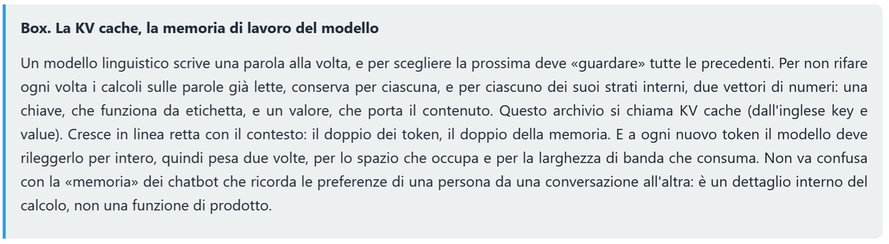
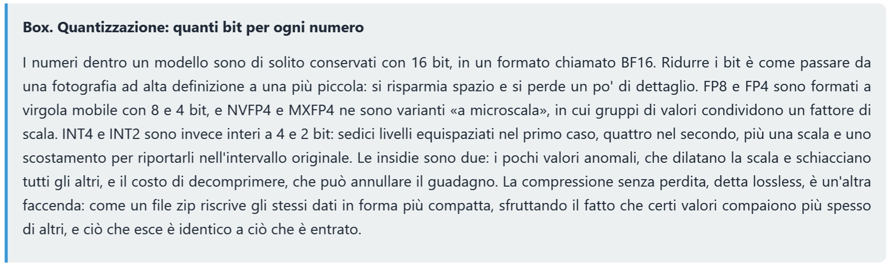
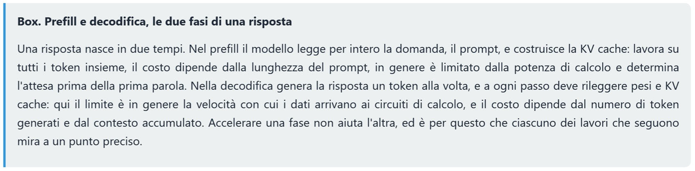
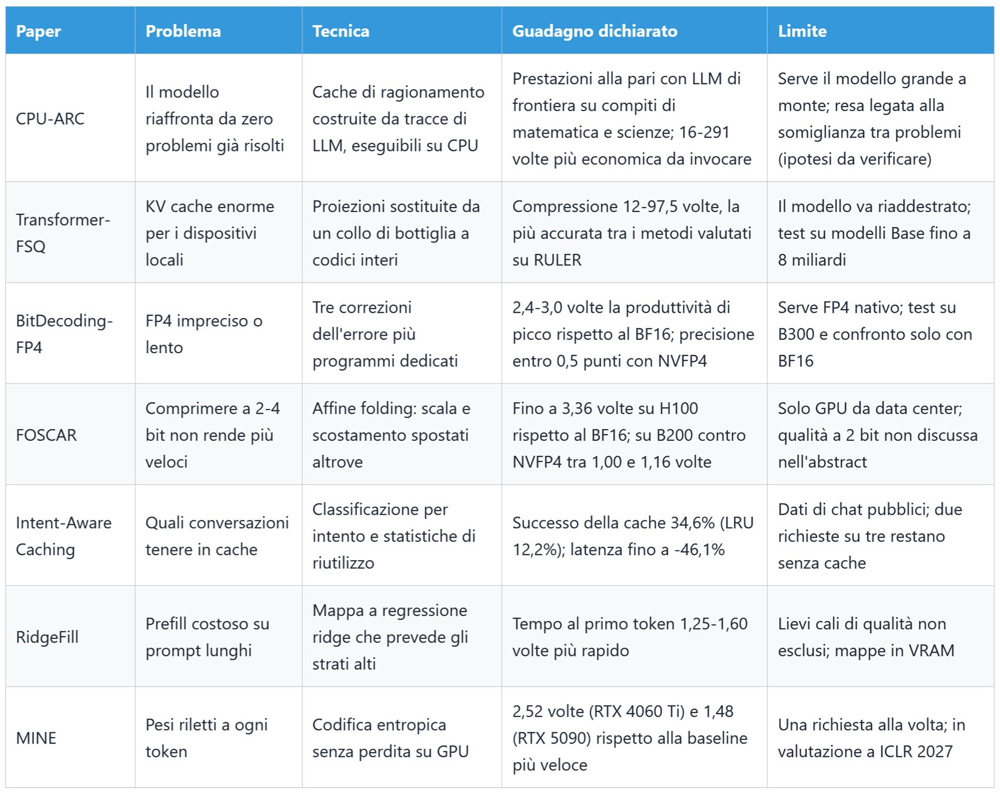

# El peso de la memoria: siete vías para aligerar los LLM

*Desde la reutilización del razonamiento deductivo hasta la compresión de los pesos de la red: siete investigaciones publicadas el mismo día, sin coordinación previa alguna, retratan la carrera por ejecutar modelos lingüísticos sobre arquitecturas de hardware sensiblemente más austeras. Cuando un modelo de lenguaje genera texto palabra por palabra, debe mantener al alcance de la mano un registro de cada término precedente, releyéndolo de forma continua en cada paso; y esas anotaciones se expanden linealmente con la extensión del diálogo. A medida que el modelo gana en destreza y le exigimos gestionar contextos de mayor longitud, el cuello de botella operativo se desplaza inexorablemente del cálculo puro a la capacidad de memoria y al ancho de banda para mover datos.*

El viernes 6 de noviembre de 2026, en un intervalo de apenas seis horas, aparecieron en arXiv siete artículos que abordan esta encrucijada desde ángulos complementarios. El primero se registró a las 12:51 UTC; el último, a las 18:58. Proceden de equipos de investigación distintos, con propósitos operacionales y plataformas de hardware dispares, sin que mediara coordinación alguna: una coincidencia fortuita que resulta profundamente reveladora. Procede aclarar con transparencia que la iniciativa de analizarlos de forma conjunta responde al criterio editorial de este autor, y que la selección obedece a una afinidad temática y no a una revisión sistemática exhaustiva de cuanto se publicó aquel día. Conviene advertir asimismo que se trata de preprints recién difundidos, en su mayor parte pendientes de revisión por pares, y que los resultados reseñados reflejan lo declarado por sus autores sobre modelos y configuraciones de prueba específicos, no siendo automáticamente extrapolables a cualquier entorno.

La tesis cardinal que vertebra este análisis es nítida: la eficiencia inferencial ha dejado de constituir un mero refinamiento para especialistas y determina hoy dónde podrá residir fácticamente un modelo: si en un servidor económico en la nube, en un ordenador personal o detrás de un servicio concurrente para miles de usuarios. Una cifra ilustra con crudeza la magnitud del desafío: los autores de [Transformer-FSQ](https://arxiv.org/abs/2611.09598) estiman que, para Qwen3-1.7B-Base —un modelo modesto para los estándares vigentes—, mantener doscientos mil tokens de contexto operativo en memoria exige 21 GiB de espacio para la KV cache, lo que equivale a 6,6 veces el tamaño que ocupan los propios pesos del modelo.

Estos siete trabajos se alinean a lo largo de una cadena arquitectónica continua. En el punto de partida se sitúan quienes persiguen evitar la reiteración de inferencias ya computadas; en el tramo intermedio, quienes comprimen la memoria operativa de trabajo; y en la capa de ejecución, quienes optimizan el servicio y el cómputo del modelo, desde la caché conversacional y la fase de prefill hasta la compresión sin pérdidas de los pesos. El término «memoria» asume así tres acepciones operativas netamente diferenciadas que conviene deslindar con rigor.

## Razonar una sola vez

### CPU-ARC: el razonamiento en memoria caché

En el videojuego independiente *Outer Wilds*, donde un sistema solar queda atrapado en un bucle temporal invariable de veintidós minutos, en cada reinicio se desvanece todo salvo el conocimiento conceptual que el jugador ha interiorizado. Una vez descubierto cómo alcanzar un enclave oculto, repetir la hazaña apenas exige unos pocos movimientos: el esfuerzo intelectual genuino —el hallazgo— se sufraga una única vez. Esta es la intuición motriz de [CPU-ARC](https://arxiv.org/abs/2611.09891), un informe técnico firmado por Peter Belcak, Greg Heinrich, Saurav Muralidharan, Shizhe Diao y Pavlo Molchanov. Los modelos de lenguaje, argumentan los autores, confunden de forma sistemática el acto de resolver un problema con la ejecución de su solución algorítmica, partiendo de cero en cada ocasión aun cuando el procedimiento lógico ya ha sido deducido previamente.

La arquitectura propuesta se denomina *agentic reasoning caching*: a partir de las trazas de razonamiento generadas por un modelo de frontera se construyen estructuras en caché, bautizadas como ARC, que pueden ejecutarse íntegramente sobre un procesador estándar (CPU), sin requerir aceleración por GPU. La fase intensiva de inducción —comprender cómo abordar una tipología de problemas— permanece delegada en el modelo de gran escala, mientras que la traslación de esa estrategia a una instancia concreta demanda una intervención testimonial del modelo lingüístico. Según las métricas declaradas, las ARC igualan la precisión de los modelos de frontera en pruebas complejas de matemáticas y ciencias, son plenamente interpretables, admiten actualizaciones progresivas, resisten pequeñas perturbaciones en las entradas y recortan el coste operativo entre 16 y 291 veces por invocación respecto a consultar al modelo matriz.

La lectura de estos datos exige cautela analítica. La reducción de costes atañe con exclusividad al uso de la caché una vez consolidada, no a su fase de construcción inicial, que continúa exigiendo el concurso de un modelo de gran envergadura. Asimismo, el resumen técnico no profundiza en la capacidad de generalización de las ARC ante problemas que se aparten de los patrones asimilados. Resulta razonable prever que su ventaja competitiva se maximice en entornos con una elevada recurrencia estructural —como asistentes de soporte técnico, procesamiento estandarizado de documentos o flujos de trabajo corporativos repetitivos—, si bien esto constituye una deducción lógica propia y no una conclusión demostrada en el texto. Los directos beneficiarios serán aquellas organizaciones con cargas de trabajo homogéneas que busquen previsibilidad en sus costes y trazabilidad de sus procesos; por el contrario, quienes comercializan inferencia de razonamiento a demanda contemplarán esta vía con recelo, puesto que una operativa recurrente que prescinda del modelo matriz deja automáticamente de devengar facturación por tokens. Esto representa, igualmente, una lectura de mercado y no una certeza consolidada.

## Comprimir la memoria operativa

La compresión de la KV cache no es un concepto surgido súbitamente el 6 de noviembre. En marzo, Google Research presentó [TurboQuant](https://aitalk.it/it/turboquant.html), metodología presentada en ICLR 2026 que postula una reducción de al menos seis veces en la huella de memoria de la KV cache, hasta situarla en torno a los tres bits por valor, sin merma de precisión en las evaluaciones de contexto extenso consignadas. En la operativa industrial cotidiana, una referencia más modesta la proporciona la KV cache en formato FP8, [soportada de forma nativa en vLLM](https://spheron.network/blog/google-turboquant-llm-compression-gpu-cloud) con una reducción cercana a 2x frente a la precisión estándar. En este marco, los tres estudios siguientes exploran sendas alternativas: rediseñar el modelo para que almacene información de forma intrínsecamente compacta, comprimir la memoria existente sin degradar la precisión o maximizar la velocidad de lectura durante la descompresión.

### Transformer-FSQ: cuantización extrema

Si el propósito es ejecutar un modelo privado en dispositivos de uso cotidiano, la factura de memoria que impone la KV cache deviene de inmediato prohibitiva, premisa de la que parte [Transformer-FSQ](https://arxiv.org/abs/2611.09598), suscrito por Szecsenyi, Lee, Shaj, Crowley y Storkey. Los autores constatan que los esquemas de cuantización post-entrenamiento convencionales quiebran de forma abrupta cuando se rebasan ratios de compresión moderados. Su planteamiento es bastante más radical que una simple rebaja en el número de bits: reemplazar por completo las proyecciones lineales que originan las claves y valores por un cuello de botella basado en cuantización escalar finita (*finite scalar quantization*, FSQ). En la práctica, el modelo aprende a codificar cada token en una taquigrafía vectorial de enteros acotados en un repertorio finito, prescindiendo de los metadatos de escala por token que sobrecargan otros esquemas, y a reconstruirlos directamente a partir de esa codificación condensada.

El peaje operativo resulta evidente: no se trata de un truco aplicable de forma inmediata sobre cualquier modelo ya descargado. La conversión exige reentrenar los nuevos módulos de proyección, consumiendo aproximadamente 0,25 tokens por cada parámetro original del modelo, lo que en una arquitectura de 8.000 millones de parámetros representa un volumen cercano a los dos mil millones de tokens de entrenamiento. Los autores evaluaron el método frente a cinco familias de técnicas rivales sobre modelos de 0,6B a 8B de parámetros. En el benchmark RULER, diseñado para medir la recuperación de información en contextos extensos, bajo factores de compresión de 12x a 97,5x Transformer-FSQ se alzó como la técnica más precisa entre las analizadas, en todas las escalas. Un kernel para GPU desarrollado en Triton procesa los códigos de forma directa: a un factor de compresión de 32x, la velocidad de decodificación empata con la de la atención estándar sin comprimir (1,01x, con un intervalo de confianza al 95% de 0,98 a 1,05, sobre Qwen3-8B-Base), alcanzando un factor de 1,54x a 97,5x de compresión. Trasladando mecánicamente ese factor de 32x al caso introductorio, los 21 GiB de partida quedarían confinados en algo menos de 700 MiB, si bien este cálculo constituye una estimación nuestra y no un ensayo del artículo.

Cuatro cautelas deben tenerse presentes. Los modelos evaluados son variantes Base y no checkpoints afinados para diálogo instruccional. La métrica de calidad referenciada en el resumen se circunscribe a la recuperación de datos, por lo que no permite inferir el comportamiento del modelo en redacción compleja o razonamiento abstracto de largo alcance. Las comprobaciones empíricas se detienen en los 8B de parámetros. Por último, la configuración de hardware sobre la que se ejecutó el kernel de Triton se omite en el resumen técnico, por lo que la estampa del portátil ejecutando contextos kilométricos responde por ahora a una aspiración de los investigadores más que a una demostración documentada. Queda en el aire una incógnita crucial para la industria: si los creadores de los modelos no distribuyen las versiones previamente convertidas, la ventaja para el usuario final permanecerá en el plano teórico.

### BitDecoding-FP4: cuatro bits con mínima pérdida de fidelidad

Operar a cuatro bits promete horizontes de ahorro notables, y [BitDecoding-FP4](https://arxiv.org/abs/2611.09825) arranca de una constatación incómoda: las implementaciones de KV cache en FP4 que recurren a cuantizaciones ingenuas degradan en exceso la precisión, mientras que los algoritmos matemáticamente rigurosos dependen de tablas de búsqueda (*codebooks*) cuya consulta penaliza severamente el rendimiento de la decodificación. Los investigadores atacan tres fuentes de error bien delimitadas. En primer término, las consultas (*queries*) dirigidas a la memoria: las desdoblan en dos tensores FP4 bajo una lógica residual en la que el segundo subsana las imprecisiones no capturadas por el primero —de modo análogo a realizar una medición inicial con una regla básica y calibrar el remanente con un micrómetro de precisión—. El error en las puntuaciones de atención disminuye, según afirman, del 60% al 1%. En segundo lugar, una dificultad de representación numérica: ante contextos sumamente extensos, las probabilidades asociadas devienen minúsculas y las escalas en formato E4M3 tienden a redondearlas a cero; un ajuste dinámico de escala solventa este desbordamiento por defecto. En tercer lugar, los valores atípicos (*outliers*) en las claves, mitigados mediante suavizado estático de canales, transformadas de Hadamard que distribuyen homogéneamente las activaciones extremas entre múltiples dimensiones y una optimización iterativa de las escalas.

En el plano del sistema informático, la operación de softmax —que acostumbra a constituir el cuello de botella por ancho de banda— se reestructura en disposición traspuesta, fusionando la cuantización de las probabilidades en la misma rutina de cálculo; las consultas se apilan para exprimir los Tensor Cores sobre una KV cache paginada. Se trata de un ejercicio paradigmático de codiseño entre algoritmo y arquitectura: no basta con comprimir la representación matemática; el formato resultante debe ajustarse a la perfección a las unidades de cálculo que han de computarlo.

Los resultados declarados engloban tanto modelos densos como de expertos mixtos (MoE), contemplando las modalidades de atención GQA y MLA. La fidelidad se mantiene a menos de 0,5 puntos respecto a la KV cache en BF16 empleando NVFP4, y a menos de 1 punto mediante MXFP4, preservando la paridad incluso durante las fases de generación del entrenamiento por refuerzo. En un despliegue de servicio integral sobre GPUs NVIDIA B300, evaluado en Qwen3-4B y Qwen3-30B-A3B, el rendimiento pico de procesamiento superó entre 2,4 y 3,0 veces al obtenido con la KV cache en BF16. El [código está disponible en abierto](https://github.com/OpenBitSys/BitDecoding-FP4). Conviene ponderar tres matices: el término de cotejo es el formato BF16 sin comprimir y no otros esquemas de baja resolución; el rendimiento «pico» alude al punto óptimo de la curva de concurrencia y no al promedio continuado; y resulta indispensable disponer de Tensor Cores con soporte nativo de FP4, como los integrados en la arquitectura B300 del ensayo, lo que encuadra este avance en el ámbito de los centros de datos más que en el hardware de consumo.

### FOSCAR: reducir el tamaño no basta

Comprimir la KV cache a 2 o 4 bits disminuye drásticamente el volumen de datos que transitan por el bus, pero no garantiza de forma automática una generación de texto más veloz. [FOSCAR](https://arxiv.org/abs/2611.09722) toma como punto de partida una constatación empírica: los kernels existentes de decodificación a 2 bits apenas aprovechaban el 31% del ancho de banda pico de la memoria HBM en las tarjetas H100 y caían por debajo del 15% en las B200. El motivo radica en que desquantizar cada valor y aplicar los factores de escala y desplazamiento antes de alimentar los Tensor Cores devora ciclos de instrucciones, siendo las instrucciones el recurso más escaso en las GPUs contemporáneas.

La solución formulada, bautizada como *affine folding*, se clarifica mediante una analogía financiera: si debéis convertir mil transacciones de euros a dólares y agregarlas, resulta mucho más eficiente sumar los importes en euros y ejecutar la conversión de divisas una sola vez sobre el montante total. En lugar de desquantizar individualmente cada elemento matricial, FOSCAR transfiere las operaciones de escala y desplazamiento al operando complementario o al resultado final de la multiplicación matricial de la atención, reduciendo esas instrucciones hasta en dos órdenes de magnitud. El resultado de la atención desquantizada permanece inalterado bajo aritmética exacta —precisando que esto no debe interpretarse como «sin pérdidas»: coincide fielmente con el método tradicional, si bien la cuantización previa a 2 y 4 bits ya ha descartado información de base—. Mediante empaquetado de instrucciones a nivel de bit, bastan 1,0 y 0,19 operaciones aritméticas por componente INT2 en H100 y B200 respectivamente, articuladas mediante cauces optimizados para cada arquitectura.

Frente a FlashInfer en BF16, la media geométrica de velocidad de decodificación escala 3,36 veces en INT2 y 2,83 en INT4 sobre H100, y 2,67 y 2,30 veces en B200. Ante alternativas más consolidadas, las ganancias se moderan pero persisten: frente a TensorRT-LLM en FP8 se obtienen factores de 2,03x y 1,71x en H100 y de 1,48x y 1,28x en B200; frente a TensorRT-LLM en NVFP4 sobre B200, la ventaja se contrae a 1,16x para INT2 e iguala la velocidad (1,00x) en INT4. Integrado en el entorno SGLang, el sistema eleva el rendimiento agregado pico hasta un 170% frente a una base de 2 bits y hasta un 341% respecto a una referencia en 16 bits. La [librería de kernels para GPU es de código abierto](https://github.com/FutureMLS-Lab). Dos apuntes metodológicos: el resumen se focaliza en el rendimiento de ejecución sin detallar el impacto cualitativo sobre las respuestas en 2 bits, y los ensayos se circunscriben a aceleradores de alta gama para centros de datos. La sintonía conceptual que vincula FOSCAR con BitDecoding-FP4 es palmaria: la compresión aislada supone únicamente la mitad del desafío; la otra mitad estriba en conseguir que la descompresión computacional resulte insignificante.

## Servir con mayor eficiencia, procesar menos

### Intent-Aware Caching: anticipar el retorno del usuario

En asistentes conversacionales estructurados en turnos sucesivos, las plataformas de servicio suelen retener la KV cache de las intervenciones previas —técnica denominada *prefix caching*— para no recomputar la fase de prefill cada vez que el interlocutor responde. Sin embargo, la memoria de vídeo es un recurso finito y fuerza a desalojar sesiones. La política habitual, LRU (menos utilizado recientemente), descarta aquello que lleva más tiempo inactivo, pasando por alto que las distintas conversaciones presentan probabilidades de continuación y cadencias temporales radicalmente heterogéneas. [Intent-Aware Caching](https://arxiv.org/abs/2611.09715), desarrollado por Arif, Yoon, Nikolopoulos, Vandierendonck, John y Ji, interviene en este punto: cataloga las solicitudes según la intención subyacente del usuario, asimila estadísticas ligeras de reutilización a partir de los registros operativos recientes (probabilidad de continuidad e intervalos de inactividad) y orienta con ellas una política de desalojo inspirada en un oráculo teórico predictivo. A título ilustrativo: quien formula una consulta culinaria difícilmente volverá a interactuar de inmediato, mientras que quien depura un fragmento de código suele replicar a los pocos minutos. El estudio cuantifica estos comportamientos a partir de registros empíricos.

Sobre los corpus de conversaciones reales de WildChat y ShareChat, la tasa de acierto en caché alcanzó el 34,6%, frente al 18,8% del modelo predictivo precedente y el 12,2% de la política LRU convencional, recortando la latencia media de servicio hasta en un 46,1%. Con ser un registro que casi triplica a LRU, encierra una advertencia ineludible: con un 34,6% de aciertos, dos de cada tres peticiones continúan sufriendo fallos de caché. En los metadatos de arXiv la investigación figura como aceptada en «NeurIPS 2026», y su [código es público](https://github.com/hasanar1f/intent-aware-caching). Una consideración de gobernanza: categorizar la intencionalidad implica, de algún modo, escrutar la temática de las solicitudes del usuario; aun cuando los autores aluden a metadatos estadísticos no invasivos, los responsables de infraestructura deberán auditar dónde residen esos registros y bajo qué plazos de conservación. Es la aportación más directamente ligada a servicios de soporte, chats y asistentes interactivos, demostrando que una caché puede volverse predictiva aprendiendo de las dinámicas de uso.

### RidgeFill: eludir las capas superiores

Cuando se somete a un modelo un contrato mercantil de un centenar de páginas o un repositorio íntegro de código, la latencia de la fase de prefill deviene asfixiante. [RidgeFill](https://arxiv.org/abs/2611.09709), firmado por Dylan Johnston y Robert P. Smith, plantea prescindir del cálculo de la mayoría de las capas superiores del transformador durante el procesamiento del prompt. Las capas iniciales operan con normalidad hasta un punto de segmentación prefijado; a partir de ahí, una matriz de transformación predice para cada capa subsiguiente la activación que habría recibido, posibilitando que cada estrato superior escriba su KV cache directamente a partir de dicha estimación. Funciona como una línea de ensamblaje en la que, rebasada una estación intermedia, los departamentos terminales no mecanizan la pieza y cumplimentan la ficha técnica basándose en una inferencia estadística. Esta aproximación existe ya en modelos entrenados específicamente para ello, como YOCO; la aportación estriba en extrapolarla *a posteriori* a modelos preexistentes no concebidos para este fin.

La función de mapeo se instrumenta mediante una regresión ridge clásica, resuelta analíticamente en forma cerrada mediante una única pasada sobre un corpus de calibración: sin reentrenamiento por descenso de gradiente, sin descarte de tokens y preservando intactas las proyecciones originales. Ahora bien: los últimos millares de tokens del prompt y la totalidad de los pasos de decodificación subsiguientes se computan sobre la arquitectura íntegra del modelo, de modo que el beneficio se concentra en el tiempo hasta el primer token (TTFT) y no en la velocidad de generación posterior. Evaluado sobre Qwen3.8-27B —el modelo denso de 27.000 millones de parámetros publicado bajo licencia Apache 2.0; [véanse análisis y métricas](https://aitalk.it/it/qwen38-27b.html)— mediante una versión modificada de llama.cpp sobre una GPU NVIDIA A100, el TTFT mejoró entre 1,25 y 1,31 veces en contextos de 16.000 a 120.000 tokens manteniendo las matrices en VRAM. La puntuación RULER retrocedió entre 1,2 y 1,4 puntos, LongBench v2 cayó 1,4 puntos, y los intervalos de confianza al 95% abarcaron el cero sin descartar pequeñas mermas de precisión. Sobre Qwen3.8-Flash-Next en vLLM, la reducción del TTFT osciló entre 1,50x y 1,60x para contextos de 9.000 a 32.000 tokens, conservando la prueba de recuperación en aguja en el pajar en un 99,8% frente al 100,0%, con un incremento en la perplejidad de los tokens sucesivos del 2,65% (intervalo del -0,02% al +4,93%).

El mérito metodológico más notable de esta investigación radica en evidenciar que promediar la pérdida de precisión entre todos los tokens diluye el error; de ahí que los autores recurran a evaluaciones específicas para desentrañar qué capacidades semánticas se degradan y en qué tramos. En tres modelos de referencia de 8B a 9B de parámetros, la regresión recuperó unos 49 puntos RULER adicionales en el segmento aproximado respecto a una truncación elemental; la pérdida en documentos extensos se mantuvo a menos de 0,03 nats de la exhibida por checkpoints de SwiftKV entrenados específicamente para tal objetivo. Encarna la propuesta más pragmática para optimizar la latencia inicial de modelos en explotación sin someterlos a costosos reentrenamientos, asumiendo un margen controlado de dispersión cualitativa y albergando las matrices de regresión en memoria. Una monografía de 50 páginas y 38 tablas, con [datos y código accesibles](https://github.com/Approximate-Science/ridgefill-data).

### MINE: compresión sin pérdidas para los pesos

Quien opera con una única tarjeta gráfica y atiende una única petición concurrente —el escenario paradigmático del entorno local— afronta un cuello de botella físico diferente: por cada palabra generada, la totalidad de los parámetros del modelo debe transferirse secuencialmente desde la VRAM a los núcleos de cálculo; en ausencia de procesamiento por lotes que amortice ese trasvase, la tasa de generación queda condicionada por el ancho de banda de la memoria. [MINE](https://arxiv.org/abs/2611.09424), de Emil Schätzle y Markus Püschel, encara este reto mediante compresión estrictamente sin pérdidas. Las composiciones de *The Disintegration Loops* de William Basinski surgieron de cintas magnéticas que se desgastaban físicamente con cada pasada sobre el cabezal de lectura: cada reproducción erosionaba el soporte físico y lo desvanecido no admitía recuperación posible; tal es el principio de la compresión con pérdidas. MINE actúa como un archivador digital: reescribe idéntica información en una disposición más densa y la restituye bit a bit en su estado original.

El corazón del sistema es dtANS-LLM, un esquema de codificación entrópica ANS optimizado para arquitecturas GPU: aprovecha que la distribución de los pesos dista de ser uniforme —asimetría que persiste incluso tras la cuantización— para asignar secuencias binarias más breves a los valores de mayor frecuencia de aparición. Incorpora parámetros que arbitran el compromiso entre tasa de compresión y sobrecoste de descompresión, calibrándolos automáticamente para cada tensor y arquitectura gráfica a fin de trazar la frontera de Pareto entre huella en memoria y latencia de ejecución. Integrado como extensión de vLLM, selecciona la configuración óptima para un presupuesto de memoria determinado. Los autores subrayan que los esquemas sin pérdidas previos únicamente aceleraban la ejecución en formatos muy concretos como BF16 bajo hipótesis restrictivas.

Los resultados empíricos declarados sobre Llama 3.1 8B Instruct, utilizando un checkpoint a 2,1 bits generado mediante la técnica EntQuant, acreditaron aceleraciones de 2,52 veces sobre una RTX 4060 Ti y de 1,48 sobre una RTX 5090 frente a la línea de base más veloz, con tasas efectivas de 2,24 y 3,43 bits por parámetro respectivamente. La relación óptima entre tamaño y cadencia de proceso difiere según la tarjeta empleada, adaptándose MINE de forma autónoma. El [código y los artefactos se hallan disponibles](https://doi.org/10.5281/zenodo.23885927) en régimen abierto. Consideraciones a valorar: el resumen omite la especificación del kernel de referencia empleado; la mejora aplica estrictamente a peticiones unitarias (tamaño de lote 1) sin datos sobre explotación concurrente; la calidad intrínseca queda condicionada por la fidelidad del modelo cuantizado a 2,1 bits de partida (MINE preserva la información sin degradarla, pero no puede restaurar la entropía descartada previamente por la cuantización); y el estudio se halla remitido a revisión para ICLR 2027. Es la línea de trabajo más próxima a la comunidad de desarrolladores locales, estaciones de trabajo y pequeñas infraestructuras.

**Resumen comparativo**

## Quién capitaliza verdaderamente estos avances

Estas siete contribuciones convergen en tres ámbitos de actuación complementarios: la deduplicación del esfuerzo computacional (CPU-ARC), la compresión de la KV cache operativa (Transformer-FSQ, BitDecoding-FP4, FOSCAR) y la orquestación del servicio de inferencia (Intent-Aware Caching, RidgeFill, MINE). Lejos de ser alternativas excluyentes, constituyen eslabones concatenados a lo largo del proceso: desde la amortización de trazas de razonamiento y la contención de la memoria atencional hasta la optimización de los kernels de GPU y el empaquetado de parámetros. Procede, no obstante, resistirse a multiplicar alegremente los factores de aceleración: cada registro emana de modelos, métricas y plataformas dispares, sin que ninguno de los estudios evalúe la interacción simultánea de estas técnicas. El grado de madurez técnica es desigual: CPU-ARC se presenta como informe técnico; BitDecoding-FP4, FOSCAR, RidgeFill y Transformer-FSQ son preprints; Intent-Aware Caching declara su aceptación en NeurIPS 2026; y MINE se encuentra en fase de evaluación para ICLR 2027.

La distribución de los beneficios dependerá del estrato tecnológico en que os situéis. Los proveedores de computación en la nube son los destinatarios más inmediatos: BitDecoding-FP4, FOSCAR e Intent-Aware Caching posibilitan alojar una mayor densidad de usuarios concurrentes y contextos más extensos sobre la misma GPU, beneficiando prioritariamente a quienes disponen de la arquitectura Blackwell con soporte nativo para FP4. Que estas optimizaciones se traduzcan en tarifas más reducidas o en mayores márgenes empresariales permanece como una incógnita abierta, supeditada a la paradoja de Jevons: un abaratamiento del servicio puede incentivar un consumo masivo que mantenga inalterado el gasto global. Las organizaciones con flujos de trabajo sistemáticos tienen en CPU-ARC y RidgeFill herramientas atractivas, supeditadas a una validación rigurosa sobre sus propios datos. ¿Y qué cabe esperar para quienes aspiráis a operar modelos privados en vuestro propio hardware? MINE ofrece aceleración inmediata en GPUs domésticas para flujos monousuario bajo vLLM; Transformer-FSQ encarna la mayor promesa para el despliegue local, si bien requiere que los desarrolladores de los modelos fundacionales adopten su arquitectura en el preentrenamiento. Finalmente, desde una perspectiva de privacidad, mecanismos como la caché basada en intenciones evidencian que afinar un servicio pasa a menudo por monitorizar el comportamiento de quienes lo emplean.

En sus *Seis propuestas para el próximo milenio*, Italo Calvino inaugura su reflexión ensalzando la levedad y defendiéndola del reproche de superficialidad: aligerar, para el escritor, consiste en sustraer peso a la estructura sin mermar su sustancia esencial, invocando la máxima de Paul Valéry según la cual conviene ser leve como el pájaro y no ingrávido como la pluma. Constituye una pauta lúcida para ponderar estas siete aportaciones. Hacer más liviano un modelo de lenguaje es matemáticamente accesible; conseguirlo sin despojarlo de la competencia cognitiva que fundamenta su utilidad constituye el verdadero reto de la ingeniería. Cada registro de rendimiento debe examinarse con una pregunta ineludible: qué capacidad se ha cedido en el camino, y quién asume esa merma. Permanece latente la disyuntiva que abrió este análisis: a medida que los modelos se vuelvan ostensiblemente más livianos, ¿quién logrará hospedar uno genuinamente propio en sus sistemas y quién se limitará a presenciar el abaratamiento de un servicio que continuará en manos ajenas?
