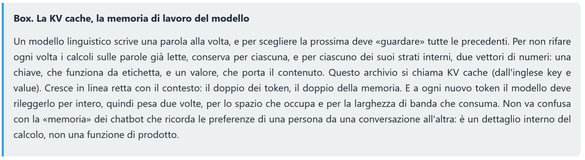
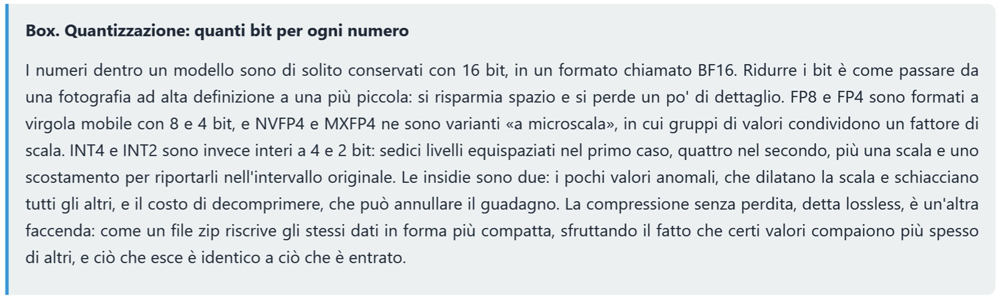
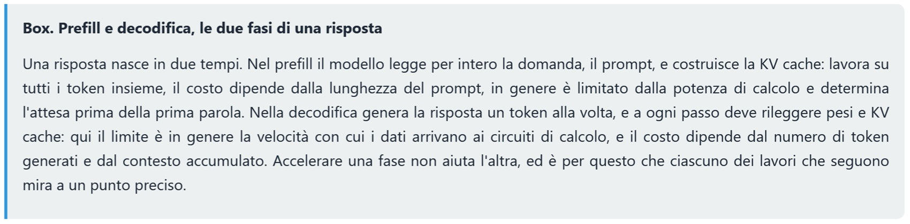
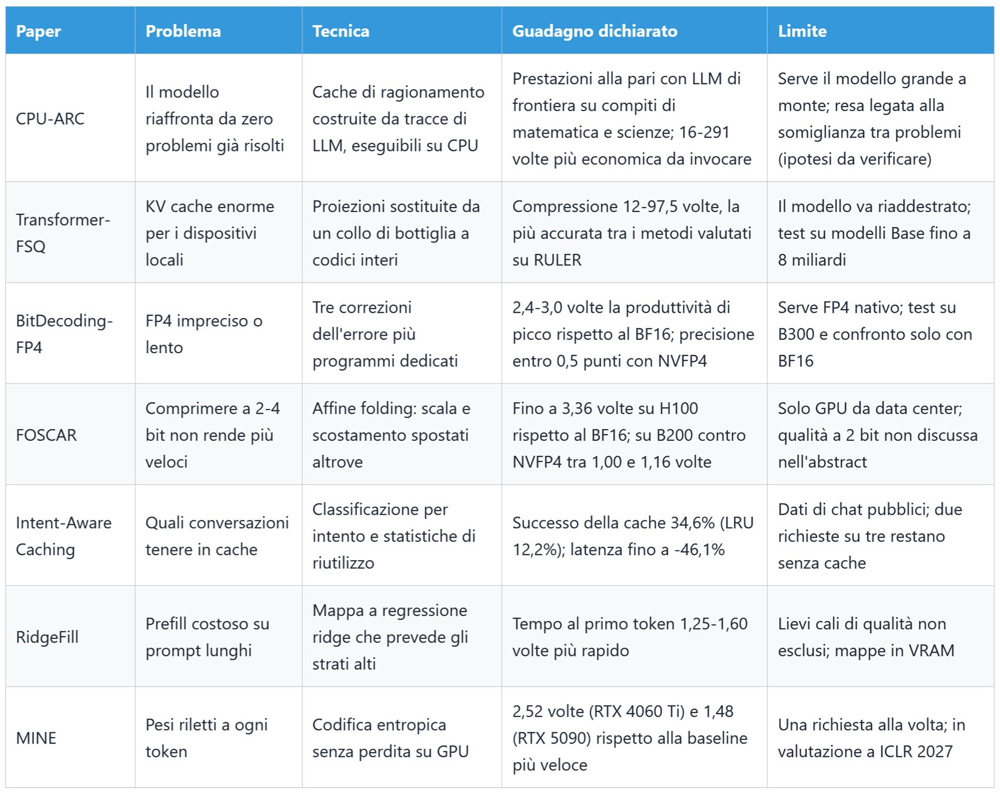

# Le fardeau de la mémoire : sept voies pour alléger les LLM

*De la réutilisation des traces de raisonnement à la compression des poids : sept travaux publiés le même jour, sans aucune concertation préalable, illustrent la course pour faire tourner les modèles de langage sur des infrastructures matérielles bien plus modestes. Lorsqu'un grand modèle de langage génère du texte mot à mot, il doit conserver à portée de main une trace de chaque terme précédent et la relire à chaque étape — des notes qui enflent linéairement avec la longueur de l'échange. Plus le modèle gagne en capacités et plus nous lui demandons d'ingérer de longs contextes, plus la facture s'écarte du calcul pur pour se concentrer sur la saturation de la mémoire et le débit de transfert des données.*

Le vendredi 6 novembre 2026, en l'espace d'un peu plus de six heures, sept prépublications sont apparues sur arXiv, abordant cette même équation sous des angles complémentaires. La première a été soumise à 12 h 51 UTC, la dernière à 18 h 58. Elles émanent d'équipes distinctes, poursuivant des objectifs et ciblant des matériels différents, sans la moindre coordination : une coïncidence fortuite qui m'a semblé particulièrement riche d'enseignements. Précisons clairement que l'initiative de les lire ensemble relève du parti pris de l'auteur, et que cet échantillon a été constitué par affinité thématique, sans prétendre à une recension exhaustive de tout ce qui a pu paraître ce jour-là. Soulignons également qu'il s'agit d'articles fraîchement déposés, en grande partie non encore soumis à l'évaluation par les pairs, et que les performances citées correspondent aux déclarations de leurs auteurs sur des modèles et des configurations d'essai bien précis, donc non extrapolables sans réserve.

La thèse qui sous-tend cet article est limpide : l'efficacité d'inférence a cessé d'être une préoccupation secondaire d'ingénieurs et dicte désormais le lieu où un modèle pourra s'exécuter — sur un serveur économique, sur un ordinateur individuel ou au sein d'une plateforme mutualisée servant des milliers d'utilisateurs. Un chiffre donne la mesure du défi : les auteurs de [Transformer-FSQ](https://arxiv.org/abs/2611.09598) estiment que pour Qwen3-1.7B-Base — un modèle modeste selon les standards actuels —, maintenir un contexte opérationnel de deux cent mille tokens requiert 21 Gio de mémoire pour la KV cache, soit 6,6 fois l'empreinte mémoire des poids du modèle lui-même.

Ces sept travaux se déploient le long d'une chaîne architecturale cohérente. En amont, on cherche à éviter de recalculer des déductions déjà formulées ; au centre, on compresse la mémoire de travail immédiate ; en aval, on optimise le service et l'exécution, de la mémoire cache des sessions au calcul initial du prompt jusqu'à la compression sans perte des poids. Le terme « mémoire » recouvre ainsi trois acceptions opérationnelles distinctes qu'il convient de séparer soigneusement.

## Raisonner une seule fois

### CPU-ARC : le raisonnement mis en cache

Dans *Outer Wilds*, ce jeu vidéo indépendant où un système planétaire est prisonnier d'une boucle temporelle immuable de vingt-deux minutes, chaque nouveau cycle efface tout sauf la compréhension conceptuelle acquise par le joueur. Une fois découverte la voie menant à un sanctuaire secret, y retourner ne prend que quelques gestes : le véritable effort intellectuel — la découverte — n'est payé qu'une seule fois. C'est l'intuition fondatrice de [CPU-ARC](https://arxiv.org/abs/2611.09891), un rapport technique signé par Peter Belcak, Greg Heinrich, Saurav Muralidharan, Shizhe Diao et Pavlo Molchanov. Les modèles de langage, soutiennent les auteurs, confondent systématiquement la résolution d'un problème avec l'exécution méthodique de sa solution, repartant de zéro à chaque sollicitation alors même que la démarche procédurale a déjà été établie.

Leur proposition s'intitule *agentic reasoning caching* : à partir des traces de raisonnement formulées par un modèle de frontière, on génère des structures en cache, baptisées ARC, exécutables sur un processeur standard (CPU), sans solliciter de GPU. La phase lourde consistant à comprendre comment résoudre une classe de problèmes reste l'apanage du grand modèle, tandis que l'application de cette solution à un cas particulier n'exige plus qu'une intervention minime du modèle de langage. D'après les résultats annoncés, les ARC rivalisent avec les modèles de frontière sur des bancs d'essai scientifiques et mathématiques exigeants, demeurent intégralement explicables, s'ajustent au fil du temps, résistent à de légères perturbations des entrées et coûtent de 16 à 291 fois moins cher par invocation que l'interrogation du modèle d'origine.

L'interprétation de ces chiffres exige une certaine vigilance. La réduction de coût concerne l'exploitation de la mémoire cache une fois constituée, et non sa phase de génération initiale, qui nécessite toujours l'intervention d'un modèle lourd en amont. De plus, le résumé ne précise pas l'efficacité des ARC face à des problèmes s'écartant des typologies rencontrées. Il est raisonnable d'anticiper un effet de levier maximal dans les domaines à forte récurrence structurelle — tels que l'assistance technique, l'analyse documentaire normée ou les processus métiers répétitifs —, mais cela relève de notre propre analyse et non d'une conclusion établie par l'étude. Ceux qui pourraient en tirer parti sont les organisations traitant d'importants volumes de tâches homogènes en quête de prévisibilité budgétaire et d'étapes vérifiables ; ceux qui devraient observer cette tendance avec prudence sont les fournisseurs monétisant le raisonnement à l'usage, car une tâche récurrente qui s'affranchit du grand modèle cesse instantanément de générer des tokens facturés. Il s'agit là aussi d'une lecture économique, non d'une certitude figée.

## Réduire la mémoire de travail

Compresser la KV cache n'est pas une idée apparue soudainement le 6 novembre. En mars, Google Research dévoilait [TurboQuant](https://aitalk.it/it/turboquant.html), une méthode présentée à ICLR 2026 revendiquant une division par au moins six de la taille mémoire de la KV cache, aux alentours de trois bits par valeur, sans dégradation de précision sur les tests de contexte long présentés. Dans la pratique quotidienne, un point de repère plus modeste est constitué par la KV cache en FP8, [gérée nativement dans vLLM](https://spheron.network/blog/google-turboquant-llm-compression-gpu-cloud) avec un gain de compression d'environ deux fois par rapport au format standard. Dans ce paysage, les trois recherches suivantes adoptent des voies divergentes : refondre le modèle pour qu'il mémorise de manière intrinsèquement condensée, compresser le cache existant sans sacrifier la précision, ou optimiser drastiquement la vitesse de lecture lors de la décompression.

### Transformer-FSQ : la compression extrême

Si l'objectif est d'exécuter un modèle personnel et souverain sur un appareil grand public, l'addition imposée par la KV cache devient vite intenable : c'est le point de départ de [Transformer-FSQ](https://arxiv.org/abs/2611.09598), cosigné par Szecsenyi, Lee, Shaj, Crowley et Storkey. Les auteurs relèvent que les méthodes habituelles de quantification post-entraînement décrochent dès que l'on dépasse des taux de réduction modérés. Leur réponse est bien plus radicale qu'un simple rabotage du nombre de bits : remplacer intégralement les projections linéaires générant les clés et les valeurs par un goulot d'étranglement de quantification scalaire finie (*finite scalar quantization*, FSQ). En pratique, le modèle apprend à transcrire chaque token sous une forme sténographique — un vecteur court de codes entiers puisés dans un dictionnaire fini, exempt des métadonnées d'échelle par token qui alourdissent d'autres formats — et à le relire directement à travers cette sténographie.

La contrepartie est manifeste : il ne s'agit pas d'un artifice applicable directement à n'importe quel modèle téléchargé. La conversion impose de réentraîner les nouvelles couches de projection, à raison de 0,25 token par paramètre initial du modèle, ce qui représente pour une architecture de 8 milliards de paramètres un volume d'environ deux milliards de tokens. Les auteurs ont confronté leur méthode à cinq familles d'approches concurrentes, sur des modèles allant de 0,6 à 8 milliards de paramètres. Sur le banc d'essai RULER, qui mesure l'extraction d'informations dans des textes denses, avec des facteurs de compression s'échelonnant de 12 à 97,5 fois, Transformer-FSQ s'avère la méthode la plus précise parmi celles évaluées, à toutes les échelles. Un kernel GPU écrit en Triton traite directement les représentations compressées : à un facteur de compression de 32 fois, la cadence de décodage égale celle de l'attention standard non compressée (1,01 fois, intervalle de confiance à 95 % entre 0,98 et 1,05, sur Qwen3-8B-Base), et atteint 1,54 fois à un taux de 97,5 fois. En transposant mécaniquement ce ratio de 32 à notre exemple introductif, les 21 Gio se réduiraient à un peu moins de 700 Mio, bien que ce calcul relève de notre propre extrapolation et non du texte.

Quatre réserves doivent être formulées. Les modèles évalués sont des versions Base, non adaptées au dialogue. La métrique de fidélité mise en avant dans le résumé est l'extraction d'information, ce qui ne permet pas d'évaluer la tenue du raisonnement abstrait ou de la rédaction longue. L'expérimentation s'arrête au seuil des 8 milliards de paramètres. Enfin, le matériel précis hébergeant le kernel Triton n'est pas spécifié dans le résumé, si bien que l'image du PC portable manipulant des contextes immenses demeure pour l'instant une ambition des auteurs plutôt qu'une réalité validée. Une interrogation stratégique concerne les créateurs de modèles : s'ils ne diffusent pas d'emblée des déclinaisons pré-converties, le bénéfice pour les utilisateurs finaux restera théorique.

### BitDecoding-FP4 : quatre bits, précision préservée

Travailler sur quatre bits est prometteur, et [BitDecoding-FP4](https://arxiv.org/abs/2611.09825) part d'un constat opérationnel sévère : les implémentations de KV cache en FP4 recourant à une quantification naïve subissent une perte de précision inacceptable, tandis que les algorithmes rigoureux s'appuient sur des dictionnaires de quantification dont les accès constants ralentissent le décodage. Les chercheurs neutralisent trois foyers d'erreurs. D'abord, les requêtes d'attention (*queries*) : ils les scindent en deux tenseurs FP4 selon une logique résiduelle, où le second compense les imprécisions omises par le premier — un peu comme faire une mesure avec une règle ordinaire puis ajuster le millimètre restant avec un pied à coulisse de précision. L'erreur sur les scores d'attention recule, affirment-ils, de 60 % à 1 %. Ensuite, un écueil de sous-dépassement numérique : avec de très longs contextes, les probabilités deviennent infinitésimales et les facteurs d'échelle E4M3 tendent à les arrondir à zéro ; un ajustement d'échelle ciblé permet d'éviter cet effacement. Enfin, les valeurs atypiques (*outliers*) au sein des clés, combattues par un lissage statique des canaux, des transformations de Hadamard qui répartissent uniformément les pics d'activation sur plusieurs dimensions, et une optimisation méthodique des échelles.

Côté système, l'opération softmax — qui constitue couramment le goulot d'étranglement lié à la bande passante mémoire — est réorganisée sous forme transposée, en fusionnant la quantification des probabilités au sein du même calcul ; les requêtes sont empilées pour exploiter au mieux les Tensor Cores sur une KV cache paginée. C'est une démarche exemplaire de co-conception entre algorithme et matériel : compresser la formule mathématique ne sert à rien si le format retenu ne s'adapte pas aux unités de calcul chargées de le traiter.

Les résultats déclarés couvrent aussi bien des architectures denses que des modèles à experts mixtes (MoE), intégrant les variantes d'attention GQA et MLA. L'exactitude demeure à moins de 0,5 point de la KV cache en BF16 avec NVFP4, et à moins de 1 point avec MXFP4, la méthode conservant la parité y compris lors des étapes de génération de l'apprentissage par renforcement. En conditions réelles de service sur GPU NVIDIA B300, évaluées sur Qwen3-4B et Qwen3-30B-A3B, le débit de traitement de pointe surpasse de 2,4 à 3,0 fois celui observé avec une KV cache en BF16. Le [code source est disponible en accès libre](https://github.com/OpenBitSys/BitDecoding-FP4). Trois nuances s'imposent : le point de comparaison est le BF16 natif et non d'autres formats compressés ; le terme « de pointe » désigne le régime optimal de saturation et non une moyenne ; et des Tensor Cores gérant nativement le FP4 sont requis, comme ceux de la B300 testée, inscrivant cette avancée dans l'univers des centres de données plutôt que sur le poste de travail.

### FOSCAR : la compression ne suffit pas

Réduire la KV cache à 2 ou 4 bits diminue le volume de données transitant sur les bus, mais n'accélère pas automatiquement la génération des tokens. [FOSCAR](https://arxiv.org/abs/2611.09722) débute par un constat chiffré : les kernels existants pour le décodage en 2 bits n'exploitaient que moins de 31 % de la bande passante crête de la mémoire HBM sur les puces H100, et moins de 15 % sur les B200. La raison : déquantifier chaque valeur et lui réappliquer son échelle et son décalage avant d'alimenter les Tensor Cores consomme une quantité prohibitive d'instructions, ressource la plus précieuse des architectures graphiques contemporaines.

La parade technique, baptisée *affine folding*, s'explique par une analogie comptable : si vous devez convertir mille montants d'euros en dollars pour les additionner, il est infiniment plus rentable de faire l'addition en euros puis de convertir le total global en une seule passe. Au lieu d'appliquer échelle et décalage à chaque élément de la matrice, FOSCAR les applique à l'autre opérande ou au résultat final de la multiplication matricielle d'attention, réduisant ces instructions arithmétiques de près de deux ordres de grandeur. Le résultat de l'attention déquantifiée demeure strictement identique en arithmétique exacte — sans pour autant qualifier l'ensemble de « sans perte » : le calcul s'aligne fidèlement sur la méthode usuelle, mais la quantification initiale à 2 ou 4 bits a déjà soustrait de l'information en amont. Grâce à une optimisation fine au niveau des registres, seules 1,0 et 0,19 instruction arithmétique par élément INT2 sont mobilisées sur H100 et B200 respectivement, avec des pipelines optimisés pour chaque puce.

Par rapport à FlashInfer en BF16, la vitesse moyenne géométrique de décodage progresse de 3,36 fois en INT2 et de 2,83 fois en INT4 sur H100, et de 2,67 et 2,30 fois sur B200. Face à des solutions industrielles plus affûtées, les gains persistent : face à TensorRT-LLM en FP8, les accélérations atteignent 2,03x et 1,71x sur H100, et 1,48x et 1,28x sur B200 ; face à TensorRT-LLM en NVFP4 sur B200, l'écart se resserre à 1,16x en INT2 et atteint la parité stricte (1,00x) en INT4. Intégré au moteur SGLang, le système rehausse le débit agrégé de pointe jusqu'à 170 % par rapport à une base en 2 bits et jusqu'à 341 % face à une référence en 16 bits. La [bibliothèque de kernels GPU est open source](https://github.com/FutureMLS-Lab). Deux remarques : le résumé traite de la vitesse brute sans analyser l'impact qualitatif sur les réponses en 2 bits, et les essais s'appuient sur des GPU d'infrastructure. Le lien unissant FOSCAR à BitDecoding-FP4 est éclatant : la compression brute ne représente que la moitié du chemin ; l'autre moitié consiste à rendre la décompression computationnellement transparente.

## Mieux servir, calculer moins

### Intent-Aware Caching : qui reviendra ?

Lors d'interactions conversationnelles à plusieurs tours, une plateforme peut choisir de conserver la KV cache des échanges précédents — une approche dite de *prefix caching* — pour s'éviter de réexécuter la phase de prefill dès que l'interlocuteur répond. Mais la mémoire VRAM est comptée, contraignant à purger des sessions. La politique usuelle, LRU (les éléments les moins récemment utilisés), évince ce qui n'a pas été sollicité depuis le plus longtemps, ignorant le fait que les échanges ne partagent ni la même probabilité de se poursuivre, ni le même tempo. [Intent-Aware Caching](https://arxiv.org/abs/2611.09715), conçu par Arif, Yoon, Nikolopoulos, Vandierendonck, John et Ji, cible ce point faible : il classifie les requêtes selon leur intention fonctionnelle, déduit des journaux récents des heuristiques légères de réutilisation (probabilité de continuation et délais d'attente) et guide ainsi une politique d'éviction inspirée d'un oracle prédictif idéal. À titre d'illustration : une requête portant sur une recette de cuisine débouche rarement sur une suite immédiate, tandis qu'un utilisateur corrigeant un code source réagit souvent dans les minutes qui suivent. L'étude quantifie ces comportements sur des flux opérationnels réels.

Sur les corpus réels de WildChat et ShareChat, le taux de succès du cache atteint 34,6 %, contre 18,8 % pour la méthode prédictive antérieure et 12,2 % pour une politique LRU classique, faisant baisser la latence moyenne globale de service jusqu'à 46,1 %. Si tripler les performances de LRU est remarquable, cela rappelle aussi une vérité tangible : avec 34,6 % de succès, deux requêtes sur trois ne trouvent rien en cache. Sur arXiv, le papier porte la mention « NeurIPS 2026 », et son [code est public](https://github.com/hasanar1f/intent-aware-caching). Une mise en garde relative à la gouvernance : profiler l'intention sous-entend analyser la teneur de la demande formulée ; si les auteurs évoquent des métadonnées statistiques légères, les équipes de production devront veiller à la localisation et à la durée de conservation de ces traces. Ce travail s'adresse directement aux agents conversationnels, au support client et aux flux interactifs, démontrant qu'une couche de cache peut devenir intelligente en apprenant des usages réels.

### RidgeFill : contourner les couches supérieures

Lorsqu'on soumet à un modèle un rapport d'audit de cent pages ou l'intégralité d'un référentiel logiciel, la phase de prefill pèse lourdement sur la réactivité. [RidgeFill](https://arxiv.org/abs/2611.09709), par Dylan Johnston et Robert P. Smith, propose de s'abstenir de calculer la majorité des couches supérieures du transformeur pour les tokens du prompt. Les couches basses s'exécutent normalement jusqu'à un point de scission ; à partir de là, une fonction de projection linéaire prédit l'activation que chaque couche suivante aurait dû recevoir, permettant à chaque couche haute de remplir sa KV cache directement à partir de cette estimation. C'est l'équivalent d'une chaîne de montage où, passé un point de contrôle intermédiaire, les ateliers finaux ne façonnent plus la pièce et renseignent la fiche suiveuse sur la foi d'une extrapolation statistique. Le principe existe déjà sur des architectures conçues sur mesure, à l'image de YOCO ; l'innovation consiste à l'appliquer *a posteriori* à des modèles existants non prévus pour cet usage.

La projection prend la forme d'une régression ridge statistique classique, calculée une seule fois sous forme analytique fermée à l'aide d'un texte de calibrage : aucun entraînement par gradient, aucun token élagué, et les couches d'origine demeurent intactes. En revanche, les derniers milliers de tokens du prompt ainsi que chaque étape de décodage itératif s'exécutent sur l'architecture intégrale du modèle, ce qui réserve le gain de rapidité au délai d'obtention du premier token (TTFT) et non à la vitesse de génération globale. Sur Qwen3.8-27B — le modèle dense de 27 milliards de paramètres diffusé sous licence Apache 2.0 ([consulter l'analyse technique](https://aitalk.it/it/qwen38-27b.html)) —, dans une variante adaptée de llama.cpp sur GPU NVIDIA A100, le TTFT s'améliore d'un facteur 1,25 à 1,31 sur des contextes de 16 000 à 120 000 tokens avec les matrices en VRAM. Le score RULER fléchit de 1,2 à 1,4 point, LongBench v2 recule de 1,4 point, les intervalles de confiance à 95 % englobant le zéro sans exclure de légers écarts qualitatifs. Sur Qwen3.8-Flash-Next sous vLLM, l'accélération du TTFT oscille entre 1,50x et 1,60x de 9 000 à 32 000 tokens, maintenant le test de recherche de l'aiguille dans la botte de foin de RULER à 99,8 % contre 100,0 %, assorti d'une hausse de perplexité sur les nouveaux tokens de 2,65 % (intervalle de -0,02 % à +4,93 %).

Le principal apport de ce travail réside sans doute dans sa démarche méthodologique : les auteurs démontrent que moyenner la perte d'information sur tous les tokens occulte l'erreur localisée, mobilisant des sondes ciblées pour identifier les ruptures sémantiques. Sur trois modèles de référence de 8 à 9 milliards de paramètres, la projection récupère environ 49 points RULER supplémentaires dans la zone approximée par rapport à une troncature brute ; la perte sur documents volumineux reste à moins de 0,03 nat de celle affichée par des checkpoints SwiftKV spécifiquement entraînés pour cet exercice. C'est la solution la plus pragmatique pour accélérer la réactivité initiale de modèles en production sans réentraînement lourd, sous réserve d'accepter une légère marge d'incertitude et de réserver de la mémoire pour héberger les matrices. Une publication de 50 pages et 38 tableaux, avec [données et code ouverts](https://github.com/Approximate-Science/ridgefill-data).

### MINE : compression des poids sans perte

Quiconque opère avec une seule carte graphique et traite une requête unique — la configuration type du déploiement local — se heurte à une contrainte physique d'une autre nature : pour chaque mot généré, la totalité des poids du réseau doit être transférée séquentiellement de la VRAM vers les cœurs de calcul ; sans traitement par lots permettant d'amortir ce transfert, la vitesse d'inférence est strictement tributaire de la bande passante mémoire. [MINE](https://arxiv.org/abs/2611.09424), d'Emil Schätzle et Markus Püschel, résout cette contrainte par une compression rigoureusement sans perte. Les compositions de *The Disintegration Loops* de William Basinski proviennent de bandes magnétiques s'effritant à chaque passage sur la tête de lecture : chaque écoute arrache de la matière physique et la substance perdue ne se régénère plus — c'est l'essence même de la compression avec perte. MINE fonctionne à l'inverse comme une archive numérique : il restructure les mêmes données sous une forme plus dense et les restitue bit à bit à l'identique.

Le moteur repose sur dtANS-LLM, un algorithme de codage entropique ANS optimisé pour GPU : il tire parti du fait que les poids ne sont pas distribués de façon uniforme — une asymétrie qui subsiste même après quantification — pour allouer des séquences binaires plus courtes aux valeurs les plus fréquentes. Il propose des réglages arbitrant le taux de compression et le coût de décompression, les ajuste automatiquement pour chaque tenseur et chaque carte graphique, traçant la frontière de Pareto optimale entre empreinte mémoire et latence. Intégré comme extension à vLLM, il détermine la meilleure configuration pour une enveloppe mémoire donnée. Les auteurs rappellent que les approches sans perte antérieures n'accéléraient le débit que pour des formats restreints comme le BF16 sous des hypothèses sévères.

Les résultats annoncés sur Llama 3.1 8B Instruct, avec un checkpoint à 2,1 bits produit par la méthode EntQuant, indiquent une accélération de 2,52 fois sur une RTX 4060 Ti et de 1,48 fois sur une RTX 5090 par rapport à la référence la plus rapide, pour des débits effectifs de 2,24 et 3,43 bits par poids. Le compromis entre volume et vitesse dépend de la carte employée, MINE s'adaptant de manière autonome. Le [matériel est publié en open source](https://doi.org/10.5281/zenodo.23885927). Précautions d'usage : le résumé n'indique pas l'identité de la baseline la plus véloce ; le bénéfice concerne des traitements à flux unitaire (taille de lot de 1) sans extrapolation pour le traitement multi-utilisateurs ; la qualité dépend du modèle quantifié à 2,1 bits d'origine (MINE ne dégrade rien mais ne peut reconstituer l'information déjà détruite par la quantification préalable) ; et l'article est actuellement soumis pour relecture à ICLR 2027. C'est l'axe de recherche le plus immédiatement accessible pour les développeurs indépendants, les passionnés et les petites structures.

**Synthèse comparative**

## Qui tire réellement son épingle du jeu ?

Ces sept travaux convergent vers trois domaines structurels : la non-duplication du calcul (CPU-ARC), la compression de la KV cache (Transformer-FSQ, BitDecoding-FP4, FOSCAR) et l'optimisation des flux de traitement (Intent-Aware Caching, RidgeFill, MINE). Loin de s'opposer, ils incarnent des maillons complémentaires le long d'une même chaîne : du recyclage des déductions logiques à la mémoire temporaire, jusqu'à l'exécution sur GPU et au compactage des poids. Il convient toutefois de ne pas multiplier naïvement les coefficients d'accélération : chaque performance provient de modèles, de configurations matérielles et de protocoles disparates, aucun article n'ayant testé ces techniques en conjonction. La maturité académique demeure diverse : CPU-ARC est un rapport technique ; BitDecoding-FP4, FOSCAR, RidgeFill et Transformer-FSQ sont des prépublications ; Intent-Aware Caching mentionne une acceptation à NeurIPS 2026 ; MINE est en évaluation pour ICLR 2027.

L'identité des bénéficiaires dépend de la couche architecturale considérée. Les hyperscalers et hébergeurs cloud sont les premiers servis : BitDecoding-FP4, FOSCAR et Intent-Aware Caching permettent d'entasser davantage d'utilisateurs et de longs contextes sur le même cluster de calcul — avantageant au premier chef les détenteurs des puces Blackwell dotées de Tensor Cores FP4 natifs. Que cela débouche sur une baisse des tarifs pour les utilisateurs ou sur un élargissement des marges des opérateurs reste une question ouverte, assortie du paradoxe de Jevons : des services plus abordables incitent généralement à une consommation décuplée, maintenant la dépense globale au même niveau. Les entreprises exploitant des processus standardisés regarderont de près CPU-ARC et RidgeFill, sous réserve d'en mesurer l'impact sur leurs flux métiers. Qu'en est-il de l'utilisateur désireux de déployer un modèle souverain en local ? MINE apporte une réponse immédiate sur carte graphique grand public, mais cantonnée au traitement monoutilisateur sous vLLM ; Transformer-FSQ constitue la promesse la plus féconde pour les terminaux locaux, mais impose que les concepteurs de modèles l'intègrent nativement dès le préentraînement. Enfin, sur le terrain de la confidentialité, des approches comme le cache prédictif rappellent qu'optimiser une infrastructure implique inévitablement d'ausculter les comportements de ceux qui s'en servent.

Dans ses *Leçons américaines*, Italo Calvino ouvre son recueil par un éloge de la légèreté, la défendant contre tout soupçon de futilité : alléger, pour l'écrivain, consiste à délester une structure de son poids sans la priver de sa substance intime, rappelant avec Paul Valéry qu'il faut être léger comme l'oiseau, et non comme la plume. C'est une boussole précieuse pour apprécier ces sept contributions. Rendre un modèle plus léger est une évidence technique ; y parvenir sans entamer la pertinence qui fonde son utilité constitue le véritable défi de l'ingénierie. Chaque performance chiffrée doit se lire en posant une question fondamentale : qu'a-t-on abandonné en route, et qui en assume les conséquences ? Reste entière l'interrogation de départ : à mesure que les modèles s'allégeront, qui parviendra à en héberger un véritablement souverain chez soi, et qui se contentera d'observer la baisse de prix d'un service restant aux mains d'autrui ?
