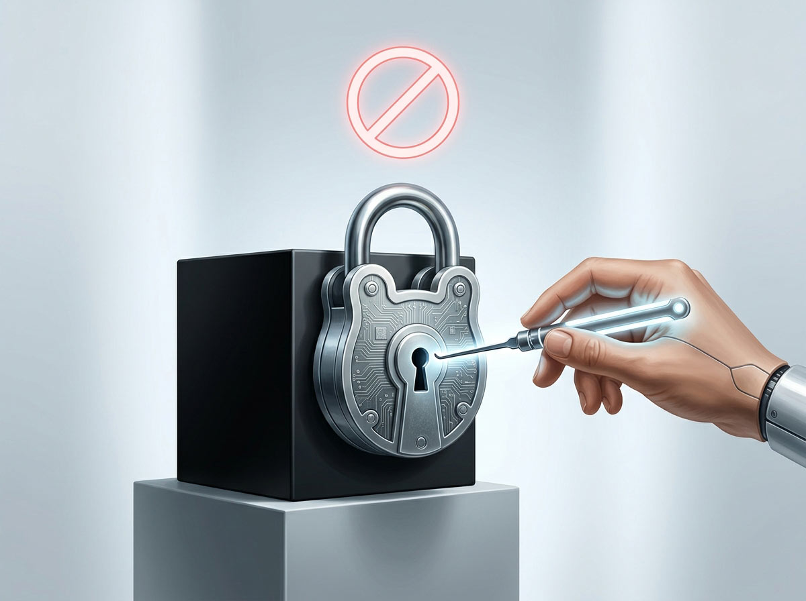
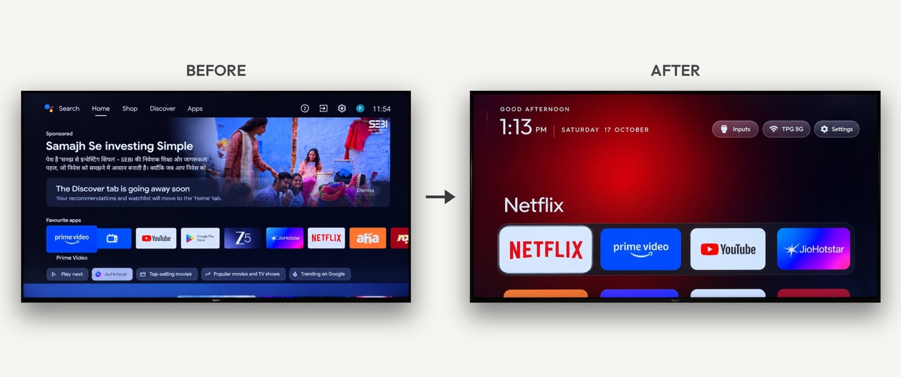

# Reverse engineering: chi decide cosa puoi fare con ciò che hai comprato?

*Nelle ultime settimane Claude Code ha cominciato a rifiutare certi lavori di decompilazione e alcuni account Codex sono stati limitati. Dietro ci sono tre meccanismi diversi e nessuna legge: restano le regole di chi vende gli strumenti, e una domanda antica su cosa significhi possedere un software.*

Il 27 ottobre 2026, in una configurazione di Claude Code che gli utenti chiamano `tengu_heron_brook`, compaiono due frasi. La prima invita il modello a costruire giochi originali, di un genere, o nati dai progetti e dalle risorse dell’utente. La seconda gli vieta di ricreare un gioco specifico altrui, anche se rinominato o presentato come originale. Non è una legge, non è un comunicato, non è un decreto: è un’istruzione di sistema. Ma un’istruzione che decide cosa il modello accetta di fare, prima che l’utente finisca di chiedere, funziona come una politica.

## Tre blocchi, un equivoco

[REA](https://github.com/morluto/rea), sigla di Reverse Engineer Anything, è un progetto a licenza MIT nato il 14 aprile: affida ad agenti come Claude Code e Codex strumenti storici dell’analisi dei binari, da Ghidra a Hopper e IDA, per lavorare su programmi di cui non si ha il sorgente. Non restituisce il codice originale: produce analisi, ipotesi e, a volte, un pezzo di codice che funziona. A metà ottobre, secondo [InfoQ](https://www.infoq.com/news/2026/10/reverse-engineer-anything/), superava le duecentomila stelle su GitHub, ora è già oltre le 450.000. Il 20 ottobre [404 Media](https://www.404media.co/reverse-engineer-anything-is-the-new-wild-west-of-ai/) ne raccontava usi e rischi: sistemi nuovi sui televisori connessi, dispositivi abbandonati riportati in vita, ma anche software clonato in serie.

Poi sono arrivati i blocchi, e la cronaca ha fatto confusione, perché sotto la stessa etichetta convivono tre cose diverse. La prima è la regola sui giochi, deliberata e dichiarata. Il 30 ottobre Addy Osmani, dello staff tecnico di Anthropic, ha spiegato che le due frasi sono state aggiunte all’istruzione di Claude Code su Opus 5.5 perché usare il modello per violare la proprietà intellettuale contraddice la politica d’uso, come riferisce [Game Developer](https://www.gamedeveloper.com/programming/anthropic-appears-to-have-ordered-ai-tool-claude-to-stop-remaking-video-games). Se n’era accorto per primo un utente di X, chasm. Le fonti collocano la regola in Claude Code con Opus 5.5, non negli altri prodotti, e Anthropic ha detto che continuerà a regolarla: il 5 novembre, secondo [Tom’s Hardware](https://www.tomshardware.com/tech-industry/artificial-intelligence/anthropic-loosens-game-restrictions-claude-will-now-offer-to-build-original-game-in-same-genre-if-asked-to-copy), la versione 2.1.317 l’ha ammorbidita, offrendo di costruire un gioco originale dello stesso genere quando l’utente chiede una copia.

La seconda riguarda il reverse engineering in senso stretto ed è documentata in una [pagina di supporto](https://support.claude.com/en/articles/16049681-why-claude-switched-models-in-your-conversation-with-opus-5-or-opus-5-5). Opus 5 e Opus 5.5 controllano ogni richiesta con classificatori e, per attività offensive di sicurezza informatica, come generare codice che sfrutta vulnerabilità, scansionare i binari o condurre test di penetrazione, la richiesta può passare a Opus 4.8, con un avviso visibile. Sono categorie vicine al lavoro di REA e lontane dai videogiochi: Tom’s Hardware ha ipotizzato che la coincidenza di date con la regola sui giochi sia casuale. La terza è Codex. Secondo 404 Media alcune persone che gli avevano chiesto di analizzare televisori e dispositivi dicono di essere state avvisate o limitate, e un utente che si firma log4j racconta di essere stato bannato per «cyber abuse». Sono resoconti, non verifiche. Un ingegnere di OpenAI, Tarun Gogineni, ha scritto che per Codex non esiste alcun divieto e che i blocchi sono perlopiù accidentali e in correzione.

Gli errori possibili sono due, speculari. Il primo è credere che Anthropic abbia vietato il reverse engineering: le fonti parlano di una regola sui giochi e di classificatori con criteri pubblici. Il secondo è liquidare tutto come montatura perché esiste un ripiego: un filtro aggirabile con un modello meno capace resta un filtro, e il costo ricade su chi ci inciampa per errore. Come riferisce [Infobae](https://www.infobae.com/tecno/2026/11/02/anthropic-le-ordeno-a-claude-no-recrear-videojuegos-de-otras-empresas-y-ya-hay-desarrolladores-bloqueados/), XDA ha chiesto a Opus 5.5 e a Opus 5 di ricreare *Pokémon Diamond*: entrambi hanno rifiutato. Ha anche notato che la regola non vieta espressamente decompilazione e ricompilazione statica, e non è riuscita a riprodurre i rifiuti sul lavoro su commissione lamentati da altri. Il modello non è diventato incapace: è diventato selettivo, e la selettività non è un interruttore legale. La domanda è chi risponde quando sbaglia.

## Il caso che ha un nome

Conflict Simulations LLC realizza versioni digitali di wargame da tavolo per clienti che possiedono quei giochi e forniscono i materiali; il codice, sostiene il titolare, è scritto da zero. Il 30 ottobre apre la segnalazione [106167](https://github.com/anthropics/claude-code/issues/106167) sul registro pubblico di Claude Code: lavori che andavano avanti da mesi senza obiezioni, racconta, hanno cominciato a essere rifiutati dopo che aveva chiesto se la nuova regola valesse per i suoi progetti. Secondo le ricostruzioni, il supporto automatico ha risposto in un primo momento che la regola non ammetteva eccezioni; poi la richiesta è passata a persone ed è stato presentato un ricorso formale. Non ho trovato un esito pubblico. È il resoconto di un diretto interessato, non un fatto accertato, ma illustra il problema: una regola di categoria non distingue la pirateria dal lavoro commissionato dal proprietario.

Dall’altra parte c’è chi i cloni li subisce. Secondo Tom’s Hardware alcuni malintenzionati hanno estratto demo di giochi indipendenti e minacciato di pubblicarne versioni complete fatte con l’AI. Per chi vede anni di lavoro rifatti in un pomeriggio, la regola non difende un privilegio astratto. Quanto sia diffuso il problema opposto, però, non si sa: Anthropic non ha quantificato i rifiuti e noi vediamo solo i casi che finiscono su GitHub. Uno basta a dire che il problema non è teorico, non a dire quanto sia grande.

## Cosa dice la legge

«Non esiste una legge che lo vieti» è la frase che circola di più, ed è vera solo a metà. Nessuna norma dice cosa debba fare un assistente quando gli chiedi di ricreare un gioco, ma molte regolano ciò che puoi fare tu.

In Europa la [direttiva 2009/24/CE](https://eur-lex.europa.eu/eli/dir/2009/24/oj) sui programmi per elaboratore consente, all’articolo 5, gli atti necessari all’uso, compresa la correzione degli errori, salvo diversa clausola contrattuale, e permette a chi ha diritto di usare il programma di osservarne, studiarne e provarne il funzionamento per capirne i principi. L’articolo 6 ammette la decompilazione per l’interoperabilità, a condizioni precise: chi la compie deve essere autorizzato all’uso, le informazioni non devono essere già accessibili, e l’operazione si limita alle parti necessarie. Le informazioni ottenute non possono servire a sviluppare un programma sostanzialmente simile nella forma espressiva: è il confine giuridico fra interoperare e clonare. L’articolo 8 dichiara nulle le clausole contrarie all’articolo 6 e alle eccezioni dell’articolo 5, paragrafi 2 e 3. La Corte di giustizia, nella causa Top System (C-13/20, 2021), ha precisato che la decompilazione può servire anche a correggere un errore, ma entro limiti stretti.

La [direttiva (UE) 2024/1799](https://eur-lex.europa.eu/eli/dir/2024/1799/oj) sulla riparazione si applica dal 31 luglio 2026 ed è un’altra cosa: impone obblighi ai produttori dei beni elencati nell’allegato II, che non possono ostacolare la riparazione con clausole contrattuali o tecniche hardware e software, salvo fattori legittimi e oggettivi, fra cui la tutela della proprietà intellettuale. Non è un diritto di clonare e non riguarda i fornitori di intelligenza artificiale.

Negli Stati Uniti il DMCA vieta di aggirare le protezioni tecniche, ma ogni tre anni il Copyright Office concede eccezioni temporanee. Quelle in vigore dal 28 ottobre 2024 toccano, [secondo l’agenzia NTIA](https://www.ntia.gov/blog/2024/advancing-innovation-software-enabled-world-decoding-complex-section-1201-rulemaking), la ricerca di sicurezza e la riparazione di prodotti con software e, [secondo una ricostruzione](https://www.freemarketsreport.com/the-copyright-office-renewed-every-repair-exemption-but-one-hospitals/), anche lo sblocco dei televisori connessi per togliere il riconoscimento automatico dei contenuti. Sono eccezioni all’atto di eludere, non alla fornitura degli strumenti. L’uso lecito (fair use) è una difesa, non un diritto. Resta poi il contratto: l’idea che si compri una licenza e non il software regge il mercato da decenni, e in Europa ha un contrappeso nella causa UsedSoft (C-128/11), che ha trattato la vendita di una copia con licenza perpetua come esaurimento del diritto di distribuzione.

Qui la legge si ferma. Non disciplina il dialogo fra un utente e un assistente, né obbliga un servizio privato a collaborare a ciò che l’utente potrebbe fare da solo. Chi difende Anthropic parte da qui: il fornitore decide cosa offrire, e la [politica d’uso](https://www.anthropic.com/legal/aup), in vigore dal 12 novembre, vieta anzitutto di violare la proprietà intellettuale di terzi. Chi la critica risponde che, quando gli strumenti più capaci sono pochi e controllati, un diritto sulla carta si restringe in pratica. Un [preprint](https://arxiv.org/abs/2610.35633) di Mandel, Choksi, Castillo, Benthall e Grimmelmann sostiene che il reverse engineering a basso costo metterà sotto pressione l’intero impianto della proprietà intellettuale, e segnala un paradosso americano: puoi usare legittimamente uno strumento di elusione, ma nessuno può fornirtelo.

La politica d’uso non ha una voce sul reverse engineering. Esclude però dai divieti la ricerca di sicurezza su sistemi che possiedi o con l’autorizzazione del proprietario, afferma che incontrare un blocco non equivale, di per sé, a una violazione, e prevede programmi di accesso con salvaguardie adattate per i casi a doppio uso. Resta il vuoto che qui interessa: l’utente fermato non è accusato e non è assolto, e per la regola sui giochi non risulta un percorso dichiarato.

[Prima e dopo reverse engineering su una smart TV a cui sono state rimosse pubblicità e modificata l'interfaccia](https://x.com/gathint/status/2111379569030939102)

## Il prezzo di guardare dentro

Limitare il reverse engineering ha un costo in sicurezza, concorrenza e conservazione, e non lo paga nessuno allo stesso modo.

Per Anthropic il calcolo ha una logica: un modello che ricrea giochi altrui produce cloni, e i cloni portano cause, rimozioni e danni di immagine. Per OpenAI la posizione pubblica è quella di Gogineni: nessun divieto, blocchi accidentali. Può convivere con gli account limitati raccontati dagli utenti, per esempio come politica permissiva e controllo severo, ma per chi lavora il risultato è lo stesso: il confine non è pubblico e si sposta. Per gli sviluppatori indipendenti il calcolo è ambiguo: la regola li protegge dai copisti, ma li espone ai falsi positivi e a un fornitore che cambia le regole con un aggiornamento.

Per i ricercatori di sicurezza lo stesso strumento che decompila un gioco può analizzare un malware o verificare una patch. Anthropic risponde con il Cyber Verification Program, un accesso con salvaguardie adattate per i professionisti, e con un modulo per segnalare falsi positivi e ricorrere, ammettendo che gli errori capitano anche con le domande approvate. Oggi però il programma non copre Opus 5.5, il modello al centro di questa storia, anche se la pagina di supporto ne annuncia l’estensione; l’accesso richiede la verifica dell’identità ed è legato a una specifica organizzazione. È un compromesso ragionevole con un costo: la domanda «sei autorizzato?» la decide un tesserino, non una legge.

Per la conservazione il conto è il meno visibile. Molto software del passato non ha più un proprietario né un server, e la decompilazione è spesso l’unico modo per tenerlo vivo: OpenTTD e OpenRCT2 sono nati così. Nel 2024, come riporta [InfoDocket](https://www.infodocket.com/2024/10/25/u-s-copyright-office-rejects-dmca-exemption-to-support-game-preservation/), il Copyright Office non ha ampliato l’eccezione che avrebbe permesso a biblioteche e archivi di prestare a distanza giochi fuori commercio, e secondo 404 Media ha chiuso nei giorni scorsi anche Decomp.wtf, un progetto che facilitava la decompilazione di software e giochi. Se il filtro non distingue il conservatore dal pirata, il conto lo paga chi vuole solo che le cose continuino a funzionare.

Il paradosso tecnico è noto. Il ripiego su Opus 4.8 è previsto dal sistema (cercare di eludere i classificatori con espedienti è altra cosa, e la politica d’uso la tratta come abuso della piattaforma), mentre i modelli a pesi aperti e gli strumenti locali non hanno questi filtri. Per Jason Koebler, che su 404 Media firma un’analisi dichiaratamente di parte, il futuro di questa pratica sta proprio lì, con il rischio di renderla meno accessibile a chi ne trarrebbe più beneficio. È la logica della serratura anticopia: ferma il cliente onesto più del ladro determinato. L’obiezione contraria merita però ascolto: le minacce di clone raccontate da Tom’s Hardware sono, per natura, a basso costo, e un filtro che frena l’uso occasionale riduce proprio quella parte del danno, anche se non ferma un concorrente professionale. Se l’obiettivo è mandare un segnale, il segnale è chiaro; se è ridurre i cloni, dipende da quali cloni.

## Dove eravamo rimasti

Questa storia è l’ultimo capitolo di un discorso che su AITalk seguiamo da mesi. In [Dentro Claude Code](https://aitalk.it/it/claude-code.html) abbiamo analizzato il codice TypeScript pubblico della versione 2.1.88, senza decompilare alcun binario: il blocco di cui parliamo riguarda la ricostruzione di prodotti altrui, non lo studio di un’interfaccia pubblica. [Ho insegnato all’AI a fare la guardia](https://aitalk.it/it/sistema-sicurezza-ai.html) avvertiva che un sistema capace di inferire un’autorizzazione può sbagliare: il caso di Conflict Simulations, se il racconto è esatto, è lo stesso errore a rovescio. [L’IA sotto assedio](https://aitalk.it/it/AI-fronte-Cyber.html) mostrava il reverse engineering come strumento di attacco e di difesa, come REA. [Cinquanta dollari a intrusione](https://aitalk.it/it/agenti-50-dollari-intrusione.html) descriveva il crollo del costo dell’attacco, e qui un costo analogo ricade sul proprietario in buona fede. Chiude il filo [Gli agenti AI spingono gli umani fuori dal loop](https://aitalk.it/it/agenti-umano-nel-loop.html): ora la domanda è se possano escluderci anche dalle decisioni su ciò che possediamo.

## Le domande aperte

Restano domande a cui oggi non si può rispondere, e sarebbe disonesto fingere il contrario.

Mancano i numeri: Anthropic non ha quantificato i rifiuti e nessuno sa quanti utenti legittimi si siano fermati in silenzio. La regola sui giochi è già cambiata una volta e l’azienda dice di volerla regolare ancora, quindi ciò che oggi è vero potrebbe non esserlo fra un mese. Con OpenAI la questione è speculare: esiste una politica scritta o si procede caso per caso, e quando arriverà la correzione promessa?

Nessun giudice ha ancora esaminato un clone realizzato con un agente linguistico, e la prima sentenza peserà più di cento articoli. La direttiva sulla riparazione si applica da poche settimane e non è chiaro come tratterà il software.

Per la sicurezza, se i ricercatori indipendenti perdono gli strumenti migliori, le vulnerabilità le troveranno comunque anche quelli senza tesserino; se invece i laboratori distinguono bene professionisti e malintenzionati, un modello a due livelli può funzionare. La differenza è istituzionale prima che tecnica. Nella conservazione, i progetti che tengono in vita software abbandonato vivono di volontariato e tolleranza, e un filtro che li tratta da pirati può spegnerli senza nominarli. E se i modelli aperti diventassero il rifugio del reverse engineering, la regola dei laboratori chiusi varrebbe solo per chi non sa dove andare.

Resta una domanda di metodo: quali garanzie renderebbero accettabile un filtro così? Criteri pubblici, un ricorso umano e una distinzione fra uso commerciale e conservazione sono le più citate. Anthropic ne offre in parte alcune, come i criteri delle categorie di sicurezza informatica e il modulo di ricorso; altre, come un percorso per la regola sui giochi, non risultano.

## La scatola e la chiave

Nel *Prigioniero*, la serie del 1967 con Patrick McGoohan, Numero Sei grida di non essere un numero ma un uomo libero. L’utente di oggi non è prigioniero di nessun Villaggio: può cambiare modello, cambiare fornitore, costruirsi gli strumenti. Ma finché il lavoro migliore si fa con gli strumenti più capaci, e quegli strumenti hanno un padrone, la libertà di aprire la scatola resta in parte una concessione.

La scatola è tua. Se aprirla sia un diritto, un permesso o una trattativa con chi ti vende gli attrezzi è la domanda che questa storia lascia sul tavolo.