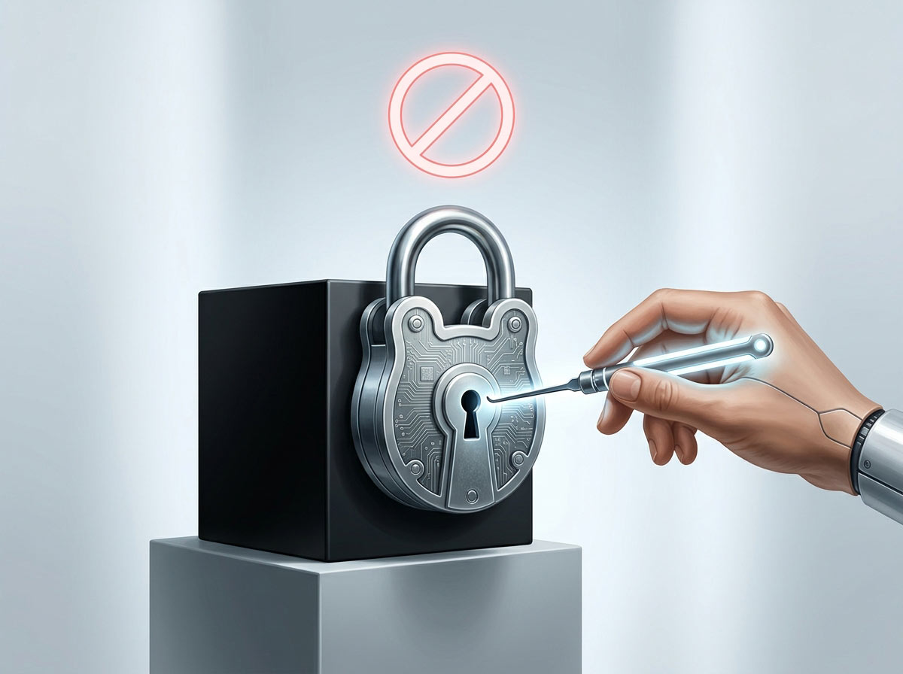
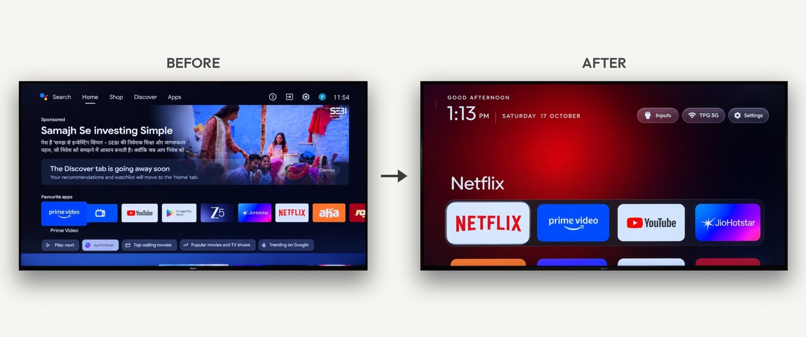

# Reverse Engineering: Wer entscheidet, was du mit dem tun kannst, was du gekauft hast?

*In den letzten Wochen hat Claude Code begonnen, bestimmte Dekompilierungsaufgaben abzulehnen, und einige Codex-Konten wurden eingeschränkt. Dahinter stehen drei verschiedene Mechanismen und kein Gesetz: es bleiben die Regeln derjenigen, die die Werkzeuge verkaufen, und eine alte Frage danach, was es bedeutet, Software zu besitzen.*

Am 27. Oktober 2026 tauchen in einer Claude-Code-Konfiguration, die Nutzer `tengu_heron_brook` nennen, zwei Sätze auf. Der erste lädt das Modell ein, originale Spiele eines Genres oder aus den Projekten und Ressourcen des Nutzers geborene Spiele zu bauen. Der zweiten verbietet es, ein spezifisches Spiel einer anderen Person neu zu erstellen, auch wenn es umbenannt oder als original dargestellt wird. Es ist kein Gesetz, keine Erklärung, kein Dekret: es ist eine Systemanweisung. Aber eine Anweisung, die entscheidet, was das Modell vor dem Ende der Frage des Nutzers zu tun akzeptiert, funktioniert wie eine Richtlinie.

## Drei Blöcke, ein Missverständnis

[REA](https://github.com/morluto/rea), die Abkürzung für Reverse Engineer Anything, ist ein MIT-licenzierter Projekt, das am 14. April entstand: es überträgt Agenten wie Claude Code und Codex historische Binäranalyse-Tools, von Ghidra über Hopper und IDA, um an Programmen zu arbeiten, für die kein Quellcode verfügbar ist. Es gibt keinen Originalcode zurück: es produziert Analysen, Hypothesen und manchmal ein Stück funktionierenden Codes. Mitte Oktober, laut [InfoQ](https://www.infoq.com/news/2026/10/reverse-engineer-anything/), überschritt es 200.000 Sterne auf GitHub, jetzt ist es bereits über 450.000. Am 20. Oktober berichtete [404 Media](https://www.404media.co/reverse-engineer-anything-is-the-new-wild-west-of-ai/) über Anwendungen und Risiken: neue Systeme in verbundenen Fernsehern, wiederaufgelebte verlassene Geräte, aber auch seriell geklontes Software.

Dann kamen die Blockaden, und die Berichterstattung wurde verwirrend, weil unter derselben Etikett drei verschiedene Dinge nebeneinander existieren. Der erste ist die Regel zu Spielen, bewusst und erklärt. Am 30. Oktober erklärte Addy Osmani, aus dem technischen Team von Anthropic, dass die beiden Sätze der Anweisung von Claude Code für Opus 5.5 hinzugefügt wurden, weil die Verwendung des Modells zur Verletzung des geistigen Eigentums der Nutzungsrichtlinie widerspricht, wie [Game Developer](https://www.gamedeveloper.com/programming/anthropic-appears-to-have-ordered-ai-tool-claude-to-stop-remaking-video-games) berichtet. Ein Nutzer von X, chasm, hat es zuerst bemerkt. Die Quellen platzieren die Regel in Claude Code mit Opus 5.5, nicht in anderen Produkten, und Anthropic sagte, es würde weiterhin regulieren: am 5. November, laut [Tom's Hardware](https://www.tomshardware.com/tech-industry/artificial-intelligence/anthropic-loosens-game-restrictions-claude-will-now-offer-to-build-original-game-in-same-genre-if-asked-to-copy), hat Version 2.1.317 sie abgeschwächt, indem sie anbot, ein originales Spiel desselben Genres zu bauen, wenn der Nutzer eine Kopie anfordert.

Der zweite betrifft Reverse Engineering im engeren Sinne und ist in einer [Support-Seite](https://support.claude.com/en/articles/16049681-why-claude-switched-models-in-your-conversation-with-opus-5-or-opus-5-5) dokumentiert. Opus 5 und Opus 5.5 prüfen jede Anfrage mit Klassifikatoren, und für offensive Cybersicherheitsaktivitäten, wie das Generieren von Code, der Schwachstellen ausnutzt, das Scannen von Binärsystemen oder Penetrationstests, kann die Anfrage zu Opus 4.8 wechseln, mit einer sichtbaren Warnung. Das sind Kategorien, die der REA-Arbeit nahe und weit von Videospielen entfernt sind: Tom's Hardware hat vermutet, dass die Übereinstimmung der Daten mit der Spielregel zufällig ist. Der dritte ist Codex. Laut 404 Media sagen einige Leute, die ihn gebeten hatten, Fernseher und Geräte zu analysieren, dass sie gewarnt oder eingeschränkt wurden, und ein Nutzer, der sich log4j nennt, erzählt, für "cyber abuse" gebannt worden zu sein. Das sind Berichte, keine Verifizierungen. Ein OpenAI-Ingenieur, Tarun Gogineni, schrieb, dass für Codex kein Verbot besteht und die Blockaden meist zufällig und in Korrektur sind.

Mögliche Fehler sind zwei, Spiegelbilder. Der erste ist zu glauben, dass Anthropic Reverse Engineering verboten hat: die Quellen sprechen von einer Regel zu Spielen und Klassifikatoren mit öffentlichen Kriterien. Der zweite ist alles als Betrug abzutun, weil es eine Alternative gibt: ein umgehbarer Filter mit einem weniger fähigen Modell bleibt ein Filter, und die Kosten fallen auf denjenigen, der versehentlich darauf stößt. Wie [Infobae](https://www.infobae.com/tecno/2026/11/02/anthropic-le-ordeno-a-claude-no-recrear-videojuegos-de-otras-empresas-y-ya-hay-desarrolladores-bloqueados/) berichtet, hat XDA Opus 5.5 und Opus 5 gebeten, *Pokémon Diamond* neu zu erstellen: beide haben abgelehnt. Es hat auch bemerkt, dass die Regel Dekompilation und statische Neukompilierung nicht ausdrücklich verbietet, und konnte die Ablehnungen bei beauftragter Arbeit, die von anderen beklagt wurde, nicht reproduzieren. Das Modell ist nicht unfähig geworden: es ist selektiv geworden, und Selektivität ist kein gesetzlicher Schalter. Die Frage ist, wer antwortet, wenn es einen Fehler macht.

## Der Fall, der einen Namen hat

Conflict Simulations LLC stellt digitale Versionen von Brettspiel-Wargames für Kunden her, die diese Spiele besitzen und die Materialien liefern; der Code, so der Besitzer, wird von Grund auf neu geschrieben. Am 30. Oktober wurde die Meldung [106167](https://github.com/anthropics/claude-code/issues/106167) im öffentlichen Register von Claude Code eröffnet: Arbeiten, die seit Monaten ohne Einwand liefen, so er, begannen nach der Frage, ob die neue Regel auf seine Projekte anwendbar sei, abgelehnt zu werden. Nach den Rekonstruktionen antwortete der automatische Support zunächst, die Regel kenne keine Ausnahmen; dann wurde die Anfrage an Personen weitergeleitet und eine formale Berufung eingereicht. Ich habe kein öffentliches Ergebnis gefunden. Es ist die Schilderung eines direkten Interessenten, keine festgestellte Tatsache, aber es illustriert das Problem: eine Kategorienregel unterscheidet nicht zwischen Piraterie und vom Eigentümer beauftragter Arbeit.

Auf der anderen Seite gibt es diejenigen, die Klonen ausgesetzt sind. Laut Tom's Hardware haben einige böswillige Akteure Demos von Indiespielen extrahiert und gedroht, komplette Versionen, die mit KI erstellt wurden, zu veröffentlichen. Für diejenigen, die sehen, wie Jahre der Arbeit in einem Nachmittag wiederhergestellt werden, schützt die Regel kein abstraktes Privileg. Wie weit verbreitet das gegenteilige Problem jedoch ist, weiß man nicht: Anthropic hat die Ablehnungen nicht quantifiziert, und wir sehen nur die Fälle, die auf GitHub landen. Eine reicht aus, um zu sagen, dass das Problem nicht theoretisch ist, nicht zu sagen, wie groß es ist.

## Was das Gesetz sagt

"Es gibt kein Gesetz, das es verbietet", ist der am häufigsten zitierte Satz, und er ist nur zur Hälfte wahr. Keine Norm sagt, was ein Assistent tun soll, wenn man ihn bittet, ein Spiel neu zu erstellen, aber viele regeln, was du selbst tun kannst.

In Europa erlaubt die [Richtlinie 2009/24/EG](https://eur-lex.europa.eu/eli/dir/2009/24/oj) über Computerprogramme in Artikel 5 die zur Nutzung notwendigen Handlungen, einschließlich der Fehlerkorrektur, sofern nicht vertraglich anders geregelt, und erlaubt dem Berechtigten, das Programm zu beobachten, zu studieren und seinen Betrieb zu testen, um seine Prinzipien zu verstehen. Artikel 6 erlaubt Dekompilierung für Interoperabilität unter bestimmten Bedingungen: Wer dies tut, muss zur Nutzung berechtigt sein, die Informationen müssen nicht bereits zugänglich sein, und die Operation beschränkt sich auf die notwendigen Teile. Die erlangten Informationen dürfen nicht verwendet werden, um ein Programm zu entwickeln, das in der ausdrucksweisen Form wesentlich ähnlich ist: das ist die rechtliche Grenze zwischen Interoperieren und Klonen. Artikel 8 erklärt Klauseln für ungültig, die gegen Artikel 6 und die Ausnahmen von Artikel 5, Absätze 2 und 3 verstoßen. Der Gerichtshof, in der Top-System-Sache (C-13/20, 2021), präzisierte, dass Dekompilierung auch zur Fehlerkorrektur dienen kann, aber innerhalb enger Grenzen.

Die [Richtlinie (EU) 2024/1799](https://eur-lex.europa.eu/eli/dir/2024/1799/oj) über Reparatur gilt ab 31. Juli 2026 und ist etwas anderes: sie verpflichtet Hersteller von Waren in Anhang II, die Reparatur nicht mit vertraglichen Klauseln oder technischen Hardware- und Softwaremaßnahmen behindern dürfen, außer für legitime und objektive Gründe, unter anderem den Schutz des geistigen Eigentums. Es ist kein Recht zu Klonen und betrifft keine KI-Anbieter.

In den USA verbietet das DMCA das Umgehen technischer Schutzmaßnahmen, aber alle drei Jahre gewährt das Copyright Office vorübergehende Ausnahmen. Die seit dem 28. Oktober 2024 geltenden betreffen, [laut der Agentur NTIA](https://www.ntia.gov/blog/2024/advancing-innovation-software-enabled-world-decoding-complex-section-1201-rulemaking), Sicherheitsforschung und Reparatur von Produkten mit Software und, [laut einer Rekonstruktion](https://www.freemarketsreport.com/the-copyright-office-renewed-every-repair-exemption-but-one-hospitals/), auch das Entsperren von verbundenen Fernsehern, um die automatische Inhaltskennzeichnung zu entfernen. Das sind Ausnahmen zum Umgehungsakt, nicht zur Bereitstellung der Werkzeuge. Fair Use ist eine Verteidigung, kein Recht. Bleibt dann der Vertrag: die Idee, dass man eine Lizenz und nicht die Software kauft, hat den Markt seit Jahrzehnten getragen, und in Europa hat es ein Gegengewicht in der UsedSoft-Sache (C-128/11), die den Verkauf einer Kopie mit ewiger Lizenz als Erschöpfung des Vertriebsrechts behandelte.

Hier hält das Gesetz auf. Es regelt nicht das Gespräch zwischen einem Nutzer und einem Assistenten, noch verpflichtet es einen privaten Dienst, mit dem zu kollaborieren, was der Nutzer selbst tun könnte. Diejenigen, die Anthropic verteidigen, beginnen hier: der Anbieter entscheidet, was er bietet, und die [Nutzungsrichtlinie](https://www.anthropic.com/legal/aup), seit dem 12. November in Kraft, verbietet vor allem die Verletzung des geistigen Eigentums Dritter. Diejenigen, die sie kritisieren, antworten, dass wenn die fähigsten Werkzeuge selten und kontrolliert sind, ein Recht auf dem Papier in der Praxis schrumpft. Ein [Preprint](https://arxiv.org/abs/2610.35633) von Mandel, Choksi, Castillo, Benthall und Grimmelmann argumentiert, dass Reverse Engineering zu niedrigem Preis den gesamten geistigen Eigentumsrahmen unter Druck setzen wird, und signalisiert einen amerikanischen Paradoxon: man kann rechtmäßig ein Umgehungsgerät verwenden, aber niemand kann es einem liefern.

Die Nutzungsrichtlinie hat keine Klausel zu Reverse Engineering. Sie schließt jedoch Sicherheitsforschung von Systemen, die man besitzt, oder mit Zustimmung des Eigentümers von den Verboten aus, stellt fest, dass ein Blockieren an sich keine Verletzung darstellt, und sieht Zugangsprogramme mit für Zwecks-Verwendungen angepassten Schutzmaßnahmen vor. Bleibt die Lücke, die uns hier interessiert: der gestoppte Nutzer wird nicht angeklagt noch freigesprochen, und für die Spielregel gibt es keinen erklärten Weg.

[Vorher und nachher Reverse Engineering an einem Smart-TV, von dem Werbung entfernt und die Schnittstelle geändert wurde](https://x.com/gathint/status/2111379569030939102)

## Der Preis des Hineinsehens

Die Einschränkung von Reverse Engineering hat Kosten in Sicherheit, Wettbewerb und Bewahrung, und niemand zahlt sie auf die gleiche Weise.

Für Anthropic hat die Berechnung Logik: ein Modell, das Spiele anderer neu erstellt, erzeugt Klonen, und Klonen bringen Klagen, Entfernung und Imageschäden. Für OpenAI ist die öffentliche Position die von Gogineni: kein Verbot, zufällige Blockaden. Es kann mit den eingeschränkten Konten, die von Nutzern berichtet werden, koexistieren, beispielsweise als permissives Politiken und strenger Kontrolle, aber für Arbeiter ist das Ergebnis gleich: die Grenze ist nicht öffentlich und sie verschiebt sich. Für unabhängige Entwickler ist die Berechnung mehrdeutig: die Regel schützt sie vor Klonern, aber sie exponiert sie auf Fehlalarme und einen Anbieter, der Regeln mit einem Update ändert.

Für Sicherheitsforscher kann das gleiche Tool, das ein Spiel dekompiliert, Malware analysieren oder einen Patch überprüfen. Anthropic antwortet mit dem Cyber Verification Program, einem Zugang mit für Profis angepassten Schutzmaßnahmen, und mit einem Modul für Meldungen von Fehlalarmen und Berufungen, gestehend, dass Fehler auch bei genehmigten Fragen passieren. Heute jedoch deckt das Programm nicht Opus 5.5, das Modell im Zentrum dieser Geschichte, obwohl die Supportseite seine Erweiterung ankündigt; Zugang erfordert Identitätsverifikation und ist an eine spezifische Organisation gebunden. Es ist ein vernünftiger Kompromiss mit Kosten: die Frage "sind Sie autorisiert?" wird von einer Mitgliedskarte, nicht von einem Gesetz entschieden.

Für die Bewahrung ist die Rechnung die am wenigsten sichtbare. Viel Software aus der Vergangenheit hat keinen Eigentümer mehr noch einen Server, und Dekompilierung ist oft der einzige Weg, sie am Leben zu halten: OpenTTD und OpenRCT2 sind so entstanden. Im Jahr 2024, wie [InfoDocket](https://www.infodocket.com/2024/10/25/u-s-copyright-office-rejects-dmca-exemption-to-support-game-preservation/) berichtet, hat das Copyright Office die Ausnahme nicht erweitert, die es Bibliotheken und Archiven erlaubt hätte, nicht mehr kommerzielle Spiele remote auszuleihen, und laut 404 Media hat es kürzlich auch Decomp.wtf geschlossen, ein Projekt, das die Dekompilierung von Software und Spielen erleichterte. Wenn der Filter den Bewahrer vom Piraten nicht unterscheidet, zahlt die Rechnung diejenigen, die einfach wollen, dass die Dinge weiter funktionieren.

Das technische Paradox ist bekannt. Die Alternative bei Opus 4.8 ist vom System vorgesehen (das Umgehen von Klassifikatoren mit Tricks ist etwas anderes, und die Nutzungsrichtlinie behandelt es als Plattformmissbrauch), während Open-Weight-Modelle und lokale Tools diese Filter nicht haben. Für Jason Koebler, der auf 404 Media eine eindeutig parteiische Analyse signiert, liegt die Zukunft dieser Praxis dort, mit dem Risiko, sie weniger zugänglich zu machen für diejenigen, die am meisten davon profitieren würden. Es ist die Logik der Antikopiersperre: sie hält den ehrlichen Kunden mehr fest als den bestimmten Dieb. Die gegenteilige Einwendung verdient jedoch Gehör: die Klonbedrohungen, die Tom's Hardware berichtet, sind von Natur aus kostengünstig, und ein Filter, der gelegentliche Nutzung verlangsamt, reduziert genau diesen Teil des Schadens, auch wenn er keinen professionellen Konkurrenten stoppt. Wenn das Ziel ein Signal zu senden ist, ist das Signal klar; wenn es darum geht, Klonen zu reduzieren, hängt es davon ab, welche Klonen.

## Wo wir geblieben waren

Diese Geschichte ist das letzte Kapitel eines Gesprächs, dem wir seit Monaten auf AITalk gefolgt sind. In [Dentro Claude Code](https://aitalk.it/it/claude-code.html) haben wir den öffentlichen TypeScript-Code der Version 2.1.88 analysiert, ohne irgendein Binär zu dekompilieren: der Block, von dem wir sprechen, betrifft die Wiederherstellung von Produkten anderer, nicht die Studie einer öffentlichen Schnittstelle. [Ich habe die KI zur Wache gelernt](https://aitalk.it/it/sistema-sicurezza-ai.html) warnte, dass ein System, das Autorisierung ableiten kann, Fehler machen kann: der Fall von Conflict Simulations, wenn die Schilderung genau ist, ist der gleiche Fehler umgekehrt. [KI unter Belagerung](https://aitalk.it/it/AI-fronte-Cyber.html) zeigte Reverse Engineering als Angriffs- und Verteidigungswerkzeug, wie REA. [Fünfzig Dollar pro Eindringen](https://aitalk.it/it/agenti-50-dollari-intrusione.html) beschrieb den Zusammenbruch der Angriffs-Kosten, und hier fällt eine analoge Kosten auf den gutgläubigen Eigentümer. Der Faden schließt mit [KI-Agenten drängen Menschen aus dem Loop](https://aitalk.it/it/agenti-umano-nel-loop.html): jetzt die Frage ist, ob sie uns auch von Entscheidungen über das ausschließen können, was wir besitzen.

## Die offenen Fragen

Es bleiben Fragen, auf die man heute nicht antworten kann, und es wäre unehrlich, das Gegenteil zu vortäuschen.

Zahlen fehlen: Anthropic hat die Ablehnungen nicht quantifiziert, und niemand weiß, wie viele legitime Nutzer schweigend stehen geblieben sind. Die Spielregel wurde bereits einmal geändert, und das Unternehmen sagt, es werde sie noch regulieren, also was heute wahr ist, könnte es in einem Monat nicht sein. Mit OpenAI ist die Frage spekulativ: gibt es eine schriftliche Richtlinie oder wird Fall für Fall vorgegangen, und wann wird die versprochene Korrektur ankommen?

Kein Richter hat noch ein mit einem Sprachagenten erstelltes Klon überprüft, und das erste Urteil wird schwerer wiegen als hundert Artikel. Die Reparatur-Richtlinie ist seit wenigen Wochen in Kraft, und es ist nicht klar, wie sie Software behandeln wird.

Für die Sicherheit, wenn unabhängige Forscher die besten Werkzeuge verlieren, werden sie die Schwachstellen trotzdem finden, auch ohne Karte; aber wenn die Labore Fachleute und Böswillige gut unterscheiden können, kann ein zweistufiges Modell funktionieren. Der Unterschied ist institutioneller als technischer. In der Bewahrung leben Projekte, die verlassene Software am Leben halten, von Freiwilligenarbeit und Toleranz, und ein Filter, der sie als Piraten behandelt, kann sie löschen, ohne sie zu benennen. Und wenn offene Modelle der Zuflucht für Reverse Engineering würden, würde die Regel für geschlossene Labore nur für diejenigen gelten, die nicht wissen, wohin sie gehen sollen.

Es bleibt eine methodische Frage: welche Garantien würden einen solchen Filter akzeptabel machen? Öffentliche Kriterien, menschliche Berufung und eine Unterscheidung zwischen kommerzieller Nutzung und Bewahrung sind am häufigsten zitiert. Anthropic bietet einige davon teilweise, wie die Kriterien für Cybersicherheitskategorien und das Berufungsmodul; andere, wie ein Weg für die Spielregel, erscheinen nicht.

## Die Schachtel und der Schlüssel

In *Prisoner*, der Serie von 1967 mit Patrick McGoohan, schreit Nummer Sechs, dass er keine Zahl sei, sondern ein freier Mensch. Der Nutzer von heute ist kein Gefangener irgendwelchen Dorfes: er kann Modell wechseln, Anbieter wechseln, seine eigenen Werkzeuge bauen. Solange die beste Arbeit mit den fähigsten Werkzeugen gemacht wird, und diese Werkzeuge einen Besitzer haben, bleibt die Freiheit, die Schachtel zu öffnen, teilweise eine Konzession.

Die Schachtel ist deine. Ob sie öffnen ein Recht, eine Erlaubnis oder eine Verhandlung mit demjenigen ist, der dir die Werkzeuge verkauft, ist die Frage, die diese Geschichte auf den Tisch lässt.