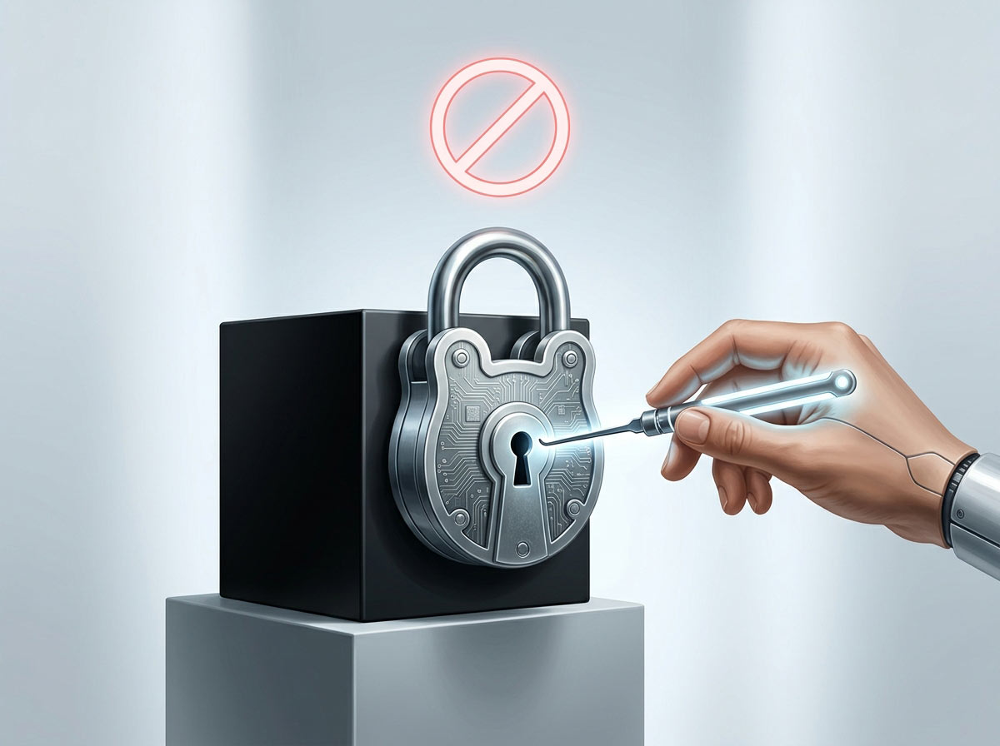
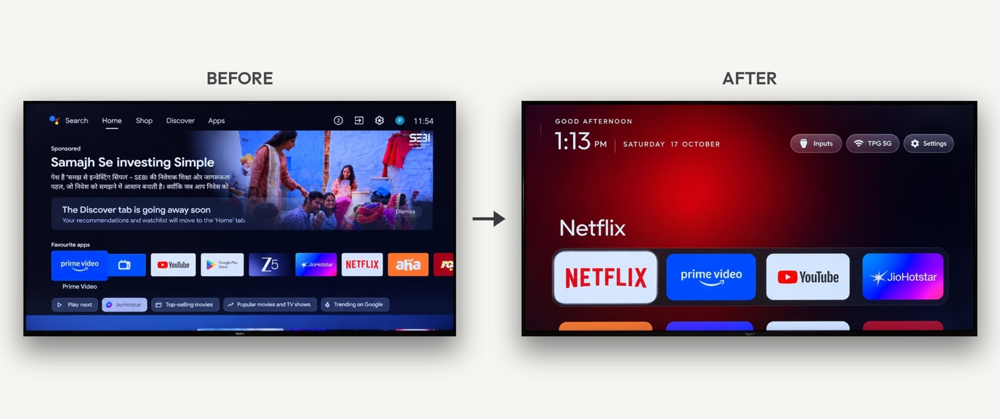

# Reverse engineering: who decides what you can do with what you bought?

*In recent weeks, Claude Code has begun rejecting certain decompilation tasks and some Codex accounts have been limited. Behind this are three different mechanisms and no law: it remains the rules set by those who sell the tools, and an ancient question about what it means to own software.*

On October 27, 2026, in a Claude Code configuration that users call `tengu_heron_brook`, two phrases appear. The first invites the model to build original games, of a genre, or born from the user's projects and resources. The second forbids it from recreating another person's specific game, even if renamed or presented as original. It is not a law, not a statement, not a decree: it is a system instruction. But an instruction that decides what the model accepts to do before the user finishes asking functions like a policy.

## Three blocks, one misconception

[REA](https://github.com/morluto/rea), the acronym for Reverse Engineer Anything, is an MIT-licensed project born on April 14: it entrusts agents like Claude Code and Codex with historical binary analysis tools, from Ghidra to Hopper and IDA, to work on programs for which source code is not available. It does not return original code: it produces analysis, hypotheses and, sometimes, a piece of working code. By mid-October, according to [InfoQ](https://www.infoq.com/news/2026/10/reverse-engineer-anything/), it surpassed 200,000 stars on GitHub, now it is already over 450,000. On October 20, [404 Media](https://www.404media.co/reverse-engineer-anything-is-the-new-wild-west-of-ai/) reported on uses and risks: new systems on connected TVs, revived abandoned devices, but also serially cloned software.

Then came the blocks, and the news became confused, because under the same label three different things coexist. The first is the rule on games, deliberate and declared. On October 30, Addy Osmani, from Anthropic's technical staff, explained that the two phrases were added to Claude Code's instruction on Opus 5.5 because using the model to violate intellectual property contradicts the usage policy, as [Game Developer](https://www.gamedeveloper.com/programming/anthropic-appears-to-have-ordered-ai-tool-claude-to-stop-remaking-video-games) reports. Someone on X noticed it first, chasm. Sources place the rule in Claude Code with Opus 5.5, not in other products, and Anthropic said it would continue to regulate it: on November 5, according to [Tom's Hardware](https://www.tomshardware.com/tech-industry/artificial-intelligence/anthropic-loosens-game-restrictions-claude-will-now-offer-to-build-original-game-in-same-genre-if-asked-to-copy), version 2.1.317 softened it, offering to build an original game of the same genre when the user asks for a copy.

The second concerns reverse engineering in the strict sense and is documented in a [support page](https://support.claude.com/en/articles/16049681-why-claude-switched-models-in-your-conversation-with-opus-5-or-opus-5-5). Opus 5 and Opus 5.5 check every request with classifiers, and for offensive cybersecurity activities, such as generating code that exploits vulnerabilities, scanning binaries or conducting penetration tests, the request can switch to Opus 4.8, with a visible warning. These are categories close to REA work and far from video games: Tom's Hardware has hypothesized that the coincidence of dates with the game rule is random. The third is Codex. According to 404 Media, some people who asked it to analyze TVs and devices say they were warned or limited, and a user who signs off as log4j recounts being banned for "cyber abuse". These are accounts, not verifications. An OpenAI engineer, Tarun Gogineni, wrote that for Codex there is no prohibition and the blocks are mostly accidental and being corrected.

Possible errors are two, mirror images. The first is believing that Anthropic has banned reverse engineering: sources speak of a rule on games and classifiers with public criteria. The second is dismissing everything as a hoax because there is a workaround: a bypassable filter with a less capable model remains a filter, and the cost falls on whoever stumbles upon it by mistake. As [Infobae](https://www.infobae.com/tecno/2026/11/02/anthropic-le-ordeno-a-claude-no-recrear-videojuegos-de-otras-empresas-y-ya-hay-desarrolladores-bloqueados/) reports, XDA asked Opus 5.5 and Opus 5 to recreate *Pokémon Diamond*: both refused. It also noted that the rule does not expressly ban decompilation and static recompilation, and could not reproduce the refusals on commissioned work complained by others. The model did not become incapable: it became selective, and selectivity is not a legal switch. The question is who answers when it makes a mistake.

## The case that has a name

Conflict Simulations LLC produces digital versions of board wargames for clients who own those games and provide the materials; the code, according to the owner, is written from scratch. On October 30 it opened report [106167](https://github.com/anthropics/claude-code/issues/106167) on Claude Code's public log: work that had been going on for months without objection, according to him, began to be refused after he asked if the new rule applied to his projects. According to the reconstruction, the automatic support initially responded that the rule admitted no exceptions; then the request passed to people and a formal appeal was presented. I did not find a public outcome. It is the account of a direct interested party, not an established fact, but it illustrates the problem: a category rule does not distinguish piracy from commissioned work by the owner.

On the other side there are those who suffer clones. According to Tom's Hardware, some malicious actors extracted demos of indie games and threatened to publish complete versions made with AI. For those who see years of work refactored in an afternoon, the rule does not defend an abstract privilege. How widespread the opposite problem is, however, is unknown: Anthropic has not quantified the refusals and we see only the cases that end up on GitHub. One is enough to say that the problem is not theoretical, not to say how big it is.

## What the law says

"There is no law that forbids it" is the most circulated phrase, and it is only half true. No norm says what an assistant should do when you ask it to recreate a game, but many regulate what you can do.

In Europe, the [2009/24/EC directive](https://eur-lex.europa.eu/eli/dir/2009/24/oj) on computer programs allows, in Article 5, acts necessary for use, including error correction, unless otherwise contractually stipulated, and allows the person entitled to use the program to observe, study and test its operation to understand its principles. Article 6 allows decompilation for interoperability, under specific conditions: whoever performs it must be authorized to use, the information must not already be accessible, and the operation is limited to the necessary parts. The information obtained cannot be used to develop a program substantially similar in expressive form: this is the legal boundary between interoperating and cloning. Article 8 declares null and void clauses contrary to Article 6 and the exceptions of Article 5, paragraphs 2 and 3. The Court of Justice, in the Top System case (C-13/20, 2021), clarified that decompilation can also serve to correct an error, but within strict limits.

The [EU Directive (EU) 2024/1799](https://eur-lex.europa.eu/eli/dir/2024/1799/oj) on repair applies from July 31, 2026, and is something else: it imposes obligations on manufacturers of goods listed in Annex II, which cannot hinder repair with contractual clauses or technical hardware and software measures, except for legitimate and objective factors, including the protection of intellectual property. It is not a right to clone and does not concern AI providers.

In the United States, the DMCA prohibits circumventing technical protections, but every three years the Copyright Office grants temporary exceptions. Those in effect since October 28, 2024 touch, [according to the NTIA agency](https://www.ntia.gov/blog/2024/advancing-innovation-software-enabled-world-decoding-complex-section-1201-rulemaking), security research and repair of products with software, and [according to a reconstruction](https://www.freemarketsreport.com/the-copyright-office-renewed-every-repair-exemption-but-one-hospitals/), also unlocking connected TVs to remove automatic content recognition. These are exceptions to the act of circumvention, not to the supply of tools. Fair use is a defense, not a right. There remains then the contract: the idea that you buy a license and not the software has sustained the market for decades, and in Europe it has a counterweight in the UsedSoft case (C-128/11), which treated the sale of a copy with perpetual license as exhaustion of the distribution right.

Here the law stops. It does not regulate the dialogue between a user and an assistant, nor does it oblige a private service to collaborate on what the user could do on their own. Those defending Anthropic start from here: the supplier decides what to offer, and the [usage policy](https://www.anthropic.com/legal/aup), in effect since November 12, above all prohibits violating third-party intellectual property. Those who criticize it respond that when the most capable tools are few and controlled, a right on paper shrinks in practice. A [preprint](https://arxiv.org/abs/2610.35633) by Mandel, Choksi, Castillo, Benthall and Grimmelmann argues that low-cost reverse engineering will put pressure on the entire intellectual property framework, and signals an American paradox: you can legitimately use an evasion tool, but no one can supply it to you.

The usage policy does not have a clause on reverse engineering. It does exclude from prohibitions security research on systems you own or with the owner's authorization, states that encountering a block does not in itself constitute a violation, and provides access programs with safeguards adapted for dual-use cases. There remains the vacuum that interests us here: the stopped user is neither accused nor acquitted, and for the game rule there is no declared path.

[Before and after reverse engineering on a smart TV from which advertisements were removed and the interface modified](https://x.com/gathint/status/2111379569030939102)

## The price of looking inside

Limiting reverse engineering has a cost in security, competition and preservation, and no one pays it in the same way.

For Anthropic the calculation has logic: a model that recreates other people's games produces clones, and clones bring lawsuits, removals and reputation damage. For OpenAI the public position is Gogineni's: no prohibition, accidental blocks. It can coexist with the limited accounts told by users, for example as permissive policy and severe control, but for workers the result is the same: the boundary is not public and it shifts. For independent developers the calculation is ambiguous: the rule protects them from copycats, but exposes them to false positives and a supplier that changes rules with an update.

For security researchers, the same tool that decompiles a game can analyze malware or verify a patch. Anthropic responds with the Cyber Verification Program, an access with safeguards adapted for professionals, and with a module to report false positives and appeal, admitting that mistakes happen even with approved questions. Today however the program does not cover Opus 5.5, the model at the center of this story, even though the support page announces its extension; access requires identity verification and is tied to a specific organization. It is a reasonable compromise with a cost: the question "are you authorized?" is decided by a membership card, not by law.

For preservation the bill is the least visible. Much software from the past no longer has an owner nor a server, and decompilation is often the only way to keep it alive: OpenTTD and OpenRCT2 were born this way. In 2024, as [InfoDocket](https://www.infodocket.com/2024/10/25/u-s-copyright-office-rejects-dmca-exemption-to-support-game-preservation/) reports, the Copyright Office did not expand the exception that would have allowed libraries and archives to lend out-of-commerce games remotely, and according to 404 Media it closed recently also Decomp.wtf, a project that facilitated decompilation of software and games. If the filter does not distinguish the conservator from the pirate, the bill is paid by those who just want things to keep working.

The technical paradox is known. The workaround on Opus 4.8 is provided by the system (trying to evade classifiers with tricks is something else, and the usage policy treats it as platform abuse), while open-weight models and local tools do not have these filters. For Jason Koebler, who signs a clearly partisan analysis on 404 Media, the future of this practice lies there, with the risk of making it less accessible to those who would benefit most from it. It is the logic of the anti-copy lock: it stops the honest customer more than the determined thief. The contrary objection deserves however to be heard: the threats of cloning told by Tom's Hardware are, by nature, low-cost, and a filter that slows occasional use reduces precisely that part of the damage, even if it does not stop a professional competitor. If the goal is to send a signal, the signal is clear; if it is to reduce clones, it depends on which clones.

## Where we left off

This story is the last chapter of a discussion we have been following on AITalk for months. In [Inside Claude Code](https://aitalk.it/it/claude-code.html) we analyzed the public TypeScript code of version 2.1.88, without decompiling any binary: the block we discuss concerns the reconstruction of other people's products, not the study of a public interface. [I taught AI to guard](https://aitalk.it/it/sistema-sicurezza-ai.html) warned that a system capable of inferring authorization can make mistakes: the Conflict Simulations case, if the account is accurate, is the same error reversed. [AI under siege](https://aitalk.it/it/AI-fronte-Cyber.html) showed reverse engineering as an attack and defense tool, like REA. [Fifty dollars per intrusion](https://aitalk.it/it/agenti-50-dollari-intrusione.html) described the collapse of attack cost, and here a similar cost falls on the good-faith owner. The thread closes with [AI agents push humans out of the loop](https://aitalk.it/it/agenti-umano-nel-loop.html): now the question is whether they can also exclude us from decisions on what we own.

## The open questions

There remain questions that cannot be answered today, and it would be dishonest to pretend otherwise.

Numbers are missing: Anthropic has not quantified the refusals and no one knows how many legitimate users stopped in silence. The game rule has already changed once and the company says it will regulate it again, so what is true today may not be true in a month. With OpenAI the issue is speculative: is there a written policy or is it handled case by case, and when will the promised correction arrive?

No judge has yet examined a clone realized with a language agent, and the first verdict will weigh more than a hundred articles. The repair directive has been in force for a few weeks and it is not clear how it will treat software.

For security, if independent researchers lose the best tools, they will find vulnerabilities anyway even without membership; but if instead laboratories distinguish well between professionals and malicious actors, a two-level model can work. The difference is institutional rather than technical. In preservation, projects that keep abandoned software alive live on volunteerism and tolerance, and a filter that treats them as pirates can extinguish them without naming them. And if open models became the refuge of reverse engineering, the closed-lab rule would apply only to those who do not know where to go.

There remains a methodological question: what guarantees would make such a filter acceptable? Public criteria, human appeal and a distinction between commercial use and preservation are the most cited. Anthropic offers some of them in part, as the criteria for cybersecurity categories and the appeal module; others, such as a path for the game rule, do not appear.

## The box and the key

In *Prisoner*, the 1967 series with Patrick McGoohan, Number Six screams that he is not a number but a free man. The user of today is not a prisoner of any Village: they can change model, change supplier, build their own tools. But as long as the best work is done with the most capable tools, and those tools have an owner, the freedom to open the box remains partly a concession.

The box is yours. Whether opening it is a right, a permission or a negotiation with whoever sells you the tools is the question this story leaves on the table.