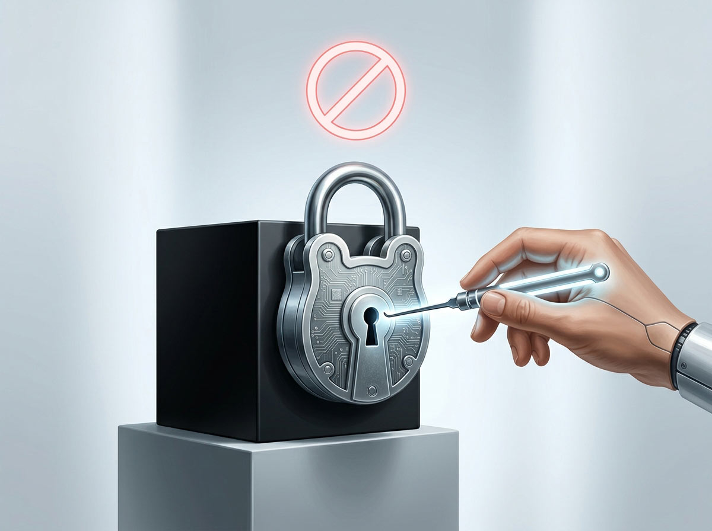
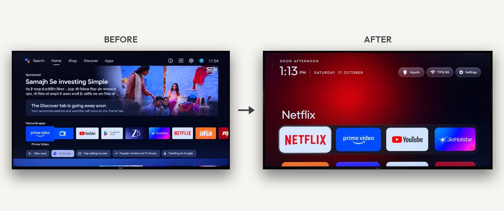

# Ingeniería inversa: ¿quién decide qué puedes hacer con lo que compraste?

*En las últimas semanas, Claude Code ha comenzado a rechazar ciertas tareas de descompilación y algunas cuentas de Codex han sido limitadas. Detrás de esto hay tres mecanismos diferentes y ninguna ley: permanecen las reglas establecidas por quienes venden las herramientas, y una pregunta antigua sobre qué significa poseer software.*

El 27 de octubre de 2026, en una configuración de Claude Code que los usuarios llaman `tengu_heron_brook`, aparecen dos frases. La primera invita al modelo a construir juegos originales, de un género, o nacidos de los proyectos y recursos del usuario. La segunda le prohíbe recrear el juego específico de otra persona, incluso si se renombra o se presenta como original. No es una ley, no es un comunicado, no es un decreto: es una instrucción del sistema. Pero una instrucción que decide qué acepta hacer el modelo antes de que el usuario termine de preguntar funciona como una política.

## Tres bloques, una equivocación

[REA](https://github.com/morluto/rea), siglas de Reverse Engineer Anything, es un proyecto de licencia MIT nacido el 14 de abril: confía a agentes como Claude Code y Codex herramientas históricas de análisis de binarios, desde Ghidra hasta Hopper e IDA, para trabajar en programas de los que no se tiene el código fuente. No devuelve el código original: produce análisis, hipótesis y, a veces, un fragmento de código funcional. A mediados de octubre, según [InfoQ](https://www.infoq.com/news/2026/10/reverse-engineer-anything/), superaba las 200.000 estrellas en GitHub, ahora ya supera las 450.000. El 20 de octubre [404 Media](https://www.404media.co/reverse-engineer-anything-is-the-new-wild-west-of-ai/) contaba usos y riesgos: sistemas nuevos en TVs conectadas, dispositivos abandonados reactivados, pero también software clonado en serie.

Llegaron los bloqueos, y las noticias se confundieron, porque bajo la misma etiqueta coexisten tres cosas distintas. La primera es la regla sobre juegos, deliberada y declarada. El 30 de octubre, Addy Osmani, del equipo técnico de Anthropic, explicó que las dos frases se añadieron a la instrucción de Claude Code sobre Opus 5.5 porque usar el modelo para violar la propiedad intelectual contradice la política de uso, como informa [Game Developer](https://www.gamedeveloper.com/programming/anthropic-appears-to-have-ordered-ai-tool-claude-to-stop-remaking-video-games). Lo notó primero un usuario de X, chasm. Las fuentes sitúan la regla en Claude Code con Opus 5.5, no en otros productos, y Anthropic dijo que continuaría regulándola: el 5 de noviembre, según [Tom's Hardware](https://www.tomshardware.com/tech-industry/artificial-intelligence/anthropic-loosens-game-restrictions-claude-will-now-offer-to-build-original-game-in-same-genre-if-asked-to-copy), la versión 2.1.317 la suavizó, ofreciendo construir un juego original del mismo género cuando el usuario pide una copia.

La segunda se refiere a la ingeniería inversa en sentido estricto y está documentada en una [página de soporte](https://support.claude.com/en/articles/16049681-why-claude-switched-models-in-your-conversation-with-opus-5-or-opus-5-5). Opus 5 y Opus 5.5 revisan cada solicitud con clasificadores, y para actividades ofensivas de ciberseguridad, como generar código que explota vulnerabilidades, escanear binarios o realizar pruebas de penetración, la solicitud puede pasar a Opus 4.8, con una advertencia visible. Son categorías cercanas al trabajo de REA y lejos de los videojuegos: Tom's Hardware ha hipotetizado que la coincidencia de fechas con la regla de juegos es aleatoria. La tercera es Codex. Según 404 Media, algunas personas que le pedían analizar TVs y dispositivos dicen haber sido advertidas o limitadas, y un usuario que se firma como log4j relata haber sido bloqueado por «abuso cibernético». Son relatos, no verificaciones. Un ingeniero de OpenAI, Tarun Gogineni, escribió que para Codex no existe ninguna prohibición y los bloqueos son mayormente accidentales y se están corrigiendo.

Los errores posibles son dos, especulares. El primero es creer que Anthropic ha prohibido la ingeniería inversa: las fuentes hablan de una regla sobre juegos y clasificadores con criterios públicos. El segundo es descartarlo todo como montaje porque existe una alternativa: un filtro eludible con un modelo menos capaz sigue siendo un filtro, y el costo recae en quien se tropieza con él por error. Como informa [Infobae](https://www.infobae.com/tecno/2026/11/02/anthropic-le-ordeno-a-claude-no-recrear-videojuegos-de-otras-empresas-y-ya-hay-desarrolladores-bloqueados/), XDA pidió a Opus 5.5 y a Opus 5 que recrearan *Pokémon Diamond*: ambos se negaron. También notó que la regla no prohíbe expresamente la descompilación y recompilación estática, y no logró reproducir los rechazos en el trabajo a comisión lamentado por otros. El modelo no se volvió incapaz: se volvió selectivo, y la selectividad no es un interruptor legal. La pregunta es quién responde cuando falla.

## El caso que tiene nombre

Conflict Simulations LLC produce versiones digitales de wargames de mesa para clientes que poseen esos juegos y proporcionan los materiales; el código, según el propietario, se escribe desde cero. El 30 de octubre abrió el reporte [106167](https://github.com/anthropics/claude-code/issues/106167) en el registro público de Claude Code: trabajos que llevaban meses sin objeciones, según él, comenzaron a ser rechazados después de preguntar si la nueva regla se aplicaba a sus proyectos. Según las reconstrucciones, el soporte automático respondió inicialmente que la regla no admitía excepciones; luego la solicitud pasó a personas y se presentó un recurso formal. No encontré un resultado público. Es el relato de un interesado directo, no un hecho establecido, pero ilustra el problema: una regla de categoría no distingue la piratería del trabajo encargo del propietario.

Del otro lado están quienes sufren clonaciones. Según Tom's Hardware, algunos actores malintencionados extrajeron demos de juegos independientes y amenazaron con publicar versiones completas hechas con IA. Para quienes ven años de trabajo refactorizados en una tarde, la regla no defiende un privilegio abstracto. Cuán extendido es el problema opuesto, sin embargo, no se sabe: Anthropic no ha cuantificado los rechazos y solo vemos los casos que acaban en GitHub. Uno basta para decir que el problema no es teórico, no para decir qué tan grande es.

## Qué dice la ley

"No existe una ley que lo prohíba" es la frase que más circula, y solo es parcialmente cierta. Ninguna norma dice qué debe hacer un asistente cuando le pides que cree un juego, pero muchas regulan lo que puedes hacer tú.

En Europa, la [directiva 2009/24/CE](https://eur-lex.europa.eu/eli/dir/2009/24/oj) sobre programas de ordenador permite, en el artículo 5, los actos necesarios para el uso, incluida la corrección de errores, salvo cláusula contractual en contrario, y permite a quien tiene derecho a usar el programa observar, estudiar y probar su funcionamiento para comprender sus principios. El artículo 6 admite la descompilación para interoperabilidad, bajo condiciones precisas: quien la realiza debe estar autorizado a usar, la información no debe ser ya accesible, y la operación se limita a las partes necesarias. La información obtenida no puede servir para desarrollar un programa sustancialmente similar en forma expresiva: es el límite jurídico entre interoperar y clonar. El artículo 8 declara nulas las cláusulas contrarias al artículo 6 y a las excepciones del artículo 5, párrafos 2 y 3. El Tribunal de Justicia, en el caso Top System (C-13/20, 2021), precisó que la descompilación también puede servir para corregir un error, pero dentro de límites estrictos.

La [directiva (UE) 2024/1799](https://eur-lex.europa.eu/eli/dir/2024/1799/oj) sobre reparación se aplica desde el 31 de julio de 2026 y es otra cosa: impone obligaciones a los fabricantes de bienes enumerados en el anexo II, que no pueden obstaculizar la reparación con cláusulas contractuales o medidas técnicas de hardware y software, salvo factores legítimos y objetivos, entre ellos la protección de la propiedad intelectual. No es un derecho de clonar y no afecta a proveedores de inteligencia artificial.

En Estados Unidos, el DMCA prohíbe eludir las protecciones técnicas, pero cada tres años la Copyright Office concede excepciones temporales. Las vigentes desde el 28 de octubre de 2024 afectan, [según la agencia NTIA](https://www.ntia.gov/blog/2024/advancing-innovation-software-enabled-world-decoding-complex-section-1201-rulemaking), la investigación de seguridad y la reparación de productos con software, y [según una reconstrucción](https://www.freemarketsreport.com/the-copyright-office-renewed-every-repair-exemption-but-one-hospitals/), también el desbloqueo de TVs conectadas para eliminar el reconocimiento automático de contenidos. Son excepciones al acto de eludir, no a la suministro de herramientas. El uso justo es una defensa, no un derecho. Queda entonces el contrato: la idea de que se compra una licencia y no el software sostiene el mercado desde décadas, y en Europa tiene un contrapeso en el caso UsedSoft (C-128/11), que trató la venta de una copia con licencia perpetua como agotamiento del derecho de distribución.

Aquí la ley se detiene. No regula el diálogo entre un usuario y un asistente, ni obliga a un servicio privado a colaborar en lo que el usuario podría hacer por sí mismo. Quienes defienden a Anthropic parten de aquí: el proveedor decide qué ofrecer, y la [política de uso](https://www.anthropic.com/legal/aup), en vigor desde el 12 de noviembre, prohíbe ante todo violar la propiedad intelectual de terceros. Quienes la critican responden que cuando las herramientas más capaces son pocas y controladas, un derecho en papel se encoge en la práctica. Un [preprint](https://arxiv.org/abs/2610.35633) de Mandel, Choksi, Castillo, Benthall y Grimmelmann sostiene que la ingeniería inversa a bajo costo pondrá presión sobre todo el marco de propiedad intelectual, y señala una paradoja americana: puedes usar legítimamente una herramienta de elusión, pero nadie puede proporcionártela.

La política de uso no tiene una cláusula sobre ingeniería inversa. Sin embargo excluye de las prohibiciones la investigación de seguridad en sistemas que posees o con autorización del propietario, afirma que encontrar un bloqueo no equivale, por sí solo, a una violación, y prevé programas de acceso con salvaguardias adaptadas para casos de doble uso. Queda el vacío que nos interesa aquí: el usuario detenido no es acusado ni absuelto, y para la regla de juegos no hay un camino declarado.

[Antes y después de ingeniería inversa en una smart TV de la que se eliminaron publicidad y se modificó la interfaz](https://x.com/gathint/status/2111379569030939102)

## El precio de mirar dentro

Limitar la ingeniería inversa tiene un costo en seguridad, competencia y conservación, y nadie lo paga igual.

Para Anthropic el cálculo tiene lógica: un modelo que recrea juegos ajenos produce clonaciones, y las clonaciones traen demandas, eliminaciones y daños de imagen. Para OpenAI la posición pública es la de Gogineni: ninguna prohibición, bloqueos accidentales. Puede coexistir con las cuentas limitadas relatadas por usuarios, por ejemplo como política permisiva y control severo, pero para los trabajadores el resultado es el mismo: el límite no es público y se desplaza. Para desarrolladores independientes el cálculo es ambiguo: la regla los protege de copistas, pero los expone a falsos positivos y a un proveedor que cambia reglas con una actualización.

Para investigadores de seguridad, la misma herramienta que descompila un juego puede analizar malware o verificar una parche. Anthropic responde con el Cyber Verification Program, un acceso con salvaguardias adaptadas para profesionales, y con un módulo para reportar falsos positivos y apelar, admitiendo que los errores ocurren incluso con preguntas aprobadas. Hoy sin embargo el programa no cubre Opus 5.5, el modelo en el centro de esta historia, aunque la página de soporte anuncia su extensión; el acceso requiere verificación de identidad y está vinculado a una organización específica. Es un compromiso razonable con un costo: la pregunta «¿estás autorizado?» la decide una tarjeta de miembro, no una ley.

Para la conservación la factura es la menos visible. Mucho software del pasado ya no tiene propietario ni servidor, y la descompilación es a menudo la única forma de mantenerlo vivo: OpenTTD y OpenRCT2 nacieron así. En 2024, como informa [InfoDocket](https://www.infodocket.com/2024/10/25/u-s-copyright-office-rejects-dmca-exemption-to-support-game-preservation/), la Copyright Office no amplió la excepción que habría permitido a bibliotecas y archivos prestar juegos fuera de comercio a distancia, y según 404 Media cerró hace días también Decomp.wtf, un proyecto que facilitaba la descompilación de software y juegos. Si el filtro no distingue al conservador del pirata, la factura la paga quien solo quiere que las cosas sigan funcionando.

La paradoja técnica es conocida. La alternativa en Opus 4.8 está prevista por el sistema (intentar eludir clasificadores con trucos es otra cosa, y la política de uso la trata como abuso de plataforma), mientras que modelos de pesos abiertos y herramientas locales no tienen estos filtros. Para Jason Koebler, que firma en 404 Media un análisis claramente partidista, el futuro de esta práctica está ahí, con el riesgo de hacerla menos accesible a quienes más beneficiarían de ella. Es la lógica de la cerradura anticopia: detiene al cliente honesto más que al ladrón determinado. La objeción contraria merece sin embargo ser escuchada: las amenazas de clonación relatadas por Tom's Hardware son, por naturaleza, de bajo costo, y un filtro que frena el uso ocasional reduce precisamente esa parte del daño, aunque no detiene a un competidor profesional. Si el objetivo es enviar una señal, la señal es clara; si es reducir clonaciones, depende de qué clonaciones.

## A dónde habíamos llegado

Esta historia es el último capítulo de un debate que seguimos en AITalk desde meses atrás. En [Dentro Claude Code](https://aitalk.it/it/claude-code.html) analizamos el código TypeScript público de la versión 2.1.88, sin descompilar ningún binario: el bloqueo de que hablamos concierne la reconstrucción de productos ajenos, no el estudio de una interfaz pública. [Enseñé a la IA a hacer guardia](https://aitalk.it/it/sistema-sicurezza-ai.html) advertía que un sistema capaz de inferir una autorización puede equivocarse: el caso de Conflict Simulations, si el relato es exacto, es el mismo error al revés. [La IA bajo asedio](https://aitalk.it/it/AI-fronte-Cyber.html) mostraba la ingeniería inversa como herramienta de ataque y defensa, como REA. [Cincuenta dólares por intrusión](https://aitalk.it/it/agenti-50-dollari-intrusione.html) describía el colapso del costo del ataque, y aquí un costo análogo recae sobre el propietario de buena fe. El hilo cierra con [Los agentes AI empujan a los humanos fuera del bucle](https://aitalk.it/it/agenti-umano-nel-loop.html): ahora la pregunta es si también pueden excluirnos de decisiones sobre lo que poseemos.

## Las preguntas abiertas

Quedan preguntas a las que hoy no se puede responder, y sería deshonesto fingir lo contrario.

Faltan números: Anthropic no ha cuantificado los rechazos y nadie sabe cuántos usuarios legítimos se detuvieron en silencio. La regla de juegos ya cambió una vez y la empresa dice que la regulará de nuevo, por lo que lo que es cierto hoy podría no serlo en un mes. Con OpenAI la cuestión es especulativa: ¿existe una política escrita o se procede caso por caso, y cuándo llegará la corrección prometida?

Ningún juez ha examinado aún una clonación realizada con un agente lingüístico, y la primera sentencia pesará más que cien artículos. La directiva sobre reparación está en vigor desde hace pocas semanas y no está claro cómo tratará el software.

Para la seguridad, si los investigadores independientes pierden las mejores herramientas, encontrarán vulnerabilidades igual aunque no tengan tarjeta; pero si los laboratorios distinguen bien entre profesionales y malintencionados, un modelo de dos niveles puede funcionar. La diferencia es institucional antes que técnica. En la conservación, los proyectos que mantienen vivo software abandonado viven de voluntarismo y tolerancia, y un filtro que los trata como piratas puede apagarlos sin nombrarlos. Y si los modelos abiertos se convirtieran en el refugio de la ingeniería inversa, la regla de laboratorios cerrados solo valdría para quienes no saben dónde ir.

Queda una pregunta de método: ¿qué garantías harían aceptable un filtro así? Criterios públicos, recurso humano y una distinción entre uso comercial y conservación son los más citados. Anthropic ofrece algunas de ellas en parte, como los criterios de categorías de ciberseguridad y el módulo de recurso; otras, como un camino para la regla de juegos, no aparecen.

## La caja y la llave

En *Prisoner*, la serie de 1967 con Patrick McGoohan, el Número Seis grita que no es un número sino un hombre libre. El usuario de hoy no es prisionero de ningún Pueblo: puede cambiar modelo, cambiar proveedor, construir sus propias herramientas. Pero mientras el mejor trabajo se hace con las herramientas más capaces, y esas herramientas tienen un dueño, la libertad de abrir la caja sigue siendo en parte una concesión.

La caja es tuya. Si abrirla es un derecho, un permiso o una negociación con quien te vende las herramientas es la pregunta que esta historia deja sobre la mesa.