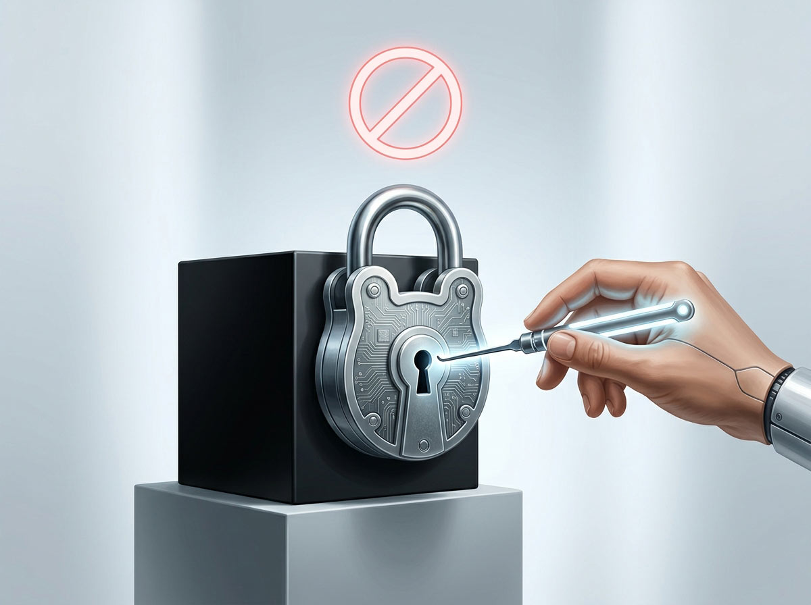
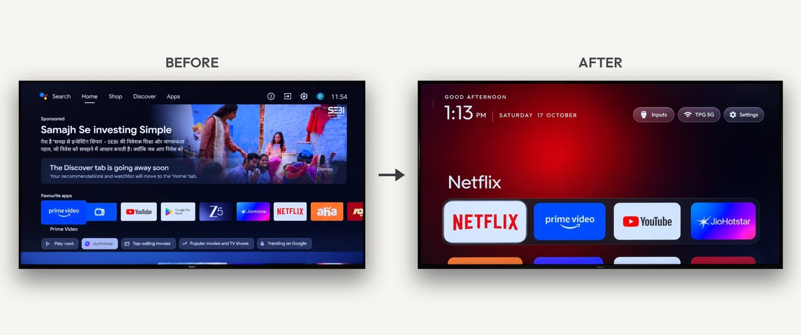

# Ingénierie inverse : qui décide de ce que vous pouvez faire avec ce que vous avez acheté ?

*Ces dernières semaines, Claude Code a commencé à rejeter certaines tâches de décompilation et certains comptes Codex ont été limités. Derrière cela, il y a trois mécanismes différents et aucune loi : il reste les règles établies par ceux qui vendent les outils, et une question ancienne sur ce que signifie posséder un logiciel.*

Le 27 octobre 2026, dans une configuration Claude Code que les utilisateurs appellent `tengu_heron_brook`, deux phrases apparaissent. La première invite le modèle à construire des jeux originaux, d'un genre, ou nés des projets et ressources de l'utilisateur. La seconde l'interdit de recréer un jeu spécifique d'autrui, même s'il est renommé ou présenté comme original. Ce n'est pas une loi, pas une déclaration, pas un décret : c'est une instruction système. Mais une instruction qui décide ce que le modèle accepte de faire avant que l'utilisateur n'ait fini de demander fonctionne comme une politique.

## Trois blocs, une méprise

[REA](https://github.com/morluto/rea), sigle de Reverse Engineer Anything, est un projet sous licence MIT né le 14 avril : il confie à des agents comme Claude Code et Codex des outils historiques d'analyse binaire, de Ghidra à Hopper et IDA, pour travailler sur des programmes pour lesquels on ne dispose pas du code source. Il ne restitue pas le code original : il produit des analyses, des hypothèses et, parfois, un morceau de code fonctionnel. Mi-octobre, selon [InfoQ](https://www.infoq.com/news/2026/10/reverse-engineer-anything/), il dépassait les 200 000 étoiles sur GitHub, maintenant il est déjà au-delà des 450 000. Le 20 octobre, [404 Media](https://www.404media.co/reverse-engineer-anything-is-the-new-wild-west-of-ai/) en parlait des usages et des risques : nouveaux systèmes sur des TV connectées, appareils abandonnés ramenés à la vie, mais aussi logiciels clonés en série.

Puis sont venus les blocages, et la presse s'est embrouillée, car sous la même étiquette coexistent trois choses différentes. La première est la règle sur les jeux, délibérée et déclarée. Le 30 octobre, Addy Osmani, de l'équipe technique d'Anthropic, a expliqué que les deux phrases avaient été ajoutées à l'instruction de Claude Code sur Opus 5.5 parce que utiliser le modèle pour violer la propriété intellectuelle contredit la politique d'utilisation, comme le rapporte [Game Developer](https://www.gamedeveloper.com/programming/anthropic-appears-to-have-ordered-ai-tool-claude-to-stop-remaking-video-games). C'est un utilisateur de X, chasm, qui l'a remarqué en premier. Les sources placent la règle dans Claude Code avec Opus 5.5, pas dans les autres produits, et Anthropic a dit qu'elle continuerait à la réguler : le 5 novembre, selon [Tom's Hardware](https://www.tomshardware.com/tech-industry/artificial-intelligence/anthropic-loosens-game-restrictions-claude-will-now-offer-to-build-original-game-in-same-genre-if-asked-to-copy), la version 2.1.317 l'a assouplie, en offrant de construire un jeu original du même genre lorsque l'utilisateur demande une copie.

La seconde concerne l'ingénierie inverse au sens strict et est documentée dans une [page de support](https://support.claude.com/en/articles/16049681-why-claude-switched-models-in-your-conversation-with-opus-5-or-opus-5-5). Opus 5 et Opus 5.5 vérifient chaque demande avec des classificateurs, et pour des activités offensives de cybersécurité, comme générer du code exploitant des vulnérabilités, scanner des binaires ou mener des tests d'intrusion, la demande peut passer à Opus 4.8, avec un avertissement visible. Ce sont des catégories proches du travail de REA et loin des jeux vidéo : Tom's Hardware a supposé que la coïncidence de dates avec la règle sur les jeux était fortuite. La troisième est Codex. Selon 404 Media, certaines personnes qui lui ont demandé d'analyser des TV et des appareils disent avoir été averties ou limitées, et un utilisateur qui se signe log4j raconte avoir été banni pour « cyber abuse ». Ce sont des témoignages, pas des vérifications. Un ingénieur OpenAI, Tarun Gogineni, a écrit qu'il n'existe aucune interdiction pour Codex et que les blocages sont surtout accidentels et en cours de correction.

Les erreurs possibles sont deux, miroirs l'une de l'autre. La première est de croire qu'Anthropic a interdit l'ingénierie inverse : les sources parlent d'une règle sur les jeux et de classificateurs avec des critères publics. La seconde est de rejeter tout comme une montreur car il existe une alternative : un filtre contourable avec un modèle moins capable reste un filtre, et le coût retombe sur celui qui s'y trompe par erreur. Comme le rapporte [Infobae](https://www.infobae.com/tecno/2026/11/02/anthropic-le-ordeno-a-claude-no-recrear-videojuegos-de-otras-empresas-y-ya-hay-desarrolladores-bloqueados/), XDA a demandé à Opus 5.5 et à Opus 5 de recréer *Pokémon Diamond* : les deux ont refusé. Il a aussi noté que la règle n'interdit pas expressément la décompilation et recompilation statique, et n'a pas réussi à reproduire les refus sur le travail à commande dénoncé par d'autres. Le modèle n'est pas devenu incapable : il est devenu sélectif, et la sélectivité n'est pas un interrupteur juridique. La question est de savoir qui répond quand il se trompe.

## L'affaire qui a un nom

Conflict Simulations LLC réalise des versions numériques de wargames de plateau pour des clients qui possèdent ces jeux et fournissent les matériaux ; le code, selon le propriétaire, est écrit à partir de zéro. Le 30 octobre, il a ouvert le signalement [106167](https://github.com/anthropics/claude-code/issues/106167) sur le registre public de Claude Code : des travaux qui allaient depuis des mois sans objection, selon lui, ont commencé à être refusés après qu'il ait demandé si la nouvelle règle s'appliquait à ses projets. Selon les reconstitutions, le support automatique a d'abord répondu que la règle n'admettait pas d'exceptions ; puis la demande est passée à des personnes et un recours formel a été présenté. Je n'ai pas trouvé d'issue publique. C'est le témoignage d'un intéressé direct, pas un fait établi, mais cela illustre le problème : une règle de catégorie ne distingue pas la piraterie du travail commandité par le propriétaire.

De l'autre côté, il y a ceux qui subissent les clones. Selon Tom's Hardware, certains malfaiteurs ont extrait des démos de jeux indépendants et menacé de publier des versions complètes faites avec l'IA. Pour ceux qui voient des années de travail refaites en une après-midi, la règle ne défend pas un privilège abstrait. Cependant, il n'est pas connu dans quelle mesure le problème opposé est répandu : Anthropic n'a pas quantifié les refus et nous ne voyons que les cas qui finissent sur GitHub. Un suffit pour dire que le problème n'est pas théorique, pas pour dire combien il est grand.

## Ce que dit la loi

« Il n'existe pas de loi qui l'interdise » est la phrase qui circule le plus, et elle n'est vraie que à moitié. Aucune norme ne dit ce qu'un assistant doit faire quand on lui demande de recréer un jeu, mais beaucoup régissent ce que vous pouvez faire vous-même.

En Europe, la [directive 2009/24/CE](https://eur-lex.europa.eu/eli/dir/2009/24/oj) sur les programmes pour ordinateurs permet, à l'article 5, les actes nécessaires à l'utilisation, y compris la correction des erreurs, sauf clause contractuelle contraire, et autorise celui qui a le droit d'utiliser le programme à l'observer, l'étudier et tester son fonctionnement pour comprendre ses principes. L'article 6 admet la décompilation pour l'interopérabilité, sous des conditions précises : celui qui la réalise doit être autorisé à l'utiliser, les informations ne doivent pas déjà être accessibles, et l'opération se limite aux parties nécessaires. Les informations obtenues ne peuvent pas servir à développer un programme substantiellement similaire dans la forme expressive : c'est la frontière juridique entre interopérer et cloner. L'article 8 déclare nulles les clauses contraires à l'article 6 et aux exceptions de l'article 5, paragraphes 2 et 3. La Cour de justice, dans l'affaire Top System (C-13/20, 2021), a précisé que la décompilation peut aussi servir à corriger une erreur, mais dans des limites strictes.

La [directive (UE) 2024/1799](https://eur-lex.europa.eu/eli/dir/2024/1799/oj) sur la réparation s'applique à partir du 31 juillet 2026 et c'est autre chose : elle impose des obligations aux fabricants des biens listés à l'annexe II, qui ne peuvent pas entraver la réparation avec des clauses contractuelles ou des mesures techniques matérielles et logicielles, sauf facteurs légitimes et objectifs, dont la protection de la propriété intellectuelle. Ce n'est pas un droit de cloner et cela ne concerne pas les fournisseurs d'intelligence artificielle.

Aux États-Unis, le DMCA interdit de contourner les protections techniques, mais tous les trois ans, le Copyright Office accorde des exceptions temporaires. Celles en vigueur depuis le 28 octobre 2024 touchent, [selon l'agence NTIA](https://www.ntia.gov/blog/2024/advancing-innovation-software-enabled-world-decoding-complex-section-1201-rulemaking), la recherche en sécurité et la réparation de produits avec logiciel, et [selon une reconstitution](https://www.freemarketsreport.com/the-copyright-office-renewed-every-repair-exemption-but-one-hospitals/), aussi le déverrouillage des TV connectées pour retirer la reconnaissance automatique du contenu. Ce sont des exceptions à l'acte de contourner, pas à la fourniture des outils. L'usage loyal (fair use) est une défense, pas un droit. Reste ensuite le contrat : l'idée qu'on achète une licence et pas le logiciel a porté le marché depuis des décennies, et en Europe, il a un contre-poids dans l'affaire UsedSoft (C-128/11), qui a traité la vente d'une copie avec licence perpétuelle comme épuisement du droit de distribution.

Ici, la loi s'arrête. Elle ne régule pas le dialogue entre un utilisateur et un assistant, ni n'oblige un service privé à collaborer à ce que l'utilisateur pourrait faire tout seul. Ceux qui défendent Anthropic partent de là : le fournisseur décide ce qu'il offre, et la [politique d'utilisation](https://www.anthropic.com/legal/aup), en vigueur depuis le 12 novembre, interdit avant tout de violer la propriété intellectuelle des tiers. Ceux qui la critiquent répondent que quand les outils les plus capables sont rares et contrôlés, un droit sur le papier se réduit en pratique. Un [preprint](https://arxiv.org/abs/2610.35633) de Mandel, Choksi, Castillo, Benthall et Grimmelmann soutient que l'ingénierie inverse à faible coût exercera une pression sur l'ensemble du cadre de la propriété intellectuelle, et signale un paradoxe américain : vous pouvez légitimement utiliser un outil de contournement, mais personne ne peut vous le fournir.

La politique d'utilisation n'a pas de clause sur l'ingénierie inverse. Elle exclut cependant des interdictions la recherche en sécurité sur des systèmes que vous possédez ou avec l'autorisation du propriétaire, affirme que rencontrer un blocage n'équivaut pas, en soi, à une violation, et prévoit des programmes d'accès avec des garanties adaptées aux cas à double usage. Reste le vide qui nous intéresse ici : l'utilisateur arrêté n'est ni accusé ni acquitté, et pour la règle sur les jeux, il n'y a pas de chemin déclaré.

[Avant et après ingénierie inverse sur une TV intelligente dont les publicités ont été supprimées et l'interface modifiée](https://x.com/gathint/status/2111379569030939102)

## Le prix de regarder à l'intérieur

 Limiter l'ingénierie inverse a un coût en matière de sécurité, de concurrence et de conservation, et personne ne le paie de la même manière.

Pour Anthropic, le calcul a une logique : un modèle qui recrée des jeux d'autrui produit des clones, et les clones entraînent des procès, des suppressions et des dommages à l'image. Pour OpenAI, la position publique est celle de Gogineni : aucune interdiction, blocages accidentels. Cela peut coexister avec les comptes limités rapportés par les utilisateurs, par exemple comme politique permissive et contrôle sévère, mais pour les travailleurs, le résultat est le même : la frontière n'est pas publique et elle bouge. Pour les développeurs indépendants, le calcul est ambigu : la règle les protège des copieurs, mais les expose aux faux positifs et à un fournisseur qui change les règles avec une mise à jour.

Pour les chercheurs en sécurité, le même outil qui décompile un jeu peut analyser un malware ou vérifier une patch. Anthropic répond par le Cyber Verification Program, un accès avec des garanties adaptées aux professionnels, et par un module pour signaler les faux positifs et faire appel, admettant que les erreurs arrivent même avec des questions approuvées. Aujourd'hui cependant, le programme ne couvre pas Opus 5.5, le modèle au centre de cette histoire, bien que la page de support en annonce l'extension ; l'accès nécessite une vérification d'identité et est lié à une organisation spécifique. C'est un compromis raisonnable avec un coût : la question « êtes-vous autorisé ? » est décidée par une carte d'adhérent, pas par une loi.

Pour la conservation, la facture est la moins visible. Beaucoup de logiciels du passé n'ont plus de propriétaire ni de serveur, et la décompilation est souvent le seul moyen de les maintenir vivants : OpenTTD et OpenRCT2 sont nés ainsi. En 2024, comme le rapporte [InfoDocket](https://www.infodocket.com/2024/10/25/u-s-copyright-office-rejects-dmca-exemption-to-support-game-preservation/), le Copyright Office n'a pas étendu l'exception qui aurait permis aux bibliothèques et archives de prêter à distance des jeux hors commerce, et selon 404 Media, il a fermé récemment aussi Decomp.wtf, un projet qui facilitait la décompilation de logiciels et de jeux. Si le filtre ne distingue pas le conservateur du pirate, la facture la paie celui qui veut simplement que les choses continuent de fonctionner.

La paradoxe technique est connu. Le contournement sur Opus 4.8 est prévu par le système (essayer de contourner les classificateurs avec des expédients est autre chose, et la politique d'utilisation le traite comme un abus de plateforme), tandis que les modèles à poids ouverts et les outils locaux n'ont pas ces filtres. Pour Jason Koebler, qui signe sur 404 Media une analyse clairement partisane, l'avenir de cette pratique réside là, avec le risque de la rendre moins accessible à ceux qui en tireraient le plus de bénéfice. C'est la logique de la serrure anti-contrefaçon : elle arrête le client honnête plus que le voleur déterminé. L'objection contraire mérite cependant d'être entendue : les menaces de clone rapportées par Tom's Hardware sont, par nature, à faible coût, et un filtre qui freine l'utilisation occasionnelle réduit précisément cette partie du dommage, même s'il n'arrête pas un concurrent professionnel. Si l'objectif est d'envoyer un signal, le signal est clair ; si c'est de réduire les clones, cela dépend de quels clones.

## Où en étions-nous

Cette histoire est le dernier chapitre d'un discours que nous suivons depuis des mois sur AITalk. Dans [Dentro Claude Code](https://aitalk.it/it/claude-code.html), nous avons analysé le code TypeScript public de la version 2.1.88, sans décompiler aucun binaire : le blocage dont nous parlons concerne la reconstruction de produits d'autrui, pas l'étude d'une interface publique. [J'ai appris à l'IA à faire la garde](https://aitalk.it/it/sistema-sicurezza-ai.html) avertissait qu'un système capable d'inférer une autorisation peut se tromper : le cas de Conflict Simulations, si le récit est exact, est la même erreur à l'envers. [L'IA sous siège](https://aitalk.it/it/AI-fronte-Cyber.html) montrait l'ingénierie inverse comme outil d'attaque et de défense, comme REA. [Cinquante dollars par intrusion](https://aitalk.it/it/agenti-50-dollari-intrusione.html) décrivait l'effondrement du coût de l'attaque, et ici un coût analogue retombe sur le propriétaire de bonne foi. Le fil se termine avec [Les agents AI poussent les humains hors de la boucle](https://aitalk.it/it/agenti-umano-nel-loop.html) : maintenant la question est s'ils peuvent aussi nous exclure des décisions sur ce que nous possédons.

## Les questions ouvertes

Il reste des questions à laquelle on ne peut pas répondre aujourd'hui, et ce serait honnête de le nier.

Il manque les chiffres : Anthropic n'a pas quantifié les refus et personne ne sait combien d'utilisateurs légitimes se sont arrêtés en silence. La règle sur les jeux a déjà changé une fois et l'entreprise dit vouloir la réguler à nouveau, donc ce qui est vrai aujourd'hui pourrait ne pas l'être dans un mois. Avec OpenAI, la question est spéculative : existe-t-il une politique écrite ou procède-t-on cas par cas, et quand la correction promise arrivera-t-elle ?

Aucun juge n'a encore examiné un clone réalisé avec un agent linguistique, et le premier jugement pèsera plus que cent articles. La directive sur la réparation est en vigueur depuis quelques semaines et il n'est pas clair comment elle traitera le logiciel.

Pour la sécurité, si les chercheurs indépendants perdent les meilleurs outils, ils trouveront les vulnérabilités quand même même sans carte ; mais si les laboratoires distinguent bien les professionnels et les malfaiteurs, un modèle à deux niveaux peut fonctionner. La différence est institutionnelle avant que technique. Dans la conservation, les projets qui maintiennent en vie des logiciels abandonnés vivent de volontariat et de tolérance, et un filtre qui les traite comme des pirates peut les éteindre sans les nommer. Et si les modèles ouverts devenaient le refuge de l'ingénierie inverse, la règle des laboratoires fermés ne vaudrait que pour ceux qui ne savent pas où aller.

Il reste une question de méthode : quelles garanties rendraient acceptable un tel filtre ? Des critères publics, un recours humain et une distinction entre usage commercial et conservation sont les plus cités. Anthropic en offre certaines en partie, comme les critères des catégories de cybersécurité et le module de recours ; d'autres, comme un chemin pour la règle sur les jeux, n'apparaissent pas.

## La boîte et la clé

Dans *Prisoner*, la série de 1967 avec Patrick McGoohan, Numéro Six crie qu'il n'est pas un numéro mais un homme libre. L'utilisateur d'aujourd'hui n'est pas prisonnier de tout Village : il peut changer de modèle, changer de fournisseur, se construire ses outils. Mais tant que le meilleur travail se fait avec les outils les plus capables, et que ces outils ont un maître, la liberté d'ouvrir la boîte reste en partie une concession.

La boîte est à vous. Si l'ouvrir est un droit, une permission ou une négociation avec celui qui vous vend les outils, c'est la question que cette histoire laisse sur la table.