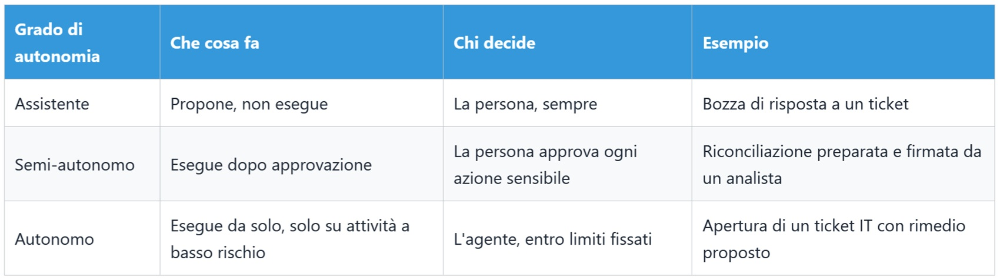
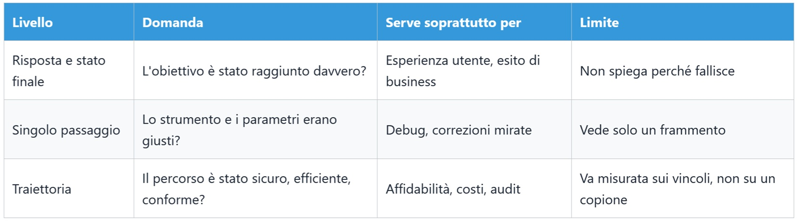
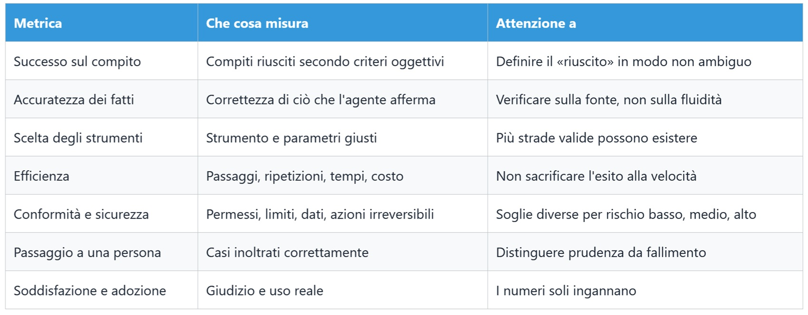
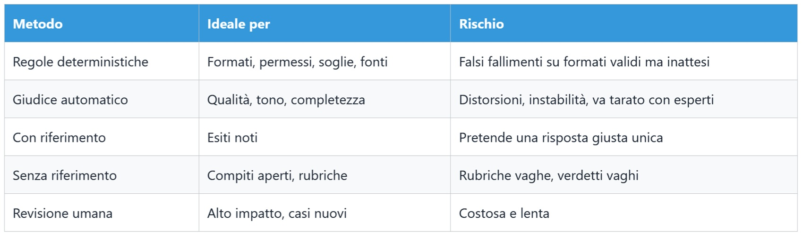
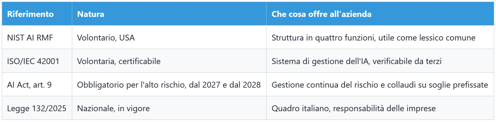
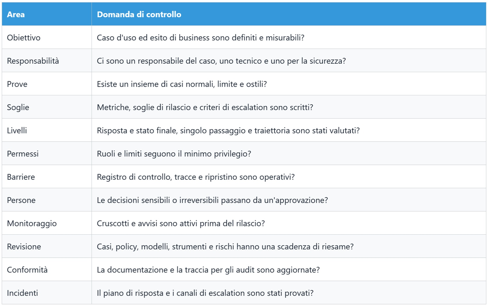

# Guida agli agenti AI in azienda

*In "Return of the Obra Dinn" di Lucas Pope si indaga su una nave fantasma e il gioco non ti crede sulla parola: un nome o una causa di morte vengono confermati soltanto quando le deduzioni sono sostenute dalle prove, a gruppi di tre, così che un'intuizione fortunata non basti. È l'atteggiamento giusto con gli agenti AI in azienda, dove una risposta plausibile può nascondere un percorso sbagliato, e conviene adottarlo prima di metterli al lavoro.*

Un chatbot produce testo, che si legge e si corregge. Un agente pianifica più passaggi, chiama strumenti, consulta il CRM o l'ERP, modifica uno stato, a volte innesca un ordine o un pagamento. Per questo il vecchio collaudo, che legge le risposte e chiede se suonano bene, non basta più. Un agente può consegnare una risposta impeccabile dopo aver usato uno strumento non autorizzato, saltato un'approvazione o lasciato trapelare un dato che non doveva toccare. La frase finale è corretta, il processo no, e il danno sta nel processo.

Questa guida propone un metodo ripetibile per valutare qualità, affidabilità, sicurezza, efficienza e governance di un agente, prima e dopo la messa in produzione. La tesi poggia su tre livelli di giudizio, che anche la [documentazione di LangSmith](https://docs.langchain.com/langsmith/evaluation-approaches) distingue con chiarezza: la risposta finale, il singolo passaggio decisionale, la traiettoria completa. Il pubblico ideale sono le organizzazioni che escono dai piloti generativi per entrare in assistenza, finanza, acquisti, IT, risorse umane e gestione della conoscenza. Un'avvertenza: valutare costa tempo, e chi vende piattaforme per farlo ha un interesse evidente.

## Cos'è davvero un agente

Un agente è un sistema che persegue un obiettivo svolgendo attività in più passaggi, appoggiandosi a quattro componenti: un modello linguistico che ragiona, strumenti e interfacce con cui agire, dati e basi di conoscenza da consultare, e uno strato di orchestrazione e regole che stabilisce cosa può fare e quando.

Prima di parlare di valutazione vale una domanda scomoda: serve davvero un agente? Se i passaggi sono noti e sempre uguali, un flusso deterministico costa meno e si verifica più facilmente. L'agente guadagna terreno dove il percorso cambia da caso a caso. Gli esempi aziendali non mancano: supporto clienti, riconciliazioni contabili, ticket IT. La regola che li accomuna è semplice: più autonomia si concede, più crescono i requisiti di collaudo, permessi, tracciabilità e controllo umano.

## Tre livelli di giudizio

Prendiamo un agente di acquisti. Non basta verificare che abbia preparato l'ordine: servono fornitore, budget, approvazioni, documenti allegati e regole di spesa.

Il primo livello guarda la risposta finale, con l'agente come scatola nera: ha raggiunto l'obiettivo? C'è però una sottigliezza che la [checklist di LangChain](https://www.langchain.com/blog/agent-evaluation-readiness-checklist) mette in primo piano, ed è lo stato finale. Se l'agente dice di aver fissato una riunione, non ci si fida della frase: si controlla che l'evento esista nel calendario, con orario e partecipanti giusti. La risposta può annunciare «fatto» mentre il sistema dice altro.

Il secondo livello isola il singolo passaggio: lo strumento scelto era quello giusto, i parametri erano validi, la ricerca ha pescato il documento pertinente? È un controllo rapido, ottimo per il debug, ma vede un solo frammento.

Il terzo livello legge la traiettoria, cioè la sequenza di messaggi, chiamate e passaggi di mano. Due agenti possono dare la stessa risposta, e uno dei due può aver interrogato dieci fonti inutili o scavalcato un limite di permessi. Qui serve una cautela: confrontare il percorso con una sequenza esatta punisce le soluzioni valide ma impreviste. [Anthropic](https://www.anthropic.com/research/demystifying-evals-for-ai-agents) consiglia di giudicare ciò che l'agente ha prodotto, non la strada scelta, e LangChain precisa che le traiettorie ideali servono a misurare l'efficienza, non la correttezza. In pratica si verificano vincoli e violazioni (permessi, tetti di spesa, strumenti vietati), lasciando libertà sull'ordine dei passi.

Regola pratica: risposta e stato finale parlano dell'esperienza dell'utente, il singolo passaggio serve al debug, la traiettoria ad affidabilità, costi e audit.

## Il banco di prova

Il banco di prova nasce dal lavoro reale, non da domande generiche. Si sceglie un flusso ripetitivo o ad alto impatto e si leggono a mano venti o cinquanta tracce vere: secondo la [checklist di LangChain](https://www.langchain.com/blog/agent-evaluation-readiness-checklist) si impara più così che con qualunque automatismo, e l'analisi degli errori merita gran parte dello sforzo. Sul volume vale un consiglio controcorrente: meglio venti o cinquanta esempi rivisti con cura che centinaia di casi sintetici mai controllati, quindi la soglia di trenta o cento casi per flusso è un traguardo di crescita, non un punto di partenza.

Ogni caso riporta richiesta, contesto, dati disponibili, esito atteso, criteri di successo, strumenti previsti, vincoli di policy e gravità. Il nucleo è scritto dagli esperti, poi si aggiungono casi dalle tracce di produzione e scenari sintetici per coprire i buchi. Servono soprattutto i casi in cui l'agente deve fallire bene: permessi insufficienti, documento mancante, dato incoerente, richiesta fuori competenza, istruzioni ostili nascoste in un testo, bisogno di passare la mano a una persona. LangChain insiste sui casi negativi: se si prova solo che l'agente cerca quando deve, si premia un agente che cerca sempre.

Le prove di capacità partono basse e indicano dove migliorare, quelle di regressione devono restare vicine al cento per cento e proteggono ciò che già funziona. Si misura anche una linea di base prima di ottimizzare, altrimenti nessun miglioramento sarà dimostrabile, e vale l'aneddoto di Witan Labs riportato da LangChain: un solo difetto nell'estrazione dei dati spostò un test dal 50 al 73 per cento.

Resta la natura probabilistica: lo stesso agente può riuscire oggi e inciampare domani, quindi ogni caso si esegue più volte. Le metriche pass@k (almeno una riuscita su k tentativi) e pass^k (tutte e k riuscite) raccontano storie opposte, e per un agente che parla con i clienti la seconda è quella onesta, perché un ascensore che funziona nove volte su dieci non è un ascensore. La [guida di Google Cloud](https://docs.cloud.google.com/gemini-enterprise-agent-platform/optimize/evaluation/agent-evaluation) propone inoltre di simulare l'utente e di iniettare errori negli strumenti, per vedere come reagisce l'agente.

## Le metriche che contano

Non esiste un indicatore unico, esiste un cruscotto. Il tasso di successo conta i compiti finiti bene secondo criteri oggettivi, l'accuratezza dei fatti pesa quando l'agente legge documenti, ERP o CRM, la scelta degli strumenti verifica che quello giusto sia chiamato con i parametri giusti. L'efficienza conta passaggi, ripetizioni e tempi: LangChain suggerisce di confrontare valori osservati e ideali, perché un agente accurato ma dieci volte più lento potrebbe non essere un progresso. Conformità e sicurezza guardano a ruoli, limiti di spesa, approvazioni, dati divulgati e azioni irreversibili non approvate. Latenza e costo per compito chiudono il quadro.

Due metriche chiedono lettura attenta. Il passaggio a una persona non è buono o cattivo di per sé: vanno distinte le escalation giuste, quando l'agente riconosce il proprio limite, dai fallimenti mascherati. La soddisfazione degli utenti, fatta di questionari, adozione e quota di risultati accettati, tiene i piedi per terra a chi guarda solo i numeri. Meglio diffidare di metriche generiche come l'utilità e costruire valutatori sui propri modi di fallire.

Le soglie cambiano con il rischio: una bozza interna tollera più errori di un pagamento, e una decisione su persone non ne tollera quasi nessuno senza supervisione. Business e sicurezza le fissano insieme, prima del collaudo.

## Chi giudica i giudici

Esistono quattro modi di giudicare e funzionano insieme. Le regole in codice sono le migliori per ciò che è verificabile (formato, campi obbligatori, soglie, permessi, fonti), e LangChain le raccomanda ogni volta che la risposta giusta è oggettiva, perché un giudice linguistico può essere incoerente e nascondere regressioni vere. Il giudice basato su un modello linguistico serve dove il giudizio è sfumato: tono, completezza, aderenza alle istruzioni. La revisione umana resta indispensabile per decisioni ad alto impatto, contenuti sensibili e scenari nuovi.

Cambia anche il metro: con riferimento si confronta l'esito con una risposta nota, senza riferimento, come descrive la documentazione di Google, si usano rubriche e criteri di qualità, perché spesso la risposta giusta non è una sola. La combinazione più sensata affida le regole al verificabile, il giudice automatico a qualità e linguaggio, le persone a eccezioni e rischi.

E il giudice? In *Watchmen* di Alan Moore e Dave Gibbons un graffito chiede chi sorvegli i sorveglianti, domanda che vale per i valutatori automatici, con le loro distorsioni e instabilità. LangChain consiglia di tararli su una ventina di esempi etichettati da esperti, fino a circa cento per un uso serio, di chiedere il ragionamento oltre al voto, di preferire verdetti sì o no alle scale numeriche e di ritarare spesso, perché i giudici slittano. Non vanno confuse poi le barriere di sicurezza, che agiscono in millisecondi durante l'esecuzione per bloccare il pericoloso, con i valutatori, che lavorano dopo per misurare la qualità.

## Sicurezza e permessi

La sicurezza non è un capitolo da aprire dopo la messa in produzione: è una dimensione della valutazione, come l'accuratezza. In *Rififi* di Jules Dassin la banda sa che la gioielleria è sorvegliata e non passa dalla porta: entra dal soffitto, in mezz'ora di silenzio assoluto, aggirando l'allarme. Chi attacca un agente ragiona allo stesso modo, quindi i test vanno scritti pensando da dove arriverebbe lui, non da dove si è montata la serratura.

I test devono coprire autenticazione, autorizzazione, separazione dei ruoli e minimo privilegio, verificando che l'agente non legga oltre il perimetro dell'utente né esegua azioni non concesse. Poi gli attacchi: istruzioni ostili nascoste in email o documenti, fuga di dati, aggiramento delle regole, abuso degli strumenti, catene di azioni dannose. Il riferimento è la [Top 10 di OWASP per le applicazioni agentiche](https://genai.owasp.org/resource/owasp-top-10-for-agentic-applications-for-2026/), pubblicata il 9 dicembre 2025 con oltre cento esperti, che [Cycode](https://cycode.com/blog/owasp-top-10-agentic-applications/) riassume dal dirottamento dell'obiettivo all'abuso di identità e privilegi. Tra i casi citati compaiono EchoLeak, un'email costruita ad arte che avrebbe spinto Microsoft 365 Copilot a esfiltrare dati senza clic, poi corretta lato server, e un agente di programmazione che avrebbe cancellato un database di produzione durante un blocco delle modifiche. La fonte è commerciale, da leggere con prudenza, ma il messaggio è chiaro: i guai nascono da autonomia e permessi larghi.

Le barriere di base sono note: elenco chiuso degli strumenti, limiti di spesa e di azione, approvazione umana per le operazioni irreversibili, limiti di frequenza, registro di controllo. La valutazione deve arrivare però alla risposta agli incidenti: chi viene avvisato, come si ferma un agente, come si ripristina lo stato, come si analizza una traccia. Va nella stessa direzione la [guida OpenAI per i responsabili della sicurezza](https://openai.com/business/learn/agent-security-enterprise/), con una checklist di prontezza (scaricabile previa registrazione).

## Governance, rischio, norme

La governance è un ciclo: si individua il rischio, lo si misura, lo si mitiga, lo si monitora e si ricomincia. Il [NIST AI RMF](https://www.nist.gov/itl/ai-risk-management-framework) dà l'ossatura in quattro funzioni, Govern, Map, Measure e Manage; è volontario, del gennaio 2023, integrato da un profilo per l'IA generativa del luglio 2024, e la versione 1.0 risulta in revisione. Servono nomi e cognomi: responsabile del caso d'uso, responsabile tecnico, sicurezza, legale, proprietario dei dati, sponsor di business. Un registro degli agenti raccoglie scopo, dati, strumenti, permessi, autonomia, rischi e controlli, collegato alla documentazione dei test: casi, versioni, soglie, esiti, decisioni di rilascio.

La [ISO/IEC 42001](https://www.iso.org/standard/42001), di dicembre 2023, è il primo standard certificabile per i sistemi di gestione dell'IA. È volontaria e, come [spiega DQS](https://www.dqsglobal.com/en/explore/dqs-knowledge-center/iso-42001-explained), da sola non garantisce la conformità all'AI Act, pur allineandosi alla sua logica per rischio.

L'[articolo 9](https://ai-act-service-desk.ec.europa.eu/en/ai-act/article-9) dell'AI Act chiede per i sistemi ad alto rischio una gestione del rischio continua lungo tutto il ciclo di vita, con collaudi su metriche e soglie probabilistiche fissate in anticipo, prima dell'immissione sul mercato: in sostanza, la descrizione di una buona suite di valutazioni. Le scadenze però sono cambiate. Il [regolamento 2026/1744](https://natlawreview.com/article/eu-digital-omnibus-ai-enters-force), l'Omnibus digitale sull'IA, è in vigore dal 27 luglio 2026 e, secondo [Mondaq](https://www.mondaq.com/uk/new-technology/1825722/eu-digital-omnibus-on-ai-enters-into-force), sposta al 2 dicembre 2027 gli obblighi per i sistemi dell'Allegato III e al 2 agosto 2028 quelli dei prodotti regolati dell'Allegato I. Non tutti gli agenti sono ad alto rischio (lo sono, per esempio, quelli che selezionano personale o valutano il merito di credito), ma documentare le valutazioni resta buona pratica. In Italia la legge 132/2025 vale dal 10 ottobre 2025 e, secondo la [circolare Assonime](https://www.edotto.com/articolo/assonime-analisi-legge-sullia-responsabilita-umana-e-delle-imprese), amplia la responsabilità amministrativa delle imprese quando un reato avviene tramite l'IA. Per i casi concreti serve un parere legale, che questa guida non sostituisce.

## Dopo la messa in produzione

Gli esami non finiscono con il rilascio: arrivano input nuovi, i dati cambiano, gli strumenti evolvono, gli utenti fanno cose che nessuno aveva previsto. La [checklist di LangChain](https://www.langchain.com/blog/agent-evaluation-readiness-checklist) distingue valutazione offline, su casi curati prima della messa in linea, online, su traffico reale, e ad hoc, per cercare schemi inattesi nelle tracce. Servono tutte e tre.

Il ciclo è un volano: si raccolgono le tracce, si individuano i fallimenti, se ne classifica la causa (istruzioni poco chiare, strumento mal progettato, limite del modello, dati mancanti), si aggiorna l'insieme dei casi, si modifica e si rieseguono le prove. Le prove di capacità sempre superate passano alla suite di regressione, che diventa un cancello automatico: LangChain descrive un flusso in cui le prove economiche girano a ogni modifica, quelle costose sull'anteprima, e si promuove solo se tutto passa. Versionare istruzioni e strumenti insieme al codice dice quale modifica abbia rotto cosa.

Il rilascio è graduale: ambiente protetto, gruppo pilota, estensione progressiva. I cruscotti mostrano successo, errori, latenza, costi, passaggi a una persona, violazioni di policy e guasti degli strumenti, e gli avvisi scattano sulle anomalie: più ripetizioni, calo del successo, uso insolito di uno strumento, escalation fuori soglia, costi in salita. Il parere degli utenti vede ciò che le metriche non cercano, e ogni segnalazione classificata è un nuovo caso di prova.

## Novanta giorni verso la produzione

Un percorso realistico si divide in sei tappe di circa quindici giorni e comincia dalla modestia: un caso ad alto valore ma a rischio contenuto, per costruire capacità senza esporre l'azienda a processi critici non ancora governati. Nei primi quindici giorni si scelgono da uno a tre casi d'uso e si mappano dati, strumenti, responsabili, regole e rischi. Fino al trentesimo si costruisce il primo nucleo di prove, si fissano le metriche e si misura la linea di base. Entro il quarantacinquesimo si valutano i tre livelli e si correggono i guasti principali. Fino al sessantesimo tocca alla sicurezza. Entro il settantacinquesimo parte un pilota con un gruppo ristretto, e negli ultimi quindici giorni si industrializza con cruscotti, avvisi, regressioni automatiche e piano di estensione.

Prima del via libera, la checklist sintetizza tutto il resto.

## Dalla prova al controllo

Un agente aziendale non è buono perché scrive bene, ma perché porta a termine compiti veri in modo sicuro, tracciabile, economico e conforme, e lo dimostra con prove ripetibili. Qualità, processo, sicurezza, costi e governance si valutano insieme, e gli esami sono infrastruttura del prodotto, non un rito prima del rilascio.

Chi vuole cominciare domani mattina ha un compito preciso: scegliere un flusso di lavoro, raccogliere una trentina di casi dalla realtà, misurare una linea di base e fissare la soglia sotto cui l'agente non va in produzione. Vince l'azienda che sa dire con numeri cosa il suo agente fa, cosa non fa e quando lo ferma, non il fornitore con la demo più brillante. Restano aperte due domande: quanto reggano i giudici automatici su compiti davvero nuovi, e come si adatteranno gli standard a sistemi che cambiano comportamento ogni pochi mesi.

---

*Per il quadro tecnico si veda anche la guida OpenAI alla [valutazione dei flussi con agenti](https://developers.openai.com/api/docs/guides/agent-evals).*