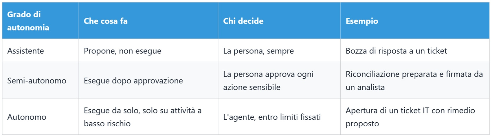
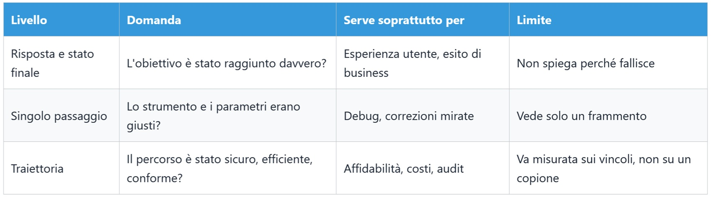
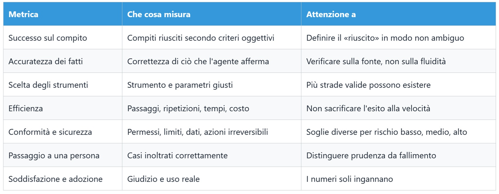
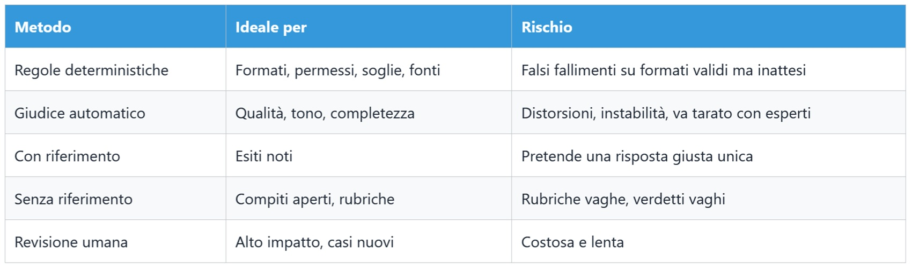
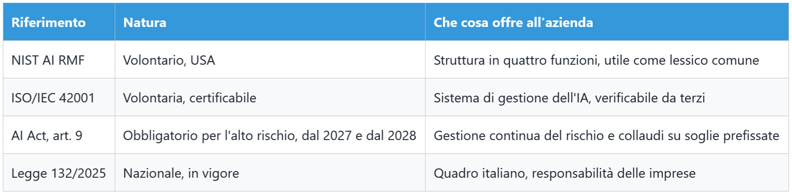
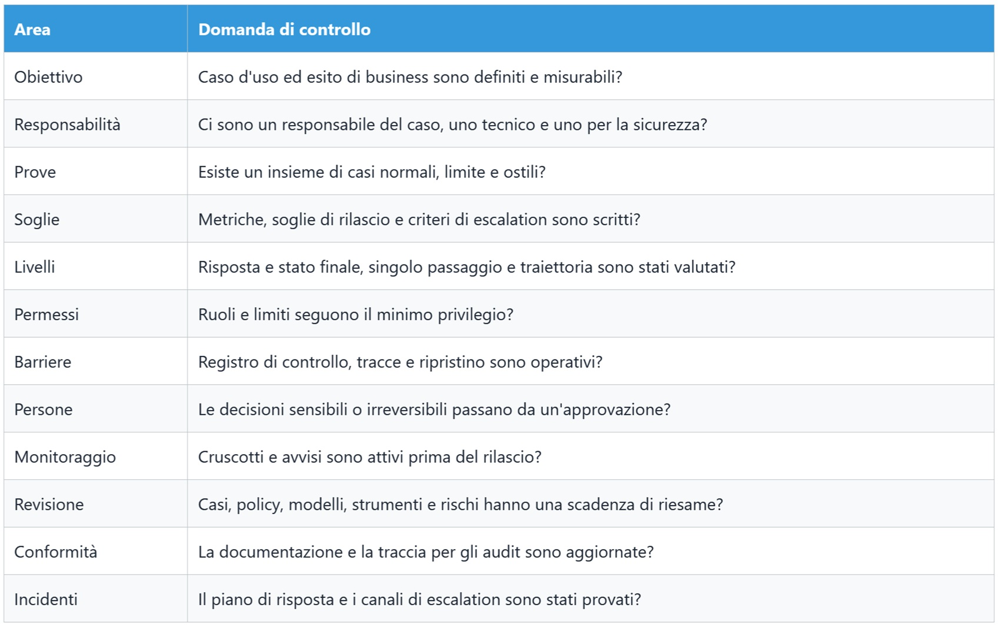

# KI-Agenten-Guide für Unternehmen

*In "Return of the Obra Dinn" von Lucas Pope wird eine Geisterinsel untersucht, und das Spiel lässt sich nicht einfach auf Wort glauben: ein Name oder Todesursache wird nur bestätigt, wenn Schlussfolgerungen durch Beweise gestützt werden, in Gruppen von drei, so dass eine glückliche Intuition nicht ausreicht. Dies ist die richtige Einstellung gegenüber KI-Agenten in Unternehmen, wo eine plausible Antwort einen falschen Weg verbergen kann, und es lohnt sich, dies vor der Arbeit zu übernehmen.*

Ein Chatbot produziert Text, der gelesen und korrigiert wird. Ein Agent plant mehrere Schritte, ruft Tools auf, konsultiert den CRM oder ERP, ändert einen Status und löst manchmal eine Bestellung oder Zahlung aus. Deshalb reicht die alte Prüfung, die Antworten liest und fragt, ob sie gut klingen, nicht mehr aus. Ein Agent kann eine einwandfreie Antwort liefern, nachdem er ein nicht autorisiertes Tool verwendet, eine Genehmigung übersprungen oder Daten freigegeben hat, die er nicht berühren sollte. Der letzte Satz ist korrekt, aber der Prozess nicht, und der Schaden liegt im Prozess.

Diese Anleitung bietet eine wiederholbare Methode zur Bewertung der Qualität, Zuverlässigkeit, Sicherheit, Effizienz und Governance eines Agenten vor und nach dem Produktivbetrieb. Die These stützt sich auf drei Beurteilungsebenen, die auch die [LangSmith-Dokumentation](https://docs.langchain.com/langsmith/evaluation-approaches) klar unterscheidet: die finale Antwort, der einzelne Entscheidungsschritt und die vollständige Trajektorie. Das ideale Publikum sind Organisationen, die von generativen Piloten in Support, Finanzen, Einkauf, IT, Personalwesen und Wissensmanagement wechseln. Eine Warnung: Evaluation kostet Zeit, und diejenigen, die Plattformen dafür verkaufen, haben ein offensichtliches Interesse.

## Was ein Agent wirklich ist

Ein Agent ist ein System, das ein Ziel verfolgt, indem es mehrstufige Aktivitäten ausführt und dabei auf vier Komponenten angewiesen ist: ein Sprachmodell, das nachdenkt, Tools und Schnittstellen zum Handeln, Daten und Wissensbasen zur Konsultation sowie eine Orchestrierungs- und Regel-Ebene, die festlegt, was es tun kann und wann.

Bevor über Evaluation gesprochen wird, stellt sich eine unbequeme Frage: Ist ein Agent wirklich notwendig? Wenn die Schritte bekannt und immer gleich sind, kostet ein deterministischer Fluss weniger und lässt sich leichter überprüfen. Der Agent gewinnt an Boden, wo der Pfad von Fall zu Fall variiert. Unternehmensbeispiele fehlen nicht: Kundensupport, Buchhaltungskonsolidierungen, IT-Tickets. Die Regel, die sie verbindet, ist einfach: Je mehr Autonomie gewährt wird, desto höher sind die Anforderungen an Prüfung, Berechtigungen, Nachverfolgbarkeit und menschliche Aufsicht.

## Drei Beurteilungsebenen

Nehmen wir einen Einkaufsagenten. Es reicht nicht, zu überprüfen, ob er die Bestellung vorbereitet hat: Lieferant, Budget, Genehmigungen, angehängte Dokumente und Ausgabenregeln müssen geprüft werden.

Die erste Ebene betrachtet die finale Antwort mit dem Agenten als Black Box: Hat er das Ziel erreicht? Es gibt jedoch eine Nuance, die die [LangChain-Checkliste](https://www.langchain.com/blog/agent-evaluation-readiness-checklist) in den Vordergrund stellt, und zwar der Endzustand. Wenn der Agent sagt, er habe ein Meeting geplant, vertraut man dem Satz nicht: Es wird überprüft, ob das Ereignis im Kalender mit der richtigen Zeit und den richtigen Teilnehmern existiert. Die Antwort kann "erledigt" ankündigen, während das System etwas anderes sagt.

Die zweite Ebene isoliert den einzelnen Schritt: War das gewählte Tool das richtige, waren die Parameter gültig, hat die Suche das relevante Dokument gefunden? Es ist eine schnelle Prüfung, hervorragend zum Debuggen, aber sieht nur einen Fragment.

Die dritte Ebene liest die Trajektorie, also die Sequenz von Nachrichten, Aufrufen und Übergaben. Zwei Agenten können dieselbe Antwort geben, und einer von ihnen kann zehn irrelevante Quellen abgefragt oder eine Berechtigungsgrenze überschritten haben. Hier ist Vorsicht geboten: Der Vergleich des Pfades mit einer genauen Sequenz bestraft gültige aber unerwartete Lösungen. [Anthropic](https://www.anthropic.com/research/demystifying-evals-for-ai-agents) empfiehlt zu beurteilen, was der Agent produziert hat, nicht den gewählten Pfad, und LangChain klärt auf, dass ideale Trajektorien zur Messung der Effizienz, nicht der Korrektheit dienen. In der Praxis werden Einschränkungen und Verletzungen überprüft (Berechtigungen, Ausgabenlimits, verbotene Tools), während die Reihenfolge der Schritte frei bleibt.

Praktische Regel: Antwort und Endzustand sprechen zur Benutzererfahrung, der einzelne Schritt dient dem Debuggen und die Trajektorie zur Zuverlässigkeit, Kosten und Prüfung.

## Der Teststand

Der Teststand entsteht aus realer Arbeit, nicht aus allgemeinen Fragen. Ein repetitiver oder hochbelasteter Arbeitsablauf wird gewählt, und zwanzig oder fünfzig reale Spuren werden manuell geprüft: Nach der [LangChain-Checkliste](https://www.langchain.com/blog/agent-evaluation-readiness-checklist) lernt man mehr auf diese Weise als durch jede Automatisierung, und die Fehleranalyse verdient den größten Teil des Aufwands. Beim Volumen gilt ein gegenintuitiver Rat: Besser zwanzig oder fünfzig sorgfältig geprüfte Beispiele als hunderte synthetischer Fälle, die nie überprüft wurden, daher ist die Schwelle von dreißig oder hundert Fällen pro Arbeitsablauf ein Wachstumsmilstein, kein Startpunkt.

Jeder Fall meldet die Anforderung, den Kontext, verfügbare Daten, erwartetes Ergebnis, Erfolgskriterien, geplante Tools, Policy-Einschränkungen und Schweregrad. Das Kernstück wird von Experten geschrieben, dann werden Fälle aus Produktions-Spuren und synthetischen Szenarien hinzugefügt, um Lücken abzudecken. Vor allem werden Fälle benötigt, bei denen der Agent gut scheitern muss: unzureichende Berechtigungen, fehlendes Dokument, inkonsistente Daten, Anforderung außerhalb des Kompetenzbereichs, feindliche Anweisungen, die in Text versteckt sind, Notwendigkeit, an eine Person weiterzugeben. LangChain besteht auf negativen Fällen: Testet man nur, dass der Agent sucht, wenn er es sollte, belohnt man einen Agenten, der immer sucht.

Fähigkeitstests beginnen niedrig und zeigen, wo verbessert werden kann, Regressionstests müssen nahe bei hundert Prozent bleiben und schützen, was bereits funktioniert. Eine Basislinie wird auch vor der Optimierung gemessen, sonst wird keine Verbesserung nachweisbar sein, und die Anekdote von Witan Labs, die von LangChain berichtet wird, trifft zu: Ein einziger Fehler bei der Datenausziehung versetzte einen Test von 50 auf 73 Prozent.

Die probabilistische Natur bleibt bestehen: Derselbe Agent kann heute erfolgreich sein und morgen stolpern, daher wird jeder Fall mehrmals ausgeführt. pass@k (mindestens ein Erfolg aus k Versuchen) und pass^k (alle k Erfolge) erzählen gegenteilige Geschichten, und für einen Agenten, der mit Kunden spricht, ist der zweite der ehrliche, weil ein Aufzug, der neunmal von zehn funktioniert, kein Aufzug ist. [Google Clouds Leitfaden](https://docs.cloud.google.com/gemini-enterprise-agent-platform/optimize/evaluation/agent-evaluation) schlägt zudem vor, den Benutzer zu simulieren und Fehler in die Tools einzuspritzen, um zu sehen, wie der Agent reagiert.

## Die Metriken, die zählen

Es gibt keinen einzelnen Indikator; es gibt ein Dashboard. Die Erfolgserate zählt Aufgaben, die gut nach objektiven Kriterien abgeschlossen wurden, die Faktenpräzision wiegt, wenn der Agent Dokumente, ERPs oder CRMs liest, die Toolauswahl überprüft, ob das richtige mit den richtigen Parametern aufgerufen wird. Effizienz zählt Schritte, Wiederholungen und Zeiten: LangChain empfiehlt, beobachtete und ideale Werte zu vergleichen, denn ein genauer, aber zehnmal langsamerer Agent könnte kein Fortschritt sein. Compliance und Sicherheit schauen nach Rollen, Ausgabenlimits, Genehmigungen, offengelegten Daten und ungenehmigten irreversiblen Aktionen. Latenz und Kosten pro Aufgabe runden das Bild ab.

Zwei Metriken erfordern sorgfältige Lektüre. Die Eskalation an eine Person ist an sich weder gut noch schlecht: Richtige Eskalationen müssen unterschieden werden, wenn der Agent seine Grenzen erkennt, von getarnten Fehlern. Die Benutzerzufriedenheit, bestehend aus Umfragen, Adoption und angenommener Ergebnisquote, hält Füße auf dem Boden für diejenigen, die nur Zahlen betrachten. Besser, sich allgemeinen Metriken wie Nutzen zu misstrauen und Evaluatoren auf eigenen Fehlerszenarien aufzubauen.

Schwellenwerte ändern sich mit dem Risiko: Ein interner Entwurf toleriert mehr Fehler als eine Zahlung, und eine Entscheidung über Personen toleriert fast keine ohne Aufsicht. Business und Sicherheit setzen sie zusammen, vor der Prüfung.

## Wer beurteilt die Beurteiler

Es gibt vier Arten zu beurteilen, und sie funktionieren zusammen. Code-Regeln sind am besten für das Überprüfbare (Format, Pflichtfelder, Schwellenwerte, Berechtigungen, Quellen), und LangChain empfiehlt sie, wenn die richtige Antwort objektiv ist, denn ein sprachlicher Richter kann inkonsistent sein und echte Regressionen verbergen. Der auf einem Sprachmodell basierende Richter dient dort, wo das Urteil nuanciert ist: Ton, Vollständigkeit, Adhärenz zu Anweisungen. Menschliche Überprüfung bleibt für hochbelastete Entscheidungen, sensible Inhalte und neue Szenarien unverzichtbar.

Die Messung ändert sich ebenfalls: Mit Referenz wird das Ergebnis mit einer bekannten Antwort verglichen; ohne Referenz, wie Google-Dokumentation beschreibt, werden Rubriken und Qualitätskriterien verwendet, weil die richtige Antwort oft nicht eine einzige ist. Die sinnvollste Kombination weist die Regeln dem Überprüfbaren zu, dem automatischen Richter Qualität und Sprache, und Menschen Ausnahmen und Risiken zu.

Und der Richter? In Alan Moore und Dave Gibbons' *Watchmen* fragt ein Graffiti, wer die Wächter beobachtet, eine Frage, die für automatische Evaluatoren gilt, mit ihren Verzerrungen und Instabilitäten. LangChain empfiehlt, sie auf etwa zwanzig von Experten beschrifteten Beispielen zu kalibrieren, bis zu etwa hundert für ernsthafte Nutzung, die Begründung über das Urteil hinaus zu verlangen, Ja/Nein-Verdicten numerischen Skalen vorzuziehen und häufig neu zu kalibrieren, denn Richter gleiten ab. Sicherheitsbarrieren dürfen nicht mit Evaluatoren verwechselt werden; Barrieren wirken in Millisekunden während der Ausführung, um das Gefährliche zu blockieren, während Evaluatoren danach arbeiten, um die Qualität zu messen.

## Sicherheit und Berechtigungen

Sicherheit ist kein Kapitel, das nach dem Produktivbetrieb eröffnet wird: Es ist eine Dimension der Evaluation, wie die Präzision. In Jules Dassin' *Rififi* weiß das Gang, dass die Juвелиrie überwacht ist, und geht nicht durch die Tür: Sie steigt vom Dach ein, in dreißig Minuten absoluten Schweigens, umgeht die Alarmanlage. Wer einen Agenten angreift, denkt genauso, daher müssen Prüfungen geschrieben werden, indem man denkt, von wo er kommen würde, nicht von wo das Schloss montiert wurde.

Prüfungen müssen Authentifizierung, Autorisierung, Rollenabtrennung und geringstes Privileg abdecken und überprüfen, ob der Agent nicht über den Benutzerbereich hinausliest oder nicht genehmigte Aktionen ausführt. Dann kommen die Angriffe: Feindliche Anweisungen, die in E-Mails oder Dokumenten versteckt sind, Datendiebstahl, Regelumgehung, Missbrauch von Tools, Ketten schädlicher Aktionen. Die Referenz ist die [OWASP Top 10 für agentic Anwendungen](https://genai.owasp.org/resource/owasp-top-10-for-agentic-applications-for-2026/), veröffentlicht am 9. Dezember 2025 mit über hundert Experten, die [Cycode](https://cycode.com/blog/owasp-top-10-agentic-applications/) von Zielerbeutung bis Identitäts- und Privilegienmissbrauch zusammenfasst. Zu den zitierten Fällen gehören EchoLeak, eine künstlich erstellte E-Mail, die Microsoft 365 Copilot dazu gebracht hätte, Daten ohne Klicken auszulesen, später serverseitig korrigiert, und ein Programmierungs-Agent, der eine Produktionsdatenbank während eines Änderungsstillstands gelöscht hätte. Die Quelle ist kommerziell und sollte mit Vorsicht gelesen werden, aber die Botschaft ist klar: Probleme entstehen aus Autonomie und weiten Berechtigungen.

Die grundlegenden Barrieren sind bekannt: Geschlossene Tool-Liste, Ausgaben- und Aktionslimits, menschliche Genehmigung für irreversible Vorgänge, Frequenzlimits, Audit-Log. Die Evaluation muss jedoch auch zur Incident-Response reichen: Wer wird informiert, wie wird ein Agent gestoppt, wie wird der Zustand wiederhergestellt, wie wird eine Spur analysiert. [OpenAI Leitfaden für Sicherheitsverantwortliche](https://openai.com/business/learn/agent-security-enterprise/) geht in dieselbe Richtung, mit einer Readiness-Checkliste (nach Registrierung herunterladbar).

## Governance, Risiko, Compliance

Governance ist ein Zyklus: Risiko identifizieren, messen, mindern, überwachen und neu beginnen. Das [NIST AI RMF](https://www.nist.gov/itl/ai-risk-management-framework) liefert das Gerüst in vier Funktionen: Govern, Map, Measure und Manage; es ist freiwillig, vom Januar 2023, ergänzt durch ein Profil für generative KI vom Juli 2024, und Version 1.0 wird überarbeitet. Namen und Nachnamen sind erforderlich: Use-Case-Besitzer, technischer Lead, Sicherheit, Recht, Datenbesitzer, Business-Sponsor. Ein Agenten-Register sammelt Zweck, Daten, Tools, Berechtigungen, Autonomie, Risiken und Kontrollen und verlinkt mit Testdokumentation: Fälle, Versionen, Schwellenwerte, Ergebnisse, Release-Entscheidungen.

Die [ISO/IEC 42001](https://www.iso.org/standard/42001) vom Dezember 2023 ist der erste zertifizierbare Standard für KI-Management-Systeme. Sie ist freiwillig und garantiert, wie [DQS erklärt](https://www.dqsglobal.com/en/explore/dqs-knowledge-center/iso-42001-explained), allein nicht die AI Act-Compliance, stimmt aber mit ihrer risikobasierten Logik überein.

[Artikel 9](https://ai-act-service-desk.ec.europa.eu/en/ai-act/article-9) des AI Act fordert für Hochrisiko-Systeme ein kontinuierliches Risikomanagement im gesamten Lebenszyklus mit Tests auf Metriken und probabilistischen Schwellenwerten, die im Voraus festgelegt wurden, vor dem Markteintritt: Kurz gesagt, die Beschreibung eines guten Evaluations-Sets. Die Fristen haben sich jedoch geändert. Die [Verordnung 2026/1744](https://natlawreview.com/article/eu-digital-omnibus-ai-enters-force), das digitale Omnibus-KI-Gesetz, ist seit dem 27. Juli 2026 in Kraft und [Mondaq](https://www.mondaq.com/uk/new-technology/1825722/eu-digital-omnibus-on-ai-enters-into-force) zufolge verschiebt sie die Verpflichtungen für Anhang-III-Systeme auf den 2. Dezember 2027 und für Anhang-I-regulierte Produkte auf den 2. August 2028. Nicht alle Agenten sind Hochrisiko (zum Beispiel solche, die Personal auswählen oder Kreditwürdigkeit bewerten), aber die Dokumentation von Evaluationen bleibt gute Praxis. In Italien gilt das Gesetz 132/2025 seit dem 10. Oktober 2025 und, wie die [Assonime-Rundschreiben](https://www.edotto.com/articolo/assonime-analisi-legge-sullia-responsabilita-umana-e-delle-imprese) angibt, erweitert es die administrative Haftung von Unternehmen, wenn ein Verbrechen über KI geschieht. Für konkrete Fälle ist eine rechtliche Beratung erforderlich, die diese Anleitung nicht ersetzt.

## Nach dem Produktivbetrieb

Prüfungen enden nicht mit dem Release: Neue Eingaben kommen an, Daten ändern sich, Tools entwickeln sich, und Benutzer tun Dinge, die niemand vorhergesehen hat. Die [LangChain-Checkliste](https://www.langchain.com/blog/agent-evaluation-readiness-checklist) unterscheidet offline-Evaluation auf vorab kuratierten Fällen vor dem Go-Live, Online-Evaluation auf echtem Traffic und ad-hoc-Evaluation, um unerwartete Muster in Spuren zu finden. Alle drei sind notwendig.

Der Zyklus ist ein Schwungrad: Spuren werden gesammelt, Fehler identifiziert, Ursachen klassifiziert (unklare Anweisungen, schlecht entworfenes Tool, Modellgrenze, fehlende Daten), der Fall-Satz aktualisiert, Tests geändert und erneut ausgeführt. Tests, die immer erfolgreich sind, gehen in die Regressionssuite über, die zu einem automatischen Tor wird: LangChain beschreibt einen Fluss, bei dem kostengünstige Tests bei jeder Änderung laufen, teure in der Vorschau, und nur wenn alles durchgeht, wird befördert. Versionierung von Anweisungen und Tools zusammen mit dem Code zeigt, welche Änderung was gebrochen hat.

Das Release ist schrittweise: Geschützter Umgebung, Pilotgruppe, schrittweise Erweiterung. Dashboards zeigen Erfolg, Fehler, Latenz, Kosten, menschliche Eskalationen, Policy-Verletzungen und Tool-Fehler, und Alarme werden bei Anomalien ausgelöst: Mehr Wiederholungen, Erfolgseinbruch, ungewöhnlicher Toolgebrauch, Eskalationen außerhalb des Schwellenwerts, steigende Kosten. Benutzermeinung sieht, was Metriken nicht suchen, und jeder klassifizierte Bericht ist ein neuer Testfall.

## Neunzig Tage bis zur Produktion

Ein realistischer Weg ist in sechs Phasen von jeweils etwa fünfzehn Tagen unterteilt und beginnt mit Demut: Ein hochwertiger Fall mit eingedämmtem Risiko, um Fähigkeiten aufzubauen, ohne das Unternehmen vor noch nicht gemanagte kritische Prozesse auszusetzen. In den ersten fünfzehn Tagen werden ein bis drei Use Cases gewählt und Daten, Tools, Verantwortliche, Regeln und Risiken kartiert. Bis zum Dreißigsten wird der erste Kern von Tests gebaut, Metriken festgelegt und die Basislinie gemessen. Bis zum Fünfundvierzigsten werden die drei Ebenen bewertet und Hauptbugs behoben. Bis zum Sechzigsten ist Sicherheit dran. Bis zum Fünfundsiebzigsten startet ein Pilot mit einer kleinen Gruppe, und in den letzten fünfzehn Tagen wird mit Dashboards, Alarmen, automatischen Regressionen und Erweiterungsplan industrialisiert.

Vor dem Go-Ahead fasst die Checkliste alles Weitere zusammen.

## Vom Test zur Kontrolle

Ein Unternehmens-Agent ist nicht gut, weil er gut schreibt, sondern weil er Aufgaben sicher, nachvollziehbar, wirtschaftlich und konform abschließt und dies mit wiederholbaren Beweisen zeigt. Qualität, Prozess, Sicherheit, Kosten und Governance werden gemeinsam bewertet, und Prüfungen sind Produktinfrastruktur, kein Ritual vor dem Release.

Wer morgen früh anfangen will, hat eine genaue Aufgabe: Einen Arbeitsablauf wählen, etwa dreißig Fälle aus der Realität sammeln, eine Basislinie messen und die Schwelle festlegen, unterhalb derer der Agent nicht in Produktion geht. Das Unternehmen gewinnt, das mit Zahlen weiß, was sein Agent tut, was er nicht tut und wann er stoppt, nicht der Anbieter mit der glänzendsten Demo. Zwei Fragen bleiben offen: Wie lange halten automatische Richter bei wirklich neuen Aufgaben, und wie werden Standards sich an Systeme anpassen, die alle paar Monate ihr Verhalten ändern.

---

*Für den technischen Rahmen siehe auch OpenAI Leitfaden zur [Evaluation von Flüssen mit Agenten](https://developers.openai.com/api/docs/guides/agent-evals).*