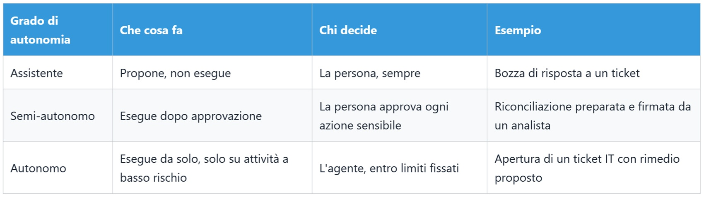
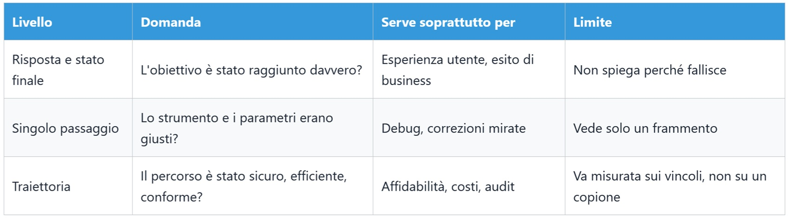
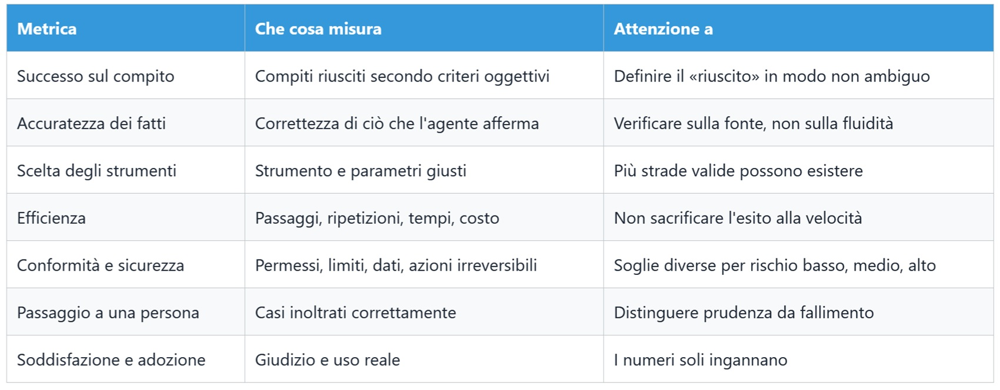
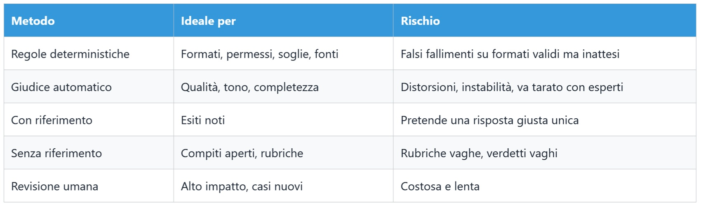
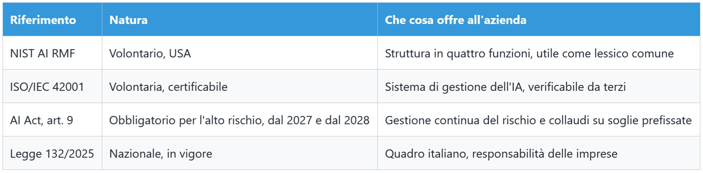
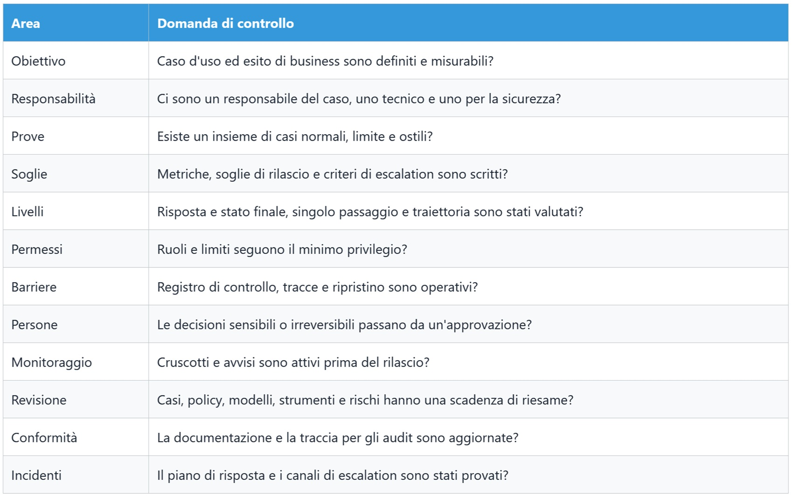

# AI Agent Guide for Business

*In "Return of the Obra Dinn" by Lucas Pope, investigators explore a ghost ship, and the game won't have it on trust: a name or cause of death is confirmed only when deductions are supported by evidence, in groups of three, so that a lucky intuition won't suffice. This is the right attitude toward AI agents in business, where a plausible answer may hide a wrong path, and it's best to adopt this before putting them to work.*

A chatbot produces text, which is read and corrected. An agent plans multiple steps, calls tools, consults the CRM or ERP, modifies a status, sometimes triggering an order or payment. That's why the old testing, which reads responses and asks if they sound good, is no longer enough. An agent can deliver a flawless answer after using an unauthorized tool, skipping an approval, or leaking data it shouldn't have touched. The final sentence is correct, but the process isn't, and the damage lies in the process.

This guide proposes a repeatable method to evaluate the quality, reliability, security, efficiency, and governance of an agent, before and after production deployment. The thesis rests on three levels of judgment, which [LangSmith documentation](https://docs.langchain.com/langsmith/evaluation-approaches) also distinguishes clearly: the final response, the individual decision step, and the complete trajectory. The ideal audience is organizations moving from generative pilots into support, finance, procurement, IT, human resources, and knowledge management. A warning: evaluation costs time, and those selling platforms to do so have an obvious interest.

## What an Agent Really Is

An agent is a system that pursues an objective by performing multi-step activities, relying on four components: a language model that reasons, tools and interfaces with which to act, data and knowledge bases to consult, and an orchestration and rules layer that establishes what it can do and when.

Before discussing evaluation, a uncomfortable question arises: is an agent really needed? If the steps are known and always the same, a deterministic flow costs less and is easier to verify. The agent gains ground where the path varies from case to case. Business examples are plentiful: customer support, accounting reconciliations, IT tickets. The rule they share is simple: the more autonomy granted, the higher the requirements for testing, permissions, traceability, and human oversight.

## Three Levels of Judgment

Take a purchasing agent. It's not enough to verify that it prepared the order: supplier, budget, approvals, attached documents, and spending rules must be checked.

The first level examines the final response, with the agent as a black box: did it achieve the objective? However, there's a subtlety that [LangChain's checklist](https://www.langchain.com/blog/agent-evaluation-readiness-checklist) puts front and center, and that's the final state. If the agent says it scheduled a meeting, don't trust the sentence: verify that the event exists in the calendar, with correct time and participants. The response may announce "done" while the system says otherwise.

The second level isolates the individual step: was the chosen tool the right one, were the parameters valid, did the search retrieve the relevant document? It's a quick check, excellent for debugging, but sees only one fragment.

The third level reads the trajectory, i.e., the sequence of messages, calls, and handoffs. Two agents can produce the same answer, and one of them may have queried ten irrelevant sources or bypassed a permission limit. Here, a caution is needed: comparing the path with an exact sequence penalizes valid but unexpected solutions. [Anthropic](https://www.anthropic.com/research/demystifying-evals-for-ai-agents) recommends judging what the agent produced, not the path chosen, and LangChain clarifies that ideal trajectories are for measuring efficiency, not correctness. In practice, constraints and violations are verified (permissions, spending limits, forbidden tools), leaving freedom on the order of steps.

Practical rule: response and final state speak to user experience, the individual step serves debugging, and the trajectory to reliability, costs, and audit.

## The Test Bench

The test bench comes from real work, not generic questions. A repetitive or high-impact workflow is chosen, and twenty or fifty real traces are manually reviewed: according to [LangChain's checklist](https://www.langchain.com/blog/agent-evaluation-readiness-checklist), one learns more this way than through any automation, and error analysis deserves most of the effort. Regarding volume, a counterintuitive advice applies: better twenty or fifty examples carefully reviewed than hundreds of synthetic cases never checked, so the threshold of thirty or one hundred cases per workflow is a growth milestone, not a starting point.

Each case reports the request, context, available data, expected outcome, success criteria, intended tools, policy constraints, and severity. The core is written by experts, then cases from production traces and synthetic scenarios are added to cover gaps. What's especially needed are cases where the agent must fail well: insufficient permissions, missing document, inconsistent data, out-of-scope request, hostile instructions hidden in text, need to escalate to a person. LangChain insists on negative cases: if one only tests that the agent searches when it should, one rewards an agent that always searches.

Capability tests start low and indicate where to improve, regression tests must stay close to one hundred percent and protect what already works. A baseline is also measured before optimizing, otherwise no improvement will be demonstrable, and the Witan Labs anecdote reported by LangChain applies: a single defect in data extraction moved a test from 50 to 73 percent.

The probabilistic nature remains: the same agent may succeed today and stumble tomorrow, so each case is run multiple times. pass@k (at least one success out of k attempts) and pass^k (all k successes) tell opposite stories, and for an agent talking to customers, the second is the honest one, because an elevator that works nine times out of ten isn't an elevator. [Google Cloud's guide](https://docs.cloud.google.com/gemini-enterprise-agent-platform/optimize/evaluation/agent-evaluation) also proposes simulating the user and injecting errors into tools to see how the agent reacts.

## The Metrics That Matter

There is no single indicator; there's a dashboard. The success rate counts tasks completed well according to objective criteria, factual accuracy weighs when the agent reads documents, ERPs, or CRMs, tool selection verifies that the right one is called with the right parameters. Efficiency counts steps, repetitions, and times: LangChain suggests comparing observed and ideal values, because an accurate agent ten times slower may not be progress. Compliance and security look at roles, spending limits, approvals, disclosed data, and unapproved irreversible actions. Latency and cost per task complete the picture.

Two metrics require careful reading. Escalation to a person isn't good or bad in itself: correct escalations, when the agent recognizes its limits, must be distinguished from masked failures. User satisfaction, composed of surveys, adoption, and accepted result share, keeps feet on the ground for those looking only at numbers. Better to distrust generic metrics like utility and build evaluators on your own failure modes.

Thresholds change with risk: an internal draft tolerates more errors than a payment, and a decision on people tolerates almost none without supervision. Business and security set them together, before testing.

## Who Judges the Judges

There are four ways to judge, and they work together. Code rules are best for what's verifiable (format, required fields, thresholds, permissions, sources), and LangChain recommends them whenever the right answer is objective, because a linguistic judge can be inconsistent and hide real regressions. Model-based judges serve where judgment is nuanced: tone, completeness, adherence to instructions. Human review remains indispensable for high-impact decisions, sensitive content, and new scenarios.

The metric also changes: with reference, the outcome is compared with a known response; without reference, as Google's documentation describes, rubrics and quality criteria are used, because often the right answer isn't a single one. The most sensible combination assigns rules to the verifiable, automatic judges to quality and language, and people to exceptions and risks.

And the judge? In Alan Moore and Dave Gibbons' *Watchmen*, a graffiti asks who watches the watchers, a question that applies to automatic evaluators, with their distortions and instabilities. LangChain recommends calibrating them on about twenty examples labeled by experts, up to around one hundred for serious use, asking for reasoning beyond the vote, preferring yes/no verdicts to numerical scales, and recalibrating often, because judges drift. Security barriers shouldn't be confused with evaluators; barriers act in milliseconds during execution to block the dangerous, while evaluators work afterward to measure quality.

## Security and Permissions

Security isn't a chapter to open after production deployment; it's a dimension of evaluation, like accuracy. In Jules Dassin's * Rififi*, the gang knows the jewelry store is monitored and doesn't go through the door: they enter from the ceiling, in thirty minutes of absolute silence, bypassing the alarm. Whoever attacks an agent reasons the same way, so tests must be written thinking from where he'd come, not from where the lock was mounted.

Tests must cover authentication, authorization, role separation, and least privilege, verifying that the agent doesn't read beyond the user's perimeter or execute unauthorized actions. Then come the attacks: hostile instructions hidden in emails or documents, data exfiltration, rule bypassing, tool abuse, chains of harmful actions. The reference is [OWASP's Top 10 for Agentic Applications](https://genai.owasp.org/resource/owasp-top-10-for-agentic-applications-for-2026/), published December 9, 2025, with over one hundred experts, which [Cycode](https://cycode.com/blog/owasp-top-10-agentic-applications/) summarizes from objective hijacking to identity and privilege abuse. Among cited cases appear EchoLeak, an artificially crafted email that would have pushed Microsoft 365 Copilot to exfiltrate data without clicking, later corrected on the server side, and a programming agent that would have deleted a production database during a change freeze. The source is commercial and should be read with caution, but the message is clear: trouble arises from autonomy and broad permissions.

Basic barriers are known: closed tool list, spending and action limits, human approval for irreversible operations, frequency limits, audit log. Evaluation must also reach incident response: who gets notified, how to stop an agent, how to restore state, how to analyze a trace. [OpenAI's guide for security leaders](https://openai.com/business/learn/agent-security-enterprise/) goes in the same direction, with a readiness checklist (downloadable upon registration).

## Governance, Risk, Compliance

Governance is a cycle: identify risk, measure it, mitigate it, monitor it, and start again. [NIST AI RMF](https://www.nist.gov/itl/ai-risk-management-framework) provides the skeleton in four functions: Govern, Map, Measure, and Manage; it's voluntary, from January 2023, supplemented by a generative AI profile from July 2024, and version 1.0 is under review. Names and surnames are needed: use case owner, technical lead, security, legal, data owner, business sponsor. An agent registry collects purpose, data, tools, permissions, autonomy, risks, and controls, linked to test documentation: cases, versions, thresholds, outcomes, release decisions.

[ISO/IEC 42001](https://www.iso.org/standard/42001), from December 2023, is the first certifiable standard for AI management systems. It's voluntary and, as [DQS explains](https://www.dqsglobal.com/en/explore/dqs-knowledge-center/iso-42001-explained), alone doesn't guarantee AI Act compliance, though it aligns with its risk-based logic.

[Article 9](https://ai-act-service-desk.ec.europa.eu/en/ai-act/article-9) of the AI Act requires continuous risk management throughout the lifecycle for high-risk systems, with tests on metrics and probabilistic thresholds set in advance, before market entry: in short, a description of a good evaluation suite. Deadlines have changed, however. [Regulation 2026/1744](https://natlawreview.com/article/eu-digital-omnibus-ai-enters-force), the digital Omnibus on AI, has been in force since July 27, 2026, and, according to [Mondaq](https://www.mondaq.com/uk/new-technology/1825722/eu-digital-omnibus-on-ai-enters-into-force), shifts obligations for Annex III systems to December 2, 2027, and for Annex I regulated products to August 2, 2028. Not all agents are high-risk (for example, those that screen personnel or assess creditworthiness are), but documenting evaluations remains good practice. In Italy, law 132/2025 has been in effect since October 10, 2025, and, according to [Assonime's circular](https://www.edotto.com/articolo/assonime-analisi-legge-sullia-responsabilita-umana-e-delle-imprese), it expands administrative liability for companies when a crime occurs through AI. For concrete cases, legal advice is needed, which this guide doesn't replace.

## After Production Deployment

Exams don't end with release: new inputs arrive, data changes, tools evolve, and users do things no one predicted. [LangChain's checklist](https://www.langchain.com/blog/agent-evaluation-readiness-checklist) distinguishes offline evaluation, on curated cases before going live, online evaluation on real traffic, and ad hoc evaluation, to find unexpected patterns in traces. All three are needed.

The cycle is momentum: collect traces, identify failures, classify causes (unclear instructions, poorly designed tool, model limit, missing data), update the case set, modify and re-run tests. Tests that always pass capabilities move to the regression suite, which becomes an automatic gate: LangChain describes a flow where cost-effective tests run on every change, expensive ones on preview, and promotion happens only if everything passes. Versioning instructions and tools with code says which change broke what.

Release is gradual: protected environment, pilot group, progressive extension. Dashboards show success, errors, latency, costs, human escalations, policy violations, and tool failures, and alerts trigger on anomalies: more repetitions, success drop, unusual tool use, out-of-threshold escalations, rising costs. User opinion sees what metrics don't seek, and every classified report is a new test case.

## Ninety Days to Production

A realistic path is divided into six stages of about fifteen days each and starts from modesty: a high-value case with contained risk, to build capabilities without exposing the company to critical processes not yet governed. In the first fifteen days, one to three use cases are selected and mapped for data, tools, owners, rules, and risks. By the thirtieth, the first core of tests is built, metrics are set, and the baseline is measured. By the forty-fifth, the three levels are evaluated and major bugs fixed. By the sixtieth, security takes over. By the seventy-fifth, a pilot starts with a small group, and in the last fifteen days, industrialization happens with dashboards, alerts, automatic regressions, and expansion plan.

Before go-ahead, the checklist summarizes everything else.

## From Test to Control

A business agent isn't good because it writes well, but because it completes real tasks securely, traceably, economically, and in compliance, demonstrating with repeatable proofs. Quality, process, security, costs, and governance are evaluated together, and exams are product infrastructure, not a ritual before release.

Those who want to start tomorrow morning have a precise task: choose a workflow, collect about thirty cases from reality, measure a baseline, and set the threshold below which the agent won't go to production. The company that wins knows with numbers what its agent does, what it doesn't do, and when it stops, not the vendor with the shiniest demo. Two questions remain open: how long automatic judges last on truly new tasks, and how standards will adapt to systems that change behavior every few months.

---

*For the technical framework, see also OpenAI's guide to [evaluating flows with agents](https://developers.openai.com/api/docs/guides/agent-evals).*