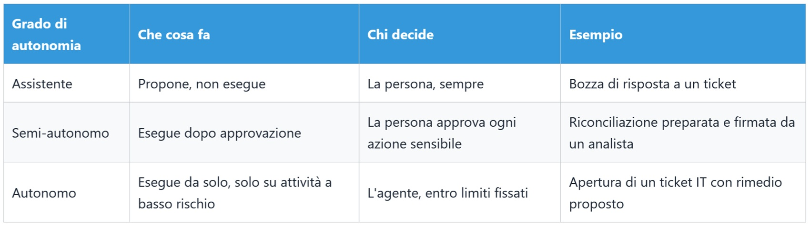
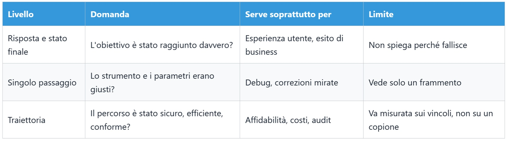
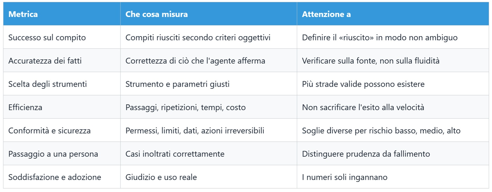
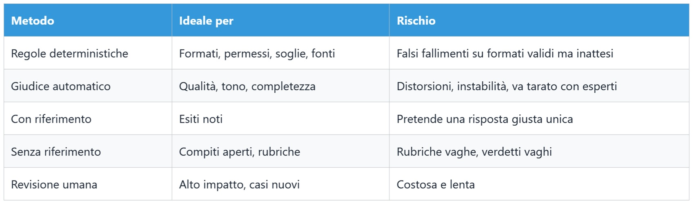
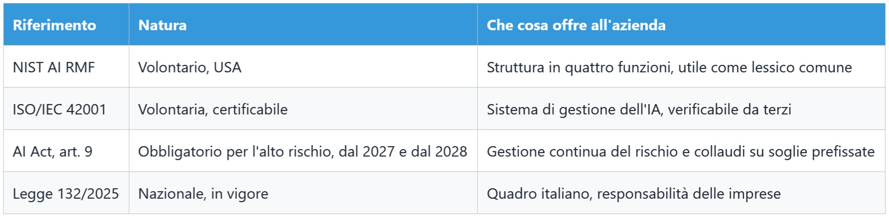
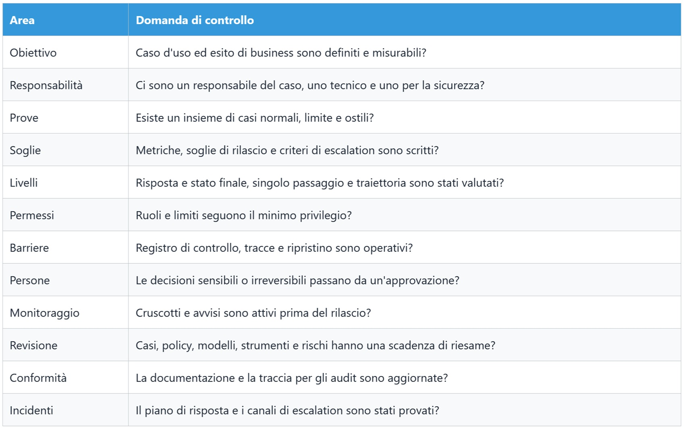

# Guía de Agentes de IA para Empresas

*En "Return of the Obra Dinn" de Lucas Pope, se investiga un barco fantasma y el juego no lo cree simplemente a palabra: un nombre o causa de muerte solo se confirman cuando las deducciones están respaldadas por pruebas, en grupos de tres, para que una intuición afortunada no sea suficiente. Este es el enfoque correcto con los agentes de IA en empresas, donde una respuesta plausible puede esconder un camino equivocado, y conviene adoptarlo antes de ponerlos a trabajar.*

Un chatbot produce texto, que se lee y corrige. Un agente planifica múltiples pasos, llama herramientas, consulta el CRM o ERP, modifica un estado, a veces iniciando un pedido o pago. Por eso la antigua prueba, que lee respuestas y pregunta si suenan bien, ya no basta. Un agente puede entregar una respuesta impecable después de usar una herramienta no autorizada, saltar una aprobación o filtrar datos que no debía tocar. La frase final es correcta, pero el proceso no, y el daño reside en el proceso.

Esta guía propone un método repetible para evaluar la calidad, confiabilidad, seguridad, eficiencia y gobernanza de un agente, antes y después del despliegue en producción. La tesis se apoya en tres niveles de juicio, que la [documentación de LangSmith](https://docs.langchain.com/langsmith/evaluation-approaches) también distingue con claridad: la respuesta final, el paso de decisión individual y la trayectoria completa. El público ideal son las organizaciones que salen de los pilotos generativos para entrar en soporte, finanzas, compras, TI, recursos humanos y gestión del conocimiento. Una advertencia: evaluar cuesta tiempo, y quienes venden plataformas para hacerlo tienen un interés evidente.

## ¿Qué es realmente un agente?

Un agente es un sistema que persigue un objetivo realizando actividades en múltiples pasos, apoyándose en cuatro componentes: un modelo de lenguaje que razona, herramientas e interfaces con las que actuar, datos y bases de conocimiento para consultar, y una capa de orquestación y reglas que establece qué puede hacer y cuándo.

Antes de hablar de evaluación, surge una pregunta incómoda: ¿verdaderamente se necesita un agente? Si los pasos son conocidos y siempre iguales, un flujo determinista cuesta menos y se verifica más fácilmente. El agente gana terreno donde el camino varía de caso en caso. Los ejemplos empresariales no faltan: soporte al cliente, conciliaciones contables, tickets de TI. La regla que los une es simple: más autonomía se concede, más crecen los requisitos de pruebas, permisos, trazabilidad y control humano.

## Tres niveles de juicio

Tomemos un agente de compras. No basta verificar que preparó el pedido: se deben revisar proveedor, presupuesto, aprobaciones, documentos adjuntos y reglas de gasto.

El primer nivel examina la respuesta final, con el agente como caja negra: ¿logró el objetivo? Sin embargo, hay una sutileza que la [lista de verificación de LangChain](https://www.langchain.com/blog/agent-evaluation-readiness-checklist) pone en primer plano, y es el estado final. Si el agente dice haber agendado una reunión, no se confía en la frase: se verifica que el evento exista en el calendario, con hora y participantes correctos. La respuesta puede anunciar "hecho" mientras el sistema dice otra cosa.

El segundo nivel aísla el paso individual: ¿la herramienta elegida fue la correcta?, ¿los parámetros eran válidos?, ¿la búsqueda recuperó el documento pertinente? Es una verificación rápida, excelente para depurar, pero solo ve un fragmento.

El tercer nivel lee la trayectoria, es decir, la secuencia de mensajes, llamadas y transferencias. Dos agentes pueden dar la misma respuesta, y uno de ellos puede haber consultado diez fuentes irrelevantes o saltado un límite de permisos. Aquí se necesita una precaución: comparar el camino con una secuencia exacta castiga soluciones válidas pero inesperadas. [Anthropic](https://www.anthropic.com/research/demystifying-evals-for-ai-agents) recomienda juzgar lo que el agente produjo, no el camino elegido, y LangChain aclara que las trayectorias ideales sirven para medir eficiencia, no corrección. En la práctica se verifican restricciones y violaciones (permisos, límites de gasto, herramientas prohibidas), dejando libertad sobre el orden de los pasos.

Regla práctica: respuesta y estado final hablan de la experiencia del usuario, el paso individual sirve para depurar y la trayectoria para confiabilidad, costos y auditoría.

## El banco de pruebas

El banco de pruebas nace del trabajo real, no de preguntas genéricas. Se elige un flujo repetitivo o de alto impacto y se revisan manualmente veinte o cincuenta trazas reales: según la [lista de verificación de LangChain](https://www.langchain.com/blog/agent-evaluation-readiness-checklist), uno aprende más así que con cualquier automatismo, y el análisis de errores merece gran parte del esfuerzo. Sobre el volumen, un consejo contraintuitivo aplica: mejor veinte o cincuenta ejemplos revisados con cuidado que cientos de casos sintéticos nunca verificados, por lo que el umbral de treinta o cien casos por flujo es un hito de crecimiento, no un punto de partida.

Caso tras caso se reporta la solicitud, contexto, datos disponibles, resultado esperado, criterios de éxito, herramientas previstas, restricciones de política y gravedad. El núcleo lo escriben expertos, luego se añaden casos de las trazas de producción y escenarios sintéticos para cubrir brechas. Sobre todo se necesitan los casos donde el agente debe fallar bien: permisos insuficientes, documento faltante, dato inconsistente, solicitud fuera de competencia, instrucciones hostiles ocultas en un texto, necesidad de pasar a una persona. LangChain insiste en casos negativos: si solo se prueba que el agente busca cuando debe, se premia un agente que siempre busca.

Las pruebas de capacidad parten bajas e indican dónde mejorar, las de regresión deben mantenerse cerca del cien por cien y proteger lo que ya funciona. También se mide una línea base antes de optimizar, de lo contrario ningún mejoramiento será demostrable, y vale la anécdota de Witan Labs reportada por LangChain: un solo defecto en la extracción de datos movió una prueba del 50 al 73 por ciento.

Queda la naturaleza probabilística: el mismo agente puede tener éxito hoy y tropezar mañana, por lo que cada caso se ejecuta varias veces. pass@k (al menos un éxito en k intentos) y pass^k (los k éxitos todos) cuentan historias opuestas, y para un agente que habla con clientes, el segundo es el honesto, porque un ascensor que funciona nueve veces sobre diez no es un ascensor. La [guía de Google Cloud](https://docs.cloud.google.com/gemini-enterprise-agent-platform/optimize/evaluation/agent-evaluation) propone además simular al usuario e inyectar errores en las herramientas para ver cómo reacciona el agente.

## Las métricas que importan

No existe un indicador único; existe un tablero. La tasa de éxito cuenta las tareas finalizadas bien según criterios objetivos, la precisión de los hechos pesa cuando el agente lee documentos, ERPs o CRMs, la selección de herramientas verifica que la correcta se llame con los parámetros correctos. La eficiencia cuenta pasos, repeticiones y tiempos: LangChain sugiere comparar valores observados e ideales, porque un agente preciso diez veces más lento podría no ser un progreso. Cumplimiento y seguridad miran roles, límites de gasto, aprobaciones, datos divulgados y acciones irreversibles no aprobadas. Latencia y costo por tarea cierran el cuadro.

Dos métricas requieren lectura atenta. La escalada a persona no es buena ni mala por sí misma: se deben distinguir las escaladas correctas, cuando el agente reconoce su límite, de los fallos disfrazados. La satisfacción de usuarios, hecha de encuestas, adopción y cuota de resultados aceptados, mantiene los pies en el suelo a quien solo mira los números. Mejor desconfiar de métricas genéricas como la utilidad y construir evaluadores sobre sus propias formas de fallar.

Los umbrales cambian con el riesgo: un borrador interno tolera más errores que un pago, y una decisión sobre personas casi no tolera ninguno sin supervisión. Negocios y seguridad los fijan juntos, antes de las pruebas.

## ¿Quién juzga a los jueces?

Existen cuatro formas de juzgar y funcionan juntas. Las reglas en código son las mejores para lo verificable (formato, campos obligatorios, umbrales, permisos, fuentes), y LangChain las recomienda cada vez que la respuesta correcta es objetiva, porque un juez lingüístico puede ser inconsistente y esconder regresiones reales. El juez basado en modelo de lenguaje sirve donde el juicio es matizado: tono, completitud, adhesión a instrucciones. La revisión humana sigue siendo indispensable para decisiones de alto impacto, contenido sensible y escenarios nuevos.

También cambia la medida: con referencia se compara el resultado con una respuesta conocida, sin referencia, como describe la documentación de Google, se usan rúbricas y criterios de calidad, porque a menudo la respuesta correcta no es una sola. La combinación más sensata asigna las reglas a lo verificable, el juez automático a calidad y lenguaje, y las personas a excepciones y riesgos.

¿Y el juez? En *Watchmen* de Alan Moore y Dave Gibbons un grafiti pregunta quién vigila a los vigilantes, pregunta que vale para evaluadores automáticos, con sus distorsiones e inestabilidades. LangChain recomienda calibrarlos sobre unos veinte ejemplos etiquetados por expertos, hasta unos cien para uso serio, pedir razonamiento más allá del voto, preferir veredictos sí/no a escalas numéricas y recalibrar a menudo, porque los jueces se deslizan. No se deben confundir después las barreras de seguridad, que actúan en milisegundos durante la ejecución para bloquear lo peligroso, con los evaluadores, que trabajan después para medir la calidad.

## Seguridad y permisos

La seguridad no es un capítulo que abrir después del despliegue en producción: es una dimensión de la evaluación, como la precisión. En *Rififi* de Jules Dassin la banda sabe que la joyería está vigilada y no pasa por la puerta: entra desde el techo, en media hora de silencio absoluto, sorteando la alarma. Quien ataca a un agente razona igual, por lo que las pruebas deben escribirse pensando desde dónde vendría él, no desde donde se montó la cerradura.

Las pruebas deben cubrir autenticación, autorización, separación de roles y mínimo privilegio, verificando que el agente no lea más allá del perímetro del usuario ni ejecute acciones no concedidas. Luego los ataques: instrucciones hostiles ocultas en correos o documentos, fuga de datos, sorteo de reglas, abuso de herramientas, cadenas de acciones dañinas. La referencia es la [Top 10 de OWASP para aplicaciones agénticas](https://genai.owasp.org/resource/owasp-top-10-for-agentic-applications-for-2026/), publicada el 9 de diciembre de 2025 con más de cien expertos, que [Cycode](https://cycode.com/blog/owasp-top-10-agentic-applications/) resume desde el secuestro del objetivo al abuso de identidad y privilegios. Entre los casos citados aparecen EchoLeak, un correo construido artificialmente que habría impulsado a Microsoft 365 Copilot a extraer datos sin hacer clic, luego corregido lado servidor, y un agente de programación que habría borrado una base de datos de producción durante un bloqueo de cambios. La fuente es comercial y debe leerse con prudencia, pero el mensaje es claro: los problemas nacen de autonomía y permisos amplios.

Las barreras básicas son conocidas: lista cerrada de herramientas, límites de gasto y de acción, aprobación humana para operaciones irreversibles, límites de frecuencia, registro de control. La evaluación debe llegar sin embargo a la respuesta a incidentes: quién es avisado, cómo se detiene un agente, cómo se restaura el estado, cómo se analiza una traza. Va en la misma dirección la [guía de OpenAI para responsables de seguridad](https://openai.com/business/learn/agent-security-enterprise/), con una lista de verificación de prontitud (descargable previa registro).

## Gobernanza, riesgo, normativa

La gobernanza es un ciclo: se identifica el riesgo, se mide, se mitiga, se monitorea y se comienza de nuevo. El [NIST AI RMF](https://www.nist.gov/itl/ai-risk-management-framework) da el esqueleto en cuatro funciones: Govern, Map, Measure y Manage; es voluntario, de enero de 2023, integrado por un perfil de IA generativa de julio de 2024, y la versión 1.0 está en revisión. Se necesitan nombres y apellidos: responsable de caso de uso, responsable técnico, seguridad, legal, propietario de datos, patrocinador de negocio. Un registro de agentes recopila propósito, datos, herramientas, permisos, autonomía, riesgos y controles, enlazado a la documentación de pruebas: casos, versiones, umbrales, resultados, decisiones de liberación.

La [ISO/IEC 42001](https://www.iso.org/standard/42001), de diciembre de 2023, es el primer estándar certificable para sistemas de gestión de IA. Es voluntaria y, como [explica DQS](https://www.dqsglobal.com/en/explore/dqs-knowledge-center/iso-42001-explained), por sí sola no garantiza la conformidad con la IA Act, aunque se alinea con su lógica de riesgo.

El [artículo 9](https://ai-act-service-desk.ec.europa.eu/en/ai-act/article-9) de la IA Act exige para sistemas de alto riesgo una gestión de riesgo continua a lo largo del ciclo de vida, con pruebas sobre métricas y umbrales probabilísticos fijados de antemano, antes de la puesta en el mercado: en esencia, la descripción de un buen suite de evaluaciones. Las fechas sin embargo cambiaron. El [reglamento 2026/1744](https://natlawreview.com/article/eu-digital-omnibus-ai-enters-force), el Omnibus digital sobre IA, está en vigor desde el 27 de julio de 2026 y, según [Mondaq](https://www.mondaq.com/uk/new-technology/1825722/eu-digital-omnibus-on-ai-enters-into-force), traslada al 2 de diciembre de 2027 los requisitos para sistemas del Anexo III y al 2 de agosto de 2028 los de productos regulados del Anexo I. No todos los agentes son de alto riesgo (son, por ejemplo, los que seleccionan personal o evalúan merecimiento de crédito), pero documentar las evaluaciones sigue siendo buena práctica. En Italia la ley 132/2025 vale desde el 10 de octubre de 2025 y, según la [circular de Assonime](https://www.edotto.com/articolo/assonime-analisi-legge-sullia-responsabilita-umana-e-delle-imprese), amplía la responsabilidad administrativa de las empresas cuando un delito ocurre mediante IA. Para casos concretos se necesita un parecer legal, que esta guía no sustituye.

## Después del despliegue en producción

Los exámenes no terminan con el lanzamiento: llegan entradas nuevas, los datos cambian, las herramientas evolucionan, los usuarios hacen cosas que nadie había previsto. La [lista de verificación de LangChain](https://www.langchain.com/blog/agent-evaluation-readiness-checklist) distingue evaluación offline, sobre casos curados antes del lanzamiento, online, sobre tráfico real, y ad hoc, para buscar patrones inesperados en las trazas. Se necesitan las tres.

El ciclo es un volante: se recopilan las trazas, se identifican los fallos, se clasifica la causa (instrucciones poco claras, herramienta mal diseñada, límite del modelo, datos faltantes), se actualiza el conjunto de casos, se modifican y vuelven a ejecutarse las pruebas. Las pruebas de capacidad siempre superadas pasan a la suite de regresión, que se convierte en un portón automático: LangChain describe un flujo donde las pruebas económicas giran en cada modificación, las costosas en la previa, y se promueve solo si todo pasa. Versionar instrucciones y herramientas junto al código dice qué modificación rompió qué.

El lanzamiento es gradual: entorno protegido, grupo piloto, extensión progresiva. Los tableros muestran éxito, errores, latencia, costos, escaladas a persona, violaciones de política y fallos de herramientas, y las alertas disparan sobre anomalías: más repeticiones, caída del éxito, uso insolito de herramienta, escaladas fuera de umbral, costos en subida. La opinión de usuarios ve lo que las métricas no buscan, y cada reporte clasificado es un nuevo caso de prueba.

## Noventa días hacia producción

Un camino realista se divide en seis etapas de quince días cada una y comienza desde la modestia: un caso de alto valor pero con riesgo contenido, para construir capacidades sin exponer a la empresa a procesos críticos no aún gobernados. En los primeros quince días se eligen de uno a tres casos de uso y se mapean datos, herramientas, responsables, reglas y riesgos. Hasta el trigésimo se construye el primer núcleo de pruebas, se fijan las métricas y se mide la línea base. Para el cuadragésimo quinto se evalúan los tres niveles y se corrigen los fallos principales. Para el sexagésimo toca a la seguridad. Para el setentacincosimo parte un piloto con un grupo restringido, y en los últimos quince días se industrializa con tableros, alertas, regresiones automáticas y plan de extensión.

Antes del visto bueno, la lista de verificación resume todo lo demás.

## De la prueba al control

Un agente empresarial no es bueno porque escribe bien, sino porque finaliza tareas reales de forma segura, trazable, económica y conforme, y lo demuestra con pruebas repetibles. Calidad, proceso, seguridad, costos y gobernanza se evalúan juntos, y los exámenes son infraestructura del producto, no un rito antes del lanzamiento.

Quien quiera comenzar mañana tiene una tarea precisa: elegir un flujo de trabajo, recopilar unos treinta casos de la realidad, medir una línea base y fijar el umbral bajo el cual el agente no va a producción. Gana la empresa que sabe decir con números qué hace su agente, qué no hace y cuándo lo detiene, no el proveedor con la demo más brillante. Quedan abiertas dos preguntas: cuánto duren los jueces automáticos en tareas verdaderamente nuevas, y cómo se adaptarán los estándares a sistemas que cambian comportamiento cada pocos meses.

---

*Para el marco técnico véase también la guía de OpenAI a [evaluación de flujos con agentes](https://developers.openai.com/api/docs/guides/agent-evals).*