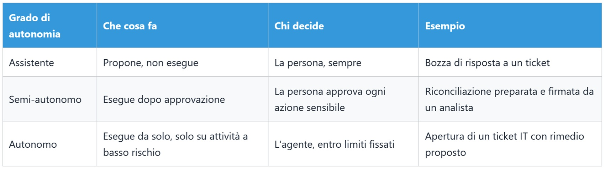
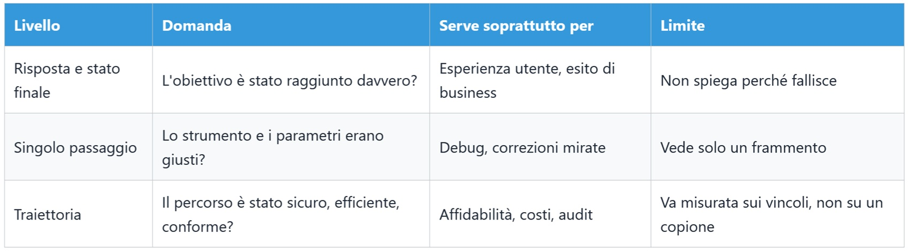
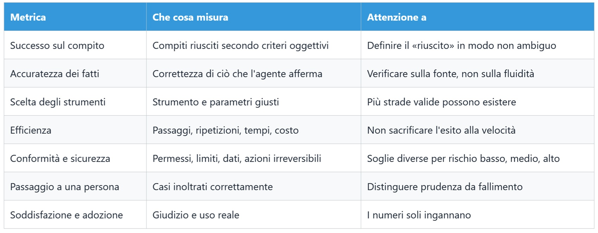
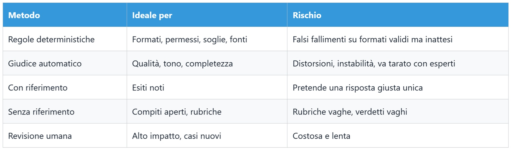
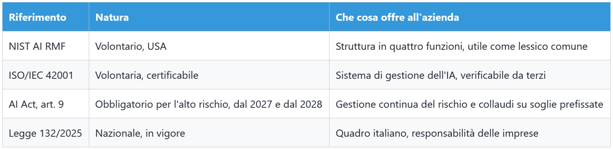
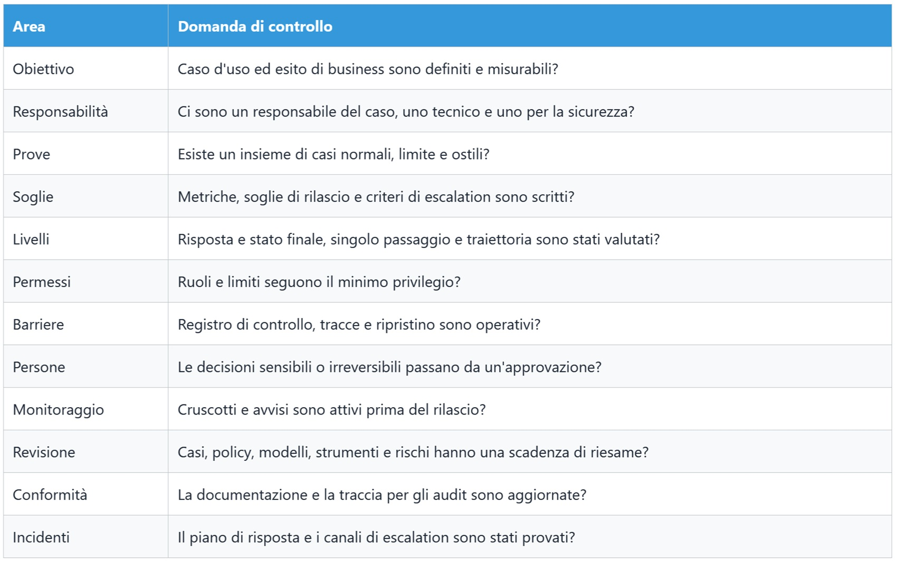

# Guide des agents IA en entreprise

*Dans "Return of the Obra Dinn" de Lucas Pope, on enquête sur un navire fantôme et le jeu ne vous croira pas sur sa parole : un nom ou une cause de mort ne sont confirmés que lorsque les déductions sont étayées par des preuves, par groupes de trois, de sorte qu'une intuition heureuse ne suffise pas. C'est l'attitude juste avec les agents IA en entreprise, où une réponse plausible peut cacher un chemin erroné, et il convient de l'adopter avant de les mettre au travail.*

Un chatbot produit du texte, qui se lit et se corrige. Un agent planifie plusieurs étapes, appelle des outils, consulte le CRM ou l'ERP, modifie un statut, déclenche parfois une commande ou un paiement. C'est pourquoi l'ancien test, qui lit les réponses et demande si elles sonnent bien, ne suffit plus. Un agent peut livrer une réponse impeccable après avoir utilisé un outil non autorisé, sauté une approbation ou divulgué des données qu'il ne devrait pas avoir touchées. La phrase finale est correcte, mais pas le processus, et le dommage réside dans le processus.

Ce guide propose une méthode répétable pour évaluer la qualité, la fiabilité, la sécurité, l'efficacité et la gouvernance d'un agent, avant et après le déploiement en production. La thèse repose sur trois niveaux de jugement, que la [documentation LangSmith](https://docs.langchain.com/langsmith/evaluation-approaches) distingue également clairement : la réponse finale, l'étape décisionnelle individuelle et la trajectoire complète. Le public idéal sont les organisations qui sortent des pilotes génératifs pour entrer dans le support, les finances, les achats, l'informatique, les ressources humaines et la gestion des connaissances. Un avertissement : évaluer coûte du temps, et ceux qui vendent des plateformes pour le faire ont un intérêt évident.

## Qu'est-ce que vraiment un agent

Un agent est un système qui poursuit un objectif en réalisant des activités multi-étapes, s'appuyant sur quatre composants : un modèle de langage qui raisonne, des outils et interfaces avec lesquels agir, des données et bases de connaissances à consulter, et une couche d'orchestration et de règles qui établit ce qu'il peut faire et quand.

Avant de parler d'évaluation, une question inconfortable surgit : un agent est-il vraiment nécessaire ? Si les étapes sont connues et toujours identiques, un flux déterministe coûte moins et est plus facile à vérifier. L'agent gagne du terrain là où le chemin varie d'un cas à l'autre. Les exemples d'entreprise ne manquent pas : support client, rapprochements comptables, tickets IT. La règle qui les unit est simple : plus d'autonomie est accordée, plus les exigences en matière de test, de permissions, de traçabilité et de supervision humaine augmentent.

## Trois niveaux de jugement

Prenons un agent d'achat. Il ne suffit pas de vérifier qu'il a préparé la commande : il faut vérifier le fournisseur, le budget, les approbations, les documents joints et les règles de dépense.

Le premier niveau examine la réponse finale, avec l'agent en boîte noire : a-t-il atteint l'objectif ? Cependant, il y a une subtilité que la [checklist de LangChain](https://www.langchain.com/blog/agent-evaluation-readiness-checklist) met en avant, et c'est l'état final. Si l'agent dit avoir programmé une réunion, on ne fait pas confiance à la phrase : on vérifie que l'événement existe dans le calendrier, avec l'heure et les participants corrects. La réponse peut annoncer « fait » tandis que le système dit autre chose.

Le deuxième niveau isole l'étape individuelle : l'outil choisi était-il le bon, les paramètres étaient-ils valides, la recherche a-t-elle récupéré le document pertinent ? C'est une vérification rapide, excellente pour le débogage, mais ne voit qu'un fragment.

Le troisième niveau lit la trajectoire, c'est-à-dire la séquence de messages, d'appels et de transmissions. Deux agents peuvent donner la même réponse, et l'un d'eux peut avoir consulté dix sources inutiles ou contourné une limite de permission. Ici, une précaution est nécessaire : comparer le chemin avec une séquence exacte pénalise les solutions valides mais imprévues. [Anthropic](https://www.anthropic.com/research/demystifying-evals-for-ai-agents) recommande de juger ce que l'agent a produit, pas le chemin choisi, et LangChain précise que les trajectoires idéales servent à mesurer l'efficacité, pas la correction. En pratique, on vérifie les contraintes et violations (permissions, plafonds de dépense, outils interdits), en laissant liberté sur l'ordre des étapes.

Règle pratique : la réponse et l'état final parlent de l'expérience utilisateur, l'étape individuelle sert au débogage, et la trajectoire à la fiabilité, aux coûts et à l'audit.

## Le banc d'essai

Le banc d'essai naît du travail réel, pas de questions génériques. On choisit un flux répétitif ou à haut impact et on relit manuellement vingt ou cinquante traces réelles : selon la [checklist de LangChain](https://www.langchain.com/blog/agent-evaluation-readiness-checklist), on apprend plus ainsi que par tout automatisation, et l'analyse des erreurs mérite la plus grande partie des efforts. Concernant le volume, un conseil contre-intuitif s'applique : mieux vaut vingt ou cinquante exemples soigneusement revus que des centaines de cas synthétiques jamais vérifiés, donc le seuil de trente ou cent cas par flux est une étape de croissance, pas un point de départ.

Chaque cas rapporte la demande, le contexte, les données disponibles, le résultat attendu, les critères de succès, les outils prévus, les contraintes de politique et la gravité. Le noyau est écrit par des experts, puis on ajoute des cas à partir des traces de production et des scénarios synthétiques pour combler les lacunes. Il faut surtout les cas où l'agent doit bien échouer : permissions insuffisantes, document manquant, donnée incohérente, demande hors compétence, instructions hostiles cachées dans un texte, nécessité de passer à une personne. LangChain insiste sur les cas négatifs : si l'on teste uniquement que l'agent recherche quand il doit, on récompense un agent qui recherche toujours.

Les tests de capacité commencent bas et indiquent où améliorer, les tests de régression doivent rester proches de cent pour cent et protéger ce qui fonctionne déjà. On mesure également une base de référence avant d'optimiser, sinon aucune amélioration ne sera démontrable, et l'anecdote de Witan Labs rapportée par LangChain s'applique : un seul défaut dans l'extraction des données a déplacé un test de 50 à 73 pour cent.

La nature probabiliste demeure : le même agent peut réussir aujourd'hui et trébucher demain, donc chaque cas est exécuté plusieurs fois. pass@k (au moins un succès sur k tentatives) et pass^k (les k succès tous) racontent des histoires opposées, et pour un agent qui parle aux clients, le second est le honnête, car un ascenseur qui fonctionne neuf fois sur dix n'est pas un ascenseur. Le [guide de Google Cloud](https://docs.cloud.google.com/gemini-enterprise-agent-platform/optimize/evaluation/agent-evaluation) propose également de simuler l'utilisateur et d'injecter des erreurs dans les outils pour voir comment l'agent réagit.

## Les métriques qui comptent

Il n'existe pas d'indicateur unique, il existe un tableau de bord. Le taux de succès compte les tâches bien terminées selon des critères objectifs, la précision factuelle pèse lorsque l'agent lit des documents, ERPs ou CRMs, la sélection d'outils vérifie que le bon est appelé avec les bons paramètres. L'efficacité compte les étapes, répétitions et temps : LangChain suggère de comparer les valeurs observées et idéales, car un agent précis mais dix fois plus lent pourrait ne pas être une progression. La conformité et la sécurité regardent les rôles, les plafonds de dépense, les approbations, les données divulguées et les actions irréversibles non approuvées. Latence et coût par tâche complètent le tableau.

Deux métriques nécessitent une lecture attentive. La montée en échelle vers une personne n'est pas bonne ou mauvaise en soi : il faut distinguer les escalades justes, lorsque l'agent reconnaît ses limites, des échecs masqués. La satisfaction des utilisateurs, faite de questionnaires, d'adoption et de part de résultats acceptés, garde les pieds sur terre à ceux qui ne regardent que les chiffres. Mieux vaut faire confiance aux métriques génériques comme l'utilité et construire des évaluateurs sur vos propres modes d'échec.

Les seuils changent avec le risque : un brouillon interne tolère plus d'erreurs qu'un paiement, et une décision sur des personnes n'en tolère presque aucune sans supervision. L'entreprise et la sécurité les fixent ensemble, avant le test.

## Qui juge les juges

Il existe quatre façons de juger et elles fonctionnent ensemble. Les règles en code sont les meilleures pour ce qui est vérifiable (format, champs obligatoires, seuils, permissions, sources), et LangChain les recommande chaque fois que la bonne réponse est objective, car un juge linguistique peut être incohérent et cacher de vraies régressions. Le juge basé sur un modèle de langage sert là où le jugement est nuancé : ton, exhaustivité, adhésion aux instructions. La révision humaine reste indispensable pour les décisions à haut impact, les contenus sensibles et les scénarios nouveaux.

La mesure change également : avec référence, le résultat est comparé à une réponse connue, sans référence, comme le décrit la documentation de Google, on utilise des grilles et des critères de qualité, car souvent la bonne réponse n'est pas une seule. La combinaison la plus sensée confie les règles au vérifiable, le juge automatique à la qualité et au langage, et les personnes aux exceptions et risques.

Et le juge ? Dans *Watchmen* d'Alan Moore et Dave Gibbons, un graffite demande qui surveille les surveillants, question qui vaut pour les évaluateurs automatiques, avec leurs distorsions et instabilités. LangChain recommande de les calibrer sur une vingtaine d'exemples étiquetés par des experts, jusqu'à environ cent pour un usage sérieux, de demander le raisonnement au-delà du vote, de préférer les verdicts oui/non aux échelles numériques et de recalibrer souvent, car les juges dérivent. Les barrières de sécurité ne doivent pas être confondues avec les évaluateurs ; les barrières agissent en millisecondes pendant l'exécution pour bloquer le dangereux, tandis que les évaluateurs travaillent après pour mesurer la qualité.

## Sécurité et permissions

La sécurité n'est pas un chapitre à ouvrir après le déploiement en production : c'est une dimension de l'évaluation, comme la précision. Dans *Rififi* de Jules Dassin, la bande sait que la bijouterie est surveillée et ne passe pas par la porte : elle entre par le plafond, en trente minutes de silence absolu, contournant l'alarme. Celui qui attaque un agent raisonne de la même façon, donc les tests doivent être écrits en pensant d'où il viendrait, pas d'où la serrure a été montée.

Les tests doivent couvrir l'authentification, l'autorisation, la séparation des rôles et le principe du moindre privilège, en vérifiant que l'agent ne lit pas au-delà du périmètre de l'utilisateur ni n'exécute d'actions non autorisées. Ensuite viennent les attaques : instructions hostiles cachées dans des e-mails ou des documents, exfiltration de données, contournement des règles, abus d'outils, chaînes d'actions nocives. La référence est la [Top 10 d'OWASP pour les applications agentic](https://genai.owasp.org/resource/owasp-top-10-for-agentic-applications-for-2026/), publiée le 9 décembre 2025 avec plus de cent experts, que [Cycode](https://cycode.com/blog/owasp-top-10-agentic-applications/) résume du hijacking de l'objectif à l'abus d'identité et de privilèges. Parmi les cas cités figurent EchoLeak, un e-mail artificiellement construit qui aurait poussé Microsoft 365 Copilot à exfiltrer des données sans cliquer, ensuite corrigé côté serveur, et un agent de programmation qui aurait supprimé une base de données de production pendant un blocage de modifications. La source est commerciale et doit être lue avec prudence, mais le message est clair : les problèmes naissent de l'autonomie et de permissions larges.

Les barrières de base sont connues : liste fermée d'outils, plafonds de dépense et d'action, approbation humaine pour les opérations irréversibles, limites de fréquence, registre d'audit. L'évaluation doit cependant aller jusqu'à la réponse aux incidents : qui est averti, comment arrêter un agent, comment restaurer l'état, comment analyser une trace. La [guida de OpenAI pour les responsables de la sécurité](https://openai.com/business/learn/agent-security-enterprise/) va dans la même direction, avec une checklist de readiness (téléchargeable sur inscription).

## Gouvernance, risque, conformité

La gouvernance est un cycle : identifier le risque, le mesurer, le mitiger, le surveiller et recommencer. Le [NIST AI RMF](https://www.nist.gov/itl/ai-risk-management-framework) fournit le squelette en quatre fonctions : Govern, Map, Measure et Manage ; il est volontaire, de janvier 2023, complété par un profil IA générative de juillet 2024, et la version 1.0 est en révision. Des noms et prénoms sont nécessaires : responsable de l'usage, responsable technique, sécurité, juridique, propriétaire des données, sponsor d'entreprise. Un registre d'agents recueille le but, les données, les outils, les permissions, l'autonomie, les risques et les contrôles, lié à la documentation des tests : cas, versions, seuils, résultats, décisions de release.

La [ISO/IEC 42001](https://www.iso.org/standard/42001), de décembre 2023, est le premier standard certifiable pour les systèmes de gestion de l'IA. Elle est volontaire et, comme [explique DQS](https://www.dqsglobal.com/en/explore/dqs-knowledge-center/iso-42001-explained), seule ne garantit pas la conformité à l'AI Act, bien qu'elle s'aligne sur sa logique de risque.

L'[article 9](https://ai-act-service-desk.ec.europa.eu/en/ai-act/article-9) de l'AI Act exige pour les systèmes à risque élevé une gestion des risques continue tout au long du cycle de vie, avec des tests sur des métriques et des seuils probabiliques fixés à l'avance, avant la mise sur le marché : en somme, la description d'un bon ensemble d'évaluations. Les délais ont cependant changé. Le [règlement 2026/1744](https://natlawreview.com/article/eu-digital-omnibus-ai-enters-force), l'Omnibus numérique sur l'IA, est en vigueur depuis le 27 juillet 2026 et, selon [Mondaq](https://www.mondaq.com/uk/new-technology/1825722/eu-digital-omnibus-on-ai-enters-into-force), reporte les obligations pour les systèmes de l'Annexe III au 2 décembre 2027 et celles des produits réglementés de l'Annexe I au 2 août 2028. Tous les agents ne sont pas à risque élevé (ceux qui sélectionnent du personnel ou évaluent la solvabilité le sont, par exemple), mais documenter les évaluations reste une bonne pratique. En Italie, la loi 132/2025 est en vigueur depuis le 10 octobre 2025 et, selon la [circulaire Assonime](https://www.edotto.com/articolo/assonime-analisi-legge-sullia-responsabilita-umana-e-delle-imprese), elle élargit la responsabilité administrative des entreprises lorsqu'un crime se produit via l'IA. Pour les cas concrets, un avis juridique est nécessaire, que ce guide ne remplace pas.

## Après le déploiement en production

Les examens ne s'arrêtent pas avec la release : de nouvelles entrées arrivent, les données changent, les outils évoluent, les utilisateurs font des choses que personne n'avait prévues. La [checklist de LangChain](https://www.langchain.com/blog/agent-evaluation-readiness-checklist) distingue l'évaluation hors ligne, sur des cas soignés avant la mise en ligne, en ligne, sur le trafic réel, et ad hoc, pour chercher des motifs inattendus dans les traces. Les trois sont nécessaires.

Le cycle est un volant : on collecte les traces, on identifie les échecs, on classe les causes (instructions peu claires, outil mal conçu, limite du modèle, données manquantes), on met à jour l'ensemble des cas, on modifie et on réexécute les tests. Les tests de capacité toujours réussis passent à la suite de régression, qui devient une passerelle automatique : LangChain décrit un flux où les tests économiques tournent à chaque modification, les coûteux en prévisualisation, et on promeut seulement si tout passe. Versionner les instructions et outils avec le code dit quelle modification a cassé quoi.

La release est progressive : environnement protégé, groupe pilote, extension progressive. Les tableaux de bord montrent le succès, les erreurs, la latence, les coûts, les montées en échelle vers une personne, les violations de politique et les pannes d'outils, et les alertes déclenchent sur les anomalies : plus de répétitions, baisse du succès, usage inhabituel d'un outil, montées en échelle hors seuil, coûts à la hausse. L'opinion des utilisateurs voit ce que les métriques ne cherchent pas, et chaque rapport classé est un nouveau cas de test.

## Quarante-cinq jours vers la production

Un chemin réaliste se divise en six étapes d'environ quinze jours chacune et commence par la modestie : un cas à haute valeur mais à risque contenu, pour construire des capacités sans exposer l'entreprise à des processus critiques non encore gouvernés. Dans les quinze premiers jours, on choisit de un à trois cas d'usage et on mappe les données, outils, responsables, règles et risques. Jusqu'au trentième, on construit le premier noyau de tests, on fixe les métriques et on mesure la base de référence. Avant le quarante-cinquième, on évalue les trois niveaux et on corrige les pannes majeures. Jusqu'au soixantième, c'est à la sécurité. Avant le soixante-quinzième, un pilote démarre avec un petit groupe, et dans les quinze derniers jours, l'industrialisation a lieu avec des tableaux de bord, alertes, régressions automatiques et plan d'extension.

Avant l'accord, la checklist résume tout le reste.

## De la preuve au contrôle

Un agent d'entreprise n'est pas bon parce qu'il écrit bien, mais parce qu'il termine des tâches réelles de manière sécurisée, traçable, économique et conforme, et le démontre avec des preuves répétables. Qualité, processus, sécurité, coûts et gouvernance sont évalués ensemble, et les examens sont une infrastructure du produit, pas un rituel avant la release.

Ceux qui veulent commencer demain ont une tâche précise : choisir un flux de travail, collecter une trentaine de cas de la réalité, mesurer une base de référence et fixer le seuil sous lequel l'agent ne va pas en production. L'entreprise qui gagne sait avec des chiffres ce que son agent fait, ce qu'il ne fait pas et quand il s'arrête, pas le fournisseur avec la démo la plus brillante. Deux questions restent ouvertes : combien de temps les juges automatiques tiennent sur des tâches vraiment nouvelles, et comment les standards s'adapteront à des systèmes qui changent de comportement chaque quelques mois.

---

*Pour le cadre technique, voir également le guide OpenAI à l'[évaluation des flux avec agents](https://developers.openai.com/api/docs/guides/agent-evals).*