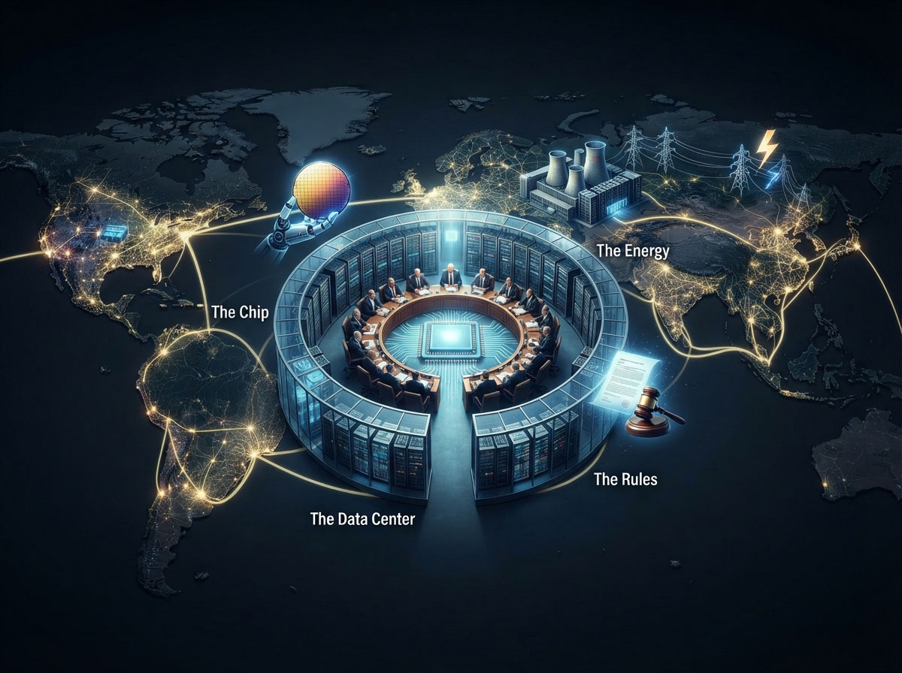
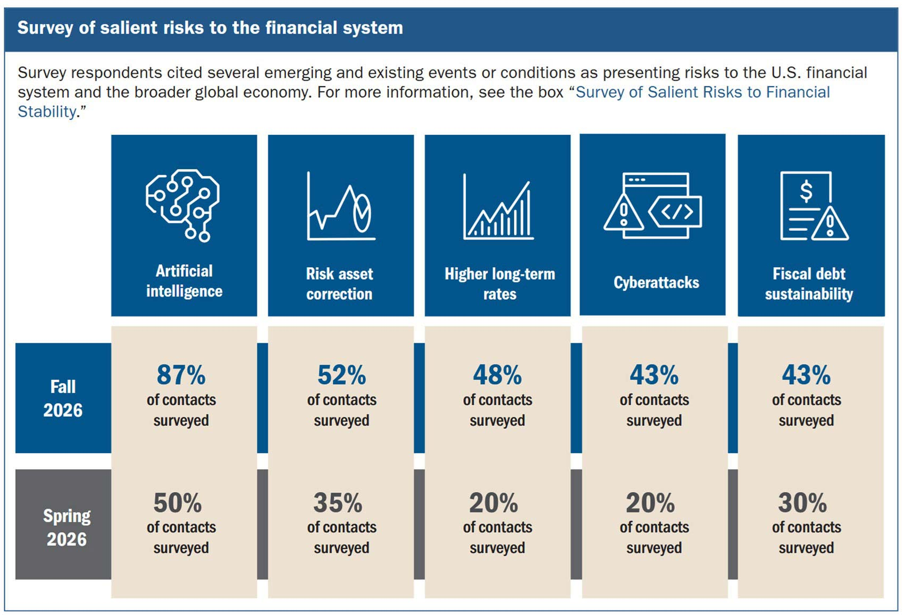

# Chip, muri, corrente: dove abita il potere dell’AI?

*La mappa fisica dell’AI nel 2026, tra debiti, embarghi che perdono acqua, regole sotto accusa e corrente elettrica. 2850 milioni di dollari, e non torneranno indietro. È l’anticipo non rimborsabile che SoftBank aveva versato per prenotare macchinari elettrici destinati ai suoi data center americani, prima di cambiare i piani e scoprire di averne ordinati più del necessario. Con altri 880 milioni tra modifiche e liquidazioni dei contratti, [la svalutazione sale a 3,7 miliardi](https://aistockwire.com/blog/softbank-sftby-7-billion-loss-ai-power-equipment-write-off-november-2026) e pesa su [una perdita trimestrale di 7,1 miliardi](https://www.business-standard.com/world-news/softbank-posts-7-bn-loss-as-us-data-centre-costs-mount-amid-ai-concerns-126111000403_1.html). Prima di chiedersi chi comanda, bisogna capire chi paga: l’AI costruisce prima di incassare, e il debito è il primo anello del potere.*

Quando turbine e trasformatori hanno tempi d’attesa di anni, chi vuole costruire paga per entrare in fila, e se la fila cambia direzione il biglietto non si rimborsa. Secondo Bloomberg la revisione dei piani segue un brusco ripensamento sulle prospettive dell’AI dopo le elezioni di metà mandato, vinte da candidati democratici con programmi ostili ai data center. La società parla di perdita temporanea e precisa che gli ordini cancellati non implicano un ridimensionamento dei progetti in corso.

In questo clima va letto il dato che ha fatto il giro del mondo: l’87% dei contatti di mercato interpellati dalla Fed indica l’AI come rischio per la stabilità finanziaria, contro il 50% della primavera. Conviene guardarlo da vicino. Nel [Financial Stability Report del 13 novembre](https://www.federalreserve.gov/publications/files/financial-stability-report-20261113.pdf), [come ricostruisce Brave New Coin](https://bravenewcoin.com/insights/fed-ai-risk-survey-87-percent-financial-stability-crypto), gli interpellati sono 23, venti dei quali hanno nominato l’AI (in primavera erano dieci su venti), e il sondaggio non rappresenta la posizione né del Board né della Fed di New York. Tra i timori raccolti figurano [attacchi informatici, finanziamenti sempre più complessi e utili che potrebbero deludere](https://www.nationthailand.com/news/world/40073507). Una fotografia di percezioni, quindi, non una misura del rischio, ma che indica con precisione dove guardano gli addetti ai lavori: a come si paga tutto questo cemento.

I conti dei due laboratori più osservati raccontano la stessa tensione con numeri diversi. OpenAI ha comunicato agli investitori, secondo [documenti visti dal Wall Street Journal](https://thenextweb.com/news/openai-revenue-q3-10bn-operating-loss), ricavi trimestrali di circa 10 miliardi, in crescita del 50%, con un margine operativo rettificato passato da meno 150% a meno 109%. La percentuale migliora, ma la perdita rettificata sale da 10,1 a 10,9 miliardi, perché, in valore assoluto, i costi aumentano più dei ricavi. Anthropic ha dichiarato nel prospetto per la quotazione 17 miliardi di ricavi nel trimestre e una perdita operativa di 567 milioni, con una crescita rallentata al 47% dopo il 144% del trimestre precedente. Le due aziende non è detto usino lo stesso metro per il «rettificato», e il confronto diretto è un azzardo.

L’altra metà di quel bilancio sono i muri. Il prospetto indica impegni di spesa minimi per [almeno 121,3 miliardi con Google fino al 2033](https://fourweekmba.com/ai-anthropic-raises-its-google-spending-floor-to-121-3b/) e 110 con Amazon fino al 2036, dovuti a prescindere dall’uso effettivo. L’accesso al calcolo non è un privilegio gratuito: [secondo la Reuters](https://www.thestar.com.my/tech/tech-news/2026/09/30/exclusive-anthropic-ipo-prospectus-lays-bare-deep-dependence-on-big-tech-partners) la società avverte di dipendere da Amazon, Google e Microsoft, che sono insieme fornitori, clienti e concorrenti, e [stando a una lettura della bozza](https://www.vktr.com/ai-market/anthropics-s1-shows-163b-in-revenue-and-compute-squeeze/) alcuni di loro non le hanno dato tutta la capacità richiesta. Chi vende l’accesso al calcolo, intanto, incassa: i ricavi di Google Cloud sono [cresciuti del 103% a 30,7 miliardi](https://techcrunch.com/2026/10/28/google-expands-ai-search-ads-globally-as-core-ad-growth-slows/), mentre la crescita della pubblicità sulla ricerca rallentava dal 17% al 12%. Google [cita il cambio, la spesa più debole di alcuni inserzionisti in Asia e Pacifico dopo il trimestre del Mondiale e la minore monetizzazione di AI Mode](https://www.europeanbusinessreview.com/google-expands-ads-in-ai-mode-as-search-growth-slows/), mentre [le ricerche crescono al ritmo più alto da cinque anni](https://www.marketingdive.com/news/googles-ai-overhaul-of-search-hits-snags-as-ad-revenue-growth-cools/). Più utilizzo, meno incasso per ogni risposta: un problema che ha chi vende pubblicità, non chi vende le vanghe.

## Embarghi che fanno acqua

Il secondo anello è il chip: chi lo vende, chi lo noleggia e chi lo controlla, e per ora il controllo si ferma alla dogana.

Nella seconda stagione di *The Wire* la polizia di Baltimora scopre che il porto è il posto dove si decide tutto: i controlli guardano i manifesti dei container, mentre il contenuto è un’altra storia. L’export dei chip soffre dello stesso difetto: il documento controllato è quello del compratore, mentre la scheda, una volta varcata la dogana, può cambiare indirizzo. Lo suggerisce un dato che [Finimize riprende da una comunicazione di Singapore](https://finimize.com/content/southeast-asias-ai-data-centers-brace-for-tighter-us-chip-rules): il 22% delle vendite di chip Nvidia risultava fatturato a soggetti con attività nella città-stato, ma solo l’1% vi era arrivato fisicamente.

Chi non può comprare, noleggia. Le aziende cinesi di AI, [secondo la Reuters](https://www.thestandard.com.hk/finance/article/348284/Chinese-AI-firms-rush-to-secure-Nvidia-chip-capacity-as-spy-scandal-stirs-fear-of-US-curbs), cercano di prenotare capacità Nvidia in data center fuori dalla Cina, temendo che lo scandalo attorno a Jensen Huang induca Washington a stringere sull’uso da remoto. Il provvedimento temuto è il Remote Access Security Act, [approvato dalla Camera con 369 voti contro 22 il 12 gennaio](https://www.theregister.com/2026/01/13/congress_votes_china_gpu_cloud/) e da allora in attesa al Senato, dove [esiste una versione con ambito diverso](https://fourweekmba.com/ai-nvidia-cloud-bill-explained-369-22-house-vote-305-day-wait/): quella della Camera copre qualsiasi soggetto straniero, quella del Senato solo le persone considerate a rischio, e scade dopo dieci anni.

La Malaysia ha scelto la via del registro. Il ministro del Commercio Johari Abdul Ghani ha annunciato che il governo [valuta una legge](https://www.thestandard.com.hk/world/article/348319/Malaysia-weighs-law-to-monitor-data-centre-operations-chips-use-trade-minister-says) per monitorare i data center e l’uso dei chip ad alte prestazioni, [chiedendo a chi vuole aprirne uno di dichiarare gestori, sedi e numero di GPU importate](https://www.thevibes.com/index.php/articles/news/129471/malaysia-moves-to-tighten-data-centre-controls-amid-scrutiny-over-nvidia-chip-exports). Lo stesso ministro ha però aggiunto che, se un operatore compra le GPU per uso proprio, non vede quale legge permetterebbe di indagarlo. Se ne ricava che il controllo guarda all’ingresso del chip più che al suo uso, e l’uso è il punto dolente.

Il caso Moonshot mostra la distanza fra le due cose. [Bloomberg ha riportato](https://www.bloomberg.com/news/articles/2026-11-10/moonshot-rents-nvidia-s-top-ai-chips-in-china-documents-show) documenti depositati in una banca dati creditizia cinese, secondo cui il laboratorio avrebbe firmato in agosto per noleggiare in Cina 32 server Super Micro con GPU Nvidia B300, per 432 milioni di yuan. Moonshot contesta l’accuratezza delle carte e nega rapporti con la società proprietaria; Nvidia e Super Micro negano legami diretti, e [Bloomberg non ha potuto accertare se esistesse una licenza](https://www.analyticsinsight.net/news/moonshot-ais-nvidia-b300-deal-32-servers-worth-usd-648-million). Dopo le richieste di commento, [il nome di Moonshot è sparito dai documenti consultabili](https://www.newsbytesapp.com/news/science/chinese-ai-firm-moonshot-ai-accessed-advanced-nvidia-chips/story). Tutto da verificare, quindi, ma il meccanismo descritto spiega perché i controlli sul chip fisico non bastino.

Sullo sfondo c’è la caduta di Huang, che il 12 novembre [si è dimesso da amministratore delegato e dal consiglio di Nvidia](https://www.onmanorama.com/news/business/2026/11/12/nvidia-ceo-and-co-founder-jensen-huang-steps-down.html) dopo le notizie sul suo rapporto con Alice Huang, ex dirigente di Megaspeed, [partner di Nvidia nel Sud-est asiatico che aveva comprato chip per 4,8 miliardi](https://www.aljazeera.com/news/2026/11/12/ai-titan-jensen-huang-out-as-nvidia-ceo). L’intelligence americana, secondo la stampa, la sospetta di lavorare per Pechino; [Pechino smentisce e le autorità di Singapore dicono di non averla identificata come agente cinese](https://www.dexerto.com/gaming/nvidia-ceo-jensen-huang-resigns-amid-spy-controversy-3427694/). Sono sospetti, non accertamenti giudiziari, e non conosco gli esiti della verifica aperta dal consiglio di Nvidia. A pagare il conto del sospetto rischia di essere l’operatore corretto, che [dovrà documentare dove sta ogni scheda e per chi lavora](https://finimize.com/content/southeast-asias-ai-data-centers-brace-for-tighter-us-chip-rules).

## Chi scrive le regole

Il terzo anello è la regola, che decide a chi spetta il chip e viene scritta mentre i dati sono incompleti e gli interessi sono molti.

Le regole sul noleggio non sono ancora scritte, e qualcuno le sta scrivendo. [Un’inchiesta del New York Times](https://www.nytimes.com/2026/11/15/us/politics/trump-lutnick-ai-chips-nvidia-cantor-fitzgerald.html), [riferita da Business Standard](https://www.business-standard.com/world-news/nvidia-row-lutnick-pushed-to-weaken-chip-rules-linked-to-family-business-126111500775_1.html), ricostruisce come il segretario al Commercio Howard Lutnick abbia spinto per limiti meno estesi su data center esteri come A201, il centro che Bitdeer sta costruendo a Johor, in Malaysia, e che dovrebbe aprire nel 2027 [fornendo calcolo a un gigante tecnologico cinese, forse Tencent](https://local21news.com/news/nation-world/lutnick-pushed-narrower-chip-curbs-as-critics-warned-china-could-gain-ground-in-ai). Bitdeer è cliente di Cantor Fitzgerald, società che Lutnick ha guidato per decenni e affidato ai figli entrando nell’amministrazione, e che per Bitdeer ha fatto da agente di vendita in un’offerta di azioni fino a un miliardo di dollari.

Il quadro va completato. Per lo stesso articolo non ci sono prove che gli investimenti di Cantor abbiano influenzato le decisioni di Lutnick, il Dipartimento dice che ha rispettato tutti gli impegni etici, e [un portavoce esclude discussioni d’affari con i figli](https://www.inquirer.com/news/nation-world/howard-lutnick-commerce-secretary-rules-data-centers-nvidia-chips-china-southeast-asia-cantor-fitzgerald-20261115.html). Ci troviamo davanti a un potenziale conflitto d’interessi, non a un illecito accertato, e la distinzione non è un cavillo.

Resta una questione che prescinde da Lutnick: oggi vendere chip alla Cina è vietato, mentre [noleggiarne l’accesso da un data center estero resta consentito](https://www.newsbytesapp.com/news/business/howard-lutnick-seeks-nvidia-export-relaxation-to-allow-china-rentals/tldr). Per chi vuole chiudere quella porta è una falla evidente; per chi gestisce data center nei Paesi ospitanti, un divieto sul noleggio trasformerebbe ogni cliente straniero in un sospetto e ogni contratto in una pratica. Chi abbia ragione dipende da un dato che manca: [non è noto quanta capacità sia stata prenotata, né presso chi](https://fourweekmba.com/ai-chinese-ai-firms-rush-for-nvidia-cloud-bill-waits-304-days/). Le regole sull’AI si scrivono, per ora, senza sapere quanto pesi il problema.

## Corrente e cemento

Il quarto anello è fisico: un data center vale quanto la corrente che lo alimenta, e la corrente ha un territorio che può dire di no.

In *Frostpunk* una città gela attorno a un generatore a carbone, e ogni scelta morale si riduce a quanta corrente si riesce a produrre e a che prezzo. Sembra un videogioco di sopravvivenza ed è, in miniatura, il quadro dei campi di supercalcolo.

Le stime di novembre dell’EIA prevedono per gli Stati Uniti consumi elettrici che passano da 4.216 miliardi di chilowattora nel 2025 a 4.306 nel 2026 e 4.370 nel 2027, un aumento complessivo di 154 miliardi. La Reuters lo attribuisce ai data center per l’AI e all’elettrificazione di case e imprese, ma [la panoramica dell’EIA non nomina l’AI come causa](https://letsdatascience.com/news/eia-forecasts-record-us-electricity-demand-through-2027-0bbee083) e offre solo totali nazionali: quanta parte dell’aumento sia dei data center è una stima di contorno, non un dato dell’agenzia.

SpaceX ha annunciato [oltre 74 miliardi di investimenti](https://tucson.com/news/local/business/article_042ebd02-d2a8-4a84-8252-e3d59ecd2276.html) in due campus: circa 50 nella contea di Cochise, in Arizona, e più di 24 a Starbase, in Texas. Sono piani, non spese già sostenute. L’Arizona attende l’approvazione della contea, con [una petizione da 2.400 firme contro e un’udienza a dicembre](https://tucson.com/news/local/business/article_042ebd02-d2a8-4a84-8252-e3d59ecd2276.html); promette raffreddamento a secco e [potrebbe arrivare a 6 gigawatt](https://www.etvbharat.com/en/technology/spacex-announces-over-usd-74-billion-investment-in-texas-arizona-supercomputing-campuses-enn26111300821). Starbase produrrà l’elettricità in proprio con una centrale a gas, e il 9 dicembre la commissione cittadina esaminerà gli sgravi fiscali. SpaceX sostiene, [come riferisce la Reuters](https://www.businessday.co.za/world/international-companies/2026-11-12-spacex-plans-74bn-ai-expansion-in-texas-and-arizona/), che il progetto arizoniano potrebbe ridurre le bollette dei soci delle cooperative elettriche fino al 20%; [i residenti, riferisce The Next Web](https://thenextweb.com/news/spacex-74b-ai-computing-centers-arizona-texas), temono per acqua, bollette e fauna.

Il costruttore è anche un locatore: secondo [Bloomberg, riportata da The Next Web](https://thenextweb.com/news/spacex-74b-ai-computing-centers-arizona-texas), Anthropic è il suo primo cliente per circa un terzo dei ricavi, e Google si è impegnata a pagare 920 milioni al mese. Il prospetto di Anthropic [indica impegni fino a 120,5 miliardi con SpaceX entro il 2029](https://www.mobileworldlive.com/?p=516583). Una centrale a gas ha un impatto ambientale diretto, e il confronto con le alternative è il vero nodo: chi vince è chi ottiene corrente prima degli altri, chi perde è chi abita accanto e paga la bolletta.

[Immagine tratta da federalreserve.gov](https://www.federalreserve.gov/publications/files/financial-stability-report-20261113.pdf)

## Pesi aperti, hardware?

C’è chi pensa di uscire dalla catena eseguendo i modelli in casa: vediamo fino a dove funziona.

Si dice spesso che l’AI locale sia la risposta alla concentrazione del potere: scarichi i pesi e sei libero. Il 20 ottobre DeepSeek ha dato forza a questa idea [pubblicando DeepInfer](https://siliconangle.com/2026/10/20/deepseek-open-sources-deepinfer-the-inference-framework-behind-its-production-services/), il motore con cui serve i suoi modelli in produzione, [su GitHub](https://github.com/deepseek-ai/DeepInfer) con licenza Apache 2.0. Dopo l’uscita è circolato [un calcolo che stima un margine lordo dell’82%](https://eu.36kr.com/en/p/4035800747578243), ma è una stima di terzi, che presuppone un uso molto alto e un affitto di 7 dollari l’ora per una GPU B300, e [non esiste ancora un confronto indipendente sull’efficienza](https://www.business-standard.com/amp/world-news/deepseek-unveils-open-source-tool-to-cut-ai-operating-costs-for-businesses-126102100247_1.html).

Quel che interessa a chi legge dall’Italia è un’altra cosa. Per [un’analisi tecnica](https://www.buildmvpfast.com/blog/deepinfer-deepseek-inference-engine-open-source-2026), DeepInfer richiede cluster molto grandi, con una soglia di 128 GPU, e la versione pubblicata non comprende tre componenti necessari a un servizio completo. Serve per capire come lavora un grande fornitore, non per girare sul portatile. [Come sottolinea già nel titolo The New Stack](https://thenewstack.io/deepseek-deepinfer-huawei-nvidia/), DeepSeek dà a Huawei lo stesso rilievo di Nvidia, un segnale che l’ecosistema si sta aprendo oltre un solo produttore.

I casi raccontati in questo articolo riguardano la Cina e i grandi flussi di data center. Nulla, nei documenti citati, riguarda chi compra una scheda per eseguire un modello a casa. I limiti dell’AI locale sono altri: quanta memoria ci si può permettere, quanta corrente consuma la macchina, quanto è grande il modello che si vuole usare. La dipendenza vera comincia quando si passa dal modello al servizio, perché lì contano i muri e chi li possiede. Chi difende i pesi aperti ricorda che riducono la dipendenza da un solo fornitore; chi li teme osserva che nessuno può richiamare un modello già scaricato. Entrambe le tesi reggono, e nessuna delle due risolve la bolletta.

## Stop e responsabilità

Se la catena è questa, resta da chiedersi chi ne risponde e se qualcuno possa fermarla.

Il 12 novembre quattro organizzazioni senza scopo di lucro, [Public Citizen, Heat Initiative, Irreplaceable Education Fund e Alliance for Secure AI](https://www.exchange4media.com/digital-news/openai-google-anthropic-meta-and-spacex-sued-over-frontier-ai-development-160200.html), [hanno citato in giudizio](https://www.aljazeera.com/news/2026/11/12/us-nonprofits-sue-tech-giants-to-halt-ai-development) OpenAI, Anthropic, Google, Meta e la divisione AI di SpaceX davanti alla Corte superiore di San Francisco, chiedendo di congelare lo sviluppo dei modelli più avanzati. Si appellano alla legge californiana sulla concorrenza sleale e alla dottrina del [disturbo pubblico](https://www.latintimes.com/nonprofits-sue-ai-companies-halt-development-601304), e fanno leva [sugli avvertimenti dei dirigenti stessi](https://www.claimsjournal.com/news/national/2026/11/13/341283.htm) sui rischi dei sistemi che costruiscono. Le accuse sono tutte da dimostrare, e [secondo un’analisi la teoria legale non è mai stata messa alla prova](https://fourweekmba.com/ai-nonprofits-sue-openai-anthropic-google-to-freeze-ai-models/).

Il legame con il tema di questo articolo è meno astratto di quanto sembri. Un congelamento colpirebbe un sistema che ha già impegnato somme enormi, dalle prenotazioni di SoftBank ai contratti con Google e Amazon da pagare a prescindere dall’uso. Per i querelanti, proprio questa corsa a investire rende urgente un freno in assenza di regole federali; per le aziende, un blocco deciso da un tribunale statale sarebbe un rischio in più dopo quelli già visti. C’è anche un dettaglio che dice molto: tra i convenuti c’è la divisione AI di SpaceX, la stessa SpaceX che, secondo Bloomberg, affitta calcolo ad Anthropic e Google, altri due convenuti. Costruttore, locatore e imputato nello stesso fascicolo. La domanda su chi risponda del rischio, tra chi sviluppa, chi affitta i muri e chi dovrebbe regolarli, è ancora senza risposta.

## Il potere ha indirizzo

Se si deve ridurre tutto a una frase: l’intelligenza artificiale è diventata un’industria di cantieri e di debiti, e il potere sta dove si decide chi compra il chip, chi costruisce il data center, chi fornisce la corrente e chi scrive le regole. Il resto, dalle perdite di SoftBank al noleggio dei server in Cina, dai campus in Arizona alla causa di San Francisco, sono variazioni dello stesso tema: l’infrastruttura è il punto in cui l’AI smette di essere software e diventa politica, finanza e territorio.

Restano aperte almeno quattro domande. Il Senato approverà il Remote Access Security Act, e in quale versione? La legge malese guarderà solo all’ingresso dei chip o anche al loro uso? I ricavi dell’AI cresceranno abbastanza in fretta da pagare impegni che non si possono cancellare? E chi risponderà, davanti a un giudice o a un elettore, di corrente e acqua per campus come quelli di Cochise e Starbase? Nessuna di queste risposte dipende da quanto sia intelligente un modello. Prima di essere intelligente, l’intelligenza artificiale ha un indirizzo, una bolletta e un proprietario.