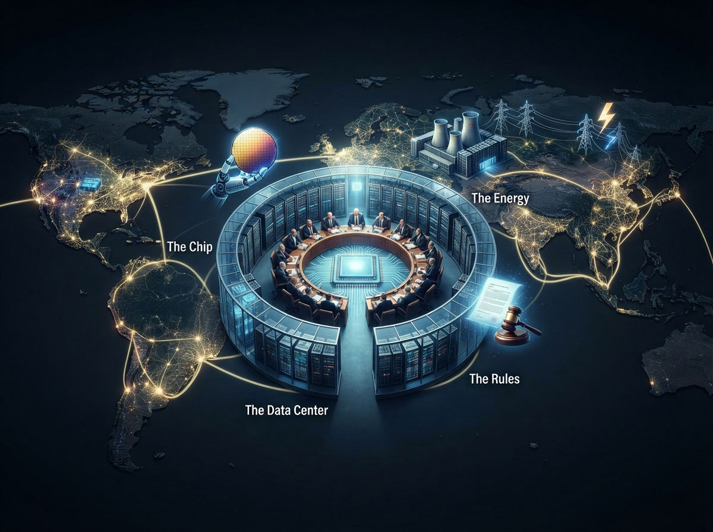
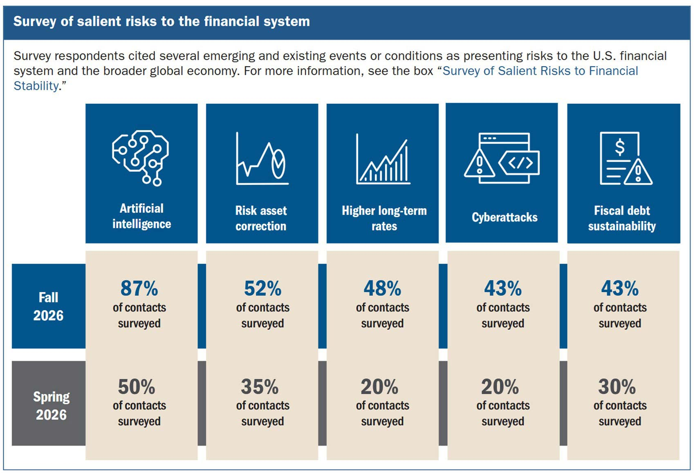

# Chips, Mauern, Strom: wo AI-Macht wohnt?

*Die physische Landkarte der KI im Jahr 2026, zwischen Schulden, Embargos, die Wasser verlieren, Regeln unter Scrutiny und elektrischer Energie. 2,85 Milliarden Dollar, und sie werden nicht zurückkehren. Es ist die nicht erstattbare Vorauszahlung, die Softbank für elektrische Ausrüstung geleistet hatte, die für ihre amerikanischen Rechenzentren bestimmt war, bevor sie ihre Pläne änderte und entdeckte, dass sie mehr bestellt hatte als notwendig. Mit weiteren 880 Millionen in Änderungen und Vertragsliquidierungen [steigt der Abschreibungsbetrag auf 3,7 Milliarden](https://aistockwire.com/blog/softbank-sftby-7-billion-loss-ai-power-equipment-write-off-november-2026) und belastet [einen vierteljährigen Verlust von 7,1 Milliarden](https://www.business-standard.com/world-news/softbank-posts-7-bn-loss-as-us-data-centre-costs-mount-amid-ai-concerns-126111000403_1.html). Bevor man fragt, wer befiehlt, muss man verstehen, wer zahlt: KI baut vor der Einnahme, und die Schuld ist das erste Glied der Macht.*

Wenn Turbinen und Transformatoren Wartezeiten von Jahren haben, muss jeder, der bauen will, zahlen, um in die Schlange einzusteigen, und wenn sich die Schlange ändert, wird das Ticket nicht erstattet. Laut Bloomberg folgt die Überprüfung der Pläne einem plötzlichen Umdenken über die Aussichten der KI nach den Zwischenwahlen, die von demokratischen Kandidaten mit Programmen gewonnen wurden, die Rechenzentren feindlich gegenüberstehen. Das Unternehmen spricht von einem vorübergehenden und genauen Verlust, der stornierte Aufträge nicht eine Reduzierung der laufenden Projekte implizieren.

In diesem Klima muss das Datum, das die Welt umkreist, gelesen werden: 87% der vom Fed befragten Marktkontakte zeigt die KI als Risiko für die finanzielle Stabilität gegenüber 50% im Frühling. Es lohnt sich, es genau anzusehen. Im [Finanzstabilitätsbericht vom 13. November](https://www.federalreserve.gov/publications/files/financial-stability-report-20261113.pdf), [wie von Brave New Coin rekonstruiert](https://bravenewcoin.com/insights/fed-ai-risk-survey-87-percent-financial-stability-crypto), sind 23 befragt, zwanzig davon haben die KI genannt (im Frühling waren es zehn von zwanzig), und die Umfrage repräsentiert nicht die Position des Rates oder der New York Fed. Unter den gesammelten Ängsten sind [Cyberangriffe, zunehmend komplexe Finanzierungen und Gewinne, die enttäuschen könnten](https://www.nationthailand.com/news/world/40073507). Ein Foto von Wahrnehmungen, daher, keine Messung des Risikos, aber eines, das genau zeigt, wo die Fachleute hinschauen: darauf, wie all dieser Beton bezahlt wird.

Die Konten der beiden am meisten beobachteten Labore erzählen die gleiche Spannung mit verschiedenen Zahlen. OpenAI hat Investoren gemäß [Dokumenten, die vom Wall Street Journal gesehen wurden](https://thenextweb.com/news/openai-revenue-q3-10bn-operating-loss), vierteljährliche Einnahmen von etwa 10 Milliarden mit einem Wachstum von 50%, mit einer bereinigten operativen Gewinnmarge, die von minus 150% auf minus 109% steigt. Der Prozentsatz verbessert sich, aber der bereinigte Verlust steigt von 10,1 auf 10,9 Milliarden, weil die Kosten in absoluten Zahlen mehr als die Einnahmen steigen. Anthropic hat im IPO-Prospekt 17 Milliarden Einnahmen im Quartal und einen operativen Verlust von 567 Millionen mit einem verlangsamen Wachstum von 47% nach den 144% des vorherigen Quartals angegeben. Die beiden Unternehmen verwenden möglicherweise nicht das gleiche Maß für den «bereinigten», und der direkte Vergleich ist eine Wette.

Die andere Hälfte dieser Bilanz sind die Mauern. Der Prospekt zeigt minimale Ausgabenverpflichtungen für [mindestens 121,3 Milliarden mit Google bis 2033](https://fourweekmba.com/ai-anthropic-raises-its-google-spending-floor-to-121-3b/) und 110 Milliarden mit Amazon bis 2036, unabhängig vom tatsächlichen Gebrauch. Der Zugang zur Rechenleistung ist kein kostenloses Privileg: [laut Reuters](https://www.thestar.com.my/tech/tech-news/2026/09/30/exclusive-anthropic-ipo-prospectus-lays-bare-deep-dependence-on-big-tech-partners) warnt das Unternehmen von der Abhängigkeit von Amazon, Google und Microsoft, die zusammen Lieferanten, Kunden und Konkurrenten sind, und [laut einer Lektüre des Entwurfs](https://www.vktr.com/ai-market/anthropics-s1-shows-163b-in-revenue-and-compute-squeeze/) haben einige von ihnen ihr nicht die gesamte geforderte Kapazität gegeben. Inzwischen kassieren diejenigen, die den Zugang zur Rechenleistung verkaufen: Die Einnahmen von Google Cloud [wuchsen um 103% auf 30,7 Milliarden](https://techcrunch.com/2026/10/28/google-expands-ai-search-ads-globally-as-core-ad-growth-slows/), während das Werbewachstum in der Suche von 17% auf 12% verlangsamt wurde. Google [zitiert Währungsumtausch, schwächere Ausgaben einiger Werbetreibender in Asien und Pazifik nach dem Weltmeisterschafts-Quartal und geringere Monetarisierung von AI Mode](https://www.europeanbusinessreview.com/google-expands-ads-in-ai-mode-as-search-growth-slows/), während [Suchanfragen das höchste Wachstum der letzten fünf Jahre verzeichnen](https://www.marketingdive.com/news/googles-ai-overhaul-of-search-hits-snags-as-ad-revenue-growth-cools/). Mehr Nutzung, weniger Einnahmen pro Antwort: ein Problem für diejenigen, die Werbung verkaufen, nicht für diejenigen, die Schaufeln verkaufen.

## Embargos, die Wasser verlieren

Das zweite Glied ist der Chip: wer ihn verkauft, wer ihn verleiht und wer ihn kontrolliert, und zur Zeit endet die Kontrolle an der Zollbehörde.

In der zweiten Staffel von *The Wire* stellt die Polizei von Baltimore fest, dass der Hafen der Ort ist, wo alles entschieden wird: Inspektionen prüfen Containermanifeste, während der Inhalt eine andere Geschichte ist. Chip-Exporte leiden unter dem gleichen Mangel: Das geprüfte Dokument ist das des Käufers, während der Chip, sobald er den Zoll passiert, die Adresse ändern kann. Dies wird durch einen Datenpunkt angedeutet, den [Finimize aus einer Mitteilung Singapurs übernimmt](https://finimize.com/content/southeast-asias-ai-data-centers-brace-for-tighter-us-chip-rules): 22% der Nvidia-Chipverkäufe wurden auf Subjekte mit Aktivitäten im Stadtstaat abgerechnet, aber nur 1% war physisch dort angekommen.

Diejenigen, die nicht kaufen können, mieten. Chinesische KI-Unternehmen [suchen nach Angaben von Reuters](https://www.thestandard.com.hk/finance/article/348284/Chinese-AI-firms-rush-to-secure-Nvidia-chip-capacity-as-spy-scandal-stirs-fear-of-US-curbs) Nvidia-Kapazität in Rechenzentren außerhalb Chinas zu reservieren, fürchten, dass der Skandal um Jensen Huang Washington dazu bringen wird, auf Fernnutzung zuzudrängen. Das gefürchtete Gesetz ist das Remote Access Security Act, [das vom Repräsentantenhaus mit 369 Stimmen gegen 22 am 12. Januar verabschiedet wurde](https://www.theregister.com/2026/01/13/congress_votes_china_gpu_cloud/) und seitdem im Senat wartet, wo [eine Version mit anderem Umfang existiert](https://fourweekmba.com/ai-nvidia-cloud-bill-explained-369-22-house-vote-305-day-wait/): Die Repräsentantenhaus-Version deckt jedes ausländische Subjekt ab, die Senats-Version nur Personen, die als riskant gelten, und läuft nach zehn Jahren ab.

Malaysia hat den Weg des Registers gewählt. Der Handelsminister Johari Abdul Ghani kündigte an, dass die Regierung [ein Gesetz erwägt](https://www.thestandard.com.hk/world/article/348319/Malaysia-weighs-law-to-monitor-data-centre-operations-chips-use-trade-minister-says), um Rechenzentren und die Nutzung von High-Performance-Chips zu überwachen, [und diejenigen, die eines eröffnen wollen, auffordert, Manager, Standorte und Anzahl importierter GPUs zu deklarieren](https://www.thevibes.com/index.php/articles/news/129471/malaysia-moves-to-tighten-data-centre-controls-amid-scrutiny-over-nvidia-chip-exports). Der gleiche Minister hat jedoch hinzugefügt, dass wenn ein Betreiber GPUs für Eigenbedarf kauft, es unklar ist, welches Gesetz ihn untersuchen würde. Man kann ableiten, dass die Kontrolle den Eingang des Chips mehr als seine Nutzung betrachtet, und die Nutzung ist der schmerzliche Punkt.

Der Moonshot-Fall zeigt die Distanz zwischen den beiden Dingen. [Bloomberg berichtete](https://www.bloomberg.com/news/articles/2026-11-10/moonshot-rents-nvidia-s-top-ai-chips-in-china-documents-show) über Dokumente, die in einer chinesischen Kreditdatenbank hinterlegt sind, wonach das Labor im August unterzeichnet hätte, um in China 32 Super Micro-Server mit Nvidia B300-GPUs für 432 Millionen Yuan zu mieten. Moonshot bestreitet die Genauigkeit der Papiere und leugnet jegliche Beziehung zum Eigentümer; Nvidia und Super Micro bestreiten direkte Verbindungen, und [Bloomberg konnte nicht feststellen, ob eine Lizenz existierte](https://www.analyticsinsight.net/news/moonshot-ais-nvidia-b300-deal-32-servers-worth-usd-648-million). Nach Anfragen um Kommentare [ist der Name von Moonshot aus zugänglichen Dokumenten verschwunden](https://www.newsbytesapp.com/news/science/chinese-ai-firm-moonshot-ai-accessed-advanced-nvidia-chips/story). Alles zu überprüfen, daher, aber der beschriebene Mechanismus erklärt, warum physische Chip-Kontrollen nicht ausreichen.

Im Hintergrund steht Huangs Fall, der am 12. November [als CEO und vom Nvidia-Aufsichtsrat zurücktrat](https://www.onmanorama.com/news/business/2026/11/12/nvidia-ceo-and-co-founder-jensen-huang-steps-down.html) nach Neuigkeiten über seine Beziehung zu Alice Huang, ehemaliger Megaspeed-Managerin, [Nvidia-Partner in Südostasien, der Chips für 4,8 Milliarden gekauft hatte](https://www.aljazeera.com/news/2026/11/12/ai-titan-jensen-huang-out-as-nvidia-ceo). Die US-Intelligenz, laut Presse, verdächtigt sie, für Peking zu arbeiten; [Peking bestreitet dies und singapurische Behörden sagen, sie habe sie nicht als chinesische Agentin identifiziert](https://www.dexerto.com/gaming/nvidia-ceo-jensen-huang-resigns-amid-spy-controversy-3427694/). Dies sind Verdächtigungen, nicht gerichtliche Untersuchungen, und ich kenne die Ergebnisse der vom Nvidia-Aufsichtsrat eingeleiteten Überprüfung nicht. Derjenige, der den Preis des Verdachts zahlt, riskiert der richtige Betreiber zu sein, der [dokumentieren muss, wo sich jede Karte befindet und für wen sie arbeitet](https://finimize.com/content/southeast-asias-ai-data-centers-brace-for-tighter-us-chip-rules).

## Wer schreibt die Regeln

Das dritte Glied ist die Regulierung, die entscheidet, wer den Chip bekommt, und wird verfasst, während Daten unvollständig und Interessen zahlreich sind.

Regeln über das Vermieten sind noch nicht geschrieben, und jemand schreibt sie. [Eine Untersuchung des New York Times](https://www.nytimes.com/2026/11/15/us/politics/trump-lutnick-ai-chips-nvidia-cantor-fitzgerald.html), [zitiert von Business Standard](https://www.business-standard.com/world-news/nvidia-row-lutnick-pushed-to-weaken-chip-rules-linked-to-family-business-126111500775_1.html), rekonstruiert, wie Handelssekretär Howard Lutnick für weniger extensive Grenzen bei ausländischen Rechenzentren wie A201 plädierte, das Zentrum, das Bitdeer in Johor, Malaysia, baut und das 2027 eröffnen sollte [Rechenleistung für einen chinesischen Tech-Giganten bereitstellen, vielleicht Tencent](https://local21news.com/news/nation-world/lutnick-pushed-narrower-chip-curbs-as-critics-warned-china-could-gain-ground-in-ai). Bitdeer ist Kunde von Cantor Fitzgerald, das Unternehmen, das Lutnick jahrzehntelang leitete und seinem Sohn anvertraute, als er in die Verwaltung eintrat, und das für Bitdeer als Verkaufsagent in einer Aktienemission von bis zu einer Milliarde Dollar diente.

Das Bild muss vervollständigt werden. Für denselben Artikel gibt es keine Beweise, dass Cantors Investitionen Lutnicks Entscheidungen beeinflusst haben, das Ministerium sagt, es habe alle ethischen Verpflichtungen respektiert, und [ein Sprecher schließt Geschäftsgespräche mit seinen Söhnen aus](https://www.inquirer.com/news/nation-world/howard-lutnick-commerce-secretary-rules-data-centers-nvidia-chips-china-southeast-asia-cantor-fitzgerald-20261115.html). Wir stehen vor einem potenziellen Interessenkonflikt, nicht einem festgestellten Verstoß, und die Unterscheidung ist nicht pedantisch.

Es bleibt eine Frage, die über Lutnick hinausgeht: heute ist der Verkauf von Chips nach China verboten, während [das Vermieten von Zugang von einem ausländischen Rechenzentrum weiterhin erlaubt ist](https://www.newsbytesapp.com/news/business/howard-lutnick-seeks-nvidia-export-relaxation-to-allow-china-rentals/tldr). Für diejenigen, die diese Tür schließen wollen, ist es eine offensichtliche Lücke; für diejenigen, die Rechenzentren in Gastländern verwalten, würde ein Verbot des Vermieters jeden ausländischen Kunden zu einem Verdächtigen und jeden Vertrag zu Bürokratie machen. Wer recht hat, hängt von fehlenden Daten ab: [es ist unbekannt, wie viel Kapazität reserviert wurde, und bei wem](https://fourweekmba.com/ai-chinese-ai-firms-rush-for-nvidia-cloud-bill-waits-304-days/). KI-Regeln werden verfasst, zur Zeit, ohne zu wissen, wie schwer das Problem wiegt.

## Strom und Beton

Das vierte Glied ist physisch: ein Rechenzentrum ist so viel wert wie der Strom, der es speist, und Strom hat ein Territorium, das nein sagen kann.

In *Frostpunk* friert eine Stadt um einen Kohlegenerator herum, und jede moralische Wahl reduziert sich darauf, wie viel Strom man produzieren kann und zu welchem Preis. Es scheint ein Überlebens-Videospiel zu sein und ist in Miniatur das Bild der Supercomputing-Felder.

November-Schätzungen der EIA prognostizieren für die USA eine Stromversorgung, die von 4.216 Milliarden Kilowattstunden im Jahr 2025 zu 4.306 im Jahr 2026 und 4.370 im Jahr 2027 steigt, eine Gesamtsteigerung von 154 Milliarden. Reuters schreibt dies Rechenzentren für KI und Elektrifizierung von Häusern und Unternehmen zu, aber [die EIA-Übersicht nennt KI nicht als Ursache](https://letsdatascience.com/news/eia-forecasts-record-us-electricity-demand-through-2027-0bbee083) und bietet nur nationale Gesamtwerte: wie viel des Anstiegs auf Rechenzentren entfällt, ist eine umgebende Schätzung, keine Agentur-Daten.

SpaceX hat [über 74 Milliarden Investitionen](https://tucson.com/news/local/business/article_042ebd02-d2a8-4a84-8252-e3d59ecd2276.html) in zwei Campus angekündigt: etwa 50 im County Cochise, Arizona, und mehr als 24 bei Starbase, Texas. Dies sind Pläne, nicht bereits getragene Ausgaben. Arizona wartet auf die Genehmigung des Countys, mit [einer Petition von 2.400 Unterschriften gegen und einer Anhörung im Dezember](https://tucson.com/news/local/business/article_042ebd02-d2a8-4a84-8252-e3d59ecd2276.html); es verspricht trockene Kühlung und [kann auf 6 Gigawatt ansteigen](https://www.etvbharat.com/en/technology/spacex-announces-over-usd-74-billion-investment-in-texas-arizona-supercomputing-campuses-enn26111300821). Starbase wird den Strom unabhängig mit einem Gaskraftwerk produzieren, und am 9. Dezember wird der Stadtrat die Steuervergünstigungen prüfen. SpaceX behauptet, [wie Reuters berichtet](https://www.businessday.co.za/world/international-companies/2026-11-12-spacex-plans-74bn-ai-expansion-in-texas-and-arizona/), dass das Arizona-Projekt die Rechnungen der Mitglieder der Elektrizitätskooperativen um bis zu 20% senken könnte; [die Bewohner, laut The Next Web](https://thenextweb.com/news/spacex-74b-ai-computing-centers-arizona-texas), befürchten Wasser, Rechnungen und Tierwelt.

Der Bauherr ist auch ein Vermieter: laut [Bloomberg, berichtet von The Next Web](https://thenextweb.com/news/spacex-74b-ai-computing-centers-arizona-texas), ist Anthropic sein erster Kunde für etwa ein Drittel der Einnahmen, und Google hat sich verpflichtet, 920 Millionen monatlich zu zahlen. Anthropics Prospekt [zeigt Verpflichtungen von bis zu 120,5 Milliarden mit SpaceX bis 2029](https://www.mobileworldlive.com/?p=516583). Ein Gaskraftwerk hat direkte Umweltauswirkungen, und der Vergleich mit Alternativen ist der eigentliche Knoten: wer gewinnt, ist, wer zuerst Strom bekommt, wer verliert, ist, wer in der Nähe lebt und die Rechnung zahlt.

[Bild von federalreserve.gov](https://www.federalreserve.gov/publications/files/financial-stability-report-20261113.pdf)

## Offene Gewichte, Hardware?

Es gibt diejenigen, die glauben, aus der Kette herauszukommen, indem sie Modelle im Hause ausführen: wir sehen, wie weit es funktioniert.

Man sagt oft, dass lokale KI die Antwort auf die Konzentration der Macht ist: laden Sie die Gewichte herunter und Sie sind frei. Am 20. Oktober hat DeepSeek diese Idee gestärkt [indem es DeepInfer veröffentlichte](https://siliconangle.com/2026/10/20/deepseek-open-sources-deepinfer-the-inference-framework-behind-its-production-services/), den Motor, mit dem es seine Modelle in der Produktion bedient, [auf GitHub](https://github.com/deepseek-ai/DeepInfer) unter Apache 2.0 Lizenz. Nach der Veröffentlichung zirkulierte eine Berechnung, [die eine Bruttomarge von 82% schätzt](https://eu.36kr.com/en/p/4035800747578243), aber es ist eine Schätzung Dritter, die ein sehr hohes Niveau voraussetzt und eine Miete von 7 Dollar pro Stunde für eine B300-GPU, und [es gibt noch keinen unabhängigen Effizienzvergleich](https://www.business-standard.com/amp/world-news/deepseek-unveils-open-source-tool-to-cut-ai-operating-costs-for-businesses-126102100247_1.html).

Was für Leser aus Italien interessant ist, ist etwas anderes. Für [eine technische Analyse](https://www.buildmvpfast.com/blog/deepinfer-deepseek-inference-engine-open-source-2026) erfordert DeepInfer sehr große Cluster mit einer Schwelle von 128 GPUs, und die veröffentlichte Version umfasst nicht drei Komponenten, die für einen vollständigen Dienst notwendig sind. Es dient dazu, zu verstehen, wie ein großer Anbieter funktioniert, nicht für den Betrieb auf einem Laptop. [Wie The New Stack bereits im Titel hervorhebt](https://thenewstack.io/deepseek-deepinfer-huawei-nvidia/), gibt DeepSeek Huawei die gleiche Prominenz wie Nvidia, ein Signal, dass sich das Ökosystem über einen einzelnen Hersteller hinaus öffnet.

Die Fälle, die in diesem Artikel erzählt werden, betreffen China und große Rechenzentrumströme. Nichts in den zitierten Dokumenten betrifft jemanden, der eine Karte kauft, um ein Modell zu Hause auszuführen. Die Grenzen der lokalen KI sind andere: wie viel Speicher kann man sich leisten, wie viel Strom verbraucht die Maschine, wie groß ist das Modell, das verwendet werden soll. Die wahre Abhängigkeit beginnt, wenn man vom Modell zum Dienst geht, denn dort zählen Mauern und deren Besitzer. Diejenigen, die offene Gewichte verteidigen, erinnern daran, dass sie die Abhängigkeit von einem einzelnen Anbieter reduzieren; diejenigen, die sie fürchten, beobachten, dass niemand ein bereits heruntergeladenes Modell zurückrufen kann. Beide Thesen halten, und keine der beiden löst die Rechnung.

## Stop und Verantwortung

Wenn dies die Kette ist, bleibt zu fragen, wer dafür verantwortlich ist und ob jemand sie stoppen kann.

Am 12. November haben vier gemeinnützige Organisationen, [Public Citizen, Heat Initiative, Irreplaceable Education Fund und Alliance for Secure AI](https://www.exchange4media.com/digital-news/openai-google-anthropic-meta-and-spacex-sued-over-frontier-ai-development-160200.html), OpenAI, Anthropic, Google, Meta und die KI-Sparte von SpaceX vor dem Obersten Gericht von San Francisco verklagt [und beantragten](https://www.aljazeera.com/news/2026/11/12/us-nonprofits-sue-tech-giants-to-halt-ai-development) das Einfrieren der Entwicklung der fortschrittlichsten Modelle. Sie appellieren an das kalifornische Gesetz gegen unlauteren Wettbewerb und an die Doktrin der [öffentlichen Belästigung](https://www.latintimes.com/nonprofits-sue-ai-companies-halt-development-601304) und machen sich [Warnungen der Führungskräfte selbst](https://www.claimsjournal.com/news/national/2026/11/13/341283.htm) auf die Risiken der Systeme, die sie bauen. Alle Anschuldigungen müssen bewiesen werden, und [laut einer Analyse wurde die rechtliche Theorie noch nie getestet](https://fourweekmba.com/ai-nonprofits-sue-openai-anthropic-google-to-freeze-ai-models/).

Die Verbindung zum Thema dieses Artikels ist weniger abstrakt, als es scheint. Eine Einfrierung würde ein System treffen, das bereits enorme Summen verpflichtet hat, von SoftBank-Reservierungen bis zu Verträgen mit Google und Amazon, die unabhängig von der Nutzung zu zahlen sind. Für die Kläger macht dieses Investitionsrennen einen dringenden Bremsmechanismus erforderlich, in Abwesenheit federaler Regeln; für Unternehmen wäre ein von einem staatlichen Gericht getroffener Block eine zusätzliche Gefahr nach denen, die bereits gesehen wurden. Es gibt auch ein Detail, das viel sagt: Unter den Angeklagten ist die KI-Sparte von SpaceX, die gleiche SpaceX, die laut Bloomberg Rechenleistung an Anthropic und Google vermietet, zwei weitere Angeklagte. Baut, Vermieter und Angeklagter in derselben Akte. Die Frage, wer für das Risiko verantwortlich ist, zwischen denen, die entwickeln, die die Mauern mieten, und die sie regulieren sollten, bleibt unbeantwortet.

## Macht hat eine Adresse

Wenn alles auf einen Satz reduziert werden muss: künstliche Intelligenz ist zu einer Baustellen- und Schuldenindustrie geworden, und Macht dort, wo man entscheidet, wer den Chip kauft, wer das Rechenzentrum baut, wer Strom liefert und wer die Regeln schreibt. Der Rest, von SoftBank-Verlusten bis zum Leasing von Servern in China, von den Campus in Arizona bis zum Prozess in San Francisco, sind Variationen desselben Themas: Infrastruktur ist der Punkt, an dem KI aufhört, Software zu sein, und wird Politik, Finanzen und Territorium.

Mindestens vier Fragen bleiben offen. Wird der Senat das Remote Access Security Act genehmigen, und in welcher Version? Wird das malaysische Gesetz nur auf den Eingang der Chips oder auch auf ihre Nutzung schauen? Werden die KI-Einnahmen schnell genug wachsen, um Verpflichtungen zu zahlen, die nicht storniert werden können? Und wer wird vor einem Richter oder Wähler für Strom und Wasser für Campus wie denen in Cochise und Starbase verantwortlich sein? Keine dieser Antworten hängt davon ab, wie intelligent ein Modell ist. Bevor sie intelligent ist, hat künstliche Intelligenz eine Adresse, eine Rechnung und einen Besitzer.
