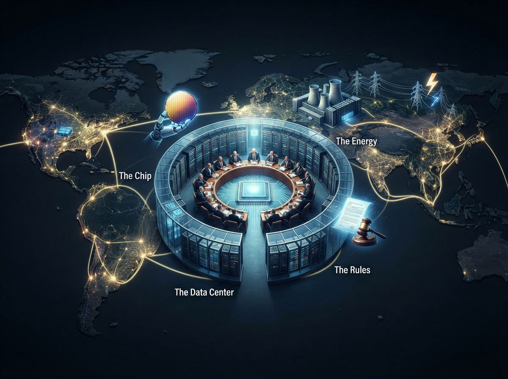
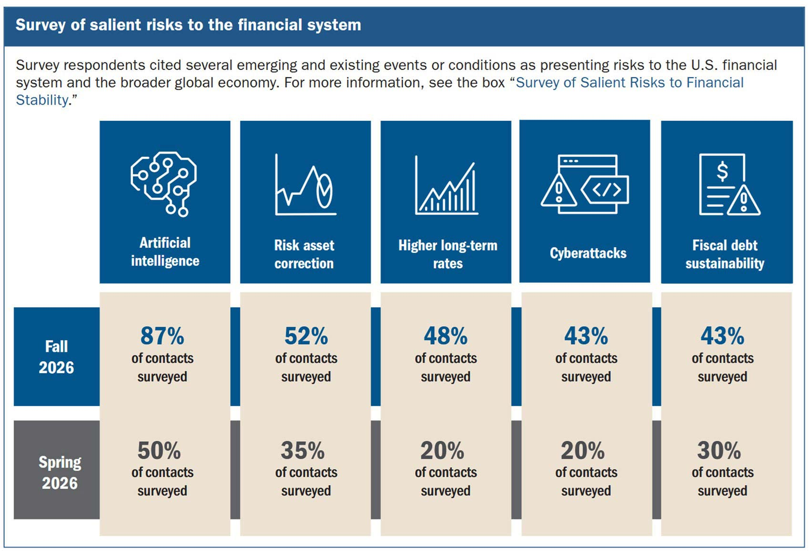

# Chips, walls, power: where AI power resides?

*The physical map of AI in 2026, between debts, embargoes that lose water, rules under scrutiny, and electrical power. $2.85 billion, and it won't come back. It's the non-refundable advance SoftBank had paid to reserve electrical equipment destined for its American data centers, before changing plans and discovering it had ordered more than necessary. With another $880 million in modifications and contract liquidations, [the write-down rises to $3.7 billion](https://aistockwire.com/blog/softbank-sftby-7-billion-loss-ai-power-equipment-write-off-november-2026) and weighs on [a quarterly loss of $7.1 billion](https://www.business-standard.com/world-news/softbank-posts-7-bn-loss-as-us-data-centre-costs-mount-amid-ai-concerns-126111000403_1.html). Before asking who commands, one must understand who pays: AI builds before collecting, and debt is the first link of power.*

When turbines and transformers have waiting times of years, whoever wants to build pays to get in line, and if the line changes direction, the ticket doesn't get refunded. According to Bloomberg, the revision of plans follows a sudden rethink on AI prospects after midterm elections, won by Democratic candidates with programs hostile to data centers. The company speaks of a temporary loss and clarifies that cancelled orders don't imply a downsizing of ongoing projects.

In this climate, the data that has circled the world must be read: 87% of market contacts polled by the Fed indicates AI as a risk to financial stability, against 50% in spring. It's worth looking at it closely. In the [Financial Stability Report of November 13](https://www.federalreserve.gov/publications/files/financial-stability-report-20261113.pdf), [as reconstructed by Brave New Coin](https://bravenewcoin.com/insights/fed-ai-risk-survey-87-percent-financial-stability-crypto), those polled are 23, twenty of whom named AI (in spring it was ten out of twenty), and the survey doesn't represent the position of either the Board or the New York Fed. Among the fears collected are [cyberattacks, increasingly complex financing, and revenues that could disappoint](https://www.nationthailand.com/news/world/40073507). A photograph of perceptions, therefore, not a measure of risk, but one that indicates precisely where industry professionals look: at how all this concrete is paid for.

The accounts of the two most observed laboratories tell the same tension with different numbers. OpenAI has communicated to investors, according to [documents seen by the Wall Street Journal](https://thenextweb.com/news/openai-revenue-q3-10bn-operating-loss), quarterly revenues of about $10 billion, growing 50%, with an adjusted operating margin passing from minus 150% to minus 109%. The percentage improves, but the adjusted loss rises from $10.1 to $10.9 billion because, in absolute terms, costs increase more than revenues. Anthropic declared in its IPO prospectus $17 billion in revenues for the quarter and an operating loss of $567 million, with growth slowing to 47% after the 144% of the previous quarter. The two companies may not use the same measure for «adjusted», and direct comparison is a gamble.

The other half of that balance sheet are the walls. The prospectus indicates minimum spending commitments for [at least $121.3 billion with Google until 2033](https://fourweekmba.com/ai-anthropic-raises-its-google-spending-floor-to-121-3b/) and $110 billion with Amazon until 2036, regardless of actual usage. Access to computing is not a free privilege: [according to Reuters](https://www.thestar.com.my/tech/tech-news/2026/09/30/exclusive-anthropic-ipo-prospectus-lays-bare-deep-dependence-on-big-tech-partners) the company warns of dependence on Amazon, Google, and Microsoft, which together are suppliers, clients, and competitors, and [according to a reading of the draft](https://www.vktr.com/ai-market/anthropics-s1-shows-163b-in-revenue-and-compute-squeeze/) some of them haven't given it all the capacity requested. Meanwhile, those selling access to computing collect: Google Cloud revenues [grew 103% to $30.7 billion](https://techcrunch.com/2026/10/28/google-expands-ai-search-ads-globally-as-core-ad-growth-slows/), while advertising growth on search slowed from 17% to 12%. Google [cites currency changes, weaker spending by some advertisers in Asia and the Pacific after the World Cup quarter, and lower monetization of AI Mode](https://www.europeanbusinessreview.com/google-expands-ads-in-ai-mode-as-search-growth-slows/), while [search queries grow at the highest rate in five years](https://www.marketingdive.com/news/googles-ai-overhaul-of-search-hits-snags-as-ad-revenue-growth-cools/). More usage, less income per answer: a problem for those who sell advertising, not for those who sell shovels.

## Embargoes that leak

The second ring is the chip: who sells it, who rents it, and who controls it, and for now control stops at customs.

In the second season of *The Wire*, the Baltimore police discover that the port is the place where everything is decided: inspections examine container manifests, while the content is another story. Chip exports suffer the same flaw: the examined document is the buyer's, while the chip, once it crosses customs, can change address. This is suggested by a data point that [Finimize picks up from a Singapore communication](https://finimize.com/content/southeast-asias-ai-data-centers-brace-for-tighter-us-chip-rules): 22% of Nvidia chip sales resulted from billing subjects with activities in the city-state, but only 1% had arrived physically there.

Those who cannot buy, rent. Chinese AI companies, [according to Reuters](https://www.thestandard.com.hk/finance/article/348284/Chinese-AI-firms-rush-to-secure-Nvidia-chip-capacity-as-spy-scandal-stirs-fear-of-US-curbs), are trying to reserve Nvidia capacity in data centers outside China, fearing that the scandal around Jensen Huang will induce Washington to tighten on remote use. The feared measure is the Remote Access Security Act, [approved by the House with 369 votes against 22 on January 12](https://www.theregister.com/2026/01/13/congress_votes_china_gpu_cloud/) and since then waiting in the Senate, where [there is a version with different scope](https://fourweekmba.com/ai-nvidia-cloud-bill-explained-369-22-house-vote-305-day-wait/): the House version covers any foreign subject, the Senate version only people considered at risk, and it expires after ten years.

Malaysia has chosen the registry route. Commerce Minister Johari Abdul Ghani announced that the government [is considering a law](https://www.thestandard.com.hk/world/article/348319/Malaysia-weighs-law-to-monitor-data-centre-operations-chips-use-trade-minister-says) to monitor data centers and the use of high-performance chips, [asking those who want to open one to declare managers, locations, and number of imported GPUs](https://www.thevibes.com/index.php/articles/news/129471/malaysia-moves-to-tighten-data-centre-controls-amid-scrutiny-over-nvidia-chip-exports). The same minister has, however, added that if an operator buys GPUs for own use, it's unclear which law would allow investigating them. It can be deduced that control looks at the chip's entry more than its use, and use is the painful point.

The Moonshot case shows the distance between the two things. [Bloomberg reported](https://www.bloomberg.com/news/articles/2026-11-10/moonshot-rents-nvidia-s-top-ai-chips-in-china-documents-show) documents deposited in a Chinese credit database, according to which the laboratory would have signed in August to rent in China 32 Super Micro servers with Nvidia B300 GPUs, for 432 million yuan. Moonshot contests the accuracy of the cards and denies any relationship with the owning company; Nvidia and Super Micro deny direct links, and [Bloomberg could not verify if a license existed](https://www.analyticsinsight.net/news/moonshot-ais-nvidia-b300-deal-32-servers-worth-usd-648-million). After requests for comment, [Moonshot's name has disappeared from accessible documents](https://www.newsbytesapp.com/news/science/chinese-ai-firm-moonshot-ai-accessed-advanced-nvidia-chips/story). Everything to be verified, therefore, but the described mechanism explains why physical chip controls aren't enough.

In the background is Huang's fall, who on November 12 [resigned as CEO and from Nvidia's board](https://www.onmanorama.com/news/business/2026/11/12/nvidia-ceo-and-co-founder-jensen-huang-steps-down.html) following news about his relationship with Alice Huang, former Megaspeed executive, [Nvidia's partner in Southeast Asia who had purchased chips for $4.8 billion](https://www.aljazeera.com/news/2026/11/12/ai-titan-jensen-huang-out-as-nvidia-ceo). American intelligence, according to the press, suspects her of working for Beijing; [Beijing denies it and Singaporean authorities say they haven't identified her as a Chinese agent](https://www.dexerto.com/gaming/nvidia-ceo-jensen-huang-resigns-amid-spy-controversy-3427694/). These are suspicions, not judicial investigations, and I don't know the outcomes of the inquiry opened by Nvidia's board. The one who pays the price of suspicion risks being the correct operator, who [will have to document where every card is and who it works for](https://finimize.com/content/southeast-asias-ai-data-centers-brace-for-tighter-us-chip-rules).

## Who writes the rules

The third ring is regulation, which decides who gets the chip and is written while data is incomplete and interests are numerous.

Rules on renting aren't written yet, and someone is writing them. [A New York Times investigation](https://www.nytimes.com/2026/11/15/us/politics/trump-lutnick-ai-chips-nvidia-cantor-fitzgerald.html), [referenced by Business Standard](https://www.business-standard.com/world-news/nvidia-row-lutnick-pushed-to-weaken-chip-rules-linked-to-family-business-126111500775_1.html), reconstructs how Commerce Secretary Howard Lutnick pushed for less extensive limits on foreign data centers like A201, the center Bitdeer is building in Johor, Malaysia, which should open in 2027 [providing computing to a Chinese tech giant, perhaps Tencent](https://local21news.com/news/nation-world/lutnick-pushed-narrower-chip-curbs-as-critics-warned-china-could-gain-ground-in-ai). Bitdeer is a client of Cantor Fitzgerald, the company Lutnick led for decades and entrusted to his sons upon entering administration, and which acted as sales agent for Bitdeer in a $1 billion stock offering.

The picture needs completion. For the same article, there's no evidence that Cantor's investments influenced Lutnick's decisions, the Department says it respected all ethical commitments, and [a spokesperson excludes business discussions with his sons](https://www.inquirer.com/news/nation-world/howard-lutnick-commerce-secretary-rules-data-centers-nvidia-chips-china-southeast-asia-cantor-fitzgerald-20261115.html). We're facing a potential conflict of interest, not an established offense, and the distinction isn't pedantic.

One issue remains that transcends Lutnick: today selling chips to China is banned, while [renting access from a foreign data center remains permitted](https://www.newsbytesapp.com/news/business/howard-lutnick-seeks-nvidia-export-relaxation-to-allow-china-rentals/tldr). For those who want to close that door, it's an obvious flaw; for those managing data centers in host countries, a ban on renting would turn every foreign client into a suspect and every contract into paperwork. Who's right depends on missing data: [it's unknown how much capacity has been reserved, nor with whom](https://fourweekmba.com/ai-chinese-ai-firms-rush-for-nvidia-cloud-bill-waits-304-days/). AI rules are being written, for now, without knowing how heavy the problem weighs.

## Power and concrete

The fourth ring is physical: a data center is worth as much as the power that feeds it, and power has a territory that can say no.

In *Frostpunk*, a city freezes around a coal generator, and every moral choice reduces to how much power one can produce and at what price. It seems like a survival video game and, in miniature, it's the picture of supercomputing fields.

November estimates from the EIA forecast for the United States electrical consumption passing from 4,216 billion kilowatt-hours in 2025 to 4,306 in 2026 and 4,370 in 2027, a total increase of 154 billion. Reuters attributes this to data centers for AI and electrification of homes and businesses, but [the EIA overview doesn't name AI as the cause](https://letsdatascience.com/news/eia-forecasts-record-us-electricity-demand-through-2027-0bbee083) and offers only national totals: how much of the increase is from data centers is a surrounding estimate, not agency data.

SpaceX has announced [over $74 billion in investments](https://tucson.com/news/local/business/article_042ebd02-d2a8-4a84-8252-e3d59ecd2276.html) in two campuses: about $50 billion in Cochise County, Arizona, and more than $24 billion at Starbase, Texas. These are plans, not already incurred expenses. Arizona awaits county approval, with [a petition with 2,400 signatures against and a hearing in December](https://tucson.com/news/local/business/article_042ebd02-d2a8-4a84-8252-e3d59ecd2276.html); it promises dry cooling and [could reach 6 gigawatts](https://www.etvbharat.com/en/technology/spacex-announces-over-usd-74-billion-investment-in-texas-arizona-supercomputing-campuses-enn26111300821). Starbase will produce electricity independently with a gas plant, and on December 9 the city commission will examine tax exemptions. SpaceX maintains, [as Reuters reports](https://www.businessday.co.za/world/international-companies/2026-11-12-spacex-plans-74bn-ai-expansion-in-texas-and-arizona/), that the Arizona project could reduce member bills of electric cooperatives up to 20%; [residents, according to The Next Web](https://thenextweb.com/news/spacex-74b-ai-computing-centers-arizona-texas), fear for water, bills, and wildlife.

The builder is also a landlord: according to [Bloomberg, reported by The Next Web](https://thenextweb.com/news/spacex-74b-ai-computing-centers-arizona-texas), Anthropic is its first client for about one-third of revenues, and Google has committed to paying $920 million monthly. Anthropic's prospectus [indicates commitments up to $120.5 billion with SpaceX by 2029](https://www.mobileworldlive.com/?p=516583). A gas plant has direct environmental impact, and comparison with alternatives is the real knot: who wins is whoever gets power first, who loses is whoever lives nearby and pays the bill.

[Image from federalreserve.gov](https://www.federalreserve.gov/publications/files/financial-stability-report-20261113.pdf)

## Open weights, hardware?

There are those who think of escaping the chain by running models in-house: we see how far it works.

It's often said that local AI is the answer to power concentration: download the weights and you're free. On October 20, DeepSeek strengthened this idea [by publishing DeepInfer](https://siliconangle.com/2026/10/20/deepseek-open-sources-deepinfer-the-inference-framework-behind-its-production-services/), the engine with which it serves its models in production, [on GitHub](https://github.com/deepseek-ai/DeepInfer) with Apache 2.0 license. After the release, a calculation circulated [estimating a gross margin of 82%](https://eu.36kr.com/en/p/4035800747578243), but it's a third-party estimate, which presupposes very high usage and a $7/hour rental for a B300 GPU, and [there's no independent efficiency comparison yet](https://www.business-standard.com/amp/world-news/deepseek-unveils-open-source-tool-to-cut-ai-operating-costs-for-businesses-126102100247_1.html).

What interests readers from Italy is something else. For [a technical analysis](https://www.buildmvpfast.com/blog/deepinfer-deepseek-inference-engine-open-source-2026), DeepInfer requires very large clusters, with a threshold of 128 GPUs, and the published version doesn't include three components necessary for a complete service. It's for understanding how a major supplier works, not for running on a laptop. [As The New Stack already highlights in the title](https://thenewstack.io/deepseek-deepinfer-huawei-nvidia/), DeepSeek gives Huawei the same prominence as Nvidia, a signal that the ecosystem is opening beyond a single manufacturer.

The cases told in this article concern China and large data center flows. Nothing in the cited documents concerns someone who buys a card to run a model at home. Local AI limits are other: how much memory one can afford, how much power the machine consumes, how large the model to be used is. Real dependence begins when moving from model to service, because there walls and who owns them count. Those defending open weights remember that they reduce dependence on a single supplier; those fearing them observe that no one can recall a downloaded model. Both theses hold, and neither resolves the bill.

## Stop and responsibility

If this is the chain, it remains to ask who's responsible and if someone can stop it.

On November 12, four non-profit organizations, [Public Citizen, Heat Initiative, Irreplaceable Education Fund, and Alliance for Secure AI](https://www.exchange4media.com/digital-news/openai-google-anthropic-meta-and-spacex-sued-over-frontier-ai-development-160200.html), [sued](https://www.aljazeera.com/news/2026/11/12/us-nonprofits-sue-tech-giants-to-halt-ai-development) OpenAI, Anthropic, Google, Meta, and SpaceX's AI division before the San Francisco Superior Court, requesting to freeze development of the most advanced models. They appeal to California's unfair competition law and the doctrine of [public nuisance](https://www.latintimes.com/nonprofits-sue-ai-companies-halt-development-601304), and leverage [warnings from the executives themselves](https://www.claimsjournal.com/news/national/2026/11/13/341283.htm) on the risks of the systems they build. All accusations need proof, and [according to an analysis, the legal theory has never been tested](https://fourweekmba.com/ai-nonprofits-sue-openai-anthropic-google-to-freeze-ai-models/).

The link to this article's theme is less abstract than it seems. A freeze would hit a system that has already committed enormous sums, from SoftBank reservations to contracts with Google and Amazon to be paid regardless of usage. For the plaintiffs, this very rush to invest makes an urgent brake imperative in the absence of federal rules; for companies, a court-blocked decision would be an additional risk after those already seen. There's also a detail that says a lot: among defendants is SpaceX's AI division, the same SpaceX that, according to Bloomberg, rents computing to Anthropic and Google, two other defendants. Builder, landlord, and defendant in the same file. The question of who answers for risk, between who develops, who rents the walls, and who should regulate, remains unanswered.

## Power has an address

If everything must be reduced to a phrase: artificial intelligence has become a construction and debt industry, and power resides where one decides who buys the chip, who builds the data center, who supplies power, and who writes the rules. The rest, from SoftBank's losses to server rentals in China, from Arizona campuses to the San Francisco lawsuit, are variations of the same theme: infrastructure is the point where AI stops being software and becomes politics, finance, and territory.

At least four questions remain open. Will the Senate approve the Remote Access Security Act, and in which version? Will the Malaysian law look only at chip entry or also at their use? Will AI revenues grow fast enough to pay commitments that can't be cancelled? And who will answer, before a judge or an elector, for power and water for campuses like those in Cochise and Starbase? None of these answers depends on how intelligent a model is. Before being intelligent, artificial intelligence has an address, a bill, and an owner.
