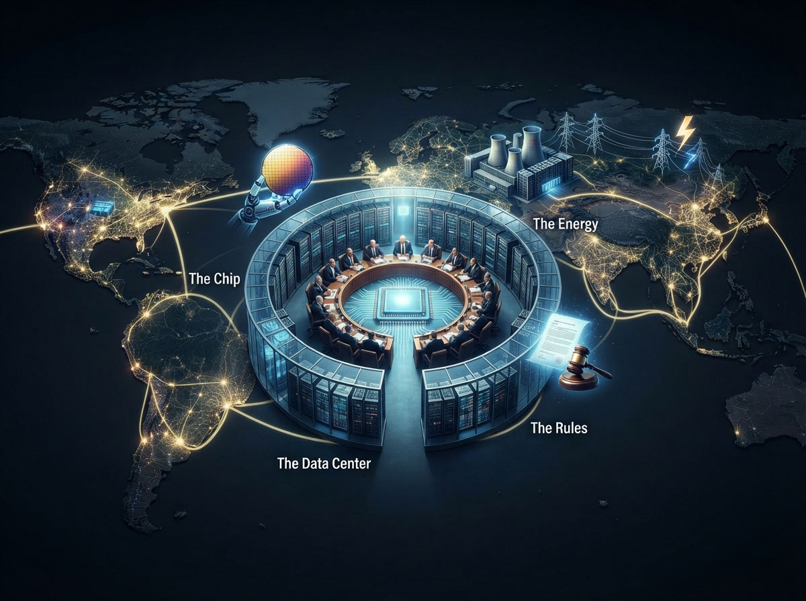
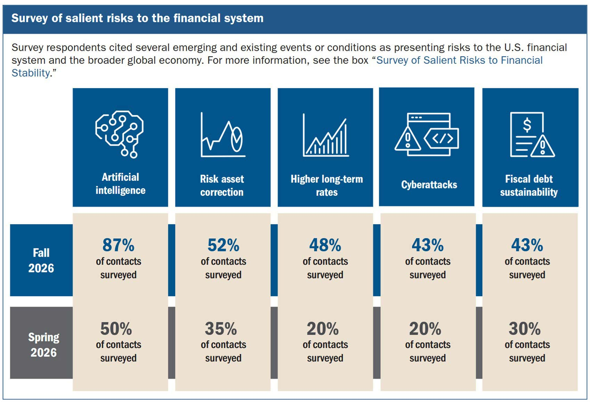

# Chips, muros, electricidad: dónde reside el poder de la IA

*El mapa físico de la IA en 2026, entre deudas, embargos que pierden agua, reglas bajo escrutinio y energía eléctrica. 2.850 millones de dólares, y no volverán atrás. Es el anticipo no reembolsable que SoftBank había pagado para reservar equipos eléctricos destinados a sus centros de datos estadounidenses, antes de cambiar los planes y descubrir que había pedido más de lo necesario. Con otros 880 millones en modificaciones y liquidaciones de contratos, [la depreciación asciende a 3.700 millones](https://aistockwire.com/blog/softbank-sftby-7-billion-loss-ai-power-equipment-write-off-november-2026) y pesa sobre [una pérdida trimestral de 7.100 millones](https://www.business-standard.com/world-news/softbank-posts-7-bn-loss-as-us-data-centre-costs-mount-amid-ai-concerns-126111000403_1.html). Antes de preguntar quién comanda, hay que entender quién paga: la IA construye antes de cobrar, y la deuda es el primer eslabón del poder.*

Cuando las turbinas y los transformadores tienen tiempos de espera de años, quien quiere construir paga para entrar en cola, y si la fila cambia de dirección, el billete no se reembolsa. Según Bloomberg, la revisión de los planes sigue un repensamiento repentino de las perspectivas de la IA después de las elecciones intermedias, ganadas por candidatos demócratas con programas hostiles a los centros de datos. La empresa habla de una pérdida temporal y precisa que los pedidos cancelados no implican una reducción de los proyectos en curso.

En este clima, hay que leer con atención el dato que ha dado la vuelta al mundo: el 87% de los contactos de mercado consultados por la Fed indica la IA como un riesgo para la estabilidad financiera, frente al 50% de la primavera. Conviene mirarlo de cerca. En el [Informe de Estabilidad Financiera del 13 de noviembre](https://www.federalreserve.gov/publications/files/financial-stability-report-20261113.pdf), [según reconstruye Brave New Coin](https://bravenewcoin.com/insights/fed-ai-risk-survey-87-percent-financial-stability-crypto), los consultados son 23, veinte de los cuales nombraron a la IA (en primavera eran diez de veinte), y la encuesta no representa la posición ni del Consejo ni de la Fed de Nueva York. Entre los temores recopilados figuran [ciberataques, financiamientos cada vez más complejos y beneficios que podrían decepcionar](https://www.nationthailand.com/news/world/40073507). Una fotografía de percepciones, por tanto, no una medida del riesgo, pero que indica con precisión dónde miran los profesionales del sector: a cómo se paga todo este cemento.

Las cuentas de los dos laboratorios más observados cuentan la misma tensión con números diferentes. OpenAI ha comunicado a los inversores, según [documentos vistos por el Wall Street Journal](https://thenextweb.com/news/openai-revenue-q3-10bn-operating-loss), ingresos trimestrales de unos 10.000 millones, en crecimiento del 50%, con un margen operativo ajustado que pasa de menos 150% a menos 109%. El porcentaje mejora, pero la pérdida ajustada asciende de 10.100 a 10.900 millones porque, en términos absolutos, los costos aumentan más que los ingresos. Anthropic declaró en su prospecto de IPO 17.000 millones de ingresos en el trimestre y una pérdida operativa de 567 millones, con un crecimiento desacelerado al 47% después del 144% del trimestre anterior. Las dos empresas no necesariamente usan la misma medida para el «ajustado», y la comparación directa es una apuesta.

La otra mitad de ese balance son los muros. El prospecto indica compromisos de gasto mínimos de [al menos 121.300 millones con Google hasta 2033](https://fourweekmba.com/ai-anthropic-raises-its-google-spending-floor-to-121-3b/) y 110.000 millones con Amazon hasta 2036, independientemente del uso efectivo. El acceso al cálculo no es un privilegio gratuito: [según Reuters](https://www.thestar.com.my/tech/tech-news/2026/09/30/exclusive-anthropic-ipo-prospectus-lays-bare-deep-dependence-on-big-tech-partners) la empresa advierte de depender de Amazon, Google y Microsoft, que juntos son proveedores, clientes y competidores, y [según una lectura del borrador](https://www.vktr.com/ai-market/anthropics-s1-shows-163b-in-revenue-and-compute-squeeze/) algunos de ellos no le han dado toda la capacidad solicitada. Mientras tanto, los que venden acceso al cómputo cobran: los ingresos de Google Cloud [crecieron un 103% hasta 30.700 millones](https://techcrunch.com/2026/10/28/google-expands-ai-search-ads-globally-as-core-ad-growth-slows/), mientras que el crecimiento de la publicidad en búsqueda se ralentizó del 17% al 12%. Google [cita cambios de divisa, gasto más débil de algunos anunciantes en Asia y el Pacífico después del trimestre de la Copa del Mundo y la menor monetización de AI Mode](https://www.europeanbusinessreview.com/google-expands-ads-in-ai-mode-as-search-growth-slows/), mientras que [las búsquedas crecen al ritmo más alto en cinco años](https://www.marketingdive.com/news/googles-ai-overhaul-of-search-hits-snags-as-ad-revenue-growth-cools/). Más uso, menos ingreso por respuesta: un problema para quienes venden publicidad, no para quienes venden palas.

## Embargos que se filtran

El segundo eslabón es el chip: quién lo vende, quién lo alquila y quién lo controla, y por ahora el control se detiene en aduanas.

En la segunda temporada de *The Wire*, la policía de Baltimore descubre que el puerto es el lugar donde se decide todo: las inspecciones examinan los manifiestos de los contenedores, mientras que el contenido es otra historia. La exportación de chips padece el mismo defecto: el documento examinado es el del comprador, mientras que el chip, una vez que cruza aduanas, puede cambiar de dirección. Esto lo sugiere un dato que [Finimize recoge de una comunicación de Singapur](https://finimize.com/content/southeast-asias-ai-data-centers-brace-for-tighter-us-chip-rules): el 22% de las ventas de chips de Nvidia resultó facturarse a sujetos con actividades en el estado-ciudad, pero solo el 1% había llegado físicamente allí.

Quienes no pueden comprar, alquilan. Las empresas chinas de IA, [según Reuters](https://www.thestandard.com.hk/finance/article/348284/Chinese-AI-firms-rush-to-secure-Nvidia-chip-capacity-as-spy-scandal-stirs-fear-of-US-curbs), buscan reservar capacidad de Nvidia en centros de datos fuera de China, temiendo que el escándalo en torno a Jensen Huang induzca a Washington a endurecer el uso remoto. La medida temida es la Ley de Seguridad de Acceso Remoto, [aprobada por la Cámara con 369 votos contra 22 el 12 de enero](https://www.theregister.com/2026/01/13/congress_votes_china_gpu_cloud/) y desde entonces pendiente en el Senado, donde [existe una versión con alcance diferente](https://fourweekmba.com/ai-nvidia-cloud-bill-explained-369-22-house-vote-305-day-wait/): la de la Cámara cubre cualquier sujeto extranjero, la del Senado solo a las personas consideradas en riesgo, y caduca después de diez años.

Malasia ha elegido la vía del registro. El ministro de Comercio, Johari Abdul Ghani, anunció que el gobierno [evalúa una ley](https://www.thestandard.com.hk/world/article/348319/Malaysia-weighs-law-to-monitor-data-centre-operations-chips-use-trade-minister-says) para monitorear los centros de datos y el uso de chips de alto rendimiento, [pidiendo a quienes quieran abrir uno que declaren gestores, sedes y número de GPUs importadas](https://www.thevibes.com/index.php/articles/news/129471/malaysia-moves-to-tighten-data-centre-controls-amid-scrutiny-over-nvidia-chip-exports). El mismo ministro, sin embargo, añadió que si un operador compra GPUs para uso propio, no queda claro qué ley permitiría investigarlo. Se deduce que el control mira la entrada del chip más que su uso, y el uso es el punto doloroso.

El caso Moonshot muestra la distancia entre las dos cosas. [Bloomberg reportó](https://www.bloomberg.com/news/articles/2026-11-10/moonshot-rents-nvidia-s-top-ai-chips-in-china-documents-show) documentos depositados en una base de datos crediticia china, según los cuales el laboratorio habría firmado en agosto para alquilar en China 32 servidores Super Micro con GPUs Nvidia B300, por 432 millones de yuanes. Moonshot cuestiona la precisión de los documentos y niega cualquier relación con la empresa propietaria; Nvidia y Super Micro niegan vínculos directos, y [Bloomberg no pudo verificar si existía una licencia](https://www.analyticsinsight.net/news/moonshot-ais-nvidia-b300-deal-32-servers-worth-usd-648-million). Tras solicitudes de comentarios, [el nombre de Moonshot ha desaparecido de los documentos accesibles](https://www.newsbytesapp.com/news/science/chinese-ai-firm-moonshot-ai-accessed-advanced-nvidia-chips/story). Todo por verificar, por tanto, pero el mecanismo descrito explica por qué los controles físicos de los chips no bastan.

Al fondo está la caída de Huang, quien el 12 de noviembre [dimitió como CEO y del consejo de Nvidia](https://www.onmanorama.com/news/business/2026/11/12/nvidia-ceo-and-co-founder-jensen-huang-steps-down.html) tras noticias sobre su relación con Alice Huang, exdirectiva de Megaspeed, [socios de Nvidia en el sudeste asiático que había comprado chips por 4.800 millones](https://www.aljazeera.com/news/2026/11/12/ai-titan-jensen-huang-out-as-nvidia-ceo). La inteligencia estadounidense, según la prensa, la sospecha que trabaja para Pekín; [Pekín lo niega y las autoridades singapureñas dicen no haberla identificado como agente chino](https://www.dexerto.com/gaming/nvidia-ceo-jensen-huang-resigns-amid-spy-controversy-3427694/). Son sospechas, no investigaciones judiciales, y no conozco los resultados de la verificación abierta por el consejo de Nvidia. El que pague la cuenta de la sospecha podría ser el operador correcto, el que [tendrá que documentar dónde está cada tarjeta y para quién trabaja](https://finimize.com/content/southeast-asias-ai-data-centers-brace-for-tighter-us-chip-rules).

## Quién escribe las reglas

El tercer eslabón es la regulación, que decide quién recibe el chip y se escribe mientras los datos son incompletos y los intereses muchos.

Las reglas sobre el alquiler aún no están escritas, y alguien las está escribiendo. [Una investigación del New York Times](https://www.nytimes.com/2026/11/15/us/politics/trump-lutnick-ai-chips-nvidia-cantor-fitzgerald.html), [citada por Business Standard](https://www.business-standard.com/world-news/nvidia-row-lutnick-pushed-to-weaken-chip-rules-linked-to-family-business-126111500775_1.html), reconstruye cómo el secretario de Comercio Howard Lutnick presionó por límites menos extensos en centros de datos extranjeros como A201, el centro que Bitdeer está construyendo en Johor, Malasia, y que debería abrir en 2027 [proveyendo cómputo a un gigante tecnológico chino, quizás Tencent](https://local21news.com/news/nation-world/lutnick-pushed-narrower-chip-curbs-as-critics-warned-china-could-gain-ground-in-ai). Bitdeer es cliente de Cantor Fitzgerald, la empresa que Lutnick dirigió durante décadas y confió a sus hijos al entrar en la administración, y que actuó como agente de ventas para Bitdeer en una oferta de acciones de hasta mil millones de dólares.

El panorama necesita ser completado. Para el mismo artículo, no hay pruebas de que las inversiones de Cantor hayan influido en las decisiones de Lutnick, el Departamento dice que respetó todos los compromisos éticos, y [un portavoz excluye conversaciones de negocios con sus hijos](https://www.inquirer.com/news/nation-world/howard-lutnick-commerce-secretary-rules-data-centers-nvidia-chips-china-southeast-asia-cantor-fitzgerald-20261115.html). Nos enfrentamos a un potencial conflicto de intereses, no a una infracción constatada, y la distinción no es un tecnicismo.

Resta una cuestión que trasciende a Lutnick: hoy vender chips a China está prohibido, mientras que [alquilar acceso desde un centro de datos extranjero sigue permitido](https://www.newsbytesapp.com/news/business/howard-lutnick-seeks-nvidia-export-relaxation-to-allow-china-rentals/tldr). Para quienes quieren cerrar esa puerta es una falla evidente; para quienes gestionan centros de datos en países anfitriones, una prohibición sobre el alquiler convertiría a cada cliente extranjero en un sospechoso y a cada contrato en papel burocrático. Quién tiene razón depende de un dato que falta: [no se sabe cuánta capacidad se haya reservado, ni con quién](https://fourweekmba.com/ai-chinese-ai-firms-rush-for-nvidia-cloud-bill-waits-304-days/). Las reglas de la IA se están escribiendo, por ahora, sin saber cuánto pesa el problema.

## Electricidad y cemento

El cuarto eslabón es físico: un centro de datos vale tanto como la electricidad que lo alimenta, y la electricidad tiene un territorio que puede decir que no.

En *Frostpunk*, una ciudad se congela alrededor de un generador de carbón, y cada elección moral se reduce a cuánta electricidad se puede producir y a qué precio. Parece un juego de supervivencia y es, en miniatura, el panorama de los campos de supercómputo.

Las estimaciones de noviembre de la EIA prevén para Estados Unidos consumos eléctricos que pasan de 4.216 mil millones de kilovatios-hora en 2025 a 4.306 mil millones en 2026 y 4.370 mil millones en 2027, un aumento total de 154 mil millones. Reuters atribuye esto a los centros de datos de la IA y a la electrificación de hogares y empresas, pero [el resumen de la EIA no menciona a la IA como causa](https://letsdatascience.com/news/eia-forecasts-record-us-electricity-demand-through-2027-0bbee083) y ofrece solo totales nacionales: cuánto del aumento sea de los centros de datos es una estimación de contexto, no un dato de la agencia.

SpaceX ha anunciado [más de 74.000 millones en inversiones](https://tucson.com/news/local/business/article_042ebd02-d2a8-4a84-8252-e3d59ecd2276.html) en dos campus: unos 50 en el condado de Cochise, Arizona, y más de 24 en Starbase, Texas. Son planes, no gastos ya incurridos. Arizona espera la aprobación del condado, con [una petición de 2.400 firmas en contra y una audiencia en diciembre](https://tucson.com/news/local/business/article_042ebd02-d2a8-4a84-8252-e3d59ecd2276.html); promete enfriamiento seco y [podría llegar a 6 gigavatios](https://www.etvbharat.com/en/technology/spacex-announces-over-usd-74-billion-investment-in-texas-arizona-supercomputing-campuses-enn26111300821). Starbase producirá la electricidad independientemente con una planta de gas, y el 9 de diciembre la comisión municipal examinará las exenciones fiscales. SpaceX sostiene, [según informa Reuters](https://www.businessday.co.za/world/international-companies/2026-11-12-spacex-plans-74bn-ai-expansion-in-texas-and-arizona/), que el proyecto de Arizona podría reducir las facturas de los miembros de las cooperativas eléctricas hasta un 20%; [los residentes, según informa The Next Web](https://thenextweb.com/news/spacex-74b-ai-computing-centers-arizona-texas), temen por el agua, las facturas y la fauna.

El constructor es también un arrendador: según [Bloomberg, citado por The Next Web](https://thenextweb.com/news/spacex-74b-ai-computing-centers-arizona-texas), Anthropic es su primer cliente por unos tercios de los ingresos, y Google se ha comprometido a pagar 920 millones mensuales. El prospecto de Anthropic [indica compromisos hasta 120.500 millones con SpaceX para 2029](https://www.mobileworldlive.com/?p=516583). Una planta de gas tiene impacto ambiental directo, y la comparación con las alternativas es el verdadero nudo: quien gana es quien obtiene electricidad primero, quien pierde es quien vive cerca y paga la factura.

[Imagen de federalreserve.gov](https://www.federalreserve.gov/publications/files/financial-stability-report-20261113.pdf)

## Pesos abiertos, hardware?

Hay quienes piensan salir de la cadena ejecutando los modelos en casa: vemos hasta dónde funciona.

Se dice a menudo que la IA local es la respuesta a la concentración del poder: descarga los pesos y estás libre. El 20 de octubre, DeepSeek dio fuerza a esta idea [publicando DeepInfer](https://siliconangle.com/2026/10/20/deepseek-open-sources-deepinfer-the-inference-framework-behind-its-production-services/), el motor con el que sirve sus modelos en producción, [en GitHub](https://github.com/deepseek-ai/DeepInfer) con licencia Apache 2.0. Tras el lanzamiento, circuló un cálculo [que estima un margen bruto del 82%](https://eu.36kr.com/en/p/4035800747578243), pero es una estimación de terceros, que presupone un uso muy alto y un alquiler de 7 dólares la hora para una GPU B300, y [aún no existe una comparación independiente de eficiencia](https://www.business-standard.com/amp/world-news/deepseek-unveils-open-source-tool-to-cut-ai-operating-costs-for-businesses-126102100247_1.html).

Lo que interesa a los lectores desde Italia es otra cosa. Para [un análisis técnico](https://www.buildmvpfast.com/blog/deepinfer-deepseek-inference-engine-open-source-2026), DeepInfer requiere clusters muy grandes, con umbral de 128 GPUs, y la versión publicada no incluye tres componentes necesarios para un servicio completo. Sirve para entender cómo funciona un gran proveedor, no para ejecutar en portátil. [Como ya destaca en el título The New Stack](https://thenewstack.io/deepseek-deepinfer-huawei-nvidia/), DeepSeek da a Huawei el mismo relevo que a Nvidia, una señal de que el ecosistema se está abriendo más allá de un solo fabricante.

Los casos contados en este artículo conciernen a China y los grandes flujos de centros de datos. Nada en los documentos citados se refiere a quien compra una tarjeta para ejecutar un modelo en casa. Los límites de la IA local son otros: cuánta memoria se puede permitir, cuánto consume la máquina, qué tan grande es el modelo que se quiere usar. La dependencia real comienza cuando se pasa del modelo al servicio, porque ahí cuentan los muros y quienes los poseen. Quienes defienden los pesos abiertos recuerdan que reducen la dependencia de un solo proveedor; quienes los temen observan que nadie puede revocar un modelo ya descargado. Ambas tesis sostienen, y ninguna resuelve la factura.

## Stop y responsabilidad

Si la cadena es esta, resta preguntar quién responde y si alguien puede detenerla.

El 12 de noviembre, cuatro organizaciones sin ánimo de lucro, [Public Citizen, Heat Initiative, Irreplaceable Education Fund y Alliance for Secure AI](https://www.exchange4media.com/digital-news/openai-google-anthropic-meta-and-spacex-sued-over-frontier-ai-development-160200.html), [demandaron a](https://www.aljazeera.com/news/2026/11/12/us-nonprofits-sue-tech-giants-to-halt-ai-development) OpenAI, Anthropic, Google, Meta y la división de IA de SpaceX ante la Corte Superior de San Francisco, pidiendo congelar el desarrollo de los modelos más avanzados. Apelan a la ley californiana de competencia desleal y a la doctrina de la [molestia pública](https://www.latintimes.com/nonprofits-sue-ai-companies-halt-development-601304), y hacen valer [las advertencias de los propios directivos](https://www.claimsjournal.com/news/national/2026/11/13/341283.htm) sobre los riesgos de los sistemas que construyen. Todas las acusaciones hay que probarlas, y [según un análisis, la teoría legal nunca se ha puesto a prueba](https://fourweekmba.com/ai-nonprofits-sue-openai-anthropic-google-to-freeze-ai-models/).

El vínculo con el tema de este artículo es menos abstracto de lo que parece. Un congelamiento golpearía un sistema que ya ha comprometido sumas enormes, desde las reservas de SoftBank hasta los contratos con Google y Amazon que hay que pagar independientemente del uso. Para los demandantes, esta misma prisa por invertir hace urgente un freno en ausencia de reglas federales; para las empresas, un bloqueo decidido por un tribunal estatal sería un riesgo más después de los ya vistos. Hay también un detalle que dice mucho: entre los demandados está la división de IA de SpaceX, la misma SpaceX que, según Bloomberg, alquila cómputo a Anthropic y Google, otros dos demandados. Constructor, arrendador e imputado en el mismo expediente. La pregunta de quién responde del riesgo, entre quien desarrolla, quien arrienda los muros y quien debería regularlos, sigue sin respuesta.

## El poder tiene dirección

Si hay que reducirlo todo a una frase: la inteligencia artificial se ha convertido en una industria de obras y deudas, y el poder reside donde se decide quién compra el chip, quién construye el centro de datos, quién proporciona la electricidad y quién escribe las reglas. El resto, desde las pérdidas de SoftBank hasta el alquiler de servidores en China, desde los campus de Arizona hasta el juicio de San Francisco, son variaciones del mismo tema: la infraestructura es el punto donde la IA deja de ser software y se convierte en política, finanzas y territorio.

Quedan al menos cuatro preguntas abiertas. ¿Aprobará el Senado la Ley de Seguridad de Acceso Remoto, y en qué versión? ¿La ley malaya mirará solo la entrada de los chips o también su uso? ¿Los ingresos de la IA crecerán lo suficientemente rápido como para pagar compromisos que no se pueden cancelar? Y quién responderá, ante un juez o un elector, de la electricidad y el agua para campus como los de Cochise y Starbase? Ninguna de estas respuestas depende de lo inteligente que sea un modelo. Antes de ser inteligente, la inteligencia artificial tiene una dirección, una factura y un propietario.
