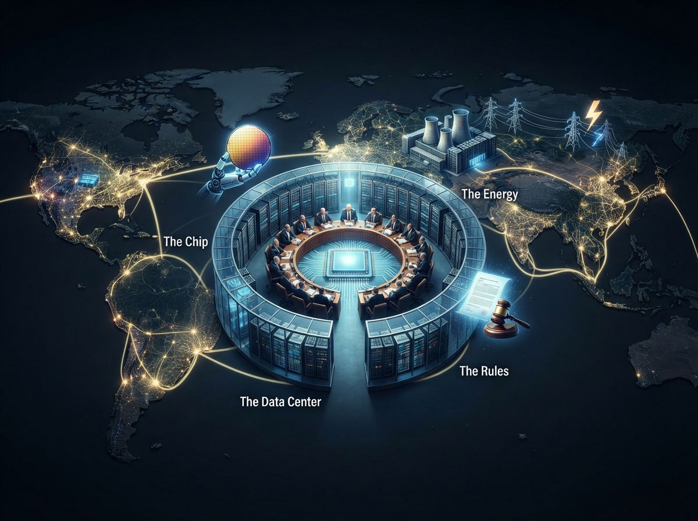
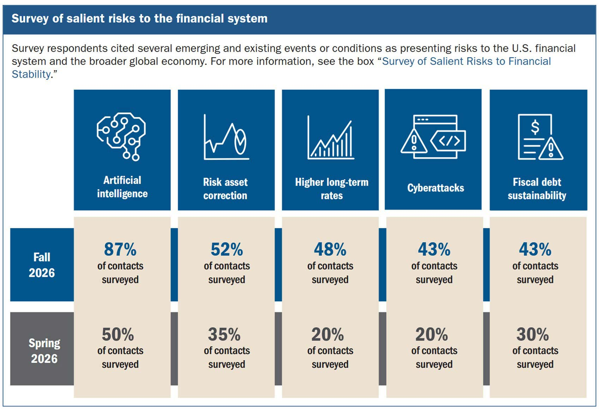

# Puce, murs, électricité : où réside le pouvoir de l'IA?

*La carte physique de l'IA en 2026, entre dettes, embargo qui perdent en eau, règles sous le feu des critiques et électricité. 2,85 milliards de dollars, et ils ne reviendront pas. C'est l'avance non remboursable que SoftBank avait versée pour réserver du matériel électrique destiné à ses centres de données américains, avant de changer de plans et de découvrir qu'elle avait commandé plus que nécessaire. Avec un autre 880 millions de modifications et liquidation de contrats, [l'amortissement monte à 3,7 milliards](https://aistockwire.com/blog/softbank-sftby-7-billion-loss-ai-power-equipment-write-off-november-2026) et pèse sur [une perte trimestrielle de 7,1 milliards](https://www.business-standard.com/world-news/softbank-posts-7-bn-loss-as-us-data-centre-costs-mount-amid-ai-concerns-126111000403_1.html). Avant de se demander qui commande, il faut comprendre qui paie : l'IA construit avant de percevoir, et la dette est le premier maillon du pouvoir.*

Quand les turbines et transformateurs ont des délais d'attente de plusieurs années, celui qui veut construire paie pour entrer dans la file, et si la file change de direction, le ticket n'est pas remboursable. Selon Bloomberg, la révision des plans suit un remaniement soudain des perspectives de l'IA après les élections législatives, gagnées par des candidats démocrates avec des programmes hostiles aux centres de données. L'entreprise parle de perte temporaire et précise que les commandes annulées n'impliquent pas une réduction des projets en cours.

Dans ce contexte, il faut lire avec attention la donnée qui a fait le tour du monde : 87% des contacts de marché interrogés par la Fed indique l'IA comme risque pour la stabilité financière, contre 50% au printemps. Il convient de l'examiner de près. Dans le [Rapport sur la Stabilité Financière du 13 novembre](https://www.federalreserve.gov/publications/files/financial-stability-report-20261113.pdf), [comme le reconstitue Brave New Coin](https://bravenewcoin.com/insights/fed-ai-risk-survey-87-percent-financial-stability-crypto), les interrogés sont 23, vingt d'entre eux ont nommé l'IA (au printemps c'était dix sur vingt), et l'enquête ne représente pas la position ni du Conseil ni de la Fed de New York. Parmi les craintes recueillies figurent [cyberattaques, financements de plus en plus complexes et revenus qui pourraient décevoir](https://www.nationthailand.com/news/world/40073507). Une photographie de perceptions, donc, pas une mesure du risque, mais qui indique avec précision où regardent les professionnels du secteur : à comment tout ce béton se paie.

Les comptes des deux laboratoires les plus observés racontent la même tension avec des chiffres différents. OpenAI a communiqué aux investisseurs, selon [des documents vus par le Wall Street Journal](https://thenextweb.com/news/openai-revenue-q3-10bn-operating-loss), des revenus trimestriels d'environ 10 milliards, en croissance de 50%, avec une marge opérationnelle ajustée passant de moins 150% à moins 109%. Le pourcentage s'améliore, mais la perte ajustée augmente de 10,1 à 10,9 milliards car, en valeur absolue, les coûts augmentent plus que les revenus. Anthropic a déclaré dans son prospectus d'IPO 17 milliards de revenus pour le trimestre et une perte opérationnelle de 567 millions, avec une croissance ralentie à 47% après les 144% du trimestre précédent. Les deux entreprises n'utilisent peut-être pas la même mesure pour l'«ajusté», et la comparaison directe est une prise de risque.

L'autre moitié de ce bilan ce sont les murs. Le prospectus indique des engagements de dépenses minimales pour [au moins 121,3 milliards avec Google jusqu'en 2033](https://fourweekmba.com/ai-anthropic-raises-its-google-spending-floor-to-121-3b/) et 110 milliards avec Amazon jusqu'en 2036, indépendamment de l'utilisation effective. L'accès au calcul n'est pas un privilège gratuit : [selon Reuters](https://www.thestar.com.my/tech/tech-news/2026/09/30/exclusive-anthropic-ipo-prospectus-lays-bare-deep-dependence-on-big-tech-partners) l'entreprise avertit d'être dépendante d'Amazon, Google et Microsoft, qui ensemble sont fournisseurs, clients et concurrents, et [selon une lecture du projet](https://www.vktr.com/ai-market/anthropics-s1-shows-163b-in-revenue-and-compute-squeeze/) certains d'entre eux ne lui ont pas donné toute la capacité demandée. Entre-temps, ceux qui vendent l'accès au calcul encaissent : les revenus de Google Cloud [ont augmenté de 103% à 30,7 milliards](https://techcrunch.com/2026/10/28/google-expands-ai-search-ads-globally-as-core-ad-growth-slows/), tandis que la croissance de la publicité sur la recherche ralentissait de 17% à 12%. Google [cite le changement de devises, la dépense plus faible de certains annonceurs en Asie et dans le Pacifique après le trimestre de la Coupe du Monde et la moindre monétisation du mode IA](https://www.europeanbusinessreview.com/google-expands-ads-in-ai-mode-as-search-growth-slows/), tandis que [les recherches augmentent au rythme le plus élevé depuis cinq ans](https://www.marketingdive.com/news/googles-ai-overhaul-of-search-hits-snags-as-ad-revenue-growth-cools/). Plus d'utilisation, moins de revenu par réponse : un problème pour ceux qui vendent de la publicité, pas pour ceux qui vendent des pelles.

## Embargo qui fuit

Le deuxième maillon est la puce : qui la vend, qui la loue et qui la contrôle, et pour l'instant le contrôle s'arrête à la douane.

Dans la deuxième saison de *The Wire*, la police de Baltimore découvre que le port est le lieu où tout se décide : les inspections examinent les manifestes des conteneurs, tandis que le contenu est une autre histoire. L'exportation de puces souffre du même défaut : le document examiné est celui de l'acheteur, tandis que la puce, une fois passée la douane, peut changer d'adresse. Cela est suggéré par un point de donnée que [Finimize reprend d'une communication de Singapour](https://finimize.com/content/southeast-asias-ai-data-centers-brace-for-tighter-us-chip-rules) : 22% des ventes de puces Nvidia résultaient de facturations d'entités avec des activités dans l'État-ville, mais seulement 1% y étaient arrivés physiquement.

Ceux qui ne peuvent pas acheter, louent. Les entreprises chinoises d'IA, [selon Reuters](https://www.thestandard.com.hk/finance/article/348284/Chinese-AI-firms-rush-to-secure-Nvidia-chip-capacity-as-spy-scandal-stirs-fear-of-US-curbs), cherchent à réserver une capacité Nvidia dans des centres de données en dehors de la Chine, craignant que le scandale autour de Jensen Huang induise Washington à resserrer sur l'utilisation à distance. La mesure crainte est la Remote Access Security Act, [approuvée par la Chambre avec 369 voix contre 22 le 12 janvier](https://www.theregister.com/2026/01/13/congress_votes_china_gpu_cloud/) et depuis lors en attente au Sénat, où [existe une version avec une portée différente](https://fourweekmba.com/ai-nvidia-cloud-bill-explained-369-22-house-vote-305-day-wait/) : celle de la Chambre couvre tout sujet étranger, celle du Sénat seulement les personnes considérées à risque, et expire après dix ans.

La Malaisie a choisi la voie du registre. Le ministre du Commerce Johari Abdul Ghani a annoncé que le gouvernement [évalue une loi](https://www.thestandard.com.hk/world/article/348319/Malaysia-weighs-law-to-monitor-data-centre-operations-chips-use-trade-minister-says) pour surveiller les centres de données et l'utilisation des puces haute performance, [demandant à ceux qui veulent en ouvrir un de déclarer gestionnaires, sièges et nombre de GPU importés](https://www.thevibes.com/index.php/articles/news/129471/malaysia-moves-to-tighten-data-centre-controls-amid-scrutiny-over-nvidia-chip-exports). Le même ministre a cependant ajouté que si un opérateur achète des GPU pour usage propre, il n'est pas clair quelle loi permettrait de l'enquêter. On en déduit que le contrôle regarde l'entrée de la puce plus que son utilisation, et l'utilisation est le point sensible.

Le cas Moonshot montre la distance entre les deux choses. [Bloomberg a rapporté](https://www.bloomberg.com/news/articles/2026-11-10/moonshot-rents-nvidia-s-top-ai-chips-in-china-documents-show) des documents déposés dans une base de données de crédit chinoise, selon lesquels le laboratoire aurait signé en août pour louer en Chine 32 serveurs Super Micro avec GPU Nvidia B300, pour 432 millions de yuans. Moonshot conteste la précision des documents et nie tout lien avec la société propriétaire ; Nvidia et Super Micro nient des liens directs, et [Bloomberg n'a pas pu vérifier si une licence existait](https://www.analyticsinsight.net/news/moonshot-ais-nvidia-b300-deal-32-servers-worth-usd-648-million). Après des demandes de commentaires, [le nom de Moonshot a disparu des documents consultables](https://www.newsbytesapp.com/news/science/chinese-ai-firm-moonshot-ai-accessed-advanced-nvidia-chips/story). Tout à vérifier, donc, mais le mécanisme décrit explique pourquoi les contrôles physiques des puces ne suffisent pas.

En arrière-plan se trouve la chute de Huang, qui le 12 novembre [a démissionné du poste de PDG et du conseil d'administration de Nvidia](https://www.onmanorama.com/news/business/2026/11/12/nvidia-ceo-and-co-founder-jensen-huang-steps-down.html) suite aux nouvelles sur sa relation avec Alice Huang, ancienne dirigeante de Megaspeed, [partenaire de Nvidia en Asie du Sud-Est qui avait acheté des puces pour 4,8 milliards](https://www.aljazeera.com/news/2026/11/12/ai-titan-jensen-huang-out-as-nvidia-ceo). Les services américains, selon la presse, la soupçonnent de travailler pour Pékin ; [Pékin le nie et les autorités de Singapour disent ne pas l'avoir identifiée comme agent chinois](https://www.dexerto.com/gaming/nvidia-ceo-jensen-huang-resigns-amid-spy-controversy-3427694/). Ce sont des soupçons, pas des enquêtes judiciaires, et je ne connais pas les résultats de la vérification ouverte par le conseil de Nvidia. Celui qui paie le prix du soupçon risque d'être l'opérateur correct, qui [devra documenter où se trouve chaque carte et pour qui elle travaille](https://finimize.com/content/southeast-asias-ai-data-centers-brace-for-tighter-us-chip-rules).

## Qui écrit les règles

Le troisième maillon est la réglementation, qui décide à qui revient la puce et est écrite tandis que les données sont incomplètes et les intérêts nombreux.

Les règles sur la location ne sont pas encore écrites, et quelqu'un les écrit. [Une enquête du New York Times](https://www.nytimes.com/2026/11/15/us/politics/trump-lutnick-ai-chips-nvidia-cantor-fitzgerald.html), [rappelée par Business Standard](https://www.business-standard.com/world-news/nvidia-row-lutnick-pushed-to-weaken-chip-rules-linked-to-family-business-126111500775_1.html), reconstitue comment le secrétaire au Commerce Howard Lutnick a poussé pour des limites moins étendues sur les centres de données étrangers comme A201, le centre que Bitdeer construit à Johor, en Malaisie, et qui devrait ouvrir en 2027 [fournissant du calcul à un géant technologique chinois, peut-être Tencent](https://local21news.com/news/nation-world/lutnick-pushed-narrower-chip-curbs-as-critics-warned-china-could-gain-ground-in-ai). Bitdeer est client de Cantor Fitzgerald, société que Lutnick a dirigée pendant des décennies et confiée à ses fils en entrant dans l'administration, et qui a fait office d'agent de vente pour Bitdeer dans une offre d'actions jusqu'à un milliard de dollars.

Le tableau doit être complété. Pour le même article, il n'y a pas de preuves que les investissements de Cantor aient influencé les décisions de Lutnick, le Département dit avoir respecté tous les engagements éthiques, et [un porte-parole exclut des discussions d'affaires avec ses fils](https://www.inquirer.com/news/nation-world/howard-lutnick-commerce-secretary-rules-data-centers-nvidia-chips-china-southeast-asia-cantor-fitzgerald-20261115.html). Nous sommes face à un conflit d'intérêts potentiel, pas à une infraction établie, et la distinction n'est pas un détail.

Il reste une question qui transcende Lutnick : aujourd'hui vendre des puces à la Chine est interdit, tandis que [louer l'accès depuis un centre de données étranger reste autorisé](https://www.newsbytesapp.com/news/business/howard-lutnick-seeks-nvidia-export-relaxation-to-allow-china-rentals/tldr). Pour ceux qui veulent fermer cette porte, c'est une faille évidente ; pour ceux qui gèrent des centres de données dans les pays hôtes, une interdiction de la location transformerait tout client étranger en suspect et tout contrat en paperasse. Qui a raison dépend d'une donnée manquante : [il n'est pas connu combien de capacité a été réservée, ni auprès de qui](https://fourweekmba.com/ai-chinese-ai-firms-rush-for-nvidia-cloud-bill-waits-304-days/). Les règles de l'IA s'écrivent, pour l'instant, sans savoir combien pèse le problème.

## Électricité et béton

Le quatrième maillon est physique : un centre de données vaut autant que l'électricité qui l'alimente, et l'électricité a un territoire qui peut dire non.

Dans *Frostpunk*, une ville gèle autour d'un générateur à charbon, et chaque choix moral se réduit à combien d'électricité on peut produire et à quel prix. C'est un jeu vidéo de survie et c'est, en miniature, le tableau des champs de supercalcul.

Les estimations de novembre de la EIA prévoient pour les États-Unis des consommations électriques qui passent de 4.216 milliards de kilowattheures en 2025 à 4.306 en 2026 et 4.370 en 2027, une augmentation totale de 154 milliards. Reuters l'attribue aux centres de données pour l'IA et à l'électrification des maisons et entreprises, mais [la vue d'ensemble de la EIA ne nomme pas l'IA comme cause](https://letsdatascience.com/news/eia-forecasts-record-us-electricity-demand-through-2027-0bbee083) et n'offre que des totaux nationaux : quelle part de l'augmentation vient des centres de données est une estimation de contexte, pas un donné de l'agence.

SpaceX a annoncé [plus de 74 milliards d'investissements](https://tucson.com/news/local/business/article_042ebd02-d2a8-4a84-8252-e3d59ecd2276.html) dans deux campus : environ 50 dans le comté de Cochise, en Arizona, et plus de 24 à Starbase, au Texas. Ce sont des plans, pas des dépenses déjà engagées. L'Arizona attend l'approbation du comté, avec [une pétition de 2.400 signatures contre et une audition en décembre](https://tucson.com/news/local/business/article_042ebd02-d2a8-4a84-8252-e3d59ecd2276.html) ; il promet un refroidissement sec et [pourrait atteindre 6 gigawatts](https://www.etvbharat.com/en/technology/spacex-announces-over-usd-74-billion-investment-in-texas-arizona-supercomputing-campuses-enn26111300821). Starbase produira l'électricité elle-même avec une centrale à gaz, et le 9 décembre la commission municipale examinera les exonérations fiscales. SpaceX soutient, [comme le rapporte Reuters](https://www.businessday.co.za/world/international-companies/2026-11-12-spacex-plans-74bn-ai-expansion-in-texas-and-arizona/), que le projet arizonien pourrait réduire les factures des membres des coopératives électriques jusqu'à 20% ; [les résidents, selon The Next Web](https://thenextweb.com/news/spacex-74b-ai-computing-centers-arizona-texas), craignent pour l'eau, les factures et la faune.

Le constructeur est aussi un bailleur : selon [Bloomberg, rapporté par The Next Web](https://thenextweb.com/news/spacex-74b-ai-computing-centers-arizona-texas), Anthropic est son premier client pour environ un tiers des revenus, et Google s'est engagé à payer 920 millions par mois. Le prospectus d'Anthropic [indique des engagements jusqu'à 120,5 milliards avec SpaceX d'ici 2029](https://www.mobileworldlive.com/?p=516583). Une centrale à gaz a un impact environnemental direct, et la comparaison avec les alternatives est le vrai nœud : celui qui gagne est celui qui obtient de l'électricité d'abord, celui qui perd est celui qui habite à côté et paie la facture.

[Image de federalreserve.gov](https://www.federalreserve.gov/publications/files/financial-stability-report-20261113.pdf)

## Poids ouverts, matériel ?

Il y a ceux qui pensent sortir de la chaîne en exécutant les modèles en interne : on voit jusqu'où ça marche.

On dit souvent que l'IA locale est la réponse à la concentration du pouvoir : téléchargez les poids et vous êtes libre. Le 20 octobre, DeepSeek a renforcé cette idée [en publiant DeepInfer](https://siliconangle.com/2026/10/20/deepseek-open-sources-deepinfer-the-inference-framework-behind-its-production-services/), le moteur avec lequel il sert ses modèles en production, [sur GitHub](https://github.com/deepseek-ai/DeepInfer) sous licence Apache 2.0. Après la sortie, un calcul a circulé [estimant une marge brute de 82%](https://eu.36kr.com/en/p/4035800747578243), mais c'est une estimation de tiers, qui suppose une utilisation très élevée et un loyer de 7 dollars l'heure pour une GPU B300, et [il n'existe pas encore de comparaison indépendante de l'efficacité](https://www.business-standard.com/amp/world-news/deepseek-unveils-open-source-tool-to-cut-ai-operating-costs-for-businesses-126102100247_1.html).

Ce qui intéresse les lecteurs d'Italie est autre chose. Pour [une analyse technique](https://www.buildmvpfast.com/blog/deepinfer-deepseek-inference-engine-open-source-2026), DeepInfer nécessite de très grands clusters, avec un seuil de 128 GPU, et la version publiée ne comprend pas trois composants nécessaires à un service complet. C'est pour comprendre comment fonctionne un grand fournisseur, pas pour tourner sur un ordinateur portable. [Comme le souligne déjà dans le titre The New Stack](https://thenewstack.io/deepseek-deepinfer-huawei-nvidia/), DeepSeek donne à Huawei la même importance que Nvidia, un signal que l'écosystème s'ouvre au-delà d'un seul producteur.

Les cas racontés dans cet article concernent la Chine et les grands flux de centres de données. Rien dans les documents cités ne concerne celui qui achète une carte pour exécuter un modèle à la maison. Les limites de l'IA locale sont autres : combien de mémoire peut-on se permettre, combien la machine consomme-t-elle d'électricité, quelle est la taille du modèle qu'on veut utiliser. La vraie dépendance commence quand on passe du modèle au service, car là comptent les murs et ceux qui les possèdent. Ceux qui défendent les poids ouverts rappellent qu'ils réduisent la dépendance d'un seul fournisseur ; ceux qui les craignent observent que personne ne peut rappeler un modèle déjà téléchargé. Les deux thèses tiennent, et aucune des deux ne résout la facture.

## Stop et responsabilité

Si la chaîne est celle-ci, il reste à demander qui en répond et si quelqu'un peut l'arrêter.

Le 12 novembre, quatre organisations à but non lucratif, [Public Citizen, Heat Initiative, Irreplaceable Education Fund et Alliance for Secure AI](https://www.exchange4media.com/digital-news/openai-google-anthropic-meta-and-spacex-sued-over-frontier-ai-development-160200.html), [ont assigné en justice](https://www.aljazeera.com/news/2026/11/12/us-nonprofits-sue-tech-giants-to-halt-ai-development) OpenAI, Anthropic, Google, Meta et la division IA de SpaceX devant la Cour supérieure de San Francisco, demandant de geler le développement des modèles les plus avancés. Elles invoquent la loi californienne sur la concurrence déloyale et la doctrine du [trouble anormal de voisinage](https://www.latintimes.com/nonprofits-sue-ai-companies-halt-development-601304), et jouent sur [les avertissements des dirigeants eux-mêmes](https://www.claimsjournal.com/news/national/2026/11/13/341283.htm) sur les risques des systèmes qu'ils construisent. Les accusations sont toutes à prouver, et [selon une analyse, la théorie juridique n'a jamais été testée](https://fourweekmba.com/ai-nonprofits-sue-openai-anthropic-google-to-freeze-ai-models/).

Le lien avec le thème de cet article est moins abstrait qu'il n'y paraît. Un gel frapperait un système qui a déjà engagé d'énormes sommes, des réservations de SoftBank aux contrats avec Google et Amazon à payer indépendamment de l'utilisation. Pour les demandeurs, cette course à investir rend un frein urgent en l'absence de règles fédérales ; pour les entreprises, un blocage décidé par un tribunal étatique serait un risque supplémentaire après ceux déjà vus. Il y a aussi un détail qui dit beaucoup : parmi les défendeurs se trouve la division IA de SpaceX, la même SpaceX qui, selon Bloomberg, loue du calcul à Anthropic et Google, deux autres défendeurs. Constructeur, bailleur et défendeur dans le même dossier. La question de qui répond du risque, entre celui qui développe, celui qui loue les murs et celui qui devrait les réglementer, reste sans réponse.

## Le pouvoir a une adresse

Si tout doit se réduire à une phrase : l'intelligence artificielle est devenue une industrie de chantiers et de dettes, et le pouvoir réside là où l'on décide qui achète la puce, qui construit le centre de données, qui fournit l'électricité et qui écrit les règles. Le reste, des pertes de SoftBank à la location de serveurs en Chine, des campus en Arizona au procès de San Francisco, sont des variations du même thème : l'infrastructure est le point où l'IA cesse d'être du logiciel pour devenir politique, financier et territorial.

Au moins quatre questions restent ouvertes. Le Sénat approuvera-t-il la Remote Access Security Act, et en quelle version ? La loi malaisienne regardera-t-elle seulement l'entrée des puces ou aussi leur utilisation ? Les revenus de l'IA croîtront-ils assez vite pour payer des engagements qui ne peuvent pas être annulés ? Et qui répondra, devant un juge ou un électeur, de l'électricité et de l'eau pour des campus comme ceux de Cochise et Starbase ? Aucune de ces réponses ne dépend de l'intelligence d'un modèle. Avant d'être intelligente, l'intelligence artificielle a une adresse, une facture et un propriétaire.
